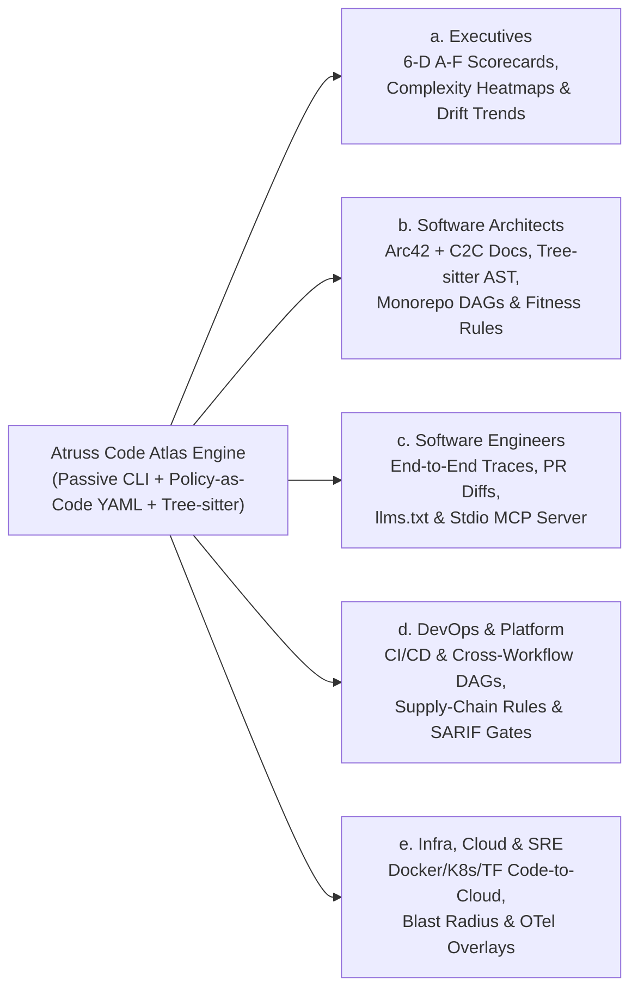

# Atruss Code Atlas: Portable Architectural & Pipeline Intelligence Platform

**Passive, zero-agent, offline-capable architectural and CI/CD pipeline observability.**

Atruss Code Atlas is a fast, lightweight CLI and static **Material Design 3 (Astro Starlight)** intelligence portal that generates portable Docs-as-Code architecture maps, end-to-end execution DAGs (`Trigger -> Entrypoint -> Script -> Dependency`), security & anti-pattern diagnostics, and 6-Dimension A–F Health Scorecards—without requiring agents, webhooks, or target repository modifications.

- **Documentation & Specification Index**: [`docs/README.md`](./docs/README.md)
- **Master PRD v2.0 (Consolidated + Top 10 Roadmap)**: [`docs/atruss-code-atlas-prd.md`](./docs/atruss-code-atlas-prd.md) *(Baseline v1.0 preserved at [`docs/atruss-code-atlas-prd-baseline.md`](./docs/atruss-code-atlas-prd-baseline.md))*
- **Unified SpecKit Specification (`FR-001`–`FR-030`)**: [`docs/atruss-code-atlas-unified-spec.md`](./docs/atruss-code-atlas-unified-spec.md) & [`specs/009-unified-atlas-spec/spec.md`](./specs/009-unified-atlas-spec/spec.md)
- **Agentic SDLC Playbook (SpecKit vs. Antigravity Native)**: [`docs/agentic-sdlc-guide.md`](./docs/agentic-sdlc-guide.md)

---

## The Value Proposition

Enterprises suffer from architectural drift and pipeline fragmentation. Developers often act as "Master Blacksmiths," hand-crafting bespoke CI/CD workflows and burying critical domain logic and infrastructure couplings across hundreds of undocumented repositories.

Atruss Code Atlas tells you **what** is being built (structural code & infrastructure architecture), **how** it gets to production (CI/CD pipeline topology), and **where** the hidden risks live (anti-patterns, CVEs, blast radius, and governance drift)—outputting deterministic, immutable artifacts (`JSON`, `CSV`, `YAML`, `Arc42/Mermaid Markdown`, and a static **Material Design 3 Web Portal**).

### The Market Gap
* **Unlike SonarQube**, which is blind to CI/CD pipelines, Atruss parses your GitHub Actions/CI DAGs and detects pipeline structural and security anti-patterns.
* **Unlike GitHub Advanced Security (GHAS)**, which locks insights inside proprietary UI silos, Atruss outputs deterministic, portable Arc42 Markdown and JSON schemas you can host anywhere.
* **Unlike Spotify Backstage**, which requires months of manual `catalog-info.yaml` upkeep and active plugin maintenance, Atruss is **100% passive**—it discovers, classifies, and maps repositories automatically in read-only mode.
* **Unlike Datadog CI Visibility**, which lacks source-level architectural context, Atruss links CI workflow triggers directly to Python, .NET, React/TypeScript, and Java Spring Boot AST/structural components.

---

## What's In It For You? (Value by Stakeholder Group)

Atruss Code Atlas is designed as a multi-lens observability platform where a single passive scan powers tailored insights across five core organizational personas—unifying the **Core Baseline (`v1.0`)** and **Horizon 2 Platform Enhancements (`v2.0` / `FR-021`–`FR-030`)**.



---

### a. Executives (CTOs, VPs of Engineering, CISOs & Engineering Directors)

> **Executive Bottom Line**: Instant, objective, organization-wide engineering portfolio visibility and supply-chain governance with **zero adoption friction** (no developer workflow changes or agent installations required).

* **Core Value**:
  * **Eliminate Blind Spots**: Automatically inventory hundreds of repositories across organizations, classifying languages, frameworks, deployment readiness, and documentation priority (`Tier 1`–`Tier 3`).
  * **Quantify Technical Debt & Risk**: Replace subjective status reports with a deterministic **6-Dimension A–F Weighted Health Scorecard** (*Code Quality*, *Security*, *Maintainability*, *Test Coverage*, *Dependency Health*, *Pipeline Health*) and Composite `technical_debt_score` (`0–100`).
  * **M&A Due Diligence & Compliance Readiness**: Generate audit-ready portfolio catalogs, CycloneDX v1.6 SBOMs, and supply-chain inventories in minutes.
* **Implemented Capabilities (`v1.0` + `v2.0`)**:
  * **27-Column Organization Discovery (`FR-005`, `FR-015`)**: Automated org-wide inventory exporting `repositories.{json,csv,yaml}` with language, framework, Docker/K8s/CI presence, and `DocumentationPriority`.
  * **6-Dimension A–F Scorecard & Debt Estimator (`FR-025`)**: Objective deterministic grading inside every `{org}-{repo}-analysis.json` plus `ScorecardHeatmap.astro` UI visualization.
  * **Material Design 3 Executive Command Center (`FR-017`, `FR-030`)**: Interactive web portal (`/`, `/orgs/`) with KPI strips, 6-D health columns, ecosystem distribution charts, risk banners, and cross-repo topology.
  * **CycloneDX v1.6 SBOM & Historical Drift (`FR-024`, `FR-027`)**: Export offline-safe `sbom/{org}-{repo}.cdx.json`, track snapshots in `catalog-history.json`, and run `atruss diff --baseline <dir1> --target <dir2>`.
  * **100-Repo Stratified Benchmark Harness (`FR-019`, `FR-020`)**: Proven scalability and SLA compliance across diverse multi-language portfolios.

---

### b. Software Architects (Enterprise, Principal, Staff & Solution Architects)

> **Architect Bottom Line**: Stop drawing static diagrams that rot on Confluence within a week—generate living **Arc42 + Mermaid** architectural blueprints and enforce declarative architectural boundaries as code.

* **Core Value**:
  * **Living Docs-as-Code**: Automatically reconstruct component topologies (Controllers/Routes, Services, Data Access Layers, UI Components) directly from source code.
  * **Cross-Boundary Governance**: Detect forbidden layer bypasses (`ATRUSS-ARCH-*`), circular dependencies (`nx.simple_cycles`), and code duplication/dead code before they calcify into monoliths.
  * **Zero-Code Extensibility**: Define new frameworks, layer rules, and CI security policies declaratively in [`manifests/ecosystems.yaml`](./manifests/ecosystems.yaml), [`manifests/architecture-rules.yaml`](./manifests/architecture-rules.yaml), and [`manifests/pipeline-rules.yaml`](./manifests/pipeline-rules.yaml).
* **Implemented Capabilities (`v1.0` + `v2.0`)**:
  * **Polyglot `tree-sitter` CST + Structural Code Analysis (`FR-012`, `FR-022`)**: Component extraction plus Cyclomatic Complexity, Cognitive Complexity, AST Clone Duplication %, and Dead Code metrics across **Python**, **.NET / C#**, **TypeScript/JS**, and **Java Spring Boot**.
  * **Declarative Architecture Fitness Functions & Workspace Graph (`FR-023`)**: Evaluates `manifests/architecture-rules.yaml` against internal import edges, discovers `pnpm`/`turbo`/`nx`/`cargo`/`go.work`/`uv` workspaces, and highlights violating edges with red dashed lines in Mermaid diagrams.
  * **Automated Arc42 + Mermaid Reports & Print/PDF (`FR-013`, `FR-030`)**: Self-contained Markdown reports (`{org}-{repo}-report.md`), SVG/PNG diagram downloads, and multi-tab Print/PDF styling.

---

### c. Software Engineering Teams (Tech Leads, Backend/Frontend Devs & AI-Assisted Engineers)

> **Software Engineer Bottom Line**: Understand unfamiliar repositories in minutes, gate PR regressions before merging, and equip your AI coding assistant (Cursor, Claude Code, Antigravity, Copilot) with deterministic graph tools.

* **Core Value**:
  * **10x Faster Onboarding**: Trace components from API routes and CLI commands down through services, data layers, and cloud infrastructure with exact file paths and line numbers.
  * **Safe Refactoring**: Compute PageRank and betweenness centrality blast radius before modifying shared components or workflow jobs.
  * **AI Agent Context Augmentation**: Supply AI coding agents with structured `llms.txt` summaries and live read-only MCP queries instead of blind grepping.
* **Implemented Capabilities (`v1.0` + `v2.0`)**:
  * **Model Context Protocol (MCP) Server & `llms.txt` (`FR-029`)**: Generates `exports/latest/llms/{llms.txt,llms-full.txt}` and exposes 10 read-only JSON-RPC stdio tools via `atruss mcp --exports-dir exports/latest`.
  * **Offline PR Quality Gate & Regression Diff (`FR-027`, `FR-028`)**: Run `atruss check --path . --sarif check.sarif.json --fail-on HIGH` or `atruss diff --baseline exports/t1 --target exports/latest --fail-on-regression`.
  * **5-Gate Agentic Workflow Validator (`FR-020`)**: Programmatic quality harness ([`scripts/validate_agent_workflow.py`](./scripts/validate_agent_workflow.py)) enforcing `0` stubbed functions, `0` skipped tests, full schema contracts, and 8-artifact SHA-256 determinism.

---

### d. DevOps & CI/CD Platform Engineers

> **DevOps Bottom Line**: Turn opaque YAML workflow jungles into visual, auditable pipeline DAGs and automatically catch critical CI/CD supply-chain vulnerabilities (`pull_request_target` pwn requests, template injection, unpinned actions) across every repository.

* **Core Value**:
  * **Pipeline Topology Visualization**: Automatically parse `.github/workflows/*.yml` definitions into visual job-dependency DAGs (`needs:` edges, triggers, runners, step counts, and `workflow_call`/`workflow_run` cross-workflow edges).
  * **14-Rule CI/CD Policy Engine**: Catch operational gaps (`NO_TEST_GATE`, `NO_CACHE`, `SEQUENTIAL_ONLY`, etc.) alongside 7 supply-chain security rules defined in [`manifests/pipeline-rules.yaml`](./manifests/pipeline-rules.yaml).
  * **Shift-Left CI Security & SARIF Export**: Block high-risk PRs and surface exact line-level annotations in GitHub Code Scanning.
* **Implemented Capabilities (`v1.0` + `v2.0`)**:
  * **14-Rule Pipeline DAG & Supply-Chain Security Analyzer (`FR-010`, `FR-021`)**: Flags operational issues plus `UNPINNED_ACTION`, `TEMPLATE_INJECTION`, `PWN_REQUEST_RISK`, `EXCESSIVE_PERMISSIONS`, `NO_TIMEOUT`, `ARTIFACT_CREDENTIAL_PERSISTENCE`, and `STATIC_CLOUD_CREDENTIALS`, alongside cross-workflow DAG edges.
  * **OASIS SARIF v2.1.0 Code Scanning Exporter (`FR-028`)**: `atruss analyze-code --format sarif`, `atruss analyze-pipeline --format sarif`, and `atruss check --sarif` emit standard SARIF v2.1.0 artifacts.
  * **Interactive M3 Pipeline & Cross-Repo Topology Explorer (`FR-017`, `FR-030`)**: `PipelineView.astro` on every repo page and `CrossRepoTopology.astro` on `/orgs/` with SVG/PNG export buttons.
  * **Turnkey GitHub Pages Deployment Pipeline (`FR-018`)**: Preconfigured `.github/workflows/deploy-pages.yml` publishing the entire static observability portal to GitHub Pages.

---

### e. Infrastructure, Cloud & SRE Teams

> **Infra & SRE Bottom Line**: Map how application code connects to Docker containers, Kubernetes/Helm workloads, and Terraform cloud resources, quantify blast radius before incidents happen, and overlay OpenTelemetry traces or test coverage onto static component maps.

* **Core Value**:
  * **Code-to-Cloud Traceability**: Bridge application submodules (`WorkspacePackage` / `ModuleUnit`), container/IaC manifests (`Dockerfile`, Kubernetes YAML, Terraform HCL), CI/CD deployment jobs, and target runtime environments.
  * **Blast-Radius & Vulnerability Prioritization**: Identify high-centrality single points of failure and tag OSV vulnerabilities with runtime/CI reachability (`REACHABLE_FROM_CI`, `REACHABLE_FROM_RUNTIME`, `UNREACHABLE_DORMANT`).
  * **Air-Gapped & Rate-Limit Resilient**: Operate offline-first with shallow clones (`--depth 1`), cached OSV lookups, and optional opt-in `--live-osv` scanning.
* **Implemented Capabilities (`v1.0` + `v2.0`)**:
  * **Arc42 Section 7 Code-to-Cloud Deployment Traceability (`FR-026`)**: Emits `code_to_cloud_edges` and renders a 4-stage Mermaid deployment diagram (`Code Modules -> Build Artifacts -> CI/CD Jobs -> Runtime Environments`).
  * **OSV.dev Batch Vulnerability Engine & Redacted Secret Scanner (`FR-024`)**: Parses polyglot manifests/lockfiles (`requirements.txt`, `uv.lock`, `package-lock.json`, `pnpm-lock.yaml`, `*.csproj`, `pom.xml`, etc.), queries `/v1/querybatch` when enabled, redacts discovered secrets, and writes CycloneDX v1.6 SBOMs.
  * **Runtime Observability & PageRank Blast Radius (`FR-023`, `FR-026`)**: `--blast-radius <node>`, `--otel-traces <traces.json>`, and `--coverage <lcov|cobertura|jest>` classify `HOT_PATH`, `COVERED_STATIC`, and `DEAD_UNOBSERVED` nodes.

---

## Feature Matrix (`v1.0` Baseline + `v2.0` Horizon 2 — Implemented)

| Capability Domain | Feature ID & Name | Status | Primary Personas Served |
| :--- | :--- | :--- | :--- |
| **Ingestion & Discovery** | `FR-005`: Dual-Mode GitHub `/trees` API & Shallow Clone Discovery (27 Columns) | **Implemented** | Executives, Architects, Infra |
| **Policy-as-Code** | `FR-004` / `FR-021` / `FR-023`: YAML Rules (`ecosystems.yaml`, `architecture-rules.yaml`, `pipeline-rules.yaml`) | **Implemented** | Architects, DevOps |
| **Pipeline & Security** | `FR-009` / `FR-010` / `FR-021`: 14-Rule CI/CD DAG, Supply-Chain Security & Cross-Workflow Edges | **Implemented** | DevOps, CISO/Executives |
| **Polyglot Tree-sitter AST** | `FR-012` / `FR-022`: 10-Ecosystem Analyzers (`Python`, `.NET`, `TS/JS`, `Java`, `Go`, `Rust`, `Ruby`, `PHP`, `Elixir`, `Container/Helm/IaC`) + Cognitive/Clone/Dead-Code | **Implemented** | Architects, SWE |
| **Fitness & Workspaces** | `FR-023`: Declarative Layer Boundaries, Cycle Detection (`nx.simple_cycles`) & PageRank Blast Radius | **Implemented** | Architects, Infra/SRE, SWE |
| **Supply Chain & SBOM** | `FR-024`: Lockfiles (`go.mod`, `Cargo.lock`, `Gemfile`, `composer.json`, `mix.exs`, etc.), Offline-Safe OSV.dev Batch API, Redacted Secrets & CycloneDX v1.6 SBOM | **Implemented** | Infra/SRE, CISO, DevOps |
| **6-D Scorecard & Debt** | `FR-025`: 6-Dimension A–F Scorecard & Technical Debt Estimator (`0–100`) | **Implemented** | Executives, Architects |
| **Code-to-Cloud & OTel** | `FR-026`: Arc42 Section 7 Code-to-Cloud Deployment Graph + `--otel-traces` / `--coverage` Overlay | **Implemented** | Infra/SRE, Architects, SWE |
| **Drift Diff & SARIF Gate** | `FR-027` / `FR-028`: `atruss diff`, `atruss check --sarif` & OASIS SARIF v2.1.0 Exporter | **Implemented** | SWE, DevOps, Architects |
| **AI Context & MCP** | `FR-029`: `llms.txt` / `llms-full.txt` Exporters & Read-Only Stdio MCP Server (`atruss mcp`, 10 Tools) | **Implemented** | SWE, Architects |
| **Web Portal & Exports** | `FR-017` / `FR-030`: 4-Tab M3 Astro Portal, `ScorecardHeatmap`, `CrossRepoTopology`, SVG/PNG & Print/PDF | **Implemented** | All Stakeholders |
| **Quality & Scale** | `FR-019` / `FR-020`: 372-Repo Production Corpus Benchmark (`--isolated`, `--checkpoint-dir`) & 5-Gate Validator (Grade `A`) | **Implemented** | SWE, Architects, Executives |

---

## Quickstart

```bash
# Clone the repository
git clone https://github.com/kumarshaz/atruss-code-atlas.git
cd atruss-code-atlas

# Create Linux/WSL virtual environment and install
uv venv .venv
source .venv/bin/activate
uv pip install -e ".[dev]"
```

### 1. Structural Analysis, Security Gates, Drift Diff & MCP Server

Atruss Code Atlas outputs deterministic datasets into `exports/{timestamp}/` and synchronizes `exports/latest/` for CLI inspection, PR gating, MCP tooling, and static Material Design 3 portal builds.

```bash
export GH_TOKEN="ghp_xxx"

# 1. Discover repositories across an organization (27-column YAML-driven classification)
atruss discover --org your-org

# 2. Analyze CI/CD pipeline topologies, supply-chain security & cross-workflow edges
atruss analyze-pipeline --from-discovery ./exports/latest/repos/repositories.json --format sarif

# 3. Deep structural code scan generating Arc42 reports, 6-D Scorecards, SBOMs, SARIF & llms.txt
atruss analyze-code --path ./my-repo --sbom --format sarif

# 4. Run offline PR quality gate or snapshot drift diff
atruss check --path ./my-repo --sarif check.sarif.json --fail-on HIGH
atruss diff --baseline ./exports/baseline --target ./exports/latest --fail-on-regression

# 5. Start the read-only stdio MCP server (10 structural & security query tools)
atruss mcp --exports-dir ./exports/latest --transport stdio

# 6. Run the Curated Production Corpus Benchmark or Stratified Random Sampler
atruss benchmark --corpus popular-100 --limit 12
atruss benchmark --random-sample 12 --seed 2026

# 7. Run the 5-Gate Agentic Workflow Conformance Validator (Grade A target)
python scripts/validate_agent_workflow.py --spec specs/009-unified-atlas-spec
```

### 2. Reproducible Corpus Benchmarking, Checkpointing & Portal Refresh

Large-scale exploration across the full 372-repository production corpus (`tests/fixtures/popular_100_corpus.json`) automatically exports `repos/`, `pipelines/`, `reports/`, `sbom/`, `sarif/`, `llms/`, `catalog-history.json`, `benchmark_summary.{json,md}`, `benchmark_manifest.json`, and `anomalies.json` into `exports/latest/`.

To keep multi-GB monorepo scans repeatable and resilient on memory- or time-constrained hosts (e.g., 8 GB RAM VMs or CI runners):

```bash
# 1. Point TMPDIR to a volume with >= 10 GB free space for shallow clones
mkdir -p .cache/tmp .cache/bench_results
export TMPDIR="$(pwd)/.cache/tmp"

# 2. Run automated subprocess-isolated, checkpointed benchmarking
#    - --isolated: frees Tree-sitter/Python memory after each repo & enforces hard timeouts
#    - --checkpoint-dir + --resume: checkpoints each repo JSON and skips completed repos if re-run
atruss benchmark \
  --corpus popular-100 \
  --isolated \
  --checkpoint-dir .cache/bench_results \
  --timeout 60 \
  --max-concurrent 5 \
  --resume

# 3. (Optional) Replay only failed/timed-out repositories with a higher timeout
atruss benchmark --replay exports/latest/anomalies.json --isolated --timeout 180

# 4. Refresh and verify the Material Design 3 Astro Portal from exports/latest/
cd web
npm run copy-data
npm test
npm run build
ASTRO_SITE=https://kumarshaz.github.io ASTRO_BASE=/atruss-code-atlas npm run build
```

> **Note on Checkpoints**: Checkpoints in `.cache/bench_results/` are local-only scratch state; once `atruss benchmark` completes and publishes `exports/latest/`, clean up `.cache/bench_results/` and `.cache/tmp/` before committing.

---

## Core Architecture (Hexagonal / Ports & Adapters)

To ensure the Python engine remains a clean, deterministic core that powers CLI reports, CI gates, MCP tools, and the Astro Starlight UI, the system enforces strict hexagonal boundaries:
* **Declarative Policy Layer**: [`manifests/ecosystems.yaml`](./manifests/ecosystems.yaml), [`manifests/architecture-rules.yaml`](./manifests/architecture-rules.yaml), and [`manifests/pipeline-rules.yaml`](./manifests/pipeline-rules.yaml).
* **Core Domain (The "Lego" Logic)**: Classification (`src/analyzers/classification.py`), Tree-sitter & fitness engines (`src/analyzers/code/`), dependency/OSV/secret scanners (`src/analyzers/dependencies/`), 6-D scorecard & Code-to-Cloud traceability (`src/analyzers/{scorecard,traceability,observability,drift}.py`), and pipeline DAG heuristics (`src/analyzers/pipeline/`).
* **Inbound Ports (Adapters)**:
  * `CLIAdapter` (`src/cli/commands/`): `discover`, `analyze-pipeline`, `analyze-code`, `analyze-coverage`, `benchmark`, `check`, `diff`, `mcp`.
* **Outbound Adapters (Exporters)**:
  * `GitHubRESTClient` & `GitCloner`: Zero-clone `/git/trees?recursive=1` inspection and shallow (`--depth 1`) ephemeral repository cloning.
  * Exporters (`src/core/exporters/`): Deterministic JSON, CSV, YAML, Arc42 Markdown, CycloneDX v1.6 SBOM, OASIS SARIF v2.1.0, and `llms.txt` writers writing to `exports/{timestamp}/` and `exports/latest/`.

---

## The Material Design 3 Astro Visualizer (Docs-as-Code)

Atruss Code Atlas includes a zero-backend **Astro v5 + Starlight** web application styled with **Google Material Design 3 (`M3`)** tonal surface tokens ([`web/src/styles/material-theme.css`](./web/src/styles/material-theme.css)).

### End-to-End Portal Build Pipeline:
1. **The Generator**: The Python CLI analyzes repositories and outputs canonical datasets, SBOMs, SARIF, `llms.txt`, and Arc42 Markdown reports into `./exports/latest/`.
2. **The Output Bridge**: `scripts/generate-report-stubs.py` converts `./exports/latest/` artifacts into 4-tab Material Design 3 Astro MDX pages (`Discovery Overview` | `CI/CD Pipeline DAG` | `Arc42 Code Architecture` | `6-D Scorecard & Security`) with `ScorecardHeatmap.astro`, client-side SVG/PNG diagram downloads, and Print/PDF layout support.
3. **The Consumer**: Running `npm run copy-data` inside `./web` synchronizes `./exports/latest/` into `web/src/data/latest/`, copies `llms*.txt` into `web/public/`, and generates the MDX report routes.
4. **Static Output**: Run `npm run build` in `./web` (or `ASTRO_BASE=/atruss-code-atlas npm run build` for GitHub Pages subpath hosting). The output in `web/dist/` is pure static HTML/CSS/JS ready for GitHub Pages, S3, or internal enterprise hosting.
