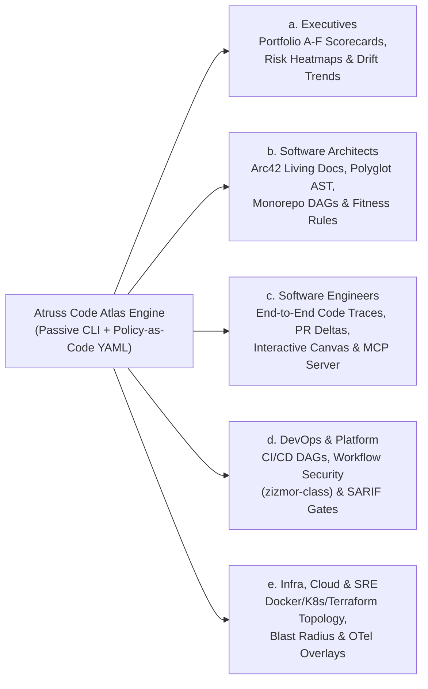

# Atruss Code Atlas: Portable Architectural & Pipeline Intelligence Platform

**Passive, zero-agent, offline-capable architectural and CI/CD pipeline observability.**

Atruss Code Atlas is a fast, lightweight CLI and static **Material Design 3 (Astro Starlight)** intelligence portal that generates portable Docs-as-Code architecture maps, end-to-end execution DAGs (`Trigger -> Entrypoint -> Script -> Dependency`), security & anti-pattern diagnostics, and 6-Dimension A–F Health Scorecards—without requiring agents, webhooks, or target repository modifications.

- **Documentation & Specification Index**: [`docs/README.md`](./docs/README.md)
- **Master PRD v2.0 (Consolidated + Top 10 Roadmap)**: [`docs/atruss-code-atlas-prd.md`](./docs/atruss-code-atlas-prd.md) *(Baseline v1.0 preserved at [`docs/atruss-code-atlas-prd-baseline.md`](./docs/atruss-code-atlas-prd-baseline.md))*
- **Unified SpecKit Specification (`FR-001`–`FR-030`)**: [`docs/atruss-code-atlas-unified-spec.md`](./docs/atruss-code-atlas-unified-spec.md) & [`specs/009-unified-atlas-spec/spec.md`](./specs/009-unified-atlas-spec/spec.md)
- **Agentic SDLC Playbook (SpecKit vs. Antigravity Native)**: [`docs/agentic-sdlc-guide.md`](./docs/agentic-sdlc-guide.md)

---

## The Value Proposition

Enterprises suffer from architectural drift and pipeline fragmentation. Developers often act as "Master Blacksmiths," hand-crafting bespoke CI/CD workflows and burying critical domain logic and infrastructure couplings across hundreds of undocumented repositories.

Atruss Code Atlas tells you **what** is being built (structural code & infrastructure architecture), **how** it gets to production (CI/CD pipeline topology), and **where** the hidden risks live (anti-patterns, CVEs, blast radius, and governance drift)—outputting deterministic, immutable artifacts (`JSON`, `CSV`, `YAML`, `Arc42/Mermaid Markdown`, and a static **Material Design 3 Web Portal**).

### The Market Gap
* **Unlike SonarQube**, which is blind to CI/CD pipelines, Atruss parses your GitHub Actions/CI DAGs and detects pipeline structural and security anti-patterns.
* **Unlike GitHub Advanced Security (GHAS)**, which locks insights inside proprietary UI silos, Atruss outputs deterministic, portable Arc42 Markdown and JSON schemas you can host anywhere.
* **Unlike Spotify Backstage**, which requires months of manual `catalog-info.yaml` upkeep and active plugin maintenance, Atruss is **100% passive**—it discovers, classifies, and maps repositories automatically in read-only mode.
* **Unlike Datadog CI Visibility**, which lacks source-level architectural context, Atruss links CI workflow triggers directly to Python, .NET, React/TypeScript, and Java Spring Boot AST/structural components.

---

## What's In It For You? (Value by Stakeholder Group)

Atruss Code Atlas is designed as a multi-lens observability platform where a single passive scan powers tailored insights across five core organizational personas—combining **Implemented Baseline (`v1.0`)** capabilities with **Planned Master PRD `v2.0` (`Horizon 2`)** enhancements.



---

### a. Executives (CTOs, VPs of Engineering, CISOs & Engineering Directors)

> **Executive Bottom Line**: Instant, objective, organization-wide engineering portfolio visibility and supply-chain governance with **zero adoption friction** (no developer workflow changes or agent installations required).

* **Core Value**:
  * **Eliminate Blind Spots**: Automatically inventory hundreds of repositories across organizations, classifying languages, frameworks, deployment readiness, and documentation priority (`Tier 1`–`Tier 3`).
  * **Quantify Technical Debt & Risk**: Replace subjective status reports with a deterministic **6-Dimension A–F Weighted Health Scorecard** (`Dependency Health`, `Security`, `Architecture`, `CI/CD`, `Maintainability`, `Test Coverage`).
  * **M&A Due Diligence & Compliance Readiness**: Generate audit-ready portfolio catalogs and supply-chain inventories in minutes.
* **Implemented Today (`v1.0 Baseline`)**:
  * **27-Column Organization Discovery (`FR-002`, `FR-015`)**: Automated org-wide inventory exporting `repositories.{json,csv,yaml}` with language, framework, Docker/K8s/CI presence, and `DocumentationPriority`.
  * **6-Dimension A–F Health Scorecard (`FR-011`)**: Objective grading across every repository and organization.
  * **Material Design 3 Executive Command Center (`FR-017`, `FR-019`)**: Interactive web portal (`/`, `/orgs/`) with KPI strips, ecosystem distribution charts, risk alert banners, and multi-org comparison leaderboards.
  * **100-Repo Stratified Benchmark Harness (`FR-020`)**: Proven scalability and SLA compliance across diverse multi-language portfolios.
* **Planned in Master PRD `v2.0` (`Horizon 2 Roadmap`)**:
  * **Longitudinal Architecture Drift & Historical Scorecard Time-Series (`REC-10` / `FR-030`)**: Track whether portfolio health grades, complexity, and security posture are improving or degrading week-over-week via `catalog-history.json` sparklines.
  * **Executive CycloneDX v1.5 / SPDX v2.3 SBOM Generation (`REC-03` / `FR-023`)**: One-command regulatory Software Bill of Materials export (`--sbom`) with exploit-reachability filtering so CISOs focus only on reachable vulnerabilities.

---

### b. Software Architects (Enterprise, Principal, Staff & Solution Architects)

> **Architect Bottom Line**: Stop drawing static diagrams that rot on Confluence within a week—generate living **Arc42 + Mermaid** architectural blueprints and enforce declarative architectural boundaries as code.

* **Core Value**:
  * **Living Docs-as-Code**: Automatically reconstruct component topologies (Controllers/Routes, Services, Data Access Layers, UI Components) directly from source code.
  * **Cross-Boundary Governance**: Detect circular dependencies (`CYCLE_DETECTED`), dead/orphaned modules (`ORPHAN_NODE`), and god scripts (`AP-001`) before they calcify into monoliths.
  * **Zero-Code Extensibility**: Define new frameworks and classification heuristics declaratively in [`manifests/ecosystems.yaml`](./manifests/ecosystems.yaml) without touching Python code.
* **Implemented Today (`v1.0 Baseline`)**:
  * **4-Ecosystem Structural Code Analysis (`FR-016`)**: Out-of-the-box component & complexity extraction for **Python** (`ast` + `radon`), **.NET / C#** (`.csproj`, Controllers, Services, `DbContext`), **React / TypeScript / Next.js**, and **Java Spring Boot** (`pom.xml`/`build.gradle`, `@RestController`, `@Service`, `@Repository`).
  * **Automated Arc42 + Mermaid Reports (`FR-005`, `FR-012`)**: Self-contained Markdown architecture reports (`{org}-{repo}-report.md`) and tabbed Material Design 3 architecture views (`ArchitectureView.astro`).
  * **Circular Dependency & Anti-Pattern Detection (`FR-007`, `FR-008`)**: Automated detection of `AP-001` through `AP-007` with concrete remediation guidance.
* **Planned in Master PRD `v2.0` (`Horizon 2 Roadmap`)**:
  * **Hybrid Tree-sitter Polyglot AST & Call Graph Engine (`REC-01` / `FR-021`)**: Deep cross-file call graph resolution across Python, JS/TS (including barrel re-exports & `tsconfig` path aliases), Go, Rust, Bash, and HCL with edge confidence scoring (`1.0` AST-verified, `0.8` heuristic, `0.5` dynamic).
  * **First-Class Monorepo Workspace Graph (`REC-05` / `FR-025`)**: Native workspace package topology (`pnpm-workspace.yaml`, `turbo.json`, `nx.json`, `Cargo.toml`, `go.work`, `uv`) modeling internal `DEPENDS_ON_WORKSPACE` edges.
  * **Declarative Architecture Fitness Functions (`REC-06` / `FR-026`)**: Policy-as-Code rules (`manifests/fitness-rules.yaml`, `--policy`) enforcing layer boundaries (e.g., forbidding UI components from importing database drivers directly).

---

### c. Software Engineering Teams (Tech Leads, Backend/Frontend Devs & AI-Assisted Engineers)

> **Software Engineer Bottom Line**: Understand unfamiliar repositories in minutes, preview the architectural impact of your Pull Requests before merging, and supercharge your AI coding assistant (Cursor, Claude Code, Antigravity, Copilot) with structural graph tools.

* **Core Value**:
  * **10x Faster Onboarding**: Trace any feature from its external trigger or entrypoint down through intermediate scripts to third-party packages (`Trigger -> Entrypoint -> Script -> Dependency`) with exact file paths and line numbers.
  * **Safe Refactoring**: Know what downstream workflows or modules will break before renaming a script or upgrading a dependency.
  * **AI Agent Context Augmentation**: Give AI coding agents exact structural call graphs and blast radii instead of letting them grep blindly.
* **Implemented Today (`v1.0 Baseline`)**:
  * **End-to-End Execution Chain Tracing (`FR-006`, `FR-007`)**: Full DAG traversal linking entrypoints (`main.py`, `package.json` scripts, `Makefile`, `Dockerfile`) to internal modules and external dependencies (`requirements.txt`, `pyproject.toml`, `package.json`, `Cargo.toml`, `go.mod`).
  * **Fast Local CLI & Deterministic JSON Exports (`FR-001`, `FR-013`)**: Run `atruss analyze-code --path ./my-repo` locally in seconds with zero network mutations.
  * **5-Gate Agentic Workflow Validator (`FR-018`)**: Built-in quality harness ([`scripts/validate_agent_workflow.py`](./scripts/validate_agent_workflow.py)) ensuring 0 stubbed functions, 0 skipped tests, and 100% schema contract parity.
* **Planned in Master PRD `v2.0` (`Horizon 2 Roadmap`)**:
  * **Model Context Protocol (MCP) Server for AI Coding Agents (`REC-07` / `FR-027`)**: Run `atruss mcp serve` (`stdio`/`sse`) to expose `get_blast_radius`, `trace_entrypoint_chain`, `query_antipatterns`, `get_repo_scorecard`, and `check_boundary_violation` directly to LLM coding agents.
  * **Interactive WebGL/Canvas Graph Explorer & Code-Jump Drawer (`REC-09` / `FR-029`)**: Smooth 60fps Cytoscape.js/ELK.js graph canvas for 500+ node repositories with `Cmd+K` search spotlight, 1-hop/2-hop neighborhood isolation, and a synchronized **Code-Jump Inspector Drawer**.
  * **Diff-Aware Incremental PR Architecture Delta (`REC-04` / `FR-024`)**: Run `atruss analyze --diff origin/main..HEAD` in `< 5 seconds` to see added/removed dependency edges and complexity deltas right in your PR.

---

### d. DevOps & CI/CD Platform Engineers

> **DevOps Bottom Line**: Turn opaque YAML workflow jungles into visual, auditable pipeline DAGs and automatically catch critical CI/CD supply-chain vulnerabilities (`pull_request_target` pwn requests, unpinned actions, missing test gates) across every repository.

* **Core Value**:
  * **Pipeline Topology Visualization**: Automatically parse `.github/workflows/*.yml`, `.gitlab-ci.yml`, `CircleCI`, and `Jenkinsfile` definitions into visual job-dependency DAGs (`needs:` edges, triggers, runners, and step counts).
  * **CI/CD Best-Practice Enforcement**: Catch deployments that bypass upstream test gates (`NO_TEST_GATE`), missing dependency caches (`MISSING_CACHE`), and unpinned container/package versions (`AP-002`, `AP-005`).
  * **Shift-Left CI Security**: Prevent malicious PRs and supply-chain action compromises before they execute on runners.
* **Implemented Today (`v1.0 Baseline`)**:
  * **Dual-Mode Pipeline DAG & Anti-Pattern Analyzer (`FR-004`, `FR-008`)**: `atruss analyze-pipeline` extracts full workflow topologies and flags structural CI anti-patterns (`NO_TEST_GATE`, `MISSING_CACHE`, `UNPINNED_VERSION`, `MISSING_LOCKFILE`, `BROAD_EXCEPT`, `HARDCODED_SECRET_PATTERN`), outputting per-repo DAGs and org-wide `pipeline_topology.{json,csv,yaml}`.
  * **Interactive M3 Pipeline DAG Viewer (`FR-014`, `FR-019`)**: Dedicated `CI/CD Pipeline DAG` tab (`PipelineView.astro`) in the Astro portal with anti-pattern severity chips and zoomable Mermaid diagrams.
  * **Turnkey GitHub Pages Deployment Pipeline (`FR-019`)**: Preconfigured `.github/workflows/deploy-pages.yml` publishing the entire static observability portal to GitHub Pages.
* **Planned in Master PRD `v2.0` (`Horizon 2 Roadmap`)**:
  * **CI/CD Workflow Security Static Analyzer — `zizmor` / `poutine` Class Rules (`REC-02` / `FR-022`)**: 7 dedicated CI/CD supply-chain security rules (`AP-008`–`AP-014`):
    * `AP-008`: `pull_request_target` untrusted checkout / `${{ github.event.pull_request.title }}` command injection (`CRITICAL`)
    * `AP-009`: Unpinned third-party GitHub Action (`uses: owner/action@v3` mutable tag vs. 40-char commit SHA) (`HIGH`)
    * `AP-010`: Missing or excessive `permissions: write-all` `GITHUB_TOKEN` scope (`HIGH`)
    * `AP-011`: Insecure `$GITHUB_ENV` / `$GITHUB_PATH` untrusted input writes (`CRITICAL`)
    * `AP-012`: Unverified workflow artifact download/execution (`HIGH`)
    * `AP-013`: Public repository executing on `self-hosted` runner (`CRITICAL`)
    * `AP-014`: Cache poisoning risk across privilege boundaries (`MEDIUM`)
  * **Native GitHub Action & SARIF v2.1.0 Code Scanning Exporter (`REC-04` / `FR-024`)**: Export `--format sarif` so pipeline and architectural violations appear as inline annotations on GitHub Pull Requests.

---

### e. Infrastructure, Cloud & SRE Teams

> **Infra & SRE Bottom Line**: Map how application code connects to Docker containers, Kubernetes/Helm workloads, and Terraform cloud resources, quantify blast radius before incidents happen, and overlay live OpenTelemetry production heatmaps onto static topology graphs.

* **Core Value**:
  * **Code-to-Cloud Traceability**: Bridge the gap between application repositories and infrastructure manifests (`Dockerfile`, `docker-compose.yml`, Kubernetes YAML, Helm `Chart.yaml`, Kustomize, and Terraform `.tf` HCL).
  * **Blast-Radius & Incident Triage**: Identify single-point-of-failure packages and shared infrastructure modules with the highest transitive downstream impact.
  * **Air-Gapped & Rate-Limit Resilient**: Operate seamlessly in restricted VPCs or air-gapped environments using shallow clones (`--depth 1`) and graceful offline degradation (`ScanDiagnostics`).
* **Implemented Today (`v1.0 Baseline`)**:
  * **Infrastructure Footprint Discovery & Structural Mapping (`FR-002`, `FR-016`)**: Automatic detection and structural mapping of `HasDockerfile`, `HasKubernetes`, `HasDatabase`, container base images, exposed ports, K8s/Helm workloads, and Terraform resources.
  * **Transitive Blast-Radius Impact Analyzer (`FR-010`)**: Calculates downstream affected scripts, services, and entrypoints if a dependency or module fails.
  * **Ephemeral Zero-Footprint Resource Safety (`FR-001`, `FR-020`)**: Blobless shallow clones (`--depth 1 --filter=blob:none`) with 180s circuit-breaker timeouts and automatic temporary disk purge after every repository.
* **Planned in Master PRD `v2.0` (`Horizon 2 Roadmap`)**:
  * **PageRank & Betweenness Centrality Blast-Radius Engine (`REC-05` / `FR-025`)**: Run `atruss analyze --blast-radius <node_id>` to compute graph centrality and transitive failure radius across multi-service and monorepo topologies.
  * **OSV.dev Batch Vulnerability Engine & Execution-Chain Reachability (`REC-03` / `FR-023`)**: High-speed vulnerability scanning (`/v1/querybatch`) that tags every CVE as `REACHABLE_FROM_CI`, `REACHABLE_FROM_RUNTIME`, or `UNREACHABLE_DORMANT` so SRE/SecOps teams prioritize real production risks.
  * **Runtime Observability Overlay — OpenTelemetry & Coverage Heatmaps (`REC-08` / `FR-028`)**: Ingest OpenTelemetry span exports (`--otel-traces`) and coverage reports (`--coverage`) to highlight `HOT_PATH` production bottlenecks vs. `DEAD_UNOBSERVED` infrastructure weight.

---

## Feature Matrix: Implemented (`v1.0`) vs. Planned (`PRD v2.0` Roadmap)

| Capability Domain | Feature ID & Name | Status | Primary Personas Served |
| :--- | :--- | :--- | :--- |
| **Ingestion & Discovery** | `FR-001` / `FR-002`: Dual-Mode GitHub `/trees` API & Shallow Clone Discovery (27 Columns) | **Implemented (`v1.0`)** | Executives, Architects, Infra |
| **Policy-as-Code** | `FR-015`: Externalized YAML Ecosystem & Archetype Registry (`manifests/ecosystems.yaml`) | **Implemented (`v1.0`)** | Architects, DevOps |
| **Pipeline Topology** | `FR-004` / `FR-005`: CI/CD Workflow Parser, NetworkX DAG Builder & Mermaid Exporter | **Implemented (`v1.0`)** | DevOps, SWE |
| **Deep Chain Analysis** | `FR-006` / `FR-007`: `Trigger -> Entrypoint -> Script -> Dependency` DAG, Cycle & Orphan Detection | **Implemented (`v1.0`)** | SWE, Architects |
| **Structural Code AST** | `FR-016`: 4-Ecosystem Analyzers (`Python`, `.NET`, `React/TS`, `Java Spring Boot`) + Arc42 Reports | **Implemented (`v1.0`)** | Architects, SWE |
| **Anti-Patterns & Risk** | `FR-008` / `FR-009` / `FR-010`: Structural Anti-Patterns (`AP-001`–`AP-007`), CVE Lookup & Blast Radius | **Implemented (`v1.0`)** | DevOps, Architects, Infra |
| **Health Scoring** | `FR-011` / `FR-012` / `FR-013`: 6-Dimension A–F Weighted Scorecard + JSON/CSV/YAML/MD Exporters | **Implemented (`v1.0`)** | Executives, Architects |
| **Web Portal (M3 UI)** | `FR-014` / `FR-017` / `FR-019`: Astro Starlight + Material Design 3 Portal & GitHub Pages CI/CD | **Implemented (`v1.0`)** | All Stakeholders |
| **Quality & Scale** | `FR-018` / `FR-020`: 5-Gate Agentic Conformance Validator & 100-Repo Stratified Benchmark | **Implemented (`v1.0`)** | SWE, Architects, Executives |
| **Polyglot AST (`REC-01`)** | `FR-021`: Hybrid Tree-sitter Polyglot AST & Cross-File Call Graph with Confidence Weights | **Planned (`v2.2`)** | Architects, SWE |
| **CI Security (`REC-02`)** | `FR-022`: CI/CD Workflow Security Static Analysis (`AP-008`–`AP-014`, `zizmor`/`poutine`-class) | **Planned (`v2.1`)** | DevOps, CISO/Executives |
| **Supply Chain (`REC-03`)** | `FR-023`: OSV.dev Batch API Engine, CycloneDX/SPDX SBOM (`--sbom`) & CVE Reachability Tagging | **Planned (`v2.1`)** | Infra/SRE, CISO, DevOps |
| **PR Governance (`REC-04`)** | `FR-024`: Diff-Aware Incremental PR Architecture Delta (`--diff`) & GitHub SARIF v2.1.0 Exporter | **Planned (`v2.2`)** | SWE, DevOps, Architects |
| **Monorepo & Graph (`REC-05`)** | `FR-025`: Monorepo Workspace Graph (`pnpm`/`nx`/`turbo`/`cargo`) & PageRank Centrality (`--blast-radius`) | **Planned (`v2.1`)** | Architects, Infra/SRE, SWE |
| **Fitness Rules (`REC-06`)** | `FR-026`: Declarative Architecture Fitness Functions & Policy-as-Code (`manifests/fitness-rules.yaml`) | **Planned (`v2.2`)** | Architects, DevOps |
| **AI Agent MCP (`REC-07`)** | `FR-027`: Model Context Protocol (MCP) Server (`atruss mcp serve`) for AI Coding Agents | **Planned (`v2.3`)** | SWE, Architects |
| **Runtime Overlay (`REC-08`)** | `FR-028`: OpenTelemetry Trace (`--otel-traces`) & Test Coverage (`--coverage`) Heatmap Overlay | **Planned (`v2.2`)** | Infra/SRE, Architects, SWE |
| **Interactive UI (`REC-09`)** | `FR-029`: WebGL/Canvas Graph Explorer (Cytoscape.js/ELK.js), `Cmd+K` Spotlight & Code-Jump Drawer | **Planned (`v2.3`)** | SWE, Architects, DevOps |
| **Historical Drift (`REC-10`)** | `FR-030`: Longitudinal Architecture Drift & Historical Scorecard Time-Series (`catalog-history.json`) | **Planned (`v2.3`)** | Executives, Architects |

---

## Quickstart

```bash
# Clone the repository
git clone https://github.com/kumarshaz/atruss-code-atlas.git
cd atruss-code-atlas

# Create WSL/Linux-native environment and install
uv venv .venv
source .venv/bin/activate
uv pip install -e ".[dev]"
```

> **Note**: If you recently migrated this project from Windows to WSL, recreate your virtual environment inside WSL.

### 1. Perform Multi-Phase Structural Extraction (CSV, JSON, YAML, Arc42 Markdown)

Atruss Code Atlas outputs deterministic datasets into `exports/{timestamp}/` (and updates `exports/latest/`), mapping to 27-column discovery schemas, pipeline DAGs, and Arc42 architecture reports that the Material Design 3 Astro portal ingests natively at build time.

```bash
export GH_TOKEN="ghp_xxx"

# 1. Discover repositories across an organization (27-column YAML-driven classification)
atruss discover --org your-org

# 2. Analyze CI/CD pipeline topologies & anti-patterns from discovery output
atruss analyze-pipeline --from-discovery ./exports/latest/repos/repositories.json

# Alternatively, pass a flat repository list or local path
atruss analyze-pipeline --repos-file targets.txt --output-dir ./reports/

# 3. Deep structural code scan generating Arc42 + Mermaid architecture reports
atruss analyze-code --repos-file targets.txt --output-dir ./architecture-reports/

# 4. Run the 100 Popular GitHub Projects Benchmark or Stratified Random Sampler
atruss benchmark --corpus popular-100 --limit 12
atruss benchmark --random-sample 12 --seed 2026

# 5. Run the 5-Gate Agentic Workflow Conformance Validator
python scripts/validate_agent_workflow.py --spec specs/009-unified-atlas-spec
```

---

## Core Architecture (Hexagonal / Ports & Adapters)

To ensure the Python engine remains a clean, deterministic core that powers CLI reports, CI gates, and the Astro Starlight UI, the system enforces strict hexagonal boundaries:
* **Declarative Policy Layer ([`manifests/ecosystems.yaml`](./manifests/ecosystems.yaml))**: Externalized rules for ecosystem detection, sub-frameworks, and 27-column discovery signals.
* **Core Domain (The "Lego" Logic)**: Immutable classification (`src/analyzers/classification.py`), AST/structural parsing (`src/analyzers/code/`), NetworkX DAG reconstruction (`src/analyzers/pipeline/dag_builder.py`), and pipeline anti-pattern heuristics (`src/analyzers/pipeline/heuristics.py`). Zero coupling to external UIs.
* **Inbound Ports (Interfaces)**:
  * `CLIAdapter` (`src/cli/commands/`): `discover`, `analyze-pipeline`, `analyze-code`, and `benchmark`.
* **Outbound Adapters (The "Modular Joints")**:
  * `GitHubRESTClient` & `GitCloner`: Dual-mode zero-clone `/git/trees?recursive=1` inspection and shallow (`--depth 1`) ephemeral repository cloning.
  * `DiscoveryExporter`, `PipelineExporter`, `MarkdownExporter`: Deterministic JSON, CSV, YAML, and Arc42/Mermaid Markdown exporters writing to `exports/{timestamp}/` and `exports/latest/`.

---

## The Material Design 3 Astro Visualizer (Docs-as-Code)

Atruss Code Atlas includes a zero-backend **Astro v5 + Starlight** web application styled with **Google Material Design 3 (`M3`)** tonal surface tokens ([`web/src/styles/material-theme.css`](./web/src/styles/material-theme.css)).

> **Note on Development**: Building or running the Astro Node.js project on Windows requires running within **WSL (Windows Subsystem for Linux)** with Node v20/v22+.
>
> ### Quick WSL Node Setup:
> 1. Install FNM: `curl -fsSL https://fnm.vercel.app/install | bash`
> 2. Initialize in shell: `source ~/.bashrc`
> 3. Install required version: `fnm install 22 && fnm default 22 && fnm use 22`

### End-to-End Portal Build Pipeline:
1. **The Generator**: The Python CLI analyzes repositories and outputs canonical JSON datasets and Arc42 Markdown reports into `./exports/latest/`.
2. **The Output Bridge**: `scripts/generate-report-stubs.py` converts `./exports/latest/` artifacts into tabbed Material Design 3 Astro MDX pages (`Discovery Overview` | `CI/CD Pipeline DAG` | `Arc42 Code Architecture`).
3. **The Consumer**: Running `npm run copy-data` inside `./web` synchronizes `./exports/latest/` into `web/src/data/latest/` and generates the MDX report routes.
4. **Static Output**: Run `npm run build` in `./web` (or `ASTRO_BASE=/atruss-code-atlas npm run build` for GitHub Pages subpath hosting). The output in `web/dist/` is pure static HTML/CSS/JS ready for GitHub Pages, S3, or internal enterprise hosting.
