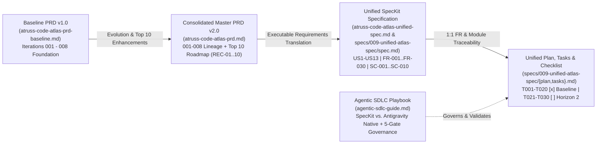

# Atruss Code Atlas — Documentation & Specification Index

Welcome to the canonical documentation hub for **Atruss Code Atlas**. This directory houses the authoritative product requirements, unified SpecKit specifications, and agentic engineering governance guides for the platform.

---

## Document Lineage & Architecture Map



---

## 1. Core Product & Specification Documents (`docs/`)

| Document | Objective & Scope | Target Audience |
| :--- | :--- | :--- |
| **[`atruss-code-atlas-prd-baseline.md`](./atruss-code-atlas-prd-baseline.md)**<br/>*(Baseline PRD v1.0)* | Preserves the clean **v1.0 Baseline Product Requirements Document** representing the foundational capabilities delivered across Iterations `001` through `008` (27-column discovery, 4-ecosystem structural code analysis, pipeline DAG extraction, `AP-001`–`AP-007` heuristics, 6-Dimension A–F Scorecard, Material Design 3 Astro Starlight portal, and 100-repo benchmark). | Product Managers, Architects, Auditors establishing baseline vs. v2.0 delta |
| **[`atruss-code-atlas-prd.md`](./atruss-code-atlas-prd.md)**<br/>*(Consolidated Master PRD v2.0)* | The **authoritative single-source-of-truth Master PRD (v2.0)**. Consolidates:<br/>1. Executive vision, market gap analysis, and **Constitution v2.1.0** principles.<br/>2. Forensic specification lineage audit across all `001`–`008` `Spec -> Plan -> Task` tracks.<br/>3. **Top 10 Strategic Industry & Forum Recommendations (`REC-01`–`REC-10`)** across Backend, Code Structure, and Frontend.<br/>4. Complete Functional Requirements catalog, **14-Rule Anti-Pattern Matrix (`AP-001`–`AP-014`)**, **6-Dimension A–F Scorecard** mathematical formulas, NFRs, and the **v2.1–v2.3 Phased Roadmap**. | Executives, Product Owners, Principal Architects, Tech Leads, DevOps & Security Leads |
| **[`atruss-code-atlas-unified-spec.md`](./atruss-code-atlas-unified-spec.md)**<br/>*(Unified SpecKit Specification)* | Collates every requirement from the Baseline PRD and Master PRD v2.0 into a strict, executable **SpecKit-style Feature Specification**:<br/>- **13 Prioritized User Stories (`US1`–`US13`)** with independent test criteria and Given/When/Then acceptance scenarios.<br/>- **Boundary & Edge Case Specifications** (cyclic graphs, dynamic imports, air-gapped OSV/NVD lookups, `>500`-node topologies).<br/>- **30 Testable Functional Requirements**: `FR-001`–`FR-020` (Delivered Baseline `001`–`008`) and `FR-021`–`FR-030` (Horizon 2 Top 10 Enhancements).<br/>- **Key Domain Entities** and **10 Measurable Success Criteria (`SC-001`–`SC-010`)**. | Software Engineers, QA/SDETs, AI Coding Agents, Compliance Reviewers |
| **[`agentic-sdlc-guide.md`](./agentic-sdlc-guide.md)**<br/>*(Agentic SDLC Playbook)* | Educational engineering playbook and empirical case study detailing how Atruss Code Atlas was built using **SpecKit Specification-Driven Development (`001`–`006A`)** and **Antigravity Native Agentic Coding (`006B`–`009`)**.<br/>Includes embedded **Mermaid diagrams**, a feature-by-feature attribution matrix, lessons learned from cross-iteration drift, the **3-Layer Hybrid 5-Gate Governance Model**, and an **Enterprise Decision Flowchart** to help teams pick and choose the right agentic framework for their compliance and velocity needs. | VP of Engineering, Engineering Managers, Staff Engineers, AI Platform & Governance Teams |

---

## 2. Unified SpecKit Execution Package (`specs/009-unified-atlas-spec/`)

To maintain 100% programmatic conformance with the **5-Gate Agentic Workflow Validator** ([`../scripts/validate_agent_workflow.py`](../scripts/validate_agent_workflow.py)), the unified specification is paired with its structured SpecKit execution artifacts in [`../specs/009-unified-atlas-spec/`](../specs/009-unified-atlas-spec/):

| Artifact | Objective & Scope | Verification Gate |
| :--- | :--- | :--- |
| **[`../specs/009-unified-atlas-spec/spec.md`](../specs/009-unified-atlas-spec/spec.md)** | Canonical SpecKit copy of the Unified Specification (`US1`–`US13`, `FR-001`–`FR-030`, `SC-001`–`SC-010`). | **Gate 1**: Extracts all `FR-\d+` and `SC-\d+` identifiers to enforce 100% task coverage. |
| **[`../specs/009-unified-atlas-spec/plan.md`](../specs/009-unified-atlas-spec/plan.md)** | **Unified Implementation Plan**. Maps constitutional guardrails, canonical repository module paths (`manifests/`, `src/`, `scripts/`, `web/`, `tests/`), and the 3-Wave delivery architecture for `REC-01`–`REC-10`. | **Gate 1**: Verifies every concrete backticked file path exists on disk (`missing_targets = 0`). |
| **[`../specs/009-unified-atlas-spec/tasks.md`](../specs/009-unified-atlas-spec/tasks.md)** | **Unified Task Traceability Matrix (`T001`–`T030`)**.<br/>- **Phase 1 & 2 (`T001`–`T020` `[x]`)**: Completed tasks mapped to `FR-001`–`FR-020` (`001`–`008`).<br/>- **Phase 3 (`T021`–`T030` `[ ]`)**: Actionable Horizon 2 backlog tasks mapped 1:1 to `FR-021`–`FR-030` (`REC-01`–`REC-10`). | **Gate 1**: Verifies 30/30 `FR`s and 10/10 `SC`s are mapped to `T001`–`T030`. |
| **[`../specs/009-unified-atlas-spec/checklists/requirements.md`](../specs/009-unified-atlas-spec/checklists/requirements.md)** | **SpecKit Specification Quality Checklist**. Confirms zero unresolved ambiguities, complete acceptance scenarios, and full requirement-to-task readiness. | SpecKit Quality & Readiness Gate |

---

## 3. Recommended Reading Order by Role

1. **New Stakeholders & Engineering Leaders**: Start with the root [`../README.md`](../README.md) (*What's In It For You* by persona), then read [`agentic-sdlc-guide.md`](./agentic-sdlc-guide.md) and Sections 1–4 of [`atruss-code-atlas-prd.md`](./atruss-code-atlas-prd.md).
2. **Product Managers & System Architects**: Read [`atruss-code-atlas-prd-baseline.md`](./atruss-code-atlas-prd-baseline.md) for the v1.0 foundation, followed by [`atruss-code-atlas-prd.md`](./atruss-code-atlas-prd.md) for the `001`–`008` lineage audit and Top 10 strategic enhancements (`REC-01`–`REC-10`).
3. **Contributors & AI Coding Agents Implementing Horizon 2 (`v2.1`–`v2.3`)**: Load [`atruss-code-atlas-unified-spec.md`](./atruss-code-atlas-unified-spec.md) alongside [`../specs/009-unified-atlas-spec/plan.md`](../specs/009-unified-atlas-spec/plan.md) and [`../specs/009-unified-atlas-spec/tasks.md`](../specs/009-unified-atlas-spec/tasks.md), and validate all changes using:
   ```bash
   python scripts/validate_agent_workflow.py --spec specs/009-unified-atlas-spec
   ```
