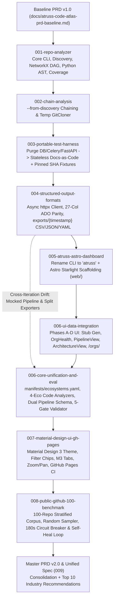
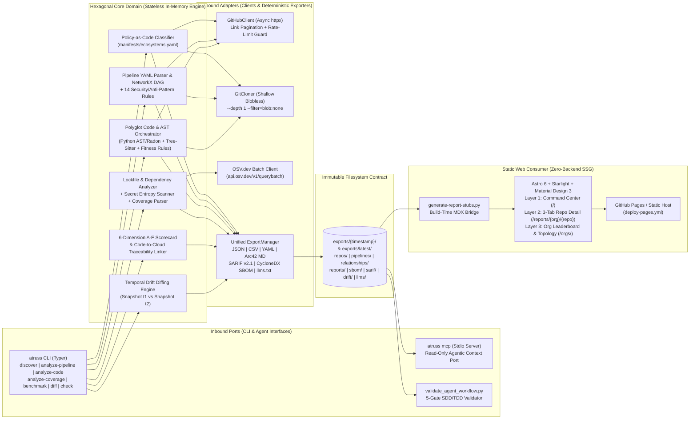

# Atruss Code Atlas: Consolidated Product Requirements Document (Master PRD v2.0)

**Document ID**: `PRD-ATRUSS-MASTER-V2`  
**Version**: `2.0.0` (Consolidated Baseline `001`–`008` + Iteration 2 Industry Enhancements)  
**Branch**: `feat/001-PRD-enhancements-it2`  
**Date**: 2026-11-14  
**Status**: Approved — Canonical Product & Architectural Intent  
**Baseline Reference**: [`docs/atruss-code-atlas-prd-baseline.md`](./atruss-code-atlas-prd-baseline.md)  
**Companion Unified SpecKit Specification**: [`docs/atruss-code-atlas-unified-spec.md`](./atruss-code-atlas-unified-spec.md) & [`specs/009-unified-atlas-spec/spec.md`](../specs/009-unified-atlas-spec/spec.md)

---

## 1. Executive Summary & Product Intent

### 1.1 Product Vision & Intent Declaration
Enterprises suffer from **architectural drift** and **CI/CD pipeline fragmentation**. Across large GitHub organizations, engineering teams act as "Master Blacksmiths"—hand-crafting bespoke GitHub Actions workflows, embedding domain logic inside undocumented monorepos, and deploying container workloads without consistent quality gates.

**Atruss Code Atlas** is a passive, offline-capable **Architectural & Pipeline Observability Platform**. It ingests any GitHub organization or repository list, performs declarative Policy-as-Code ecosystem classification, reconstructs CI/CD workflow Directed Acyclic Graphs (DAGs) with security/anti-pattern detection, extracts multi-language structural code boundaries, and emits **immutable, deterministic Docs-as-Code artifacts** (`JSON`, `CSV`, `YAML`, `SARIF`, `CycloneDX SBOM`, `llms.txt`, and `Arc42 Markdown` with embedded `Mermaid` diagrams). These artifacts are consumed at build time by a zero-backend **Astro 6 + Starlight + Google Material Design 3 (M3)** static web observatory deployable directly to GitHub Pages, S3, or air-gapped intranets.

### 1.2 Market Gap & Competitive Differentiation

| Competitor / Category | Core Strength | The Missing Link (Market Gap) | Atruss Code Atlas v2.0 Advantage |
| :--- | :--- | :--- | :--- |
| **SonarQube / SonarCloud** | Deep AST code quality, cyclomatic complexity, and quality gates | **Blind to CI/CD pipelines & deployment topology.** Does not parse `.github/workflows` DAGs or detect pipeline supply-chain/gating anti-patterns. | Bridges **Structural Code Architecture** and **CI/CD Pipeline Topology** in a single unified model and Code-to-Cloud graph. |
| **GitHub Advanced Security (GHAS)** | Native secret scanning, Dependabot, and CodeQL | **Zero portability & SaaS lock-in.** Findings are trapped in GitHub's proprietary UI; no Arc42 architectural synthesis or offline static export. | Emits deterministic, portable **Arc42 Markdown + JSON/CSV/YAML/SARIF** artifacts that live in Git and render statically anywhere. |
| **Spotify Backstage** | Extensible Internal Developer Portal (IDP) and catalog | **Heavy active instrumentation.** Requires Postgres, backend microservices, and developer-maintained `catalog-info.yaml` files in every repo. | **100% passive & stateless.** Zero agents, zero webhooks, zero databases, and zero files required in target repositories. |
| **Datadog CI Visibility** | Real-time pipeline duration and test flakiness telemetry | **Zero architectural context.** Knows a workflow job failed, but cannot tell if the repo is a `.NET` CQRS microservice, a `FastAPI` backend, or a `React` SPA. | Maps every CI/CD workflow and deployment target directly to discovered code modules, frameworks, and architectural layers. |
| **Structurizr / C4 Tools** | Rich C4 architecture-as-code diagrams | **Manual DSL maintenance.** Requires architects to hand-write and update Structurizr DSL as code evolves. | Automatically reverse-engineers **Arc42 + C4-aligned Mermaid diagrams** directly from source ASTs and workflow YAML. |

### 1.3 Non-Negotiable Constitution (v2.1.0 + v2.0 Enhancements)

1. **I. Policy-as-Code & Extensibility**: All ecosystem detection, framework classification, 27-column discovery signals (`manifests/ecosystems.yaml`), and architectural fitness rules (`manifests/architecture-rules.yaml`) MUST be externalized as YAML/JSON manifests—never hardcoded in Python engine logic.
2. **II. Single Source of Truth for Reports**: The canonical JSON export (`exports/latest/`) is the single source of truth. All Markdown, HTML, PDF, SARIF, and Astro M3 UI views MUST derive strictly from canonical exports.
3. **III. Security & Privacy First**: GitHub tokens (`GH_TOKEN` / `GITHUB_TOKEN`) MUST never be persisted to disk or logs (`MaskingFormatter` in `src/core/auth.py`). Cloned repositories MUST use ephemeral temporary directories purged immediately upon completion. Vulnerability intelligence MUST use package-native `OSV.dev` batch APIs with optional NVD/CVSS enrichment.
4. **IV. Performance & Scalability**: Analysis of any repository under `500k LoC` (`< 250MB`) MUST complete in `< 3 minutes` (`180s` asyncio circuit breaker), supporting bounded concurrent HTTP/clone workers (`Semaphore(10)` for API discovery, `Semaphore(4)` for shallow blobless clones).
5. **V. Auditability & Determinism**: Running Atruss Code Atlas twice against the same Git commit SHA MUST produce byte-for-byte identical canonical JSON and Markdown content digests (verified by SHA-256 Gate 5).
6. **VI. Pipeline Visualization as a First-Class Feature**: Pipeline DAG reconstruction, cross-workflow linkage, and security/anti-pattern heuristics are primary product pillars on par with code architecture analysis.
7. **VII. Strict Specification & Test-Driven Development (SDD/TDD)**: Every feature MUST follow SpecKit (`spec.md -> plan.md -> tasks.md`) traceability and pass the **5-Gate Agentic Workflow Validator** (`scripts/validate_agent_workflow.py`) with **0 skipped tests** against synthetic and pinned-SHA public fixtures.
8. **VIII. Standardized WSL / Linux Execution Environment**: All Python (`.venv`) and Node.js (`fnm` v22+) build and test workloads execute deterministically in Linux/WSL environments.

---

## 2. Specification Lineage Investigation (`001`–`008` Forensic Audit)

To consolidate the PRD into a single authoritative source of truth, we conducted a complete forensic investigation across all **9 SpecKit directories** (`001` through `008`, including both `006-ui-data-integration` and `006-core-unification-and-eval`) and the v1.0 Baseline PRD (`docs/atruss-code-atlas-prd-baseline.md`).

### 2.1 Visual Lineage & Architectural Evolution Map



### 2.2 Iteration-by-Iteration `Spec -> Plan -> Task` Lineage Analysis

#### Iteration `001-repo-analyzer` — *Repository Discovery and Deep Analysis*
- **Specification (`specs/001-repo-analyzer/spec.md`)**:
  - Defined 4 foundational user stories: `US1` (Discover & Classify Repositories, P1), `US2` (Analyze CI/CD Pipelines, P1), `US3` (Deep Local Code Analysis & Arc42 Generation, P2), and `US4` (Extract Test Coverage, P2).
  - Established `FR-001` through `FR-009` and `SC-001` through `SC-005` (`< 2 min` for 100-repo discovery, `100%` DAG job accuracy, `< 3 min` for `< 500k LoC` deep analysis, `< 5%` anti-pattern false positives, `±2%` test coverage extraction tolerance).
- **Plan (`specs/001-repo-analyzer/plan.md` & `data-model.md`)**:
  - Originally planned a stateful stack using Python 3.12, FastAPI, Celery, Redis, and PostgreSQL (`SQLAlchemy` + `Alembic`) alongside `PyYAML`, `NetworkX`, `Radon`, and `Bandit`.
- **Tasks (`specs/001-repo-analyzer/tasks.md`)**:
  - Executed `T001`–`T036` across 8 phases: created `src/analyzers/classification.py`, `src/analyzers/pipeline/{parser,dag_builder,heuristics}.py`, `src/analyzers/code/{orchestrator,python_ast}.py`, `src/analyzers/coverage_parser.py`, `src/core/services/{github_api,report_generator}.py`, and CLI commands (`discover`, `analyze-pipeline`, `analyze-code`, `analyze-coverage`).
- **Lineage Audit Finding**:
  - While `001` established the core analyzers, it initially relied on SQLite/PostgreSQL models and left 5 integration test suites in `tests/integration/` (`test_classification_e2e.py`, `test_coverage_e2e.py`, `test_pipeline_dag_e2e.py`, `test_golden_snapshots.py`, `test_performance.py`) as skipped stubs (`pytest.skip`)—which was later remediated in `006-core-unification-and-eval`.

#### Iteration `002-chain-analysis` — *Chained Analysis Pipeline*
- **Specification (`specs/002-chain-analysis/spec.md`)**:
  - Added `US1` (Chained Code Analysis, P1) and `US2` (Chained Pipeline Analysis, P1) with `FR-001`–`FR-007` and `SC-001`–`SC-002` so engineers could pipe discovery JSON directly into `analyze-code` and `analyze-pipeline` without manual `git clone` scripting.
- **Plan & Tasks (`specs/002-chain-analysis/plan.md`, `tasks.md` `T001`–`T009`)**:
  - Created `src/core/utils/git_cloner.py` (`GitCloner`) using `subprocess.run` to clone repositories into isolated OS temporary directories (`tempfile.gettempdir()`) and added `--from-discovery` to `analyze_code.py` and `analyze_pipeline.py`.

#### Iteration `003-portable-test-harness` — *Portable Output Architecture & Strict Test Harness*
- **Specification (`specs/003-portable-test-harness/spec.md`)**:
  - Pivoted the product architecture toward **100% Stateless Docs-as-Code Portability**: `US1` (Offline CLI Execution & Immutable Docs-as-Code Output, P1), `US2` (Comprehensive Fixture Testing against Real Monorepos, P1), and `US3` (Chained Input Sourcing via `--repos-file`, P2), defining `FR-001`–`FR-005` and `SC-001`–`SC-003`.
- **Plan & Tasks (`specs/003-portable-test-harness/plan.md`, `tasks.md` `T001`–`T020`)**:
  - Purged `FastAPI`, `Celery`, `Redis`, `SQLAlchemy`, and `Alembic` (`T001`–`T002`).
  - Introduced Pydantic models (`PortableArtifact`, `HarnessFixture`, `PipelineWorkflow` in `src/models/artifacts.py`), `JSONExporter`, `MarkdownExporter`, `tests/utils/fixture_manager.py`, and `--repos-file` support.
  - Ratified **Constitution v2.0/v2.1** prohibiting database/broker dependencies in the core CLI.

#### Iteration `004-structured-output-formats` — *Structured Output Formats (GitHub Parity Edition)*
- **Specification (`specs/004-structured-output-formats/spec.md`)**:
  - Defined `US1` (Structured Repo Discovery Output in CSV/JSON/YAML, P1) and `US2` (Structured Pipeline Visualization Output in CSV/JSON/YAML, P1) with `FR-001`–`FR-008` and `SC-001`–`SC-004`.
  - Translated enterprise Azure DevOps (ADO) PowerShell discovery scripts to GitHub REST v3 equivalents, establishing the **27-column `DiscoveryManifestItem` schema** (`Organization`, `Project`, `ProjectId`, `RepositoryName`, `RepositoryId`, `DefaultBranch`, `CloneUrl`, `SshUrl`, `WebUrl`, `Size`, `IsDisabled`, `IsPrivate`, `LastUpdate`, `PrimaryLanguage`, `FrameworkType`, `AllFrameworks`, `DeployableTypes`, `HasAPI`, `HasService`, `HasFrontend`, `HasDatabase`, `TechnologyStack`, `HasDockerfile`, `HasPipeline`, `HasKubernetes`, `DocumentationPriority`, `AnalyzedDate`) and the timestamped archival directory structure (`exports/{timestamp}/`).
- **Plan & Tasks (`specs/004-structured-output-formats/plan.md`, `tasks.md` `T001`–`T017`)**:
  - Implemented `src/core/http_client.py` (`GitHubClient` with `httpx.AsyncClient`, `asyncio.Semaphore(10)`, RFC 5988 `Link` header pagination, proactive `X-RateLimit-Remaining < 50` sleep, and secondary 403 rate-limit backoff).
  - Implemented `src/core/auth.py` (dual-logger `MaskingFormatter` redacting `ghp_*` / `github_pat_*` tokens).
  - Implemented `src/core/utils/export_manager.py` and `src/core/exporters/{base,csv,json,yaml,discovery,pipeline,markdown}_exporter.py`.
- **Lineage Audit Finding**:
  - During `004`, `analyze_pipeline.py` was temporarily replaced with an async stub (`# Mock targeting behavior`) that emitted only aggregate `relationships/pipeline_topology.json` and dropped `--repos-file` and per-repo DAG JSONs—causing a split-brain between `003` and `004` that was later diagnosed and resolved in `006-core-unification-and-eval`.

#### Iteration `005-atruss-astro-dashboard` — *Atruss CLI Brand Realignment & Astro Starlight Dashboard*
- **Specification (`specs/005-atruss-astro-dashboard/spec.md`)**:
  - Defined `US1` (Brand Realignment from `repo-analyzer` to `atruss`, P1), `US2` (Astro Starlight Web Scaffolding in `web/`, P1), and `US3` (Summary Dashboard View `AtlasSummary.astro`, P2), with `FR-001`–`FR-005` and `SC-001`–`SC-004`.
- **Plan & Tasks (`specs/005-atruss-astro-dashboard/plan.md`, `tasks.md` `T001`–`T023`)**:
  - Renamed CLI entrypoint in `pyproject.toml` and `src/cli/main.py` to `atruss`.
  - Provisioned `web/` using Astro + `@astrojs/starlight` + `astro-mermaid`, configured `npm run copy-data` pre-build synchronization, and enforced **Constitution Principle VIII** (Node.js v22 via `fnm` in WSL).

#### Iteration `006-ui-data-integration` — *Full Astro UI Extension (Phases A–D)*
- **Specification (`specs/006-ui-data-integration/spec.md`)**:
  - Defined the 4-phase UI expansion:
    - **Phase A (`US1`, P1)**: Central Repository Discovery & Routing (`OrgHealthStrip.astro`, `LanguageChart.astro`, `RiskFlags.astro`, `RepoGrid.astro`, `RepoCard.astro`, `DiscoveryTable.astro`, custom `atruss-favicon.png`, and `scripts/generate-report-stubs.py`).
    - **Phase B (`US2`, P1)**: CI/CD Pipeline Observability (`PipelineView.astro`, `AntiPatternBadge.astro`, `EmptyStatePrompt.astro`, `contracts/pipeline-output.schema.json`).
    - **Phase C (`US3`, P2)**: Architectural Arc42 Boundary Visualization (`ArchitectureView.astro`).
    - **Phase D (`US4`, P3)**: Multi-Organization Comparison Leaderboard (`/orgs/index.mdx`, `OrgComparisonTable.astro`, `LeaderboardView.astro`, `OrgMaturityScore` formula).
- **Plan & Tasks (`specs/006-ui-data-integration/plan.md`, `tasks.md` `T001`–`T039`)**:
  - Implemented all Phase A–D Astro components, extended Starlight `docsSchema` in `web/src/content.config.ts`, and created unit tests for the stub generator (`tests/unit/test_generate_stubs.py`).

#### Iteration `006-core-unification-and-eval` — *Core Engine Unification, Policy-as-Code & Agentic Workflow Evaluation*
- **Specification (`specs/006-core-unification-and-eval/spec.md`)**:
  - Directly addressed the cross-iteration architectural drift accumulated across `001`–`006`:
    - `US1` (Declarative Policy-as-Code Discovery & Classification via `manifests/ecosystems.yaml` and `/git/trees?recursive=1`, P1)
    - `US2` (Unified Dual-Mode Pipeline DAG & 7-Heuristic Anti-Pattern Analysis outputting both per-repo `pipelines/{org}-{repo}-pipeline.json` and aggregate `relationships/pipeline_topology.{json,csv,yaml}`, P1)
    - `US3` (4-Ecosystem Structural Code Analysis for Python, .NET, React/TS/JS, and Java Spring Boot + Arc42 Generation, P1)
    - `US4` (5-Gate Agentic Coding Workflow Validator & Zero-Skip Test Suite, P1)
- **Plan & Tasks (`specs/006-core-unification-and-eval/plan.md`, `tasks.md` `T001`–`T020`)**:
  - Created `manifests/ecosystems.yaml`; refactored `src/analyzers/classification.py` and `src/cli/commands/discover.py`.
  - Updated `src/core/utils/export_manager.py` to automatically synchronize `exports/latest/` on every export run.
  - Wired `parser.py`, `dag_builder.py`, and all 7 PRD anti-patterns in `heuristics.py` into `analyze_pipeline.py` and `pipeline_exporter.py`.
  - Implemented `src/analyzers/code/{python_ast,dotnet_structural,js_ts_structural,java_structural}.py` and unified `orchestrator.py`.
  - Replaced all `pytest.skip()` calls in `tests/integration/` with deterministic tests and built `scripts/validate_agent_workflow.py`.

#### Iteration `007-material-design-ui-gh-pages` — *Material Design 3 UI Overhaul & GitHub Pages Deployment*
- **Specification (`specs/007-material-design-ui-gh-pages/spec.md`)**:
  - Defined `US1` (M3 Tonal Theme & App Shell, P1), `US2` (Interactive M3 Atlas Command Center with Filter Chips & Search, P1), `US3` (Tabbed M3 Repository Detail View with Zoom/Pan DAGs, P1), and `US4` (Automated GitHub Pages Deployment Pipeline with `BASE_URL`-safe routing, P1), covering `FR-001`–`FR-006` and `SC-001`–`SC-004`.
- **Plan & Tasks (`specs/007-material-design-ui-gh-pages/plan.md`, `tasks.md` `T001`–`T012`)**:
  - Created `web/src/styles/material-theme.css` implementing M3 Dark/Light tonal tokens (`--md-sys-color-*`, `--md-sys-shape-*`), `Roboto Flex`, `JetBrains Mono`, and `Material Symbols Outlined`.
  - Upgraded all 14 Astro components in `web/src/components/` (including `RepoTabs.astro`) to M3 specifications, added interactive filter chips and search in `RepoGrid.astro`, made all internal links `import.meta.env.BASE_URL`-safe, and created `.github/workflows/deploy-pages.yml`.

#### Iteration `008-public-github-100-benchmark` — *100 Popular + Randomized Public GitHub Benchmark & Self-Healing Agent Loop*
- **Specification (`specs/008-public-github-100-benchmark/spec.md`)**:
  - Defined `US1` (Curated 100 Popular GitHub Projects Corpus, P1), `US2` (Dynamic Stratified Random GitHub Sampler `--random-sample N --seed S`, P1), and `US3` (Fault-Isolated Execution, Anomaly Ledger & Self-Healing Agent Task, P1) with `FR-001`–`FR-005` and `SC-001`–`SC-004`.
- **Plan & Tasks (`specs/008-public-github-100-benchmark/plan.md`, `tasks.md` `T001`–`T009`)**:
  - Created `src/models/benchmark.py`, `tests/fixtures/popular_100_corpus.json` (25 Python, 25 .NET, 25 React/TS/JS, 25 Java Spring Boot), `scripts/curate_corpus.py`, `src/cli/commands/benchmark.py` (`atruss benchmark`), `scripts/run_benchmark_loop.py`, and `.agent/skills/benchmark-self-heal/SKILL.md`.

### 2.3 Master SpecKit Lineage Summary Table (`001`–`008`)

| Track ID | Feature Name | Spec User Stories | Spec FRs & SCs | Tasks Executed | Primary Codebase Artifacts Produced | Current Status |
| :--- | :--- | :--- | :--- | :--- | :--- | :--- |
| **`001`** | `001-repo-analyzer` | `US1`–`US4` | `FR-001`..`009`<br/>`SC-001`..`005` | `T001`–`T036` (36) | `src/cli/main.py`, `src/analyzers/classification.py`, `src/analyzers/pipeline/*`, `src/analyzers/code/*`, `src/analyzers/coverage_parser.py` | **Complete** (DB layer superseded by `003`) |
| **`002`** | `002-chain-analysis` | `US1`–`US2` | `FR-001`..`007`<br/>`SC-001`..`002` | `T001`–`T009` (9) | `src/core/utils/git_cloner.py`, `--from-discovery` CLI chaining | **Complete** |
| **`003`** | `003-portable-test-harness` | `US1`–`US3` | `FR-001`..`005`<br/>`SC-001`..`003` | `T001`–`T020` (20) | `src/models/artifacts.py`, `tests/utils/fixture_manager.py`, `--repos-file` support, stateless offline CLI | **Complete** |
| **`004`** | `004-structured-output-formats` | `US1`–`US2` | `FR-001`..`008`<br/>`SC-001`..`004` | `T001`–`T017` (18) | `src/core/http_client.py`, `src/core/auth.py`, `src/core/utils/export_manager.py`, `src/core/exporters/*`, `src/models/{discovery,topology}.py` | **Complete** (Drift healed in `006-core`) |
| **`005`** | `005-atruss-astro-dashboard` | `US1`–`US3` | `FR-001`..`005`<br/>`SC-001`..`004` | `T001`–`T023` (23) | `atruss` CLI rename, `web/` Astro Starlight project, `AtlasSummary.astro` | **Complete** |
| **`006-ui`** | `006-ui-data-integration` | `US1`–`US4` | `FR-001`..`007`<br/>`SC-001`..`004` | `T001`–`T039` (39) | `scripts/generate-report-stubs.py`, `OrgHealthStrip`, `LanguageChart`, `RiskFlags`, `RepoGrid`, `RepoCard`, `DiscoveryTable`, `PipelineView`, `ArchitectureView`, `OrgComparisonTable` | **Complete** |
| **`006-core`** | `006-core-unification-and-eval` | `US1`–`US4` | `FR-001`..`010`<br/>`SC-001`..`004` | `T001`–`T020` (20) | `manifests/ecosystems.yaml`, `dotnet_structural.py`, `js_ts_structural.py`, `java_structural.py`, `scripts/validate_agent_workflow.py`, 0-skip test suite | **Complete** (Grade `A` Verified) |
| **`007`** | `007-material-design-ui-gh-pages` | `US1`–`US4` | `FR-001`..`006`<br/>`SC-001`..`004` | `T001`–`T012` (12) | `web/src/styles/material-theme.css`, `RepoTabs.astro`, M3 filter chips, `BASE_URL` routing, `.github/workflows/deploy-pages.yml` | **Complete** |
| **`008`** | `008-public-github-100-benchmark` | `US1`–`US3` | `FR-001`..`005`<br/>`SC-001`..`004` | `T001`–`T009` (9) | `tests/fixtures/popular_100_corpus.json`, `src/models/benchmark.py`, `src/cli/commands/benchmark.py`, `scripts/curate_corpus.py`, `scripts/run_benchmark_loop.py`, `.agent/skills/benchmark-self-heal/SKILL.md` | **Complete** |

---

## 3. Top 10 Strategic Product & Architectural Recommendations

Based on a comprehensive review of the Baseline PRD (`docs/atruss-code-atlas-prd-baseline.md`), the implemented codebase across Iterations `001`–`008`, recent empirical software engineering research (2025–2026), and active technical discussions across practitioner forums (Hacker News, Reddit `r/devops`, `r/softwarearchitecture`, `r/secops`, OpenSSF, and CNCF), below are the **Top 10 Strategic Recommendations** spanning **Backend & Security**, **Code Structure & Static Analysis**, and **Frontend & Developer Experience**.

---

### Recommendation #1: Advanced CI/CD Supply-Chain Security & Workflow Static Analysis (`zizmor` / `poutine` / `actionlint` Parity + Cross-Workflow DAGs)
- **Domain**: Backend / Pipeline Security & Topology (`src/analyzers/pipeline/`)
- **Industry Research & Forum Context**:
  - Following high-profile GitHub Actions supply-chain compromises (such as the March 2025 `tj-actions/changed-files` tag-hijacking incident affecting tens of thousands of repositories) and the October 2026 empirical benchmark *"Unpacking Security Scanners for GitHub Actions Workflows"* (arXiv:2601.14455 comparing `zizmor`, `poutine`, and `actionlint` across 2,722 workflows), DevSecOps forums overwhelmingly emphasize that checking only for test gates and caches is no longer sufficient.
  - Furthermore, `specs/006-ui-data-integration/contracts/pipeline-output.schema.json` already listed `UNPINNED_ACTION` and `NO_TIMEOUT` in its enum, and the Baseline PRD (`FR-VIZ-10`) specified `workflow_call` / `workflow_run` cross-workflow edges, which are not yet emitted as directed cross-workflow edges in `dag_builder.py`.
- **Current Baseline Gap**:
  - `src/analyzers/pipeline/heuristics.py` currently evaluates 7 operational heuristics (`NO_TEST_GATE`, `NO_CACHE`, `NO_ARTIFACT_HANDOFF`, `HARDCODED_SECRET`, `SEQUENTIAL_ONLY`, `UNFILTERED_MAIN_PUSH`, `UNLABELED_SELF_HOSTED`), but does not detect supply-chain injection vectors or cross-workflow `workflow_call` / `workflow_run` DAG edges.
- **Concrete Product Enhancement**:
  1. Expand `heuristics.py` with **7 supply-chain security rules** (bringing the total to 14 rules, externalizable in `manifests/pipeline-rules.yaml`):
     - `UNPINNED_ACTION` (`HIGH`): Third-party `uses: owner/action@vX` not pinned to a full 40-character commit SHA.
     - `TEMPLATE_INJECTION` (`CRITICAL`): Untrusted `${{ github.event.issue.title }}`, `${{ github.event.pull_request.title }}`, or `${{ github.head_ref }}` interpolated directly into `run:` shell blocks.
     - `PWN_REQUEST_RISK` (`CRITICAL`): Workflow uses `on: pull_request_target` combined with `actions/checkout` checking out untrusted PR head refs.
     - `EXCESSIVE_PERMISSIONS` (`HIGH`): Missing top-level/job `permissions:` block or `permissions: write-all` instead of least-privilege `contents: read`.
     - `NO_TIMEOUT` (`LOW`): Jobs missing `timeout-minutes:`, risking 6-hour hung runner bills.
     - `ARTIFACT_CREDENTIAL_PERSISTENCE` (`MEDIUM`): `actions/checkout` without `persist-credentials: false` in jobs that upload artifacts (`artipacked` vector).
     - `STATIC_CLOUD_CREDENTIALS` (`HIGH`): Cloud deployment steps (`aws-actions`, `azure/login`, `google-github-actions/auth`) using static long-lived secrets instead of OIDC (`id-token: write`).
  2. Upgrade `parser.py` and `dag_builder.py` to resolve `uses: ./.github/workflows/reusable.yml` (`workflow_call`) and `on: workflow_run` triggers as explicit `cross_workflow` directed edges (`FR-VIZ-10`).

---

### Recommendation #2: Universal Polyglot AST & Call-Graph Engine via `tree-sitter`
- **Domain**: Code Structure & Static Analysis (`src/analyzers/code/`)
- **Industry Research & Forum Context**:
  - In `006-core-unification-and-eval`, Python analysis uses `ast` + `radon`, while `.NET` (`dotnet_structural.py`), `React/TS/JS` (`js_ts_structural.py`), and `Java Spring Boot` (`java_structural.py`) rely on regex pattern matching so the CLI can run without requiring the `.NET SDK` or `JDK` installed.
  - Recent research (*"Codebase-Memory: Tree-Sitter-Based Knowledge Graphs for LLM Code Exploration"*, arXiv:2603.27277, Mar 2026) and engineering discussions around `Aider`, `Semgrep`, and `py-tree-sitter` (`tree-sitter-language-pack`) demonstrate that `tree-sitter` provides pre-compiled, zero-SDK, sub-millisecond Concrete Syntax Tree (CST/AST) parsing for C#, TypeScript/TSX, Java, Python, Go, and Rust natively inside Python.
- **Current Baseline Gap**:
  - Regex extractors in `.NET`, `TS/JS`, and `Java` cannot accurately compute function-level Cyclomatic Complexity (`FR-ANA-02`), class-level Cognitive Complexity (`FR-ANA-03`), code clone duplication (`FR-ANA-04`), unreachable/dead exports (`FR-ANA-05`), or method-level call graphs.
- **Concrete Product Enhancement**:
  1. Integrate `tree-sitter` (`tree-sitter-language-pack`) as the unified polyglot AST backend in `src/analyzers/code/treesitter_engine.py`, retaining regex fallback for environments without binary wheels.
  2. Compute true **Cyclomatic Complexity (`FR-ANA-02`)** and **Cognitive Complexity (`FR-ANA-03`)** (measuring nesting depth increments for `if`/`for`/`while`/`catch`/`switch` nodes) uniformly across Python, C#, TypeScript/JavaScript, and Java.
  3. Extract **Symbol Import/Call Graphs** and detect **Dead Code (`FR-ANA-05`)** (unreferenced internal classes/functions/exports) and **Type-1/Type-2 AST Token Clone Duplication % (`FR-ANA-04`)** via rolling Rabin-Karp / MinHash AST subtree fingerprints.

---

### Recommendation #3: Declarative Architectural Fitness Functions & Layer Violation Detection (`manifests/architecture-rules.yaml`)
- **Domain**: Code Structure & Governance (`manifests/` & `src/analyzers/code/`)
- **Industry Research & Forum Context**:
  - On `r/softwarearchitecture` and the ThoughtWorks Technology Radar, software architects consistently note that generating architecture diagrams is only half the battle—preventing **architectural erosion** requires automated **Architectural Fitness Functions** (popularized by *Building Evolutionary Architectures*, `ArchUnit` in Java, `NetArchTest` in .NET, and `import-linter` in Python).
- **Current Baseline Gap**:
  - `orchestrator.py` discovers `API_ROUTE`, `SERVICE`, `DATA_ACCESS_LAYER`, `UI_COMPONENT`, and `MODULE` components, and connects all `API_ROUTE -> SERVICE -> DATA_ACCESS_LAYER` heuristically in `report_generator.py`, rather than tracing actual import statements between files and flagging forbidden layer bypasses.
- **Concrete Product Enhancement**:
  1. Introduce `manifests/architecture-rules.yaml` defining declarative **Layer Dependency Contracts** (e.g., `API_ROUTE` and `UI_COMPONENT` MUST NOT import `DATA_ACCESS_LAYER` directly when a `SERVICE` layer exists; `DOMAIN` modules MUST NOT import `INFRASTRUCTURE` adapters; no circular dependencies `A -> B -> A` between internal modules).
  2. Build an **Internal Module Dependency Graph (`nx.DiGraph`)** from actual file import/using/package statements in `src/analyzers/code/fitness_engine.py`.
  3. Flag cyclic dependencies (`nx.simple_cycles`) and forbidden layer bypasses as `AntiPatternFinding(entity_type="ARCHITECTURE")`, rendering violated edges in red (`stroke:#ff5449,stroke-width:2px,stroke-dasharray: 5 5`) inside the Arc42 Mermaid diagram and listing them in the Findings Table (`FR-RPT-07`).

---

### Recommendation #4: Lockfile-Aware Dependency Graph, `OSV.dev` Batch Vulnerability Scanner & CycloneDX SBOM Exporter
- **Domain**: Backend & Supply-Chain Security (`src/analyzers/dependencies/` & `src/core/exporters/`)
- **Industry Research & Forum Context**:
  - Baseline PRD `FR-ANA-06`, `FR-ANA-08`, `FR-RPT-05`, and `NFR-SEC-02` mandated dependency CVE scanning against the NIST NVD API. However, 2025–2026 AppSec industry analyses (OpenSSF, OWASP, *"OSV vs NVD: which vulnerability database should you use?"*, Oct 2026) document that NIST NVD suffered severe enrichment backlogs, transitioned to a restricted risk-based enrichment model in April 2026, has strict unauthenticated rate limits (5 req / 30s), and uses CPE product identifiers that poorly match open-source package ecosystems.
  - Conversely, **Google's Open Source Vulnerabilities API (`https://api.osv.dev/v1/querybatch`)** is free, requires no API key, natively indexes PyPI, npm, NuGet, and Maven by exact Package URL (`purl`), aggregates GHSA + PySEC + Malicious Package advisories (`MAL-*`), and resolves 1,000 dependencies in a single batch HTTP POST in `< 500ms`.
- **Current Baseline Gap**:
  - `FR-ANA-06` (CVE scanning), `FR-ANA-08` (outdated dependencies), and `FR-RPT-05` (Dependency Tree with CVE annotations) from the Baseline PRD were not yet implemented in `001`–`008`.
- **Concrete Product Enhancement**:
  1. Implement `src/analyzers/dependencies/manifest_parser.py` to parse direct and transitive dependencies from manifests and lockfiles (`requirements.txt`, `pyproject.toml`, `uv.lock`, `poetry.lock`, `package.json`, `package-lock.json`, `pnpm-lock.yaml`, `*.csproj`, `packages.lock.json`, `pom.xml`, `build.gradle`).
  2. Query `https://api.osv.dev/v1/querybatch` (with offline cache fallback and optional NIST NVD CVSS enrichment) to annotate every dependency with CVE/GHSA IDs, severity (`CRITICAL`/`HIGH`/`MEDIUM`/`LOW`), and fixed upgrade versions (`FR-ANA-06`, `FR-ANA-08`, `FR-RPT-05`).
  3. Emit a standard **CycloneDX v1.6 JSON SBOM** (`exports/latest/sbom/{org}-{repo}.cdx.json`) per repository for enterprise compliance (EO 14028 / EU CRA).
  4. Expand secret scanning (`FR-ANA-07`) from workflow YAMLs to full repository source files using combined regex + Shannon entropy (`H > 4.5` on base64/hex tokens) while respecting `.gitignore`.

---

### Recommendation #5: Deterministic 6-Dimension A–F Executive Scorecard & Technical Debt Index
- **Domain**: Core Domain & Product Analytics (`src/analyzers/scorecard.py` & `web/src/components/`)
- **Industry Research & Forum Context**:
  - Engineering executives and platform teams on `r/devops` and Gartner IDP evaluations emphasize that raw metrics (LoC, complexity numbers, anti-pattern counts) create cognitive overload unless distilled into an actionable, standardized **Service Maturity Scorecard** (similar to Cortex, OpsLevel, and SonarQube's A–E Maintainability/Reliability/Security ratings).
- **Current Baseline Gap**:
  - Baseline PRD §3 (`FR-ANA-10`, `FR-RPT-04`) and §6 explicitly required a **6-Dimension A–F Grade Scorecard** (*Code Quality*, *Security*, *Maintainability*, *Test Coverage*, *Dependency Health*, *Pipeline Health*) and a **Composite Technical Debt Score** for every repository across all 4 ecosystems. In `006`, only an org-level `OrgMaturityScore` (`0–100`) was implemented.
- **Concrete Product Enhancement**:
  1. Implement `src/analyzers/scorecard.py` computing a deterministic `0–100` score and letter grade (`A`: 90–100, `B`: 80–89, `C`: 70–79, `D`: 60–69, `F`: <60) across all **6 PRD Dimensions**:
     - **Code Quality**: Weighted function of Avg/Max Cyclomatic Complexity, Clone Duplication %, and Dead Code %.
     - **Security**: Weighted function of Critical/High CVEs, hardcoded secrets, and critical pipeline security findings (`TEMPLATE_INJECTION`, `PWN_REQUEST_RISK`).
     - **Maintainability**: Weighted function of Cognitive Complexity, Architectural Fitness violations, cyclic dependencies, and file size distribution.
     - **Test Coverage**: Extracted coverage % (`coverage_parser.py`) + presence of automated test execution steps in CI.
     - **Dependency Health**: Outdated dependency ratio, lockfile presence, and known vulnerable package ratio.
     - **Pipeline Health**: Presence of `.github/workflows`, parallelization factor, test gating, caching, artifact hygiene, and action SHA pinning.
  2. Compute the composite **Technical Debt Score (`0–100`)** and estimated remediation effort, storing the full `scorecard` object inside `PortableArtifact` (`{org}-{repo}-analysis.json`) and rendering an M3 6-Dimension Grade Strip on every repository detail page.

---

### Recommendation #6: Code-to-Cloud Traceability Graph (Arc42 Section 7 Deployment View)
- **Domain**: Architecture-to-Pipeline Bridge (`src/analyzers/` & `web/src/components/`)
- **Industry Research & Forum Context**:
  - The core thesis of Atruss Code Atlas is bridging *what is built* (code architecture) with *how it reaches production* (pipeline topology). In C4 Model and Arc42 Section 7 (*Deployment View*), architects map how software containers/modules are packaged into artifacts and deployed to runtime infrastructure environments.
- **Current Baseline Gap**:
  - Currently, `PipelineView.astro` renders the GitHub Actions job graph and `ArchitectureView.astro` renders the source code component graph, but the two graphs are not explicitly linked—even when a monorepo has multiple `.csproj` / `package.json` submodules built by specific workflow jobs and deployed to specific Kubernetes/Azure/AWS environments.
- **Concrete Product Enhancement**:
  1. Implement a **Code-to-Cloud Linker (`src/analyzers/traceability.py`)** that correlates:
     - **Code Module** (`src/Services/Ordering/Ordering.API.csproj` or `client/package.json`)
     - **Container / IaC Unit** (`Dockerfile`, `docker-compose.yml`, `k8s/*.yaml`, `*.tf`, `*.bicep`) referenced via `working-directory:`, `context:`, or `file:` in workflow steps
     - **GitHub Actions Job** (`workflow.yml#build-ordering-api` -> `workflow.yml#deploy-prod`)
     - **Deployment Target / Environment** (`environment: production`, runner group, or cloud target resource)
  2. Emit an **Arc42 Section 7 Deployment Traceability Mermaid Diagram** (`graph LR` with subgraphs for `Code Modules`, `Build Artifacts / Containers`, `CI/CD Jobs`, and `Runtime Environments`) in both `{org}-{repo}-report.md` and the Astro UI.

---

### Recommendation #7: Temporal Architectural & Pipeline Drift Diffing Engine (`atruss diff`)
- **Domain**: Backend CLI & CI/CD Governance (`src/cli/commands/diff.py`)
- **Industry Research & Forum Context**:
  - A recurring critique of static documentation generators on Hacker News and `r/softwarearchitecture` is that point-in-time snapshots do not alert teams when architecture degrades between releases. Because Atruss Code Atlas (`004` / `006`) already saves immutable timestamped archives under `exports/{YYYY-MM-DD_HH-MM-SS}/`, it has the exact foundational data needed for **Temporal Drift Analysis**.
- **Current Baseline Gap**:
  - There is no CLI command or UI view to compare two export snapshots (`exports/{t1}` vs `exports/{t2}`) or compare a pull request branch against `main` to quantify architectural drift.
- **Concrete Product Enhancement**:
  1. Add `atruss diff --baseline <exports/t1> --target <exports/t2> [--output-dir ...]` to compute a structured `DriftDeltaReport` (`exports/latest/drift/drift_report.{json,md}`):
     - **Repository Inventory Delta**: Added/removed/archived repositories, language/framework migrations.
     - **Pipeline Topology Delta**: Newly introduced or resolved anti-patterns, added/removed workflow jobs or deployment gates.
     - **Code Architecture Delta**: Added/removed `ArchitectureComponent` nodes, new layer fitness violations, Cyclomatic/Cognitive complexity deltas, and 6-Dimension Scorecard grade transitions (e.g., `Security: A -> C`).
  2. Support `--fail-on-regression` exit codes so `atruss diff` can act as a deterministic CI/CD architectural drift gate.

---

### Recommendation #8: OASIS SARIF v2.1.0 Exporter & PR Quality Gate Mode (`atruss check --sarif`)
- **Domain**: Backend Exporters & DevSecOps Integration (`src/core/exporters/sarif_exporter.py`)
- **Industry Research & Forum Context**:
  - Developer discussions consistently highlight that engineers do not visit external dashboards during daily coding unless findings also surface inline in their Pull Requests and IDE problems pane. **OASIS SARIF v2.1.0 (Static Analysis Results Interchange Format)** is the universal open standard supported natively by GitHub Code Scanning (`github/codeql-action/upload-sarif`), VS Code SARIF Viewer, and Azure DevOps—requiring zero proprietary SaaS server.
- **Current Baseline Gap**:
  - Atruss exports `JSON`, `CSV`, `YAML`, and `Markdown`, but does not export `SARIF v2.1.0` with file/line location pointers for pipeline anti-patterns, hardcoded secrets, or architectural layer violations.
- **Concrete Product Enhancement**:
  1. Record source file paths and 1-indexed line numbers (`file_source`, `start_line`, `end_line`) on every `AntiPatternFinding`, secret detection, CVE lockfile entry, and `FitnessViolation`.
  2. Implement `src/core/exporters/sarif_exporter.py` emitting valid **SARIF v2.1.0** (`exports/latest/sarif/{org}-{repo}.sarif.json`) mapping all Atruss rule IDs (`ATRUSS-PIPE-001`..`014`, `ATRUSS-ARCH-001`..`005`, `ATRUSS-SEC-001`..`003`).
  3. Add a lightweight `atruss check --path . --sarif out.sarif --fail-on HIGH` command so any repository can run Atruss passively inside a 10-second GitHub Actions PR check.

---

### Recommendation #9: AI Coding Agent Context Generator (`llms.txt` / `llms-full.txt`) & Read-Only MCP Server (`atruss mcp`)
- **Domain**: AI/Agentic Ecosystem Integration (`src/core/exporters/llms_exporter.py` & `src/cli/commands/mcp_server.py`)
- **Industry Research & Forum Context**:
  - In 2025–2026, AI coding assistants (GitHub Copilot, Claude Code, Cursor, Google Antigravity) have become primary consumers of software architecture documentation. Recent benchmarks (arXiv:2603.27277 *"Tree-Sitter-Based Knowledge Graphs for LLM Code Exploration via MCP"*) prove that exposing pre-computed structural code and pipeline graphs via the **Model Context Protocol (MCP)** and standardized **`llms.txt`** files reduces agent token consumption by **10x** and tool calls by **2.1x** when navigating multi-repo organizations.
- **Current Baseline Gap**:
  - While Atruss has internal SpecKit skills (`.agent/skills/`) and a 5-Gate Validator (`scripts/validate_agent_workflow.py`), its generated architectural intelligence in `exports/latest/` is formatted only for human web browsing (Astro) or raw data pipelines (CSV/JSON), not packaged for AI coding agents via `llms.txt` or MCP.
- **Concrete Product Enhancement**:
  1. Generate standard **`/llms.txt`** (concise organization & repository architectural index) and **`/llms-full.txt`** (consolidated Arc42 boundaries, API routes, data models, and CI/CD topology) into `exports/latest/llms/` and `web/public/` during `npm run copy-data` so any LLM or agent pointed at the GitHub Pages site can ingest the entire org's architecture in one fetch.
  2. Provide a zero-database, read-only stdio **MCP Server command (`atruss mcp --exports-dir ./exports/latest`)** exposing typed tools (`list_repositories`, `get_repo_architecture`, `get_pipeline_dag`, `find_cross_repo_impacts`, `get_security_findings`) backed directly by the static JSON artifacts in `exports/latest/`.

---

### Recommendation #10: Interactive M3 Observatory Enhancements — C4 Drill-Down, Complexity Heatmap, Client-Side SVG/PNG/PDF Export & Cross-Repo Topology Explorer
- **Domain**: Frontend / Astro Material Design 3 Observatory (`web/src/components/`)
- **Industry Research & Forum Context**:
  - Frontend architecture portal discussions emphasize that static Mermaid diagrams become hard to read on large repositories unless paired with visual heatmaps, interactive node inspection, and one-click artifact export (SVG/PNG/PDF) for architecture review boards (ARBs) and compliance audits.
- **Current Baseline Gap**:
  - Original PRD requirements `FR-RPT-03` (Export HTML to PDF), `FR-RPT-06` (Module Complexity Heatmap), and `FR-VIZ-08` (Export DAG as SVG or PNG) are not yet surfaced in the Astro M3 UI (`web/`), and `/orgs/` shows a tabular leaderboard without a visual cross-repository topology graph.
- **Concrete Product Enhancement**:
  1. **One-Click SVG, PNG & Print-to-PDF Export (`FR-VIZ-08`, `FR-RPT-03`)**: Add M3 Action Buttons (`download` icon) to `PipelineView.astro`, `ArchitectureView.astro`, and the repository header to serialize rendered Mermaid `<svg>` nodes directly to `.svg` and high-DPI `<canvas>` `.png` downloads client-side, plus a dedicated `@media print` M3 stylesheet that expands all 3 tabs (`Discovery`, `Pipeline DAG`, `Arc42 Architecture`) into a clean, multi-page executive PDF report without requiring server-side WeasyPrint binaries.
  2. **M3 Module Complexity & Risk Heatmap (`ScorecardHeatmap.astro`, `FR-RPT-06`)**: Add a build-time SVG treemap/heatmap and 6-Dimension A–F Grade Strip (`ScorecardStrip.astro`) to the Repository Detail view visualizing module LoC (area) vs. Cyclomatic/Cognitive Complexity (M3 semantic color token).
  3. **Organization Cross-Repo Dependency & Reusable Workflow Map (`CrossRepoTopology.astro`)**: Enhance `/orgs/` with an interactive Mermaid/SVG graph showing shared reusable workflows (`workflow_call`), shared internal packages, and deployment target clusters across all repositories in an organization.

---

## 4. Target System Architecture (v2.0 Hexagonal Core + Static M3 Observatory)

### 4.1 High-Level Architecture Diagram



### 4.2 Canonical Archival Directory Structure (`exports/{timestamp}/` & `exports/latest/`)

Every execution of `atruss` writes deterministically to `exports/{YYYY-MM-DD_HH-MM-SS}/` and atomically synchronizes `exports/latest/`:

```text
exports/
├── {YYYY-MM-DD_HH-MM-SS}/
└── latest/
    ├── repos/
    │   ├── repositories.json                     # Canonical 27-column discovery array + metadata envelope
    │   ├── repositories.csv                      # UTF-8-SIG BOM flattened 27-column spreadsheet export
    │   └── repositories.yaml                     # Hierarchical YAML discovery manifest
    ├── pipelines/
    │   └── {org}-{repo}-pipeline.json            # Per-repo workflow DAGs, jobs, needs edges, 14 anti-patterns
    ├── relationships/
    │   ├── pipeline_topology.json                # Org-wide workflow -> environment -> runner relationships
    │   ├── pipeline_topology.csv                 # Flattened deployment chain CSV
    │   └── pipeline_topology.yaml                # YAML deployment topology
    ├── reports/
    │   ├── {org}-{repo}-analysis.json            # Canonical PortableArtifact (components, metrics, 6-D scorecard, dependencies)
    │   ├── {org}-{repo}-report.md                # Self-contained Arc42 Markdown report with Mermaid diagrams & frontmatter
    │   └── pipeline_topology.md                  # 3-Subgraph Mermaid deployment topology summary
    ├── sbom/                                     # [v2.0 Rec #4]
    │   └── {org}-{repo}.cdx.json                 # CycloneDX v1.6 JSON Software Bill of Materials + OSV vulnerabilities
    ├── sarif/                                    # [v2.0 Rec #8]
    │   └── {org}-{repo}.sarif.json               # OASIS SARIF v2.1.0 static analysis findings for GitHub Code Scanning
    ├── drift/                                    # [v2.0 Rec #7]
    │   ├── drift_report.json                     # Temporal delta between baseline and target export snapshots
    │   └── drift_report.md                       # Human-readable architectural & pipeline drift summary
    ├── llms/                                     # [v2.0 Rec #9]
    │   ├── llms.txt                              # Concise AI agent architectural index
    │   └── llms-full.txt                         # Full AI agent architectural & pipeline context map
    ├── benchmark_manifest.json                   # Deterministic replay manifest (seed, corpus/random targets, SHAs)
    ├── benchmark_summary.json                    # 100-repo benchmark accuracy, runtime, and SLA scorecard
    ├── benchmark_summary.md                      # Markdown benchmark report
    ├── anomalies.json                            # Fault-isolated diagnostic ledger for self-healing agent loop
    └── agent-eval-report.json                    # 5-Gate Agentic Workflow Validator scorecard (Grade A-F)
```

---

## 5. Consolidated Functional Requirements Catalog (v2.0 Master Taxonomy)

All requirements across Baseline PRD v1.0, SpecKit Iterations `001`–`008`, and the Top 10 Industry Recommendations are consolidated below.

### 5.1 Domain 1: Repository Discovery & Policy-as-Code Classification (`FR-ING-*`)

| ID | Requirement Statement | Priority | Lineage Origin | Status |
| :--- | :--- | :---: | :--- | :--- |
| **FR-ING-01** | System MUST support optional GitHub PAT authentication (`--token`, `GH_TOKEN`, `GITHUB_TOKEN`) with `Bearer` headers and dual-logger token masking (`MaskingFormatter`), while operating unauthenticated for small public scans. | P0 | `001` FR-003, `004` T003 | **Implemented** |
| **FR-ING-02** | System MUST provide a `discover` CLI command (`atruss discover --org <org>`) that paginates `/orgs/{org}/repos` (and fallback `/users/{org}/repos`) via RFC 5988 `Link: rel="next"` headers with proactive `X-RateLimit-Remaining` throttling and secondary `403`/`429` retry backoff. | P0 | `001` FR-001, `004` T002 | **Implemented** |
| **FR-ING-03** | System MUST fetch recursive repository file trees via `GET /repos/{owner}/{repo}/git/trees/{sha}?recursive=1` (with graceful handling of empty or truncated trees) to classify repositories without requiring a full `git clone`. | P0 | `004` Spec, `006-core` FR-002 | **Implemented** |
| **FR-ING-04** | System MUST externalize all ecosystem detection rules, framework sub-classifications, tie-break priorities (`Java > .NET > Python > JS/TS`), and 27-column discovery signals into `manifests/ecosystems.yaml` so new frameworks or languages (e.g., Go, Rust) can be added with zero Python code changes. | P0 | Constitution I, `006-core` FR-001 | **Implemented** |
| **FR-ING-05** | System MUST populate all 27 ADO-parity discovery columns (`Organization`, `Project`, `ProjectId`, `RepositoryName`, `RepositoryId`, `DefaultBranch`, `CloneUrl`, `SshUrl`, `WebUrl`, `Size`, `IsDisabled`, `IsPrivate`, `LastUpdate`, `PrimaryLanguage`, `FrameworkType`, `AllFrameworks`, `DeployableTypes`, `HasAPI`, `HasService`, `HasFrontend`, `HasDatabase`, `TechnologyStack`, `HasDockerfile`, `HasPipeline`, `HasKubernetes`, `DocumentationPriority`, `AnalyzedDate`). | P0 | `004` FR-001..003, `006-core` FR-002 | **Implemented** |
| **FR-ING-06** | System MUST detect multi-ecosystem monorepos by identifying manifest-anchored subdirectories (`pom.xml`, `build.gradle`, `*.csproj`, `pyproject.toml`, `requirements.txt`, `package.json`) and partitioning them into independent `ModuleUnit` entries. | P0 | `001` US1, `006-core` T003 | **Implemented** |
| **FR-ING-07** | System MUST support repository exclusion filtering via `--include-archived`, `--exclude-repo-names`, `--exclude-repo-patterns` (defaulting to excluding `Test*`, `*Sandbox*`, `*Personal*`, `*Demo*`, `*Wiki*`, `*Archive*`), and `--dry-run` validation mode. | P1 | `004` T009–T010 | **Implemented** |
| **FR-ING-08** | System MUST support chained multi-mode target ingestion across `analyze-pipeline` and `analyze-code` via `--from-discovery <repositories.json>`, `--repos-file <targets.txt>`, or `--path <local_dir>`. | P0 | `002` FR-002, `003` FR-004, `006-core` FR-003 | **Implemented** |
| **FR-ING-09** | System MUST execute local repository clones using shallow blobless git flags (`git clone --depth 1 --filter=blob:none --single-branch`) inside isolated temporary directories that are automatically purged upon completion. | P0 | `002` FR-004, `008` FR-003 | **Implemented** |

### 5.2 Domain 2: CI/CD Pipeline Topology, DAG & Supply-Chain Security (`FR-VIZ-*`)

| ID | Requirement Statement | Priority | Lineage Origin | Status |
| :--- | :--- | :---: | :--- | :--- |
| **FR-VIZ-01** | System MUST parse all `.github/workflows/*.yml` and `*.yaml` files (both via remote GitHub API contents and local clones) to extract workflow names, trigger events (`on:`), job definitions, runner types (`runs-on`), step counts, environments, and `needs:` dependencies. | P0 | `001` FR-004, `006-core` FR-004 | **Implemented** |
| **FR-VIZ-02** | System MUST construct a formal NetworkX Directed Acyclic Graph (`nx.DiGraph`) per workflow where jobs are nodes and `needs:` directives are directed edges, computing `is_valid_dag`, `node_count`, `edge_count`, `max_depth`, and `has_parallelism`. | P0 | `001` FR-005, `006-core` T006 | **Implemented** |
| **FR-VIZ-03** | System MUST detect the 7 core operational pipeline anti-patterns: `NO_TEST_GATE` (`CRITICAL`/`HIGH`), `NO_CACHE` (`MEDIUM`), `NO_ARTIFACT_HANDOFF` (`MEDIUM`), `HARDCODED_SECRET` (`CRITICAL`), `SEQUENTIAL_ONLY` (`LOW`), `UNFILTERED_MAIN_PUSH` (`HIGH`), and `UNLABELED_SELF_HOSTED` (`MEDIUM`). | P0 | `001` FR-006, `006-core` T006 | **Implemented** |
| **FR-VIZ-04** | System MUST export both per-repository pipeline DAG files (`exports/latest/pipelines/{org}-{repo}-pipeline.json`) AND organization-wide deployment topology files (`exports/latest/relationships/pipeline_topology.{json,csv,yaml}` and `reports/pipeline_topology.md` with 3-subgraph Mermaid diagrams). | P0 | `004` FR-004..006, `006-core` FR-005 | **Implemented** |
| **FR-VIZ-05** | System MUST detect the 7 advanced CI/CD supply-chain security anti-patterns: `UNPINNED_ACTION` (non-SHA 3rd-party action ref), `TEMPLATE_INJECTION` (untrusted `${{ github.event.* }}` in `run:`), `PWN_REQUEST_RISK` (`pull_request_target` + untrusted checkout), `EXCESSIVE_PERMISSIONS` (missing/write-all `permissions:`), `NO_TIMEOUT` (missing `timeout-minutes:`), `ARTIFACT_CREDENTIAL_PERSISTENCE` (checkout credentials persisted before artifact upload), and `STATIC_CLOUD_CREDENTIALS` (missing OIDC `id-token: write`). | P1 | **Rec #1** (Industry / arXiv:2601.14455) | **Horizon 2 Spec** |
| **FR-VIZ-06** | System MUST resolve reusable workflow calls (`uses: ./.github/workflows/*.yml` / `org/repo/.github/workflows/*.yml@ref`) and `workflow_run` triggers as explicit `cross_workflow` directed edges across workflow graphs. | P1 | Baseline `FR-VIZ-10` + **Rec #1** | **Horizon 2 Spec** |

### 5.3 Domain 3: Polyglot Code Structure, AST & Architectural Fitness (`FR-ANA-*`)

| ID | Requirement Statement | Priority | Lineage Origin | Status |
| :--- | :--- | :---: | :--- | :--- |
| **FR-ANA-01** | System MUST extract structural architectural components (`API_ROUTE`, `SERVICE`, `DATA_ACCESS_LAYER`, `UI_COMPONENT`, `MODULE`) and compute `files_analyzed`, `loc`, and `sloc` across all 4 MVP ecosystems: Python (`python_ast.py`), .NET (`dotnet_structural.py`), React/TS/JS (`js_ts_structural.py`), and Java Spring Boot (`java_structural.py`). | P0 | `001` FR-007, `006-core` FR-007 | **Implemented** |
| **FR-ANA-02** | System MUST compute Cyclomatic Complexity (`avg_cyclomatic_complexity`, `max_cyclomatic_complexity`) for Python via `radon`/AST and across `.NET`, `React/TS/JS`, and `Java` via `tree-sitter` AST decision-point traversal (with structural fallback). | P0 | Baseline `FR-ANA-02`, `006-core` T011 + **Rec #2** | **Implemented (Py) / Rec #2 (Polyglot)** |
| **FR-ANA-03** | System MUST extract test coverage percentages (`±2%` tolerance) from CI/CD test artifacts and logs supporting `pytest` (`coverage.xml`/stdout), `Jest`/`Vitest`, `dotnet test` (Cobertura), and `JaCoCo` (`jacoco.xml`). | P1 | `001` FR-009 (`coverage_parser.py`) | **Implemented** |
| **FR-ANA-04** | System MUST compute per-class/module **Cognitive Complexity** (penalizing nested control flow structures and recursion) and **AST Token Clone Duplication %** across all supported ecosystems via `tree-sitter`. | P1 | Baseline `FR-ANA-03/04` + **Rec #2** | **Horizon 2 Spec** |
| **FR-ANA-05** | System MUST construct file-level and symbol-level import/call graphs to identify **Dead Code** (unreferenced internal functions/classes/exports) and actual cross-component dependency edges. | P1 | Baseline `FR-ANA-05` + **Rec #2** | **Horizon 2 Spec** |
| **FR-ANA-06** | System MUST evaluate declarative **Architectural Fitness Functions** from `manifests/architecture-rules.yaml` against the internal import graph to flag forbidden layer bypasses (e.g., `UI_COMPONENT -> DATA_ACCESS_LAYER` or `API_ROUTE -> DATA_ACCESS_LAYER` bypassing `SERVICE`) and circular module dependencies (`nx.simple_cycles`). | P1 | **Rec #3** (Fitness Functions) | **Horizon 2 Spec** |
| **FR-ANA-07** | System MUST correlate discovered code submodules, `Dockerfile` / Kubernetes / Terraform manifests, and GitHub Actions deployment jobs into a unified **Code-to-Cloud Traceability Graph** (Arc42 Section 7 Deployment View). | P1 | **Rec #6** (Code-to-Cloud Bridge) | **Horizon 2 Spec** |

### 5.4 Domain 4: Supply-Chain Security, OSV Vulnerability Intelligence & SBOM (`FR-SEC-*`)

| ID | Requirement Statement | Priority | Lineage Origin | Status |
| :--- | :--- | :---: | :--- | :--- |
| **FR-SEC-01** | System MUST parse direct and locked transitive package dependencies across Python (`requirements.txt`, `pyproject.toml`, `uv.lock`, `poetry.lock`), .NET (`*.csproj`, `packages.lock.json`), JS/TS (`package.json`, `package-lock.json`, `pnpm-lock.yaml`), and Java (`pom.xml`, `build.gradle`). | P1 | Baseline `FR-ING-06` + **Rec #4** | **Horizon 2 Spec** |
| **FR-SEC-02** | System MUST query Google's **OSV.dev Batch API (`https://api.osv.dev/v1/querybatch`)** (with optional NIST NVD CVSS enrichment and offline cache support) to detect vulnerable dependencies, malware advisories (`MAL-*`), severity ratings, and fixed upgrade versions. | P1 | Baseline `FR-ANA-06/08` + **Rec #4** | **Horizon 2 Spec** |
| **FR-SEC-03** | System MUST export a standard **CycloneDX v1.6 JSON SBOM** (`exports/latest/sbom/{org}-{repo}.cdx.json`) containing all discovered packages, PURL identifiers, licenses, and vulnerability annotations. | P2 | **Rec #4** (SBOM Compliance) | **Horizon 2 Spec** |
| **FR-SEC-04** | System MUST scan both `.github/workflows/*.yml` and repository source/configuration files for hardcoded secrets using combined regex signatures (`AKIA*`, `ghp_*`, `github_pat_*`, `sk-*`, private keys) and Shannon entropy analysis while honoring `.gitignore`. | P0 | Baseline `FR-ANA-07`, `006-core` T006 + **Rec #4** | **Implemented (Pipelines) / Rec #4 (Repo)** |

### 5.5 Domain 5: Multi-Format Exporters, Scorecards & Temporal Drift (`FR-RPT-*`)

| ID | Requirement Statement | Priority | Lineage Origin | Status |
| :--- | :--- | :---: | :--- | :--- |
| **FR-RPT-01** | System MUST output canonical JSON (`{org}-{repo}-analysis.json`) and self-contained Arc42 Markdown (`{org}-{repo}-report.md` with YAML frontmatter and Mermaid diagrams) into `exports/{timestamp}/reports/` and `exports/latest/reports/`. | P0 | `001` FR-008, `003` FR-001..002, `006-core` FR-008 | **Implemented** |
| **FR-RPT-02** | System MUST stamp every exported JSON, CSV, YAML, and Markdown artifact with the analyzed repository Git commit `sha` and ISO-8601 `analyzed_at` timestamp, producing byte-for-byte deterministic content for identical inputs. | P0 | Baseline `FR-RPT-09`, `NFR-DET-01`, `006-core` Gate 5 | **Implemented** |
| **FR-RPT-03** | System MUST compute a deterministic **6-Dimension A–F Repository Scorecard** (*Code Quality*, *Security*, *Maintainability*, *Test Coverage*, *Dependency Health*, *Pipeline Health*) and **Composite Technical Debt Score (`0–100`)** for every analyzed repository and monorepo module. | P0 | Baseline `FR-RPT-04`, `FR-ANA-10` + **Rec #5** | **Horizon 2 Spec** |
| **FR-RPT-04** | System MUST provide an `atruss diff --baseline <dir1> --target <dir2>` CLI command that compares two export snapshots to generate `exports/latest/drift/drift_report.{json,md}` detailing new anti-patterns, complexity changes, architectural violations, and scorecard grade regressions. | P1 | **Rec #7** (Temporal Drift) | **Horizon 2 Spec** |
| **FR-RPT-05** | System MUST export static analysis findings (pipeline anti-patterns, hardcoded secrets, CVEs, and architectural fitness violations) in **OASIS SARIF v2.1.0** format (`exports/latest/sarif/{org}-{repo}.sarif.json`) and support `atruss check --sarif` for CI/CD PR quality gates. | P1 | **Rec #8** (SARIF PR Gate) | **Horizon 2 Spec** |
| **FR-RPT-06** | System MUST generate AI-ready **`llms.txt`** and **`llms-full.txt`** architectural context indexes (`exports/latest/llms/`) and provide a read-only stdio **Model Context Protocol server (`atruss mcp`)** for AI coding agents. | P2 | **Rec #9** (MCP & `llms.txt`) | **Horizon 2 Spec** |

### 5.6 Domain 6: Material Design 3 Astro Observatory & Interactive UX (`FR-UI-*`)

| ID | Requirement Statement | Priority | Lineage Origin | Status |
| :--- | :--- | :---: | :--- | :--- |
| **FR-UI-01** | System MUST provide a static Astro 6 + Starlight web application (`web/`) styled with a comprehensive **Google Material Design 3 (`material-theme.css`)** dark/light tonal surface hierarchy (`--md-sys-color-*`), `Roboto Flex` / `JetBrains Mono` typography, and `Material Symbols Outlined` iconography. | P0 | `005` FR-002, `007` FR-001 | **Implemented** |
| **FR-UI-02** | System MUST synchronize `exports/latest/` into `web/src/content/docs/reports/` at build time via `npm run copy-data` and `scripts/generate-report-stubs.py`, validating frontmatter via Starlight's Zod `docsSchema`. | P0 | `005` Clarifications, `006-ui` FR-001..002 | **Implemented** |
| **FR-UI-03** | System MUST render **Layer 1: Atlas Command Center (`/`)** featuring `OrgHealthStrip.astro`, `LanguageChart.astro` (build-time accessible SVG), `RiskFlags.astro`, and `RepoGrid.astro` + `RepoCard.astro` with interactive **M3 Filter Chips** (`All`, `Python`, `.NET`, `JavaScript/TypeScript`, `Java`, `Has Pipeline`, `Has Docker`, `High Risk`) and live text search. | P0 | `006-ui` FR-004, `007` FR-002..003 | **Implemented** |
| **FR-UI-04** | System MUST render **Layer 2: Tabbed M3 Repository Detail View (`/reports/{org}/{repo}/`)** with `RepoTabs.astro` switching cleanly between **Tab 1: Discovery Overview (`DiscoveryTable.astro`)**, **Tab 2: CI/CD Pipeline DAG (`PipelineView.astro` + `AntiPatternBadge.astro`)**, and **Tab 3: Arc42 Code Architecture (`ArchitectureView.astro`)**, with graceful `EmptyStatePrompt.astro` fallbacks and interactive Mermaid zoom/pan/reset controls. | P0 | `006-ui` FR-005..006, `007` FR-004 | **Implemented** |
| **FR-UI-05** | System MUST render **Layer 3: Multi-Organization Comparison Leaderboard (`/orgs/`)** (`OrgComparisonTable.astro`, `LeaderboardView.astro`) ranking organizations by computed `OrgMaturityScore` (`0–100`). | P1 | `006-ui` FR-007, `007` T010 | **Implemented** |
| **FR-UI-06** | System MUST support configurable `ASTRO_SITE` and `ASTRO_BASE` environment variables with `import.meta.env.BASE_URL`-safe links across all components and automated deployment to GitHub Pages via `.github/workflows/deploy-pages.yml`. | P0 | `007` FR-005..006 | **Implemented** |
| **FR-UI-07** | System MUST provide client-side **Export as SVG / PNG** buttons (`FR-VIZ-08`) on Mermaid diagrams, a **Print / Export to PDF** view (`FR-RPT-03`), an **M3 6-Dimension Scorecard & Complexity Heatmap (`ScorecardHeatmap.astro`, `FR-RPT-06`)**, and a **Cross-Repo Reusable Workflow & Dependency Graph** on `/orgs/`. | P1 | Baseline `FR-RPT-03/06`, `FR-VIZ-08` + **Rec #10** | **Horizon 2 Spec** |

### 5.7 Domain 7: 100-Repo Benchmark Harness & 5-Gate Agentic Governance (`FR-GOV-*`)

| ID | Requirement Statement | Priority | Lineage Origin | Status |
| :--- | :--- | :---: | :--- | :--- |
| **FR-GOV-01** | System MUST maintain a version-controlled, validated **100 Popular Public GitHub Repositories Corpus** (`tests/fixtures/popular_100_corpus.json` + `scripts/curate_corpus.py`) stratified across 25 Python, 25 .NET, 25 React/TS/JS, and 25 Java Spring Boot repositories (`< 250MB` / `< 500k LoC` each), including pinned golden fixtures (`dotnet/eShop`, `github-samples/pets-workshop`, `Azure-Samples/todo-nodejs-mongo-terraform`, `hamvocke/spring-testing`). | P0 | `003` FR-005, `008` FR-001 | **Implemented** |
| **FR-GOV-02** | System MUST provide an `atruss benchmark` CLI command (`src/cli/commands/benchmark.py`) supporting `--corpus popular-100`, `--random-sample <N> --seed <int>` (stratified across star tiers `100..1000`, `1000..10000`, `>10000`), and `--replay <benchmark_manifest.json>`, with bounded concurrency and a `180s` per-repo circuit breaker. | P0 | `008` FR-002..003 | **Implemented** |
| **FR-GOV-03** | System MUST isolate per-repository benchmark failures into `exports/latest/anomalies.json` without crashing the batch, emit `benchmark_summary.{json,md}`, and provide an autonomous self-healing loop (`scripts/run_benchmark_loop.py` and `.agent/skills/benchmark-self-heal/SKILL.md`). | P0 | `008` FR-004..005 | **Implemented** |
| **FR-GOV-04** | System MUST enforce the **5-Gate Agentic Coding Workflow Validator** (`scripts/validate_agent_workflow.py`) checking: Gate 1 (Spec-Plan-Task Traceability), Gate 2 (AST Anti-Stub & Anti-Skip Audit), Gate 3 (Full Pytest Execution with 0 Skips), Gate 4 (Python-to-Astro Schema Contract Verification), and Gate 5 (SHA-256 Determinism Check), outputting `exports/latest/agent-eval-report.json`. | P0 | `006-core` FR-009..010 | **Implemented** |

---

## 6. Policy-as-Code Manifests, Heuristics & Scoring Specifications

### 6.1 Ecosystem Classification & Monorepo Resolution (`manifests/ecosystems.yaml`)
- **Priority Order**: `java_springboot` (100) > `.net` (90) > `python` (80) > `react_ts_js` (70).
- **Sub-Classifications**:
  - **Java (`java_springboot`)**: `Spring Boot`, `Quarkus`, `Java Maven/Gradle`.
  - **.NET (`.net`)**: `ASP.NET Core`, `.NET Worker Service`, `Blazor`, `.NET Application`, `.NET Library`.
  - **Python (`python`)**: `FastAPI`, `Django`, `Flask`, `Python Application`.
  - **JavaScript/TypeScript (`react_ts_js`)**: `Next.js`, `Angular`, `Astro`, `React (Vite)`, `React`, `Express / Node API`, `TypeScript`, `Node.js`.
- **27-Column Discovery Signals**: Declarative regex lists in `manifests/ecosystems.yaml` evaluate `HasAPI`, `HasService`, `HasFrontend`, `HasDatabase`, `HasDockerfile`, `HasPipeline`, `HasKubernetes`, and `HasTerraform`, mapping to `DeployableTypes`, `TechnologyStack`, and 4-tier `DocumentationPriority` (`Tier 1 - Critical` when 90-day releases >= 3; `Tier 2 - Active` when `HasPipeline` is true on primary ecosystems; `Tier 3 - Maintenance` when language is known; `Tier 4 - Unclassified` otherwise).

### 6.2 Complete 14-Rule Pipeline Anti-Pattern & Security Matrix

| Rule ID | Type Code | Severity | Detection Logic | Status |
| :--- | :--- | :---: | :--- | :--- |
| **PIPE-001** | `NO_TEST_GATE` | `CRITICAL` / `HIGH` | Deploy job (`deploy`/`publish`/`release` or `environment:`) has empty `needs:` (`CRITICAL`) or no upstream test job in `nx.ancestors(G, node)` (`HIGH`). | **Implemented** |
| **PIPE-002** | `NO_CACHE` | `MEDIUM` | Workflow runs package install commands (`pip`, `uv`, `poetry`, `npm`, `yarn`, `pnpm`, `dotnet`, `mvn`, `gradle`) without `actions/cache` or setup-action `cache:`. | **Implemented** |
| **PIPE-003** | `NO_ARTIFACT_HANDOFF` | `MEDIUM` | Multi-job workflow (`>= 2` jobs) contains a deploy stage without `upload-artifact`, `upload-pages-artifact`, or container push step. | **Implemented** |
| **PIPE-004** | `HARDCODED_SECRET` | `CRITICAL` | Workflow/job/step `env:` or `run:` contains literal token signatures (`AKIA*`, `ghp_*`, `github_pat_*`, `sk-*`) or non-`${{}}` secret keys (`>= 8` chars). | **Implemented** |
| **PIPE-005** | `SEQUENTIAL_ONLY` | `LOW` | Workflow DAG has `>= 3` jobs where `edge_count == node_count - 1` and `dag_longest_path_length == node_count - 1` (zero parallelism). | **Implemented** |
| **PIPE-006** | `UNFILTERED_MAIN_PUSH` | `HIGH` | Deploy-capable workflow triggers on `push` without `branches:` or `tags:` filters. | **Implemented** |
| **PIPE-007** | `UNLABELED_SELF_HOSTED` | `MEDIUM` | Job specifies `runs-on: self-hosted` without constraint labels. | **Implemented** |
| **PIPE-008** | `UNPINNED_ACTION` | `HIGH` | Third-party step `uses: owner/repo@ref` (excluding `actions/*` or local `./*`) is not pinned to a 40-char commit SHA. | **Horizon 2 (Rec #1)** |
| **PIPE-009** | `TEMPLATE_INJECTION` | `CRITICAL` | Step `run:` script directly interpolates untrusted GitHub event context (`${{ github.event.issue.* }}`, `${{ github.event.pull_request.* }}`, `${{ github.head_ref }}`). | **Horizon 2 (Rec #1)** |
| **PIPE-010** | `PWN_REQUEST_RISK` | `CRITICAL` | Workflow triggers on `pull_request_target` and checks out untrusted PR head ref/SHA. | **Horizon 2 (Rec #1)** |
| **PIPE-011** | `EXCESSIVE_PERMISSIONS` | `HIGH` | Workflow omits `permissions:` block or specifies `permissions: write-all`. | **Horizon 2 (Rec #1)** |
| **PIPE-012** | `NO_TIMEOUT` | `LOW` | Job omits `timeout-minutes:`, allowing hung runners to run up to 360 minutes. | **Horizon 2 (Rec #1)** |
| **PIPE-013** | `ARTIFACT_CREDENTIAL_PERSISTENCE` | `MEDIUM` | Job runs `actions/checkout` without `persist-credentials: false` and uploads workspace artifacts. | **Horizon 2 (Rec #1)** |
| **PIPE-014** | `STATIC_CLOUD_CREDENTIALS` | `HIGH` | Cloud auth step uses static secret keys without `permissions: id-token: write` (OIDC). | **Horizon 2 (Rec #1)** |

### 6.3 6-Dimension A–F Repository Scorecard & Org Maturity Formulas

#### Per-Repository 6-Dimension Scorecard (`0–100` -> `A` / `B` / `C` / `D` / `F`)
- **Grade Thresholds**: `A` (`90–100`), `B` (`80–89`), `C` (`70–79`), `D` (`60–69`), `F` (`< 60`).
- **Dimension Weights for Composite Repository Health / Technical Debt Score**:
  $$\text{RepoHealthScore} = 0.20 \cdot S_{\text{Quality}} + 0.20 \cdot S_{\text{Security}} + 0.15 \cdot S_{\text{Maintainability}} + 0.15 \cdot S_{\text{Coverage}} + 0.15 \cdot S_{\text{Dependencies}} + 0.15 \cdot S_{\text{Pipeline}}$$
  $$\text{TechnicalDebtScore} = 100 - \text{RepoHealthScore}$$

#### Organization Maturity Score (`/orgs/` Leaderboard, Implemented in `006`/`007`)
$$\text{OrgMaturityScore} = \left(\frac{\text{repos\_with\_pipeline}}{\text{total\_repos}} \times 60\right) + \left(\frac{\text{repos\_without\_antipatterns}}{\text{repos\_with\_pipeline}} \times 40\right)$$
*(Guarded: returns `0` if `repos_with_pipeline == 0`; falls back to `pipeline_coverage_pct * 60` when pipeline JSONs have not yet been generated).*

---

## 7. Non-Functional Requirements (The Constitution Matrix)

| NFR ID | Principle | Requirement | Enforcement Mechanism |
| :--- | :--- | :--- | :--- |
| **NFR-DET-01** | Determinism | Running Atruss twice on the same Git SHA MUST produce identical SHA-256 JSON and Markdown digests. | Enforced by Gate 5 of `scripts/validate_agent_workflow.py`. |
| **NFR-POR-01** | Portability | Core CLI and Astro UI MUST operate 100% offline/statelessly without PostgreSQL, Redis, Celery, or FastAPI. | Enforced by `pyproject.toml` and Gate 4 sandbox contract check. |
| **NFR-PERF-01** | Performance | Discovery of 100 repos `< 2 min`; deep analysis of `< 500k LoC` repo `< 3 min` (`180s`); Astro build `< 30s`. | Enforced by `asyncio.wait_for(..., timeout=180.0)` and `test_performance.py`. |
| **NFR-SEC-01** | Token Privacy | GitHub PATs MUST never be written to disk, stdout, or log files; temp clones MUST auto-purge. | Enforced by `MaskingFormatter` (`src/core/auth.py`) and `TemporaryDirectory` context managers. |
| **NFR-SEC-02** | Live Advisory Sourcing | Dependency vulnerability scans MUST query `OSV.dev` / NVD APIs dynamically rather than vendoring stale static CVE tables. | Enforced by `OSVBatchClient` configuration layer. |
| **NFR-EXT-01** | Schema & Manifest First | Ecosystem rules live in `manifests/*.yaml`; UI reads exclusively from `exports/latest/` validated by Zod/Pydantic schemas. | Enforced by `test_classification.py` and Gate 4 Astro contract validator. |
| **NFR-QUAL-01** | Zero-Skip TDD | 100% of unit and integration tests MUST execute and pass with `0 skipped` tests and `0` stub bodies. | Enforced by Gate 2 (AST scan) and Gate 3 (`pytest --strict-markers`) in `validate_agent_workflow.py`. |

---

## 8. Phased Roadmap & Definition of Done

### 8.1 Baseline MVP & Foundation Tracks (Iterations `001`–`008` — **COMPLETE ✅**)
- [x] **Track `001`–`003`**: Stateless Python CLI (`atruss`), Policy-as-Code classification, NetworkX pipeline DAGs, coverage parser, and pinned-SHA fixture test harness.
- [x] **Track `004`**: Async `GitHubClient`, Link pagination, proactive rate-limit protection, 27-column ADO-parity discovery schema, and `exports/{timestamp}/` + `exports/latest/` archival.
- [x] **Track `005`–`007`**: Astro 6 + Starlight + Google Material Design 3 web observatory (`web/`), 3-tab repository detail view, interactive M3 filter chips, `/orgs/` maturity leaderboard, and `.github/workflows/deploy-pages.yml`.
- [x] **Track `006-core` & `008`**: 4-ecosystem structural code analyzers (`Python`, `.NET`, `React/TS/JS`, `Java Spring Boot`), 5-Gate Agentic Workflow Validator (Grade `A`, 0 skipped tests), and 100-repo popular + random public GitHub benchmark runner (`atruss benchmark`).

### 8.2 Horizon 2 Strategic Enhancement Tracks (Recommendations `#1`–`#10`)
- [ ] **Track `009` (Unified Spec & Polyglot AST / Fitness Engine — Recs `#2`, `#3`, `#5`)**: `tree-sitter` polyglot AST integration, Cognitive Complexity & Clone Duplication, `manifests/architecture-rules.yaml` layer violation detection, and the 6-Dimension A–F Repository Scorecard.
- [ ] **Track `010` (CI/CD Supply-Chain Security & OSV/SBOM Scanner — Recs `#1`, `#4`)**: 7 advanced GitHub Actions supply-chain rules (`zizmor`/`poutine` parity), `workflow_call` cross-workflow DAG edges, lockfile parsing, `OSV.dev` batch vulnerability lookup, and CycloneDX v1.6 SBOM export.
- [ ] **Track `011` (Code-to-Cloud Traceability, Drift Diffing & SARIF PR Gate — Recs `#6`, `#7`, `#8`)**: Arc42 Section 7 Code-to-Cloud deployment graph, `atruss diff` snapshot delta engine, and `atruss check --sarif` OASIS SARIF v2.1.0 exporter.
- [ ] **Track `012` (AI Agent MCP / `llms.txt` & M3 Interactive Exports — Recs `#9`, `#10`)**: Build-time `llms.txt` / `llms-full.txt` generation, `atruss mcp` stdio server, client-side SVG/PNG/PDF export buttons, `ScorecardHeatmap.astro`, and cross-repo topology explorer.
