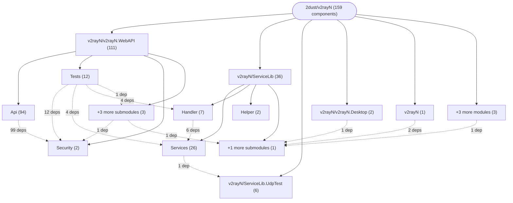
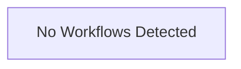

# Repository Architecture Analysis: 2dust/v2rayN

## Metadata
- **SHA**: `e3457fa4b4776d380d3bac271e63eeb42847ebaa`
- **Primary Ecosystem**: .NET

## Quality Metrics
- **avg_cyclomatic_complexity**: 9.96
- **component_count**: 159
- **files_analyzed**: 1316
- **framework**: ASP.NET Core
- **loc**: 250626
- **max_cyclomatic_complexity**: 372
- **sloc**: 208632

# Architecture: 2dust/v2rayN

## Context
- **Repository**: `2dust/v2rayN`
- **SHA**: `e3457fa4b4776d380d3bac271e63eeb42847ebaa`
- **Ecosystem**: .NET
- **Framework**: Unknown

## Building Block View

## Component Details

Showing top 60 representative components out of 159 across 8 module group(s):

- **Module `v2rayN/v2rayN.WebAPI`** (111 components — API_ROUTE: 104, SERVICE: 4, MODULE: 3)
- **Module `v2rayN/ServiceLib`** (36 components — SERVICE: 35, MODULE: 1)
- **Module `v2rayN/ServiceLib.UdpTest`** (6 components — SERVICE: 5, MODULE: 1)
- **Module `v2rayN/v2rayN.Desktop`** (2 components — MODULE: 1, SERVICE: 1)
- **Module `v2rayN`** (1 components — MODULE: 1)
- **Module `v2rayN/AmazTool`** (1 components — MODULE: 1)
- **Module `v2rayN/ServiceLib.Tests`** (1 components — MODULE: 1)
- **Module `v2rayN/v2rayN`** (1 components — MODULE: 1)

- **SpeedtestService** (`v2rayN/ServiceLib/Services/SpeedtestService.cs`): SERVICE (deps: ConnectionHandler, DownloadService, ProcessService, UdpTestService)
- **UdpTestService** (`v2rayN/ServiceLib.UdpTest/UdpTestService.cs`): SERVICE (deps: DnsService, McBeService, NtpService, StunService)
- **CoreConfigHandler** (`v2rayN/ServiceLib/Handler/CoreConfigHandler.cs`): SERVICE (deps: CoreConfigClashService, CoreConfigSingboxService, CoreConfigV2rayService)
- **ConfigHandler** (`v2rayN/ServiceLib/Handler/ConfigHandler.cs`): SERVICE (deps: DownloadService, FmtHandler)
- **GET_a** (`v2rayN/v2rayN.WebAPI/Tests/SubscriptionParityTests.cs`): API_ROUTE (deps: DownloadService, SubscriptionHandler)
- **GET_api_setup_status** (`v2rayN/v2rayN.WebAPI/Api/WebSetupEndpoints.cs`): API_ROUTE (deps: WebAuthService, WebSessionService)
- **GET_api_test_download** (`v2rayN/v2rayN.WebAPI/Tests/WebCorsTests.cs`): API_ROUTE (deps: WebAuthService, WebSessionService)
- **GET_api_test_runtime-failure** (`v2rayN/v2rayN.WebAPI/Tests/WebAuthEndpointTests.cs`): API_ROUTE (deps: WebAuthService, WebSessionService)
- **GET_api_test_session** (`v2rayN/v2rayN.WebAPI/Tests/WebAuthEndpointTests.cs`): API_ROUTE (deps: WebAuthService, WebSessionService)
- **GET_api_test_session** (`v2rayN/v2rayN.WebAPI/Tests/WebCorsTests.cs`): API_ROUTE (deps: WebAuthService, WebSessionService)
- **GET_b** (`v2rayN/v2rayN.WebAPI/Tests/SubscriptionParityTests.cs`): API_ROUTE (deps: DownloadService, SubscriptionHandler)
- **GET_convert** (`v2rayN/v2rayN.WebAPI/Tests/SubscriptionParityTests.cs`): API_ROUTE (deps: DownloadService, SubscriptionHandler)
- **GET_login-limited** (`v2rayN/v2rayN.WebAPI/Tests/WebAuthRateLimitTests.cs`): API_ROUTE (deps: WebAuthService, WebSessionService)
- **GET_main** (`v2rayN/v2rayN.WebAPI/Tests/SubscriptionParityTests.cs`): API_ROUTE (deps: DownloadService, SubscriptionHandler)
- **GET_setup-limited** (`v2rayN/v2rayN.WebAPI/Tests/WebAuthRateLimitTests.cs`): API_ROUTE (deps: WebAuthService, WebSessionService)
- **POST_api_auth_login** (`v2rayN/v2rayN.WebAPI/Api/WebAuthEndpoints.cs`): API_ROUTE (deps: WebAuthService, WebSessionService)
- **POST_api_auth_logout** (`v2rayN/v2rayN.WebAPI/Api/WebAuthEndpoints.cs`): API_ROUTE (deps: WebAuthService, WebSessionService)
- **POST_api_auth_sse-ticket** (`v2rayN/v2rayN.WebAPI/Api/WebAuthEndpoints.cs`): API_ROUTE (deps: WebAuthService, WebSessionService)
- **POST_api_setup** (`v2rayN/v2rayN.WebAPI/Api/WebSetupEndpoints.cs`): API_ROUTE (deps: WebAuthService, WebSessionService)
- **SubscriptionHandler** (`v2rayN/ServiceLib/Handler/SubscriptionHandler.cs`): SERVICE (deps: ConfigHandler, DownloadService)
- **v2rayN.Desktop** (`v2rayN/v2rayN.Desktop/v2rayN.Desktop.csproj`): MODULE (deps: GlobalHotKeys, ServiceLib)
- **v2rayN.WebAPI.Tests** (`v2rayN/v2rayN.WebAPI/Tests/v2rayN.WebAPI.Tests.csproj`): MODULE (deps: InstanceLockProcessHelper, v2rayN.WebAPI)
- **ConnectionHandler** (`v2rayN/ServiceLib/Handler/ConnectionHandler.cs`): SERVICE (deps: DownloadService)
- **DELETE_api_logs** (`v2rayN/v2rayN.WebAPI/Api/WebApiEndpoints.cs`): API_ROUTE (deps: WebSessionService)
- **DELETE_api_profiles** (`v2rayN/v2rayN.WebAPI/Api/WebApiEndpoints.cs`): API_ROUTE (deps: WebSessionService)
- **DELETE_api_profiles_invalid-test-results** (`v2rayN/v2rayN.WebAPI/Api/WebApiEndpoints.cs`): API_ROUTE (deps: WebSessionService)
- **DELETE_api_settings_routing-profiles_{id}** (`v2rayN/v2rayN.WebAPI/Api/WebApiEndpoints.cs`): API_ROUTE (deps: WebSessionService)
- **DELETE_api_settings_routing-profiles_{id}_rules_{ruleId}** (`v2rayN/v2rayN.WebAPI/Api/WebApiEndpoints.cs`): API_ROUTE (deps: WebSessionService)
- **DELETE_api_speedtests** (`v2rayN/v2rayN.WebAPI/Api/WebApiEndpoints.cs`): API_ROUTE (deps: WebSessionService)
- **DELETE_api_statistics** (`v2rayN/v2rayN.WebAPI/Api/WebApiEndpoints.cs`): API_ROUTE (deps: WebSessionService)
- **DELETE_api_subscriptions_{id}** (`v2rayN/v2rayN.WebAPI/Api/WebApiEndpoints.cs`): API_ROUTE (deps: WebSessionService)
- **GET_api_backup_download** (`v2rayN/v2rayN.WebAPI/Api/WebApiEndpoints.cs`): API_ROUTE (deps: WebSessionService)
- **GET_api_core-updates** (`v2rayN/v2rayN.WebAPI/Api/WebApiEndpoints.cs`): API_ROUTE (deps: WebSessionService)
- **GET_api_core-updates_progress** (`v2rayN/v2rayN.WebAPI/Api/WebApiEndpoints.cs`): API_ROUTE (deps: WebSessionService)
- **GET_api_core-updates_{coreType}_check** (`v2rayN/v2rayN.WebAPI/Api/WebApiEndpoints.cs`): API_ROUTE (deps: WebSessionService)
- **GET_api_core_xray_check-update** (`v2rayN/v2rayN.WebAPI/Api/WebApiEndpoints.cs`): API_ROUTE (deps: WebSessionService)
- **GET_api_editor-options** (`v2rayN/v2rayN.WebAPI/Api/WebApiEndpoints.cs`): API_ROUTE (deps: WebSessionService)
- **GET_api_events** (`v2rayN/v2rayN.WebAPI/Api/WebApiEndpoints.cs`): API_ROUTE (deps: WebSessionService)
- **GET_api_health** (`v2rayN/v2rayN.WebAPI/Api/WebApiEndpoints.cs`): API_ROUTE (deps: WebSessionService)
- **GET_api_logs** (`v2rayN/v2rayN.WebAPI/Api/WebApiEndpoints.cs`): API_ROUTE (deps: WebSessionService)
- **GET_api_logs_page** (`v2rayN/v2rayN.WebAPI/Api/WebApiEndpoints.cs`): API_ROUTE (deps: WebSessionService)
- **GET_api_operations** (`v2rayN/v2rayN.WebAPI/Api/WebApiEndpoints.cs`): API_ROUTE (deps: WebSessionService)
- **GET_api_profile-groups** (`v2rayN/v2rayN.WebAPI/Api/WebApiEndpoints.cs`): API_ROUTE (deps: WebSessionService)
- **GET_api_profiles** (`v2rayN/v2rayN.WebAPI/Api/WebApiEndpoints.cs`): API_ROUTE (deps: WebSessionService)
- **GET_api_profiles_{id}** (`v2rayN/v2rayN.WebAPI/Api/WebApiEndpoints.cs`): API_ROUTE (deps: WebSessionService)
- **GET_api_settings** (`v2rayN/v2rayN.WebAPI/Api/WebApiEndpoints.cs`): API_ROUTE (deps: WebSessionService)
- **GET_api_settings_core-templates** (`v2rayN/v2rayN.WebAPI/Api/WebApiEndpoints.cs`): API_ROUTE (deps: WebSessionService)
- **GET_api_settings_dns_defaults** (`v2rayN/v2rayN.WebAPI/Api/WebApiEndpoints.cs`): API_ROUTE (deps: WebSessionService)
- **GET_api_settings_dns_editor-options** (`v2rayN/v2rayN.WebAPI/Api/WebApiEndpoints.cs`): API_ROUTE (deps: WebSessionService)
- **GET_api_settings_dns_profiles** (`v2rayN/v2rayN.WebAPI/Api/WebApiEndpoints.cs`): API_ROUTE (deps: WebSessionService)
- **GET_api_settings_dns_simple** (`v2rayN/v2rayN.WebAPI/Api/WebApiEndpoints.cs`): API_ROUTE (deps: WebSessionService)
- **GET_api_settings_routing-profiles** (`v2rayN/v2rayN.WebAPI/Api/WebApiEndpoints.cs`): API_ROUTE (deps: WebSessionService)
- **GET_api_settings_routing-profiles_{id}_rules** (`v2rayN/v2rayN.WebAPI/Api/WebApiEndpoints.cs`): API_ROUTE (deps: WebSessionService)
- **GET_api_settings_webdav** (`v2rayN/v2rayN.WebAPI/Api/WebApiEndpoints.cs`): API_ROUTE (deps: WebSessionService)
- **GET_api_status** (`v2rayN/v2rayN.WebAPI/Api/WebApiEndpoints.cs`): API_ROUTE (deps: WebSessionService)
- **GET_api_subscriptions** (`v2rayN/v2rayN.WebAPI/Api/WebApiEndpoints.cs`): API_ROUTE (deps: WebSessionService)
- **GET_api_subscriptions_{id}_share** (`v2rayN/v2rayN.WebAPI/Api/WebApiEndpoints.cs`): API_ROUTE (deps: WebSessionService)
- **GET_api_web-updates** (`v2rayN/v2rayN.WebAPI/Api/WebApiEndpoints.cs`): API_ROUTE (deps: WebSessionService)
- **GET_api_web-updates_check** (`v2rayN/v2rayN.WebAPI/Api/WebApiEndpoints.cs`): API_ROUTE (deps: WebSessionService)
- **POST_api_backup_restore** (`v2rayN/v2rayN.WebAPI/Api/WebApiEndpoints.cs`): API_ROUTE (deps: WebSessionService)

## CI/CD Pipeline Topology

