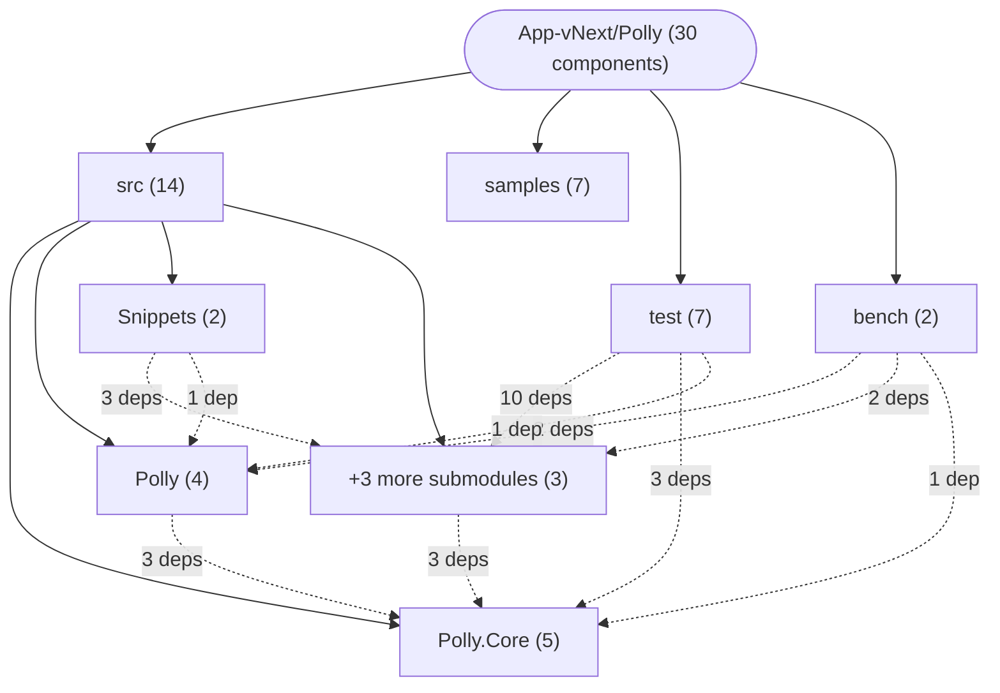
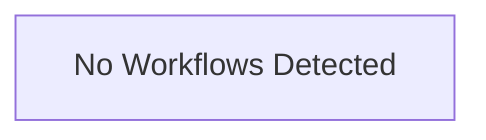

# Repository Architecture Analysis: App-vNext/Polly

## Metadata
- **SHA**: `88f2039c1d865158a91fe05b8ac23d73a88a9092`
- **Primary Ecosystem**: .NET

## Quality Metrics
- **avg_cyclomatic_complexity**: 3.84
- **component_count**: 30
- **files_analyzed**: 1594
- **framework**: ASP.NET Core
- **loc**: 212306
- **max_cyclomatic_complexity**: 182
- **sloc**: 144446

# Architecture: App-vNext/Polly

## Context
- **Repository**: `App-vNext/Polly`
- **SHA**: `88f2039c1d865158a91fe05b8ac23d73a88a9092`
- **Ecosystem**: .NET
- **Framework**: Unknown

## Building Block View

## Component Details
- **Polly.Benchmarks** (`bench/Polly.Benchmarks/Polly.Benchmarks.csproj`): MODULE (deps: Polly)
- **Polly.Core.Benchmarks** (`bench/Polly.Core.Benchmarks/Polly.Core.Benchmarks.csproj`): MODULE (deps: Polly, Polly.Core, Polly.Extensions, Polly.RateLimiting)
- **Chaos** (`samples/Chaos/Chaos.csproj`): MODULE
- **DependencyInjection** (`samples/DependencyInjection/DependencyInjection.csproj`): MODULE
- **Extensibility** (`samples/Extensibility/Extensibility.csproj`): MODULE
- **GenericPipelines** (`samples/GenericPipelines/GenericPipelines.csproj`): MODULE
- **Intro** (`samples/Intro/Intro.csproj`): MODULE
- **Retries** (`samples/Retries/Retries.csproj`): MODULE
- **Polly** (`src/Polly/Polly.csproj`): MODULE (deps: Polly.Core)
- **Polly.Core** (`src/Polly.Core/Polly.Core.csproj`): MODULE
- **Polly.Extensions** (`src/Polly.Extensions/Polly.Extensions.csproj`): MODULE (deps: Polly.Core)
- **Polly.RateLimiting** (`src/Polly.RateLimiting/Polly.RateLimiting.csproj`): MODULE (deps: Polly.Core)
- **Polly.Testing** (`src/Polly.Testing/Polly.Testing.csproj`): MODULE (deps: Polly.Core)
- **Snippets** (`src/Snippets/Snippets.csproj`): MODULE (deps: Polly, Polly.Extensions, Polly.RateLimiting, Polly.Testing)
- **Polly.AotTest** (`test/Polly.AotTest/Polly.AotTest.csproj`): MODULE (deps: Polly.Core, Polly.Extensions, Polly.RateLimiting)
- **Polly.Core.Tests** (`test/Polly.Core.Tests/Polly.Core.Tests.csproj`): MODULE (deps: Polly.Core, Polly.TestUtils, Polly.Testing)
- **Polly.Extensions.Tests** (`test/Polly.Extensions.Tests/Polly.Extensions.Tests.csproj`): MODULE (deps: Polly.Extensions, Polly.RateLimiting, Polly.TestUtils)
- **Polly.RateLimiting.Tests** (`test/Polly.RateLimiting.Tests/Polly.RateLimiting.Tests.csproj`): MODULE (deps: Polly.RateLimiting, Polly.TestUtils, Polly.Testing)
- **Polly.Specs** (`test/Polly.Specs/Polly.Specs.csproj`): MODULE (deps: Polly, Polly.TestUtils)
- **Polly.TestUtils** (`test/Polly.TestUtils/Polly.TestUtils.csproj`): MODULE (deps: Polly.Core)
- **Polly.Testing.Tests** (`test/Polly.Testing.Tests/Polly.Testing.Tests.csproj`): MODULE (deps: Polly.Extensions, Polly.RateLimiting, Polly.Testing)
- **GET_root** (`samples/Chaos/Program.cs`): API_ROUTE
- **CircuitStateController** (`src/Polly.Core/CircuitBreaker/Controller/CircuitStateController.cs`): API_ROUTE
- **FallbackHandler** (`src/Polly.Core/Fallback/FallbackHandler.cs`): SERVICE
- **HedgingController** (`src/Polly.Core/Hedging/Controller/HedgingController.cs`): API_ROUTE (deps: HedgingHandler)
- **HedgingHandler** (`src/Polly.Core/Hedging/Controller/HedgingHandler.cs`): SERVICE
- **AdvancedCircuitController** (`src/Polly/CircuitBreaker/AdvancedCircuitController.cs`): API_ROUTE (deps: CircuitStateController)
- **CircuitStateController** (`src/Polly/CircuitBreaker/CircuitStateController.cs`): API_ROUTE
- **ConsecutiveCountCircuitController** (`src/Polly/CircuitBreaker/ConsecutiveCountCircuitController.cs`): API_ROUTE (deps: CircuitStateController)
- **HedgingHandler** (`src/Snippets/Docs/Hedging.cs`): SERVICE

## CI/CD Pipeline Topology

