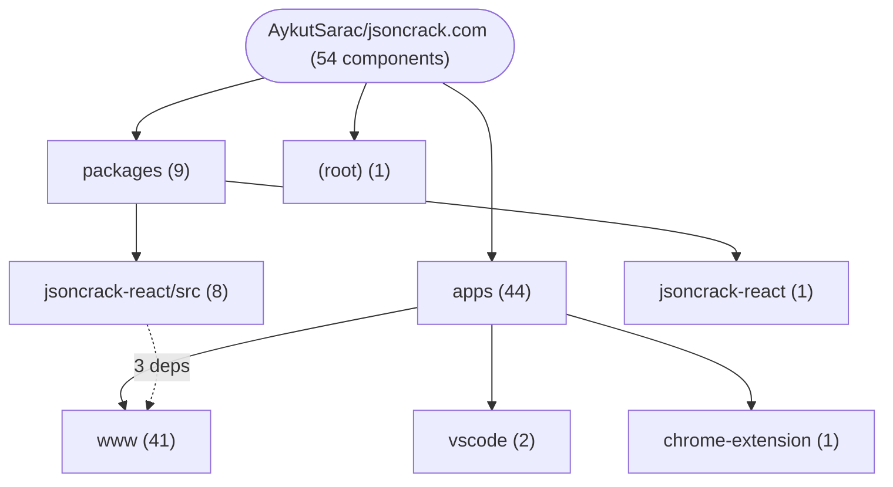
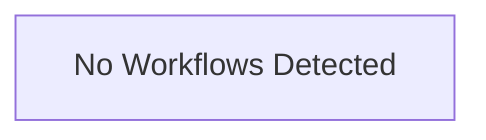

# Repository Architecture Analysis: AykutSarac/jsoncrack.com

## Metadata
- **SHA**: `a46d0d0adb098e12e577a083e87ead7f61f90098`
- **Primary Ecosystem**: JavaScript/TypeScript

## Quality Metrics
- **avg_cyclomatic_complexity**: 8.55
- **component_count**: 54
- **files_analyzed**: 226
- **framework**: Next.js
- **loc**: 19384
- **max_cyclomatic_complexity**: 70
- **sloc**: 17084

# Architecture: AykutSarac/jsoncrack.com

## Context
- **Repository**: `AykutSarac/jsoncrack.com`
- **SHA**: `a46d0d0adb098e12e577a083e87ead7f61f90098`
- **Ecosystem**: JavaScript/TypeScript
- **Framework**: Unknown

## Building Block View

## Component Details
- **chrome-extension** (`apps/chrome-extension/package.json`): MODULE
- **jsoncrack-vscode** (`apps/vscode/package.json`): MODULE
- **www** (`apps/www/package.json`): MODULE
- **jsoncrack-monorepo** (`package.json`): MODULE
- **jsoncrack-react** (`packages/jsoncrack-react/package.json`): MODULE
- **NodeModal** (`apps/vscode/src/components/NodeModal.tsx`): UI_COMPONENT
- **BottomBar** (`apps/www/src/features/editor/BottomBar.tsx`): UI_COMPONENT
- **FullscreenDropzone** (`apps/www/src/features/editor/FullscreenDropzone.tsx`): UI_COMPONENT
- **FileMenu** (`apps/www/src/features/editor/Toolbar/FileMenu.tsx`): UI_COMPONENT
- **SearchInput** (`apps/www/src/features/editor/Toolbar/SearchInput.tsx`): UI_COMPONENT
- **ThemeToggle** (`apps/www/src/features/editor/Toolbar/ThemeToggle.tsx`): UI_COMPONENT
- **ToolsMenu** (`apps/www/src/features/editor/Toolbar/ToolsMenu.tsx`): UI_COMPONENT
- **ViewMenu** (`apps/www/src/features/editor/Toolbar/ViewMenu.tsx`): UI_COMPONENT
- **Toolbar** (`apps/www/src/features/editor/Toolbar/index.tsx`): UI_COMPONENT (deps: FileMenu, JSONCrackLogo, ThemeToggle, ToolsMenu, ViewMenu)
- **CustomEdge** (`apps/www/src/features/editor/views/GraphView/CustomEdge/index.tsx`): UI_COMPONENT
- **NotSupported** (`apps/www/src/features/editor/views/GraphView/NotSupported.tsx`): UI_COMPONENT
- **OpenInToDiagram** (`apps/www/src/features/editor/views/GraphView/OpenInToDiagram.tsx`): UI_COMPONENT
- **SecureInfo** (`apps/www/src/features/editor/views/GraphView/SecureInfo.tsx`): UI_COMPONENT
- **Toolbar** (`apps/www/src/features/editor/views/GraphView/Toolbar/index.tsx`): UI_COMPONENT (deps: SearchInput)
- **GraphView** (`apps/www/src/features/editor/views/GraphView/index.tsx`): UI_COMPONENT (deps: NotSupported, OpenInToDiagram, SecureInfo)
- **Label** (`apps/www/src/features/editor/views/TreeView/Label.tsx`): UI_COMPONENT
- **TextRenderer** (`apps/www/src/features/editor/views/TreeView/TextRenderer.tsx`): UI_COMPONENT
- **Value** (`apps/www/src/features/editor/views/TreeView/Value.tsx`): UI_COMPONENT (deps: TextRenderer)
- **TreeView** (`apps/www/src/features/editor/views/TreeView/index.tsx`): UI_COMPONENT (deps: Label, Value)
- **DownloadModal** (`apps/www/src/features/modals/DownloadModal/index.tsx`): UI_COMPONENT
- **EditorChoiceModal** (`apps/www/src/features/modals/EditorChoiceModal/index.tsx`): UI_COMPONENT
- **ImportModal** (`apps/www/src/features/modals/ImportModal/index.tsx`): UI_COMPONENT
- **JPathModal** (`apps/www/src/features/modals/JPathModal/index.tsx`): UI_COMPONENT
- **JQModal** (`apps/www/src/features/modals/JQModal/index.tsx`): UI_COMPONENT
- **NodeModal** (`apps/www/src/features/modals/NodeModal/index.tsx`): UI_COMPONENT
- **SchemaModal** (`apps/www/src/features/modals/SchemaModal/index.tsx`): UI_COMPONENT
- **TypeModal** (`apps/www/src/features/modals/TypeModal/index.tsx`): UI_COMPONENT
- **JSONCrackLogo** (`apps/www/src/layout/JSONCrackBrandLogo.tsx`): UI_COMPONENT
- **FAQ** (`apps/www/src/layout/Landing/FAQ.tsx`): UI_COMPONENT
- **Features** (`apps/www/src/layout/Landing/Features.tsx`): UI_COMPONENT
- **HeroPreview** (`apps/www/src/layout/Landing/HeroPreview.tsx`): UI_COMPONENT
- **HeroSection** (`apps/www/src/layout/Landing/HeroSection.tsx`): UI_COMPONENT
- **Section1** (`apps/www/src/layout/Landing/Section1.tsx`): UI_COMPONENT
- **Section2** (`apps/www/src/layout/Landing/Section2.tsx`): UI_COMPONENT
- **Section3** (`apps/www/src/layout/Landing/Section3.tsx`): UI_COMPONENT
- **Footer** (`apps/www/src/layout/PageLayout/Footer.tsx`): UI_COMPONENT (deps: JSONCrackLogo)
- **Navbar** (`apps/www/src/layout/PageLayout/Navbar.tsx`): UI_COMPONENT (deps: JSONCrackLogo)
- **StyledPageWrapper** (`apps/www/src/pages/editor.tsx`): UI_COMPONENT (deps: BottomBar, FullscreenDropzone)
- **StyledEditorWrapper** (`apps/www/src/pages/editor.tsx`): UI_COMPONENT (deps: BottomBar, FullscreenDropzone)
- **StyledEditor** (`apps/www/src/pages/editor.tsx`): UI_COMPONENT (deps: BottomBar, FullscreenDropzone)
- **HomePage** (`apps/www/src/pages/index.tsx`): UI_COMPONENT (deps: FAQ, Features, HeroPreview, HeroSection, Section1, Section2, Section3)
- **JSONCrack** (`packages/jsoncrack-react/src/JSONCrackComponent.tsx`): UI_COMPONENT (deps: CollapseContext, Controls, CustomEdge, CustomNode)
- **CollapseContext** (`packages/jsoncrack-react/src/components/CollapseContext.ts`): UI_COMPONENT
- **Controls** (`packages/jsoncrack-react/src/components/Controls.tsx`): UI_COMPONENT
- **CustomEdge** (`packages/jsoncrack-react/src/components/CustomEdge.tsx`): UI_COMPONENT
- **CustomNode** (`packages/jsoncrack-react/src/components/CustomNode.tsx`): UI_COMPONENT (deps: ObjectNode, TextNode)
- **ObjectNode** (`packages/jsoncrack-react/src/components/ObjectNode.tsx`): UI_COMPONENT (deps: CollapseContext, TextRenderer)
- **TextNode** (`packages/jsoncrack-react/src/components/TextNode.tsx`): UI_COMPONENT (deps: TextRenderer)
- **TextRenderer** (`packages/jsoncrack-react/src/components/TextRenderer.tsx`): UI_COMPONENT

## CI/CD Pipeline Topology

