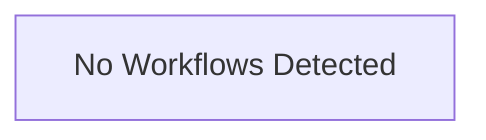

# Repository Architecture Analysis: Azure-Samples/todo-nodejs-mongo-terraform

## Metadata
- **SHA**: `8a0fc6ba6d225476afacd29ad74262e2abd7588a`
- **Primary Ecosystem**: JavaScript/TypeScript

## Quality Metrics
- **avg_cyclomatic_complexity**: 5.29
- **component_count**: 23
- **files_analyzed**: 53
- **framework**: React (Vite)
- **loc**: 2744
- **max_cyclomatic_complexity**: 27
- **sloc**: 2238

# Architecture: Azure-Samples/todo-nodejs-mongo-terraform

## Context
- **Repository**: `Azure-Samples/todo-nodejs-mongo-terraform`
- **SHA**: `8a0fc6ba6d225476afacd29ad74262e2abd7588a`
- **Ecosystem**: JavaScript/TypeScript
- **Framework**: Unknown

## Building Block View

```mermaid
graph TD;
    todo_node_ts_express_mongo["todo-node-ts-express-mongo : MODULE"]
    GET_root["GET_root : API_ROUTE"]
    POST_root["POST_root : API_ROUTE"]
    GET__itemId["GET_:itemId : API_ROUTE"]
    PUT__itemId["PUT_:itemId : API_ROUTE"]
    DELETE__itemId["DELETE_:itemId : API_ROUTE"]
    GET_state__state["GET_state_:state : API_ROUTE"]
    PUT_state__state["PUT_state_:state : API_ROUTE"]
    GET__listId["GET_:listId : API_ROUTE"]
    PUT__listId["PUT_:listId : API_ROUTE"]
    DELETE__listId["DELETE_:listId : API_ROUTE"]
    todo_vite["todo-vite : MODULE"]
    TelemetryProvider["TelemetryProvider : UI_COMPONENT"]
    TelemetryConsumer["TelemetryConsumer : UI_COMPONENT"]
    TodoContext["TodoContext : UI_COMPONENT"]
    TodoItemDetailPane["TodoItemDetailPane : UI_COMPONENT"]
    ItemService["ItemService : SERVICE"]
    ListService["ListService : SERVICE"]
    RestService["RestService : SERVICE"]
    DarkTheme["DarkTheme : UI_COMPONENT"]
    tests["tests : MODULE"]
    repo_root(["Azure-Samples/todo-nodejs-mongo-terraform"])
    repo_root --> DELETE__itemId
    repo_root --> DELETE__listId
    repo_root --> DarkTheme
    repo_root --> GET__itemId
    repo_root --> GET__listId
    repo_root --> GET_root
    repo_root --> GET_state__state
    repo_root --> POST_root
    repo_root --> PUT__itemId
    repo_root --> PUT__listId
    repo_root --> PUT_state__state
    repo_root --> TelemetryConsumer
    repo_root --> TelemetryProvider
    repo_root --> TodoContext
    repo_root --> TodoItemDetailPane
    repo_root --> tests
    repo_root --> todo_node_ts_express_mongo
    repo_root --> todo_vite
    ItemService --> RestService
    ListService --> RestService
```

## Component Details
- **todo-node-ts-express-mongo** (`src/api/package.json`): MODULE
- **GET_root** (`src/api/src/routes/items.ts`): API_ROUTE
- **POST_root** (`src/api/src/routes/items.ts`): API_ROUTE
- **GET_:itemId** (`src/api/src/routes/items.ts`): API_ROUTE
- **PUT_:itemId** (`src/api/src/routes/items.ts`): API_ROUTE
- **DELETE_:itemId** (`src/api/src/routes/items.ts`): API_ROUTE
- **GET_state_:state** (`src/api/src/routes/items.ts`): API_ROUTE
- **PUT_state_:state** (`src/api/src/routes/items.ts`): API_ROUTE
- **GET_root** (`src/api/src/routes/lists.ts`): API_ROUTE
- **POST_root** (`src/api/src/routes/lists.ts`): API_ROUTE
- **GET_:listId** (`src/api/src/routes/lists.ts`): API_ROUTE
- **PUT_:listId** (`src/api/src/routes/lists.ts`): API_ROUTE
- **DELETE_:listId** (`src/api/src/routes/lists.ts`): API_ROUTE
- **todo-vite** (`src/web/package.json`): MODULE
- **TelemetryProvider** (`src/web/src/components/telemetryContext.ts`): UI_COMPONENT
- **TelemetryConsumer** (`src/web/src/components/telemetryContext.ts`): UI_COMPONENT
- **TodoContext** (`src/web/src/components/todoContext.ts`): UI_COMPONENT
- **TodoItemDetailPane** (`src/web/src/components/todoItemDetailPane.tsx`): UI_COMPONENT
- **ItemService** (`src/web/src/services/itemService.ts`): SERVICE (deps: RestService)
- **ListService** (`src/web/src/services/listService.ts`): SERVICE (deps: RestService)
- **RestService** (`src/web/src/services/restService.ts`): SERVICE
- **DarkTheme** (`src/web/src/ux/theme.ts`): UI_COMPONENT
- **tests** (`tests/package.json`): MODULE

## CI/CD Pipeline Topology

