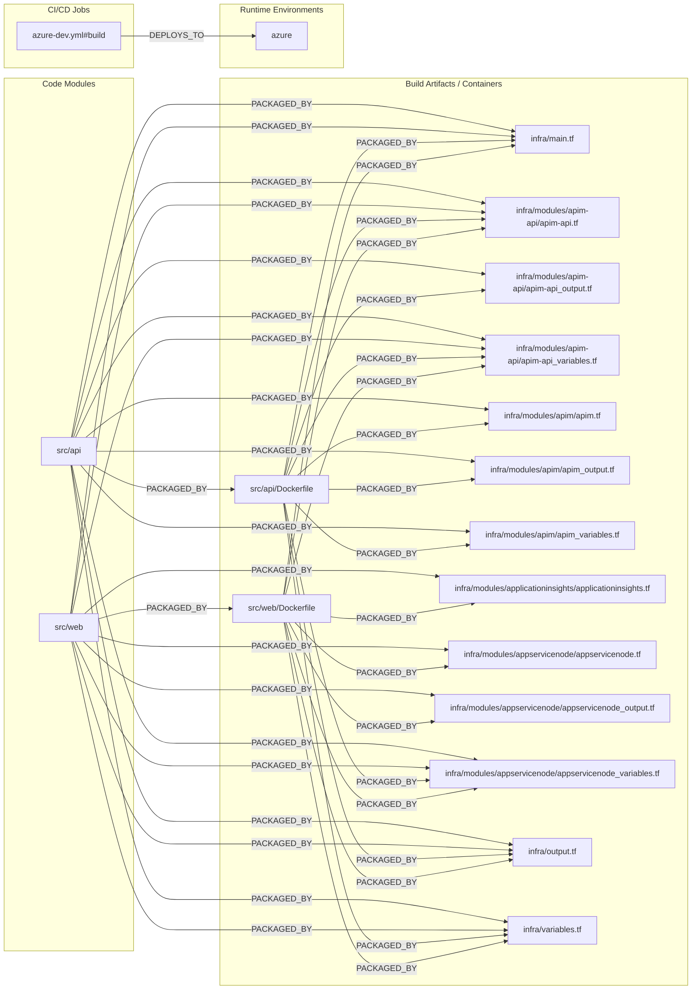
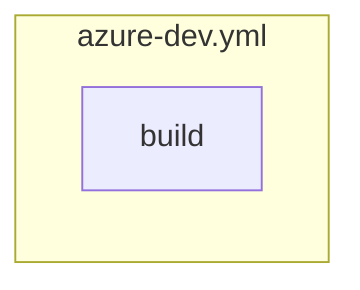

# Repository Architecture Analysis: Azure-Samples/todo-nodejs-mongo-terraform

## Metadata
- **SHA**: `8a0fc6ba6d225476afacd29ad74262e2abd7588a`
- **Primary Ecosystem**: JavaScript/TypeScript

## Quality Metrics
- **ast_engine**: tree-sitter
- **avg_cognitive_complexity**: 3.68
- **avg_cyclomatic_complexity**: 3.5
- **component_count**: 23
- **dead_code_count**: 6
- **dead_code_symbols**: 6 entry(ies)
- **duplication_pct**: 60.36
- **file_complexities**: 25 entry(ies)
- **files_analyzed**: 53
- **fitness_passed**: False
- **fitness_violation_count**: 3
- **framework**: React (Vite)
- **import_edges**: 100 entry(ies)
- **loc**: 2744
- **max_cognitive_complexity**: 29
- **max_cyclomatic_complexity**: 22
- **sloc**: 2238
- **test_file_count**: 7

# Architecture: Azure-Samples/todo-nodejs-mongo-terraform

## Context
- **Repository**: `Azure-Samples/todo-nodejs-mongo-terraform`
- **SHA**: `8a0fc6ba6d225476afacd29ad74262e2abd7588a`
- **Ecosystem**: JavaScript/TypeScript
- **Framework**: React (Vite)

## Building Block View

```mermaid
graph TD;
    todo_node_ts_express_mongo["todo-node-ts-express-mongo : MODULE"]
    GET_root["GET_root : API_ROUTE"]
    POST_root["POST_root : API_ROUTE"]
    GET__itemId["GET_:itemId : API_ROUTE"]
    PUT__itemId["PUT_:itemId : API_ROUTE"]
    DELETE__itemId["DELETE_:itemId : API_ROUTE"]
    GET_state__state["GET_state_:state : API_ROUTE"]
    PUT_state__state["PUT_state_:state : API_ROUTE"]
    GET__listId["GET_:listId : API_ROUTE"]
    PUT__listId["PUT_:listId : API_ROUTE"]
    DELETE__listId["DELETE_:listId : API_ROUTE"]
    todo_vite["todo-vite : MODULE"]
    TelemetryProvider["TelemetryProvider : UI_COMPONENT"]
    TelemetryConsumer["TelemetryConsumer : UI_COMPONENT"]
    TodoContext["TodoContext : UI_COMPONENT"]
    TodoItemDetailPane["TodoItemDetailPane : UI_COMPONENT"]
    ItemService["ItemService : SERVICE"]
    ListService["ListService : SERVICE"]
    RestService["RestService : SERVICE"]
    DarkTheme["DarkTheme : UI_COMPONENT"]
    tests["tests : MODULE"]
    repo_root(["Azure-Samples/todo-nodejs-mongo-terraform"])
    repo_root --> DELETE__itemId
    repo_root --> DELETE__listId
    repo_root --> DarkTheme
    repo_root --> GET__itemId
    repo_root --> GET__listId
    repo_root --> GET_root
    repo_root --> GET_state__state
    repo_root --> POST_root
    repo_root --> PUT__itemId
    repo_root --> PUT__listId
    repo_root --> PUT_state__state
    repo_root --> TelemetryConsumer
    repo_root --> TelemetryProvider
    repo_root --> TodoContext
    repo_root --> TodoItemDetailPane
    repo_root --> tests
    repo_root --> todo_node_ts_express_mongo
    repo_root --> todo_vite
    ItemService --> RestService
    ListService --> RestService
```

## Component Details
- **todo-node-ts-express-mongo** (`src/api/package.json`): MODULE
- **GET_root** (`src/api/src/routes/items.ts`): API_ROUTE
- **POST_root** (`src/api/src/routes/items.ts`): API_ROUTE
- **GET_:itemId** (`src/api/src/routes/items.ts`): API_ROUTE
- **PUT_:itemId** (`src/api/src/routes/items.ts`): API_ROUTE
- **DELETE_:itemId** (`src/api/src/routes/items.ts`): API_ROUTE
- **GET_state_:state** (`src/api/src/routes/items.ts`): API_ROUTE
- **PUT_state_:state** (`src/api/src/routes/items.ts`): API_ROUTE
- **GET_root** (`src/api/src/routes/lists.ts`): API_ROUTE
- **POST_root** (`src/api/src/routes/lists.ts`): API_ROUTE
- **GET_:listId** (`src/api/src/routes/lists.ts`): API_ROUTE
- **PUT_:listId** (`src/api/src/routes/lists.ts`): API_ROUTE
- **DELETE_:listId** (`src/api/src/routes/lists.ts`): API_ROUTE
- **todo-vite** (`src/web/package.json`): MODULE
- **TelemetryProvider** (`src/web/src/components/telemetryContext.ts`): UI_COMPONENT
- **TelemetryConsumer** (`src/web/src/components/telemetryContext.ts`): UI_COMPONENT
- **TodoContext** (`src/web/src/components/todoContext.ts`): UI_COMPONENT
- **TodoItemDetailPane** (`src/web/src/components/todoItemDetailPane.tsx`): UI_COMPONENT
- **ItemService** (`src/web/src/services/itemService.ts`): SERVICE (deps: RestService)
- **ListService** (`src/web/src/services/listService.ts`): SERVICE (deps: RestService)
- **RestService** (`src/web/src/services/restService.ts`): SERVICE
- **DarkTheme** (`src/web/src/ux/theme.ts`): UI_COMPONENT
- **tests** (`tests/package.json`): MODULE

## 6-Dimension Repository Scorecard

- **Overall Grade**: `D` (60.62/100)
- **Technical Debt Score**: 39.38
- **Estimated Remediation Effort**: 40.92h

| Dimension | Grade | Score | Weight | Details |
| :--- | :---: | :---: | :---: | :--- |
| Code Quality | `F` | 50.50 | 0.20 | avg_cc=3.50, max_cc=22, duplication=60.36%, dead_code=6 |
| Dependency Health | `A` | 100.00 | 0.15 | dependencies=1356, outdated=0, vulnerable=0, has_lockfile=True |
| Maintainability | `D` | 68.50 | 0.15 | avg_cognitive=3.68, max_cognitive=29, fitness_violations=3, oversized_files=0 |
| Pipeline Health | `C` | 77.00 | 0.15 | workflows=1, operational_antipatterns=2, parallel_branches=False |
| Security | `F` | 16.00 | 0.20 | vulnerabilities=0, secrets=0, pipeline_security_findings=7 |
| Test Coverage | `C` | 70.00 | 0.15 | coverage=unavailable, ci_test_job=False, test_files_detected=True |

## Architecture Fitness & Workspace Boundaries

- **[MEDIUM] `ATRUSS-ARCH-005` (COMPLEXITY_THRESHOLD)**: Repository duplication_pct (60.36) exceeds policy threshold (15.0).
- **[MEDIUM] `ATRUSS-ARCH-005` (COMPLEXITY_THRESHOLD)**: Repository max_cognitive_complexity (29.0) exceeds policy threshold (25.0).
- **[MEDIUM] `ATRUSS-ARCH-005` (COMPLEXITY_THRESHOLD)**: Repository max_cyclomatic_complexity (22.0) exceeds policy threshold (20.0).

## Supply Chain Dependencies, Vulnerabilities & Secrets

- **Dependencies Parsed**: 1356 | **Vulnerabilities**: 0 | **Secrets**: 0

### Inventory Sample
- `@azure/identity` `4.2.1` (npm, `src/api/package-lock.json`)
- `@azure/identity` `4.2.1` (npm, `src/api/package.json`)
- `@azure/keyvault-secrets` `4.7.0` (npm, `src/api/package.json`)
- `@azure/keyvault-secrets` `4.8.0` (npm, `src/api/package-lock.json`)
- `@babel/plugin-proposal-private-property-in-object` `7.21.11` (npm, `src/web/package-lock.json`)
- `@babel/plugin-proposal-private-property-in-object` `7.21.11` (npm, `src/web/package.json`)
- `@babel/preset-env` `7.18.2` (npm, `src/api/package.json`)
- `@babel/preset-env` `7.24.0` (npm, `src/api/package-lock.json`)
- `@babel/preset-typescript` `7.17.12` (npm, `src/api/package.json`)
- `@babel/preset-typescript` `7.23.3` (npm, `src/api/package-lock.json`)
- `@fluentui/react` `8.117.2` (npm, `src/web/package-lock.json`)
- `@fluentui/react` `8.73.0` (npm, `src/web/package.json`)
- `@microsoft/applicationinsights-react-js` `17.0.3` (npm, `src/web/package.json`)
- `@microsoft/applicationinsights-react-js` `17.1.2` (npm, `src/web/package-lock.json`)
- `@microsoft/applicationinsights-web` `3.0.7` (npm, `src/web/package.json`)
- `@microsoft/applicationinsights-web` `3.1.2` (npm, `src/web/package-lock.json`)
- `@playwright/test` `1.22.2` (npm, `tests/package-lock.json`)
- `@playwright/test` `1.22.2` (npm, `tests/package.json`)
- `@types/config` `0.0.41` (npm, `src/api/package-lock.json`)
- `@types/config` `0.0.41` (npm, `src/api/package.json`)
- `@types/cors` `2.8.12` (npm, `src/api/package.json`)
- `@types/cors` `2.8.17` (npm, `src/api/package-lock.json`)
- `@types/express` `4.17.13` (npm, `src/api/package.json`)
- `@types/express` `4.17.21` (npm, `src/api/package-lock.json`)
- `@types/jest` `28.1.1` (npm, `src/api/package.json`)
- `@types/jest` `28.1.8` (npm, `src/api/package-lock.json`)
- `@types/react` `18.2.43` (npm, `src/web/package.json`)
- `@types/react` `18.2.74` (npm, `src/web/package-lock.json`)
- `@types/react-dom` `18.2.17` (npm, `src/web/package.json`)
- `@types/react-dom` `18.2.24` (npm, `src/web/package-lock.json`)
- ... (+1326 more dependencies)

## Section 7: Code-to-Cloud Deployment Traceability

- `azure-dev.yml#build` (ci_job) --[DEPLOYS_TO]--> `azure` (environment)
- `src/api` (code_module) --[PACKAGED_BY]--> `src/api/Dockerfile` (container)
- `src/api` (code_module) --[PACKAGED_BY]--> `infra/main.tf` (iac)
- `src/api` (code_module) --[PACKAGED_BY]--> `infra/modules/apim-api/apim-api.tf` (iac)
- `src/api` (code_module) --[PACKAGED_BY]--> `infra/modules/apim-api/apim-api_output.tf` (iac)
- `src/api` (code_module) --[PACKAGED_BY]--> `infra/modules/apim-api/apim-api_variables.tf` (iac)
- `src/api` (code_module) --[PACKAGED_BY]--> `infra/modules/apim/apim.tf` (iac)
- `src/api` (code_module) --[PACKAGED_BY]--> `infra/modules/apim/apim_output.tf` (iac)
- `src/api` (code_module) --[PACKAGED_BY]--> `infra/modules/apim/apim_variables.tf` (iac)
- `src/api` (code_module) --[PACKAGED_BY]--> `infra/modules/appservicenode/appservicenode_variables.tf` (iac)
- `src/api` (code_module) --[PACKAGED_BY]--> `infra/output.tf` (iac)
- `src/api` (code_module) --[PACKAGED_BY]--> `infra/variables.tf` (iac)
- `src/web` (code_module) --[PACKAGED_BY]--> `src/web/Dockerfile` (container)
- `src/web` (code_module) --[PACKAGED_BY]--> `infra/main.tf` (iac)
- `src/web` (code_module) --[PACKAGED_BY]--> `infra/modules/apim-api/apim-api.tf` (iac)
- `src/web` (code_module) --[PACKAGED_BY]--> `infra/modules/apim-api/apim-api_variables.tf` (iac)
- `src/web` (code_module) --[PACKAGED_BY]--> `infra/modules/applicationinsights/applicationinsights.tf` (iac)
- `src/web` (code_module) --[PACKAGED_BY]--> `infra/modules/appservicenode/appservicenode.tf` (iac)
- `src/web` (code_module) --[PACKAGED_BY]--> `infra/modules/appservicenode/appservicenode_output.tf` (iac)
- `src/web` (code_module) --[PACKAGED_BY]--> `infra/modules/appservicenode/appservicenode_variables.tf` (iac)
- `src/web` (code_module) --[PACKAGED_BY]--> `infra/output.tf` (iac)
- `src/web` (code_module) --[PACKAGED_BY]--> `infra/variables.tf` (iac)
- `src/api/Dockerfile` (container) --[PACKAGED_BY]--> `infra/main.tf` (iac)
- `src/api/Dockerfile` (container) --[PACKAGED_BY]--> `infra/modules/apim-api/apim-api.tf` (iac)
- `src/api/Dockerfile` (container) --[PACKAGED_BY]--> `infra/modules/apim-api/apim-api_output.tf` (iac)
- `src/api/Dockerfile` (container) --[PACKAGED_BY]--> `infra/modules/apim-api/apim-api_variables.tf` (iac)
- `src/api/Dockerfile` (container) --[PACKAGED_BY]--> `infra/modules/apim/apim.tf` (iac)
- `src/api/Dockerfile` (container) --[PACKAGED_BY]--> `infra/modules/apim/apim_output.tf` (iac)
- `src/api/Dockerfile` (container) --[PACKAGED_BY]--> `infra/modules/apim/apim_variables.tf` (iac)
- `src/api/Dockerfile` (container) --[PACKAGED_BY]--> `infra/modules/appservicenode/appservicenode_variables.tf` (iac)
- `src/api/Dockerfile` (container) --[PACKAGED_BY]--> `infra/output.tf` (iac)
- `src/api/Dockerfile` (container) --[PACKAGED_BY]--> `infra/variables.tf` (iac)
- `src/web/Dockerfile` (container) --[PACKAGED_BY]--> `infra/main.tf` (iac)
- `src/web/Dockerfile` (container) --[PACKAGED_BY]--> `infra/modules/apim-api/apim-api.tf` (iac)
- `src/web/Dockerfile` (container) --[PACKAGED_BY]--> `infra/modules/apim-api/apim-api_variables.tf` (iac)
- `src/web/Dockerfile` (container) --[PACKAGED_BY]--> `infra/modules/applicationinsights/applicationinsights.tf` (iac)
- `src/web/Dockerfile` (container) --[PACKAGED_BY]--> `infra/modules/appservicenode/appservicenode.tf` (iac)
- `src/web/Dockerfile` (container) --[PACKAGED_BY]--> `infra/modules/appservicenode/appservicenode_output.tf` (iac)
- `src/web/Dockerfile` (container) --[PACKAGED_BY]--> `infra/modules/appservicenode/appservicenode_variables.tf` (iac)
- `src/web/Dockerfile` (container) --[PACKAGED_BY]--> `infra/output.tf` (iac)

## CI/CD Pipeline Topology

