# Repository Architecture Analysis: BCUninstaller/Bulk-Crap-Uninstaller

## Metadata
- **SHA**: `30da609384c98ba6e35c6530129541ea4ff3970a`
- **Primary Ecosystem**: .NET

## Quality Metrics
- **avg_cyclomatic_complexity**: 20.72
- **component_count**: 21
- **files_analyzed**: 1125
- **framework**: ASP.NET Core
- **loc**: 249649
- **max_cyclomatic_complexity**: 1222
- **sloc**: 155638

# Architecture: BCUninstaller/Bulk-Crap-Uninstaller

## Context
- **Repository**: `BCUninstaller/Bulk-Crap-Uninstaller`
- **SHA**: `30da609384c98ba6e35c6530129541ea4ff3970a`
- **Ecosystem**: .NET
- **Framework**: Unknown

## Building Block View

```mermaid
graph TD;
    BCU_console["BCU-console : MODULE"]
    BulkCrapUninstaller["BulkCrapUninstaller : MODULE"]
    BulkCrapUninstallerTests["BulkCrapUninstallerTests : MODULE"]
    KlocTools["KlocTools : MODULE"]
    NBug["NBug : MODULE"]
    NetSettingBinder["NetSettingBinder : MODULE"]
    ObjectListView["ObjectListView : MODULE"]
    OculusHelper["OculusHelper : MODULE"]
    PortableSettingsProvider["PortableSettingsProvider : MODULE"]
    ScriptHelper["ScriptHelper : MODULE"]
    SimpleTreeMap["SimpleTreeMap : MODULE"]
    SimpleTreeMapTestApp["SimpleTreeMapTestApp : MODULE"]
    SteamHelper["SteamHelper : MODULE"]
    StoreAppHelper["StoreAppHelper : MODULE"]
    UninstallTools["UninstallTools : MODULE"]
    UninstallerAutomatizer["UninstallerAutomatizer : MODULE"]
    UniversalUninstaller["UniversalUninstaller : MODULE"]
    WinUpdateHelper["WinUpdateHelper : MODULE"]
    WindowStyleController["WindowStyleController : API_ROUTE"]
    Handler["Handler : SERVICE"]
    UninstallHandler["UninstallHandler : SERVICE"]
    repo_root(["BCUninstaller/Bulk-Crap-Uninstaller"])
    repo_root --> Handler
    repo_root --> StoreAppHelper
    repo_root --> UninstallHandler
    repo_root --> WinUpdateHelper
    repo_root --> WindowStyleController
    BCU_console --> UninstallTools
    BulkCrapUninstaller --> KlocTools
    BulkCrapUninstaller --> NBug
    BulkCrapUninstaller --> NetSettingBinder
    BulkCrapUninstaller --> ObjectListView
    BulkCrapUninstaller --> PortableSettingsProvider
    BulkCrapUninstaller --> SimpleTreeMap
    BulkCrapUninstaller --> UninstallTools
    BulkCrapUninstallerTests --> BulkCrapUninstaller
    BulkCrapUninstallerTests --> UninstallTools
    OculusHelper --> KlocTools
    ScriptHelper --> KlocTools
    SimpleTreeMap --> ObjectListView
    SimpleTreeMapTestApp --> SimpleTreeMap
    SteamHelper --> KlocTools
    UninstallTools --> KlocTools
    UninstallTools --> ObjectListView
    UninstallerAutomatizer --> KlocTools
    UninstallerAutomatizer --> UninstallTools
    UniversalUninstaller --> KlocTools
    UniversalUninstaller --> ObjectListView
```

## Component Details
- **BCU-console** (`source/BCU-console/BCU-console.csproj`): MODULE (deps: UninstallTools)
- **BulkCrapUninstaller** (`source/BulkCrapUninstaller/BulkCrapUninstaller.csproj`): MODULE (deps: KlocTools, NBug, NetSettingBinder, ObjectListView, PortableSettingsProvider, SimpleTreeMap, UninstallTools)
- **BulkCrapUninstallerTests** (`source/BulkCrapUninstallerTests/BulkCrapUninstallerTests.csproj`): MODULE (deps: BulkCrapUninstaller, UninstallTools)
- **KlocTools** (`source/KlocTools/KlocTools.csproj`): MODULE
- **NBug** (`source/NBug_custom/NBug.csproj`): MODULE
- **NetSettingBinder** (`source/NetSettingBinder/NetSettingBinder.csproj`): MODULE
- **ObjectListView** (`source/ObjectListView/ObjectListView.csproj`): MODULE
- **OculusHelper** (`source/OculusHelper/OculusHelper.csproj`): MODULE (deps: KlocTools)
- **PortableSettingsProvider** (`source/PortableSettingsProvider/PortableSettingsProvider.csproj`): MODULE
- **ScriptHelper** (`source/ScriptHelper/ScriptHelper.csproj`): MODULE (deps: KlocTools)
- **SimpleTreeMap** (`source/SimpleTreeMap/SimpleTreeMap.csproj`): MODULE (deps: ObjectListView)
- **SimpleTreeMapTestApp** (`source/SimpleTreeMapTests/SimpleTreeMapTestApp.csproj`): MODULE (deps: SimpleTreeMap)
- **SteamHelper** (`source/SteamHelper/SteamHelper.csproj`): MODULE (deps: KlocTools)
- **StoreAppHelper** (`source/StoreAppHelper/StoreAppHelper.csproj`): MODULE
- **UninstallTools** (`source/UninstallTools/UninstallTools.csproj`): MODULE (deps: KlocTools, ObjectListView)
- **UninstallerAutomatizer** (`source/UninstallerAutomatizer/UninstallerAutomatizer.csproj`): MODULE (deps: KlocTools, UninstallTools)
- **UniversalUninstaller** (`source/UniversalUninstaller/UniversalUninstaller.csproj`): MODULE (deps: KlocTools, ObjectListView)
- **WinUpdateHelper** (`source/WinUpdateHelper/WinUpdateHelper.csproj`): MODULE
- **WindowStyleController** (`source/KlocTools/Forms/Tools/WindowStyleController.cs`): API_ROUTE
- **Handler** (`source/NBug_custom/Handler.cs`): SERVICE
- **UninstallHandler** (`source/UninstallerAutomatizer/Automation/UninstallHandler.cs`): SERVICE

## CI/CD Pipeline Topology

