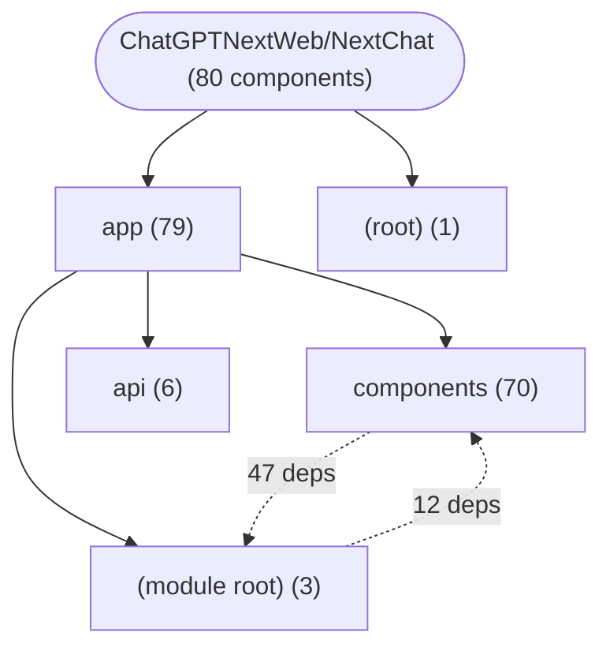
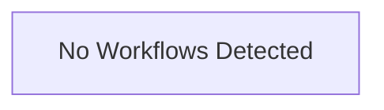

# Repository Architecture Analysis: ChatGPTNextWeb/NextChat

## Metadata
- **SHA**: `1d3dc331512929a4b1d3e82354e72acce33b5c7a`
- **Primary Ecosystem**: JavaScript/TypeScript

## Quality Metrics
- **avg_cyclomatic_complexity**: 12.01
- **component_count**: 80
- **files_analyzed**: 191
- **framework**: Next.js
- **loc**: 43214
- **max_cyclomatic_complexity**: 137
- **sloc**: 38862

# Architecture: ChatGPTNextWeb/NextChat

## Context
- **Repository**: `ChatGPTNextWeb/NextChat`
- **SHA**: `1d3dc331512929a4b1d3e82354e72acce33b5c7a`
- **Ecosystem**: JavaScript/TypeScript
- **Framework**: Unknown

## Building Block View

## Component Details

Showing top 60 representative components out of 80 across 2 module group(s):

- **Module `app`** (79 components — UI_COMPONENT: 73, API_ROUTE: 6)
- **Module `(root)`** (1 components — MODULE: 1)

- **Chat** (`app/components/chat.tsx`): UI_COMPONENT (deps: Avatar, AvatarPicker, Card, ChatCommandPrefix, ContextPrompts, EmojiAvatar (+23 more))
- **ChatAction** (`app/components/chat.tsx`): UI_COMPONENT (deps: Avatar, AvatarPicker, Card, ChatCommandPrefix, ContextPrompts, EmojiAvatar (+23 more))
- **ChatActions** (`app/components/chat.tsx`): UI_COMPONENT (deps: Avatar, AvatarPicker, Card, ChatCommandPrefix, ContextPrompts, EmojiAvatar (+23 more))
- **DeleteImageButton** (`app/components/chat.tsx`): UI_COMPONENT (deps: Avatar, AvatarPicker, Card, ChatCommandPrefix, ContextPrompts, EmojiAvatar (+23 more))
- **EditMessageModal** (`app/components/chat.tsx`): UI_COMPONENT (deps: Avatar, AvatarPicker, Card, ChatCommandPrefix, ContextPrompts, EmojiAvatar (+23 more))
- **PromptHints** (`app/components/chat.tsx`): UI_COMPONENT (deps: Avatar, AvatarPicker, Card, ChatCommandPrefix, ContextPrompts, EmojiAvatar (+23 more))
- **SessionConfigModel** (`app/components/chat.tsx`): UI_COMPONENT (deps: Avatar, AvatarPicker, Card, ChatCommandPrefix, ContextPrompts, EmojiAvatar (+23 more))
- **ShortcutKeyModal** (`app/components/chat.tsx`): UI_COMPONENT (deps: Avatar, AvatarPicker, Card, ChatCommandPrefix, ContextPrompts, EmojiAvatar (+23 more))
- **Settings** (`app/components/settings.tsx`): UI_COMPONENT (deps: Avatar, AvatarPicker, Card, ContextPrompts, EmojiAvatar, FullScreen (+19 more))
- **ExportMessageModal** (`app/components/exporter.tsx`): UI_COMPONENT (deps: Avatar, AvatarPicker, Card, ContextPrompts, EmojiAvatar, FullScreen (+16 more))
- **ImagePreviewer** (`app/components/exporter.tsx`): UI_COMPONENT (deps: Avatar, AvatarPicker, Card, ContextPrompts, EmojiAvatar, FullScreen (+16 more))
- **JsonPreviewer** (`app/components/exporter.tsx`): UI_COMPONENT (deps: Avatar, AvatarPicker, Card, ContextPrompts, EmojiAvatar, FullScreen (+16 more))
- **MarkdownPreviewer** (`app/components/exporter.tsx`): UI_COMPONENT (deps: Avatar, AvatarPicker, Card, ContextPrompts, EmojiAvatar, FullScreen (+16 more))
- **MessageExporter** (`app/components/exporter.tsx`): UI_COMPONENT (deps: Avatar, AvatarPicker, Card, ContextPrompts, EmojiAvatar, FullScreen (+16 more))
- **PreviewActions** (`app/components/exporter.tsx`): UI_COMPONENT (deps: Avatar, AvatarPicker, Card, ContextPrompts, EmojiAvatar, FullScreen (+16 more))
- **RenderExport** (`app/components/exporter.tsx`): UI_COMPONENT (deps: Avatar, AvatarPicker, Card, ContextPrompts, EmojiAvatar, FullScreen (+16 more))
- **NewChat** (`app/components/new-chat.tsx`): UI_COMPONENT (deps: Avatar, AvatarPicker, Card, ChatCommandPrefix, ContextPrompts, EmojiAvatar (+15 more))
- **Markdown** (`app/components/markdown.tsx`): UI_COMPONENT (deps: Artifacts, ArtifactsShareButton, Card, FullScreen, HTMLPreview, IconButton (+14 more))
- **MarkdownContent** (`app/components/markdown.tsx`): UI_COMPONENT (deps: Artifacts, ArtifactsShareButton, Card, FullScreen, HTMLPreview, IconButton (+14 more))
- **Mermaid** (`app/components/markdown.tsx`): UI_COMPONENT (deps: Artifacts, ArtifactsShareButton, Card, FullScreen, HTMLPreview, IconButton (+14 more))
- **PreCode** (`app/components/markdown.tsx`): UI_COMPONENT (deps: Artifacts, ArtifactsShareButton, Card, FullScreen, HTMLPreview, IconButton (+14 more))
- **ContextPrompts** (`app/components/mask.tsx`): UI_COMPONENT (deps: Avatar, AvatarPicker, Card, EmojiAvatar, FullScreen, IconButton (+12 more))
- **MaskAvatar** (`app/components/mask.tsx`): UI_COMPONENT (deps: Avatar, AvatarPicker, Card, EmojiAvatar, FullScreen, IconButton (+12 more))
- **MaskConfig** (`app/components/mask.tsx`): UI_COMPONENT (deps: Avatar, AvatarPicker, Card, EmojiAvatar, FullScreen, IconButton (+12 more))
- **MaskPage** (`app/components/mask.tsx`): UI_COMPONENT (deps: Avatar, AvatarPicker, Card, EmojiAvatar, FullScreen, IconButton (+12 more))
- **ChatItem** (`app/components/chat-list.tsx`): UI_COMPONENT (deps: Card, ContextPrompts, FullScreen, Input, List, ListItem (+11 more))
- **ChatList** (`app/components/chat-list.tsx`): UI_COMPONENT (deps: Card, ContextPrompts, FullScreen, Input, List, ListItem (+11 more))
- **Artifacts** (`app/components/artifacts.tsx`): UI_COMPONENT (deps: Card, FullScreen, Home, IconButton, Input, List (+10 more))
- **ArtifactsShareButton** (`app/components/artifacts.tsx`): UI_COMPONENT (deps: Card, FullScreen, Home, IconButton, Input, List (+10 more))
- **HTMLPreview** (`app/components/artifacts.tsx`): UI_COMPONENT (deps: Card, FullScreen, Home, IconButton, Input, List (+10 more))
- **SideBar** (`app/components/sidebar.tsx`): UI_COMPONENT (deps: Card, FullScreen, IconButton, Input, List, ListItem (+8 more))
- **SideBarBody** (`app/components/sidebar.tsx`): UI_COMPONENT (deps: Card, FullScreen, IconButton, Input, List, ListItem (+8 more))
- **SideBarContainer** (`app/components/sidebar.tsx`): UI_COMPONENT (deps: Card, FullScreen, IconButton, Input, List, ListItem (+8 more))
- **SideBarHeader** (`app/components/sidebar.tsx`): UI_COMPONENT (deps: Card, FullScreen, IconButton, Input, List, ListItem (+8 more))
- **SideBarTail** (`app/components/sidebar.tsx`): UI_COMPONENT (deps: Card, FullScreen, IconButton, Input, List, ListItem (+8 more))
- **AuthPage** (`app/components/auth.tsx`): UI_COMPONENT (deps: Card, FullScreen, IconButton, Input, List, ListItem (+7 more))
- **McpMarketPage** (`app/components/mcp-market.tsx`): UI_COMPONENT (deps: Card, FullScreen, IconButton, Input, List, ListItem (+7 more))
- **ModelConfigList** (`app/components/model-config.tsx`): UI_COMPONENT (deps: Card, FullScreen, Input, InputRange, List, ListItem (+7 more))
- **PluginPage** (`app/components/plugin.tsx`): UI_COMPONENT (deps: Card, FullScreen, IconButton, Input, List, ListItem (+7 more))
- **TTSConfigList** (`app/components/tts-config.tsx`): UI_COMPONENT (deps: Card, FullScreen, Input, InputRange, List, ListItem (+7 more))
- **MOBILE_MAX_WIDTH** (`app/utils.ts`): UI_COMPONENT (deps: Card, FullScreen, Input, List, ListItem, Loading (+6 more))
- **Home** (`app/components/home.tsx`): UI_COMPONENT (deps: AuthPage, MOBILE_MAX_WIDTH, ModelConfigList, RealtimeConfigList, SideBar, SideBarBody (+4 more))
- **Loading** (`app/components/home.tsx`): UI_COMPONENT (deps: AuthPage, MOBILE_MAX_WIDTH, ModelConfigList, RealtimeConfigList, SideBar, SideBarBody (+4 more))
- **WindowContent** (`app/components/home.tsx`): UI_COMPONENT (deps: AuthPage, MOBILE_MAX_WIDTH, ModelConfigList, RealtimeConfigList, SideBar, SideBarBody (+4 more))
- **MessageSelector** (`app/components/message-selector.tsx`): UI_COMPONENT (deps: Avatar, AvatarPicker, ContextPrompts, EmojiAvatar, IconButton, MOBILE_MAX_WIDTH (+3 more))
- **Card** (`app/components/ui-lib.tsx`): UI_COMPONENT (deps: Avatar, AvatarPicker, EmojiAvatar, IconButton)
- **FullScreen** (`app/components/ui-lib.tsx`): UI_COMPONENT (deps: Avatar, AvatarPicker, EmojiAvatar, IconButton)
- **Input** (`app/components/ui-lib.tsx`): UI_COMPONENT (deps: Avatar, AvatarPicker, EmojiAvatar, IconButton)
- **List** (`app/components/ui-lib.tsx`): UI_COMPONENT (deps: Avatar, AvatarPicker, EmojiAvatar, IconButton)
- **ListItem** (`app/components/ui-lib.tsx`): UI_COMPONENT (deps: Avatar, AvatarPicker, EmojiAvatar, IconButton)
- **Loading** (`app/components/ui-lib.tsx`): UI_COMPONENT (deps: Avatar, AvatarPicker, EmojiAvatar, IconButton)
- **Modal** (`app/components/ui-lib.tsx`): UI_COMPONENT (deps: Avatar, AvatarPicker, EmojiAvatar, IconButton)
- **PasswordInput** (`app/components/ui-lib.tsx`): UI_COMPONENT (deps: Avatar, AvatarPicker, EmojiAvatar, IconButton)
- **Popover** (`app/components/ui-lib.tsx`): UI_COMPONENT (deps: Avatar, AvatarPicker, EmojiAvatar, IconButton)
- **Sd** (`app/components/sd/sd.tsx`): UI_COMPONENT (deps: ControlParam, ControlParamItem, SdPanel, SideBar)
- **Select** (`app/components/ui-lib.tsx`): UI_COMPONENT (deps: Avatar, AvatarPicker, EmojiAvatar, IconButton)
- **Selector** (`app/components/ui-lib.tsx`): UI_COMPONENT (deps: Avatar, AvatarPicker, EmojiAvatar, IconButton)
- **Toast** (`app/components/ui-lib.tsx`): UI_COMPONENT (deps: Avatar, AvatarPicker, EmojiAvatar, IconButton)
- **SideBar** (`app/components/sd/sd-sidebar.tsx`): UI_COMPONENT (deps: ControlParam, ControlParamItem, SdPanel)
- **SearchChatPage** (`app/components/search-chat.tsx`): UI_COMPONENT (deps: IconButton)

## CI/CD Pipeline Topology

