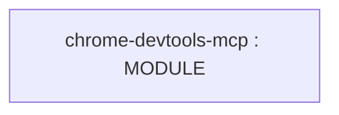

# Repository Architecture Analysis: ChromeDevTools/chrome-devtools-mcp

## Metadata
- **SHA**: `4b1e5511088b8a5fb333fc61a8b4a51ab022ca7b`
- **Primary Ecosystem**: JavaScript/TypeScript

## Quality Metrics
- **avg_cyclomatic_complexity**: 5.78
- **component_count**: 1
- **files_analyzed**: 49
- **framework**: Express / Node API
- **loc**: 5551
- **max_cyclomatic_complexity**: 32
- **sloc**: 4643

# Architecture: ChromeDevTools/chrome-devtools-mcp

## Context
- **Repository**: `ChromeDevTools/chrome-devtools-mcp`
- **SHA**: `4b1e5511088b8a5fb333fc61a8b4a51ab022ca7b`
- **Ecosystem**: JavaScript/TypeScript
- **Framework**: Unknown

## Building Block View

## Component Details
- **chrome-devtools-mcp** (`package.json`): MODULE

## CI/CD Pipeline Topology

