# Repository Architecture Analysis: D4Vinci/Scrapling

## Metadata
- **SHA**: `bb223f2f5fc8f743772751a5ce283ef7851ca6be`
- **Primary Ecosystem**: Python

## Quality Metrics
- **avg_cyclomatic_complexity**: 3.95
- **component_count**: 19
- **files_analyzed**: 274
- **framework**: Unknown
- **loc**: 71034
- **max_cyclomatic_complexity**: 41
- **sloc**: 59257

# Architecture: D4Vinci/Scrapling

## Context
- **Repository**: `D4Vinci/Scrapling`
- **SHA**: `bb223f2f5fc8f743772751a5ce283ef7851ca6be`
- **Ecosystem**: Python
- **Framework**: Unknown

## Building Block View

```mermaid
graph TD;
    install["install : CLI_COMMAND"]
    mcp["mcp : CLI_COMMAND"]
    shell["shell : CLI_COMMAND"]
    get["get : CLI_COMMAND"]
    post["post : CLI_COMMAND"]
    put["put : CLI_COMMAND"]
    delete["delete : CLI_COMMAND"]
    fetch["fetch : CLI_COMMAND"]
    NetworkRequestInfo["NetworkRequestInfo : DATA_ACCESS_LAYER"]
    NetworkRequestModel["NetworkRequestModel : DATA_ACCESS_LAYER"]
    ResponseModel["ResponseModel : DATA_ACCESS_LAYER"]
    NetworkRequestsModel["NetworkRequestsModel : DATA_ACCESS_LAYER"]
    SessionCreatedModel["SessionCreatedModel : DATA_ACCESS_LAYER"]
    SessionClosedModel["SessionClosedModel : DATA_ACCESS_LAYER"]
    ResponseCacheManager["ResponseCacheManager : SERVICE"]
    CheckpointManager["CheckpointManager : SERVICE"]
    RobotsTxtManager["RobotsTxtManager : SERVICE"]
    SessionManager["SessionManager : SERVICE"]
    TestResponseCacheManager["TestResponseCacheManager : SERVICE"]
    repo_root(["D4Vinci/Scrapling"])
    repo_root --> CheckpointManager
    repo_root --> RobotsTxtManager
    NetworkRequestsModel --> NetworkRequestInfo
    NetworkRequestsModel --> NetworkRequestModel
    NetworkRequestsModel --> shell
    ResponseModel --> NetworkRequestInfo
    ResponseModel --> NetworkRequestModel
    ResponseModel --> shell
    SessionClosedModel --> NetworkRequestInfo
    SessionClosedModel --> NetworkRequestModel
    SessionClosedModel --> shell
    SessionCreatedModel --> NetworkRequestInfo
    SessionCreatedModel --> NetworkRequestModel
    SessionCreatedModel --> shell
    TestResponseCacheManager --> ResponseCacheManager
    TestResponseCacheManager --> SessionManager
    delete --> shell
    fetch --> shell
    get --> shell
    install --> shell
    mcp --> shell
    post --> shell
    put --> shell
```

## Component Details
- **install** (`scrapling/cli.py`): CLI_COMMAND (deps: shell)
- **mcp** (`scrapling/cli.py`): CLI_COMMAND (deps: shell)
- **shell** (`scrapling/cli.py`): CLI_COMMAND
- **get** (`scrapling/cli.py`): CLI_COMMAND (deps: shell)
- **post** (`scrapling/cli.py`): CLI_COMMAND (deps: shell)
- **put** (`scrapling/cli.py`): CLI_COMMAND (deps: shell)
- **delete** (`scrapling/cli.py`): CLI_COMMAND (deps: shell)
- **fetch** (`scrapling/cli.py`): CLI_COMMAND (deps: shell)
- **NetworkRequestInfo** (`scrapling/core/ai/_network_formatting.py`): DATA_ACCESS_LAYER
- **NetworkRequestModel** (`scrapling/core/ai/_network_formatting.py`): DATA_ACCESS_LAYER
- **ResponseModel** (`scrapling/core/ai/server.py`): DATA_ACCESS_LAYER (deps: NetworkRequestInfo, NetworkRequestModel, shell)
- **NetworkRequestsModel** (`scrapling/core/ai/server.py`): DATA_ACCESS_LAYER (deps: NetworkRequestInfo, NetworkRequestModel, shell)
- **SessionCreatedModel** (`scrapling/core/ai/server.py`): DATA_ACCESS_LAYER (deps: NetworkRequestInfo, NetworkRequestModel, shell)
- **SessionClosedModel** (`scrapling/core/ai/server.py`): DATA_ACCESS_LAYER (deps: NetworkRequestInfo, NetworkRequestModel, shell)
- **ResponseCacheManager** (`scrapling/spiders/cache.py`): SERVICE
- **CheckpointManager** (`scrapling/spiders/checkpoint.py`): SERVICE
- **RobotsTxtManager** (`scrapling/spiders/robotstxt.py`): SERVICE
- **SessionManager** (`scrapling/spiders/session.py`): SERVICE
- **TestResponseCacheManager** (`tests/spiders/test_cache.py`): SERVICE (deps: ResponseCacheManager, SessionManager)

## CI/CD Pipeline Topology

