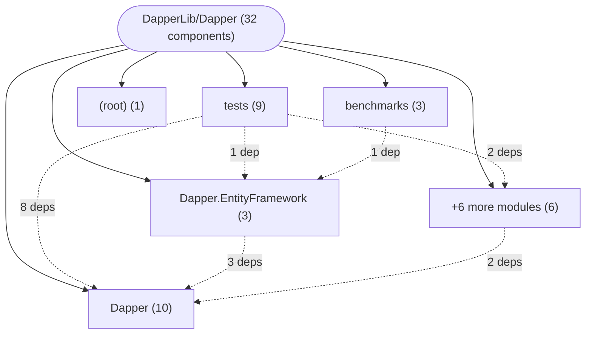

# Repository Architecture Analysis: DapperLib/Dapper

## Metadata
- **SHA**: `eb47546a408bbf6c178bda4f04dc205bc51ffbfe`
- **Primary Ecosystem**: .NET

## Quality Metrics
- **avg_cyclomatic_complexity**: 10.18
- **component_count**: 32
- **files_analyzed**: 314
- **framework**: ASP.NET Core
- **loc**: 53580
- **max_cyclomatic_complexity**: 668
- **sloc**: 40740

# Architecture: DapperLib/Dapper

## Context
- **Repository**: `DapperLib/Dapper`
- **SHA**: `eb47546a408bbf6c178bda4f04dc205bc51ffbfe`
- **Ecosystem**: .NET
- **Framework**: Unknown

## Building Block View

## Component Details
- **Build** (`Build.csproj`): MODULE (deps: *)
- **Dapper** (`Dapper/Dapper.csproj`): MODULE
- **Dapper.EntityFramework** (`Dapper.EntityFramework/Dapper.EntityFramework.csproj`): MODULE (deps: Dapper)
- **Dapper.EntityFramework.StrongName** (`Dapper.EntityFramework.StrongName/Dapper.EntityFramework.StrongName.csproj`): MODULE (deps: Dapper.StrongName)
- **Dapper.ProviderTools** (`Dapper.ProviderTools/Dapper.ProviderTools.csproj`): MODULE
- **Dapper.Rainbow** (`Dapper.Rainbow/Dapper.Rainbow.csproj`): MODULE (deps: Dapper)
- **Dapper.SqlBuilder** (`Dapper.SqlBuilder/Dapper.SqlBuilder.csproj`): MODULE (deps: Dapper)
- **Dapper.StrongName** (`Dapper.StrongName/Dapper.StrongName.csproj`): MODULE
- **Dapper.Tests.Performance** (`benchmarks/Dapper.Tests.Performance/Dapper.Tests.Performance.csproj`): MODULE (deps: Dapper.EntityFramework)
- **docs** (`docs/docs.csproj`): MODULE
- **Dapper.Tests** (`tests/Dapper.Tests/Dapper.Tests.csproj`): MODULE (deps: Dapper.EntityFramework, Dapper.ProviderTools, Dapper.SqlBuilder)
- **DbGeographyHandler** (`Dapper.EntityFramework/DbGeographyHandler.cs`): SERVICE (deps: TypeHandler)
- **DbGeometryHandler** (`Dapper.EntityFramework/DbGeometryHandler.cs`): SERVICE (deps: TypeHandler)
- **DataTableHandler** (`Dapper/DataTableHandler.cs`): SERVICE (deps: TypeHandler)
- **SqlDataRecordHandler** (`Dapper/SqlDataRecordHandler.cs`): SERVICE (deps: TypeHandler)
- **TypeHandler** (`Dapper/SqlMapper.TypeHandler.cs`): SERVICE (deps: StringTypeHandler)
- **StringTypeHandler** (`Dapper/SqlMapper.TypeHandler.cs`): SERVICE (deps: TypeHandler)
- **UdtTypeHandler** (`Dapper/UdtTypeHandler.cs`): SERVICE (deps: TypeHandler)
- **XmlTypeHandler** (`Dapper/XmlHandlers.cs`): SERVICE (deps: StringTypeHandler, XDocumentHandler, XElementHandler, XmlDocumentHandler)
- **XmlDocumentHandler** (`Dapper/XmlHandlers.cs`): SERVICE (deps: StringTypeHandler, XDocumentHandler, XElementHandler, XmlTypeHandler)
- **XDocumentHandler** (`Dapper/XmlHandlers.cs`): SERVICE (deps: StringTypeHandler, XElementHandler, XmlDocumentHandler, XmlTypeHandler)
- **XElementHandler** (`Dapper/XmlHandlers.cs`): SERVICE (deps: StringTypeHandler, XDocumentHandler, XmlDocumentHandler, XmlTypeHandler)
- **EFContext** (`benchmarks/Dapper.Tests.Performance/EntityFramework/EFContext.cs`): DATA_ACCESS_LAYER
- **EFCoreContext** (`benchmarks/Dapper.Tests.Performance/EntityFrameworkCore/EFCoreContext.cs`): DATA_ACCESS_LAYER
- **StringEnumHandler** (`tests/Dapper.Tests/PreferTypeHandlersForEnumsTests.cs`): SERVICE (deps: TypeHandler)
- **LocalDateHandler** (`tests/Dapper.Tests/TypeHandlerTests.cs`): SERVICE (deps: Issue1959_Raw_Handler, Issue1959_Subclass_Handler, Issue461_BlargHandler, RatingValueHandler, RecordingTypeHandler, StringListTypeHandler, TypeHandler)
- **RatingValueHandler** (`tests/Dapper.Tests/TypeHandlerTests.cs`): SERVICE (deps: Issue1959_Raw_Handler, Issue1959_Subclass_Handler, Issue461_BlargHandler, LocalDateHandler, RecordingTypeHandler, StringListTypeHandler, TypeHandler)
- **StringListTypeHandler** (`tests/Dapper.Tests/TypeHandlerTests.cs`): SERVICE (deps: Issue1959_Raw_Handler, Issue1959_Subclass_Handler, Issue461_BlargHandler, LocalDateHandler, RatingValueHandler, RecordingTypeHandler, TypeHandler)
- **RecordingTypeHandler** (`tests/Dapper.Tests/TypeHandlerTests.cs`): SERVICE (deps: Issue1959_Raw_Handler, Issue1959_Subclass_Handler, Issue461_BlargHandler, LocalDateHandler, RatingValueHandler, StringListTypeHandler, TypeHandler)
- **Issue461_BlargHandler** (`tests/Dapper.Tests/TypeHandlerTests.cs`): SERVICE (deps: Issue1959_Raw_Handler, Issue1959_Subclass_Handler, LocalDateHandler, RatingValueHandler, RecordingTypeHandler, StringListTypeHandler, TypeHandler)
- **Issue1959_Subclass_Handler** (`tests/Dapper.Tests/TypeHandlerTests.cs`): SERVICE (deps: Issue1959_Raw_Handler, Issue461_BlargHandler, LocalDateHandler, RatingValueHandler, RecordingTypeHandler, StringListTypeHandler, TypeHandler)
- **Issue1959_Raw_Handler** (`tests/Dapper.Tests/TypeHandlerTests.cs`): SERVICE (deps: Issue1959_Subclass_Handler, Issue461_BlargHandler, LocalDateHandler, RatingValueHandler, RecordingTypeHandler, StringListTypeHandler, TypeHandler)

## CI/CD Pipeline Topology

