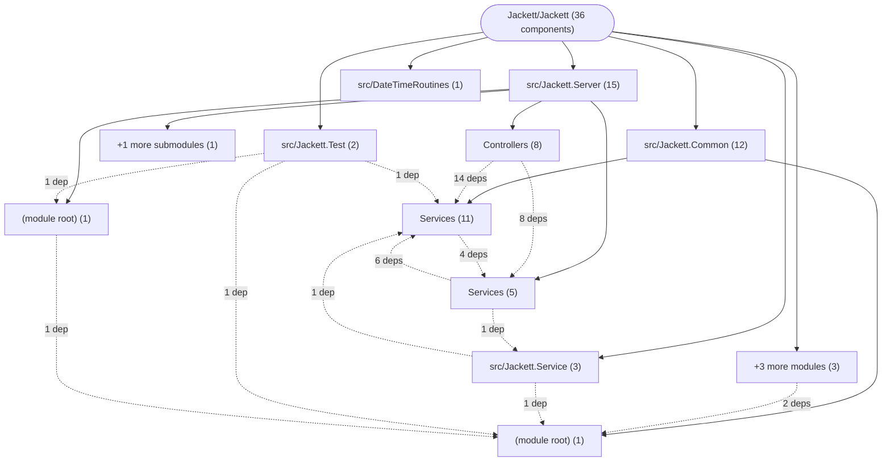

# Repository Architecture Analysis: Jackett/Jackett

## Metadata
- **SHA**: `5a41a62a106823a9994cdb127a075d32ec8604a1`
- **Primary Ecosystem**: .NET

## Quality Metrics
- **avg_cyclomatic_complexity**: 23.72
- **component_count**: 36
- **files_analyzed**: 606
- **framework**: ASP.NET Core
- **loc**: 95768
- **max_cyclomatic_complexity**: 468
- **sloc**: 80030

# Architecture: Jackett/Jackett

## Context
- **Repository**: `Jackett/Jackett`
- **SHA**: `5a41a62a106823a9994cdb127a075d32ec8604a1`
- **Ecosystem**: .NET
- **Framework**: Unknown

## Building Block View

## Component Details
- **DateTimeRoutines** (`src/DateTimeRoutines/DateTimeRoutines.csproj`): MODULE
- **Jackett.Common** (`src/Jackett.Common/Jackett.Common.csproj`): MODULE (deps: DateTimeRoutines)
- **Jackett.IntegrationTests** (`src/Jackett.IntegrationTests/Jackett.IntegrationTests.csproj`): MODULE
- **Jackett.Server** (`src/Jackett.Server/Jackett.Server.csproj`): MODULE (deps: Jackett.Common)
- **Jackett.Service** (`src/Jackett.Service/Jackett.Service.csproj`): MODULE (deps: Jackett.Common)
- **Jackett.Test** (`src/Jackett.Test/Jackett.Test.csproj`): MODULE (deps: Jackett.Common, Jackett.Server)
- **Jackett.Tray** (`src/Jackett.Tray/Jackett.Tray.csproj`): MODULE (deps: Jackett.Common)
- **Jackett.Updater** (`src/Jackett.Updater/Jackett.Updater.csproj`): MODULE (deps: Jackett.Common)
- **CacheService** (`src/Jackett.Common/Services/CacheService.cs`): SERVICE
- **ConfigurationService** (`src/Jackett.Common/Services/ConfigurationService.cs`): SERVICE (deps: ProcessService, SerializeService)
- **IndexerConfigurationService** (`src/Jackett.Common/Services/IndexerConfigurationService.cs`): SERVICE (deps: ConfigurationService)
- **IndexerManagerService** (`src/Jackett.Common/Services/IndexerManagerService.cs`): SERVICE (deps: CacheService, ConfigurationService, IndexerConfigurationService, ProcessService, ProtectionService)
- **LogCacheService** (`src/Jackett.Common/Services/LogCacheService.cs`): SERVICE
- **ProcessService** (`src/Jackett.Common/Services/ProcessService.cs`): SERVICE
- **SerializeService** (`src/Jackett.Common/Services/SerializeService.cs`): SERVICE
- **RunTimeService** (`src/Jackett.Common/Services/SpinService.cs`): SERVICE
- **TrayLockService** (`src/Jackett.Common/Services/TrayLockService.cs`): SERVICE
- **UpdateService** (`src/Jackett.Common/Services/UpdateService.cs`): SERVICE (deps: FilePermissionService, ServiceConfigService, TrayLockService)
- **WindowsServiceConfigService** (`src/Jackett.Common/Services/WindowsServiceConfigService.cs`): SERVICE (deps: ProcessService, Service, ServiceConfigService)
- **BlackholeController** (`src/Jackett.Server/Controllers/BlackholeController.cs`): API_ROUTE (deps: IndexerManagerService, ProtectionService)
- **DownloadController** (`src/Jackett.Server/Controllers/DownloadController.cs`): API_ROUTE (deps: IndexerManagerService, ProtectionService)
- **HealthcheckController** (`src/Jackett.Server/Controllers/HealthcheckController.cs`): API_ROUTE
- **ImageController** (`src/Jackett.Server/Controllers/ImageController.cs`): API_ROUTE (deps: IndexerManagerService, ProtectionService)
- **IndexerApiController** (`src/Jackett.Server/Controllers/IndexerApiController.cs`): API_ROUTE (deps: CacheService, IndexerManagerService, ServerConfigurationController, ServerService)
- **ResultsController** (`src/Jackett.Server/Controllers/ResultsController.cs`): API_ROUTE (deps: CacheService, IndexerManagerService, ServerService)
- **ServerConfigurationController** (`src/Jackett.Server/Controllers/ServerConfigurationController.cs`): API_ROUTE (deps: CacheService, ConfigurationService, IndexerManagerService, LogCacheService, ProcessService, SecurityService, ServerService, UpdateService)
- **WebUIController** (`src/Jackett.Server/Controllers/UIController.cs`): API_ROUTE (deps: ConfigurationService, SecurityService)
- **CustomExceptionHandler** (`src/Jackett.Server/Middleware/CustomExceptionHandler.cs`): SERVICE
- **FilePermissionService** (`src/Jackett.Server/Services/FilePermissionService.cs`): SERVICE
- **ProtectionService** (`src/Jackett.Server/Services/ProtectionService.cs`): SERVICE
- **SecurityService** (`src/Jackett.Server/Services/SecurityService.cs`): SERVICE
- **ServerService** (`src/Jackett.Server/Services/ServerService.cs`): SERVICE (deps: ConfigurationService, IndexerManagerService, ProcessService, ProtectionService, SerializeService, UpdateService)
- **ServiceConfigService** (`src/Jackett.Server/Services/ServiceConfigService.cs`): SERVICE (deps: ProcessService, Service)
- **Service** (`src/Jackett.Service/Service.Designer.cs`): SERVICE
- **Service** (`src/Jackett.Service/Service.cs`): SERVICE (deps: ProcessService)
- **TestCacheService** (`src/Jackett.Test/TestHelpers/TestCacheService.cs`): SERVICE (deps: CacheService)

## CI/CD Pipeline Topology

