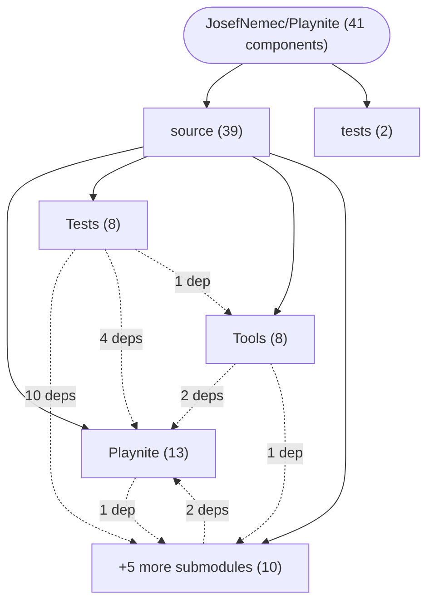

# Repository Architecture Analysis: JosefNemec/Playnite

## Metadata
- **SHA**: `e2e6efcda311fea38fcd92f61c8ca90811d97f28`
- **Primary Ecosystem**: .NET

## Quality Metrics
- **avg_cyclomatic_complexity**: 5.52
- **component_count**: 41
- **files_analyzed**: 741
- **framework**: ASP.NET Core
- **loc**: 143976
- **max_cyclomatic_complexity**: 461
- **sloc**: 114083

# Architecture: JosefNemec/Playnite

## Context
- **Repository**: `JosefNemec/Playnite`
- **SHA**: `e2e6efcda311fea38fcd92f61c8ca90811d97f28`
- **Ecosystem**: .NET
- **Framework**: Unknown

## Building Block View

## Component Details
- **Playnite** (`source/Playnite/Playnite.csproj`): MODULE (deps: Playnite.SDK)
- **GenericPlayController** (`source/Playnite/Controllers/GenericGameController.cs`): API_ROUTE
- **EventBufferHandler** (`source/Playnite/Database/Collections/ItemCollection.cs`): SERVICE
- **EventBufferHandler** (`source/Playnite/Database/EventBufferHandler.cs`): SERVICE
- **GlobalTaskHandler** (`source/Playnite/GlobalTaskHandler.cs`): SERVICE
- **LoadedGameController** (`source/Playnite/Input/GameController.cs`): API_ROUTE
- **PipeService** (`source/Playnite/PipeServer.cs`): SERVICE
- **PlayniteUriHandler** (`source/Playnite/PlayniteUriHandler.cs`): SERVICE
- **DeleteCookiesHandler** (`source/Playnite/WebView/CookieDestroyer.cs`): SERVICE (deps: SetCookieHandler)
- **SetCookieHandler** (`source/Playnite/WebView/CookieDestroyer.cs`): SERVICE (deps: DeleteCookiesHandler)
- **CustomResourceRequestHandler** (`source/Playnite/WebView/WebViewBase.cs`): SERVICE (deps: CustomRequestHandler, DeleteCookiesHandler, SetCookieHandler)
- **CustomRequestHandler** (`source/Playnite/WebView/WebViewBase.cs`): SERVICE (deps: CustomResourceRequestHandler, DeleteCookiesHandler, SetCookieHandler)
- **WindowPositionHandler** (`source/Playnite/Windows/WindowPositionHandler.cs`): SERVICE
- **Playnite.BrowserProcess** (`source/Playnite.BrowserProcess/Playnite.BrowserProcess.csproj`): MODULE
- **Playnite.Deps** (`source/Playnite.Deps/Playnite.Deps.csproj`): MODULE
- **Playnite.DesktopApp** (`source/Playnite.DesktopApp/Playnite.DesktopApp.csproj`): MODULE (deps: Playnite, Playnite.SDK)
- **Playnite.FullscreenApp** (`source/Playnite.FullscreenApp/Playnite.FullscreenApp.csproj`): MODULE (deps: Playnite, Playnite.SDK)
- **Playnite.SDK** (`source/PlayniteSDK/Playnite.SDK.csproj`): MODULE
- **GamepadController** (`source/PlayniteSDK/Events/ApplicationEvents.cs`): API_ROUTE
- **AutomaticPlayController** (`source/PlayniteSDK/Plugins/Actions.cs`): API_ROUTE (deps: InstallController, PlayController, UninstallController)
- **InstallController** (`source/PlayniteSDK/Plugins/Actions.cs`): API_ROUTE (deps: AutomaticPlayController, PlayController, UninstallController)
- **UninstallController** (`source/PlayniteSDK/Plugins/Actions.cs`): API_ROUTE (deps: AutomaticPlayController, InstallController, PlayController)
- **PlayController** (`source/PlayniteSDK/Plugins/Actions.cs`): API_ROUTE (deps: AutomaticPlayController, InstallController, UninstallController)
- **Playnite.DesktopApp.Tests** (`source/Tests/Playnite.DesktopApp.Tests/Playnite.DesktopApp.Tests.csproj`): MODULE (deps: Playnite, Playnite.DesktopApp, Playnite.SDK, Playnite.Tests)
- **Playnite.FullscreenApp.Tests** (`source/Tests/Playnite.FullscreenApp.Tests/Playnite.FullscreenApp.Tests.csproj`): MODULE (deps: Playnite, Playnite.FullscreenApp, Playnite.SDK)
- **Playnite.Tests** (`source/Tests/Playnite.Tests/Playnite.Tests.csproj`): MODULE (deps: Playnite, Playnite.SDK)
- **Playnite.Toolbox.Tests** (`source/Tests/Playnite.Toolbox.Tests/Playnite.Toolbox.Tests.csproj`): MODULE (deps: Playnite, Playnite.SDK, Playnite.Toolbox)
- **TestApp** (`source/Tests/TestApp/TestApp.csproj`): MODULE (deps: Playnite.SDK)
- **TestGameLibrary** (`source/Tests/TestGameLibrary/TestGameLibrary.csproj`): MODULE (deps: Playnite.SDK)
- **TestMetadataPlugin** (`source/Tests/TestMetadataPlugin/TestMetadataPlugin.csproj`): MODULE (deps: Playnite.SDK)
- **TestPlugin** (`source/Tests/TestPlugin/TestPlugin.csproj`): MODULE (deps: Playnite.SDK)
- **Playnite.Toolbox** (`source/Tools/Playnite.Toolbox/Playnite.Toolbox.csproj`): MODULE (deps: Playnite, Playnite.SDK)
- **CustomLibraryPlugin** (`source/Tools/Playnite.Toolbox/Templates/Extensions/CustomLibraryPlugin/CustomLibraryPlugin.csproj`): MODULE
- **CustomMetadataPlugin** (`source/Tools/Playnite.Toolbox/Templates/Extensions/CustomMetadataPlugin/CustomMetadataPlugin.csproj`): MODULE
- **GenericPlugin** (`source/Tools/Playnite.Toolbox/Templates/Extensions/GenericPlugin/GenericPlugin.csproj`): MODULE
- **Theme** (`source/Tools/Playnite.Toolbox/Templates/Themes/Desktop/Theme.csproj`): MODULE
- **Theme** (`source/Tools/Playnite.Toolbox/Templates/Themes/Fullscreen/Theme.csproj`): MODULE
- **Playnite.Utilities** (`source/Tools/Playnite.Utilities/Playnite.Utilities.csproj`): MODULE (deps: Playnite)
- **PlayniteInstaller** (`source/Tools/PlayniteInstaller/PlayniteInstaller.csproj`): MODULE
- **TestPluginDev** (`tests/Extensions/Plugins/FullTestPluginDev/TestPluginDev.csproj`): MODULE
- **TestPluginNuget** (`tests/Extensions/Plugins/FullTestPluginNuget/TestPluginNuget.csproj`): MODULE

## CI/CD Pipeline Topology

