# Repository Architecture Analysis: ManimCommunity/manim

## Metadata
- **SHA**: `6ed9b12ba8cf1a4341cf103afde23774887aee36`
- **Primary Ecosystem**: Python

## Quality Metrics
- **avg_cyclomatic_complexity**: 2.6
- **component_count**: 15
- **files_analyzed**: 404
- **framework**: Unknown
- **loc**: 108215
- **max_cyclomatic_complexity**: 47
- **sloc**: 86887

# Architecture: ManimCommunity/manim

## Context
- **Repository**: `ManimCommunity/manim`
- **SHA**: `6ed9b12ba8cf1a4341cf103afde23774887aee36`
- **Ecosystem**: Python
- **Framework**: Unknown

## Building Block View

```mermaid
graph TD;
    clear["clear : CLI_COMMAND"]
    write["write : CLI_COMMAND"]
    show["show : CLI_COMMAND"]
    export["export : CLI_COMMAND"]
    checkhealth["checkhealth : CLI_COMMAND"]
    project["project : CLI_COMMAND"]
    scene["scene : CLI_COMMAND"]
    plugins["plugins : CLI_COMMAND"]
    render["render : CLI_COMMAND"]
    Manager["Manager : SERVICE"]
    changelog["changelog : CLI_COMMAND"]
    export_changelog["export_changelog : CLI_COMMAND"]
    citation["citation : CLI_COMMAND"]
    fetch_releases["fetch_releases : CLI_COMMAND"]
    HookManager["HookManager : SERVICE"]
    repo_root(["ManimCommunity/manim"])
    repo_root --> changelog
    repo_root --> checkhealth
    repo_root --> citation
    repo_root --> clear
    repo_root --> export
    repo_root --> export_changelog
    repo_root --> fetch_releases
    repo_root --> plugins
    repo_root --> project
    repo_root --> render
    repo_root --> show
    repo_root --> write
    HookManager --> Manager
    HookManager --> scene
    Manager --> scene
```

## Component Details
- **clear** (`manim/cli/cache/commands.py`): CLI_COMMAND
- **write** (`manim/cli/cfg/group.py`): CLI_COMMAND
- **show** (`manim/cli/cfg/group.py`): CLI_COMMAND
- **export** (`manim/cli/cfg/group.py`): CLI_COMMAND
- **checkhealth** (`manim/cli/checkhealth/commands.py`): CLI_COMMAND
- **project** (`manim/cli/init/commands.py`): CLI_COMMAND
- **scene** (`manim/cli/init/commands.py`): CLI_COMMAND
- **plugins** (`manim/cli/plugins/commands.py`): CLI_COMMAND
- **render** (`manim/cli/render/commands.py`): CLI_COMMAND
- **Manager** (`manim/manager.py`): SERVICE (deps: scene)
- **changelog** (`scripts/release.py`): CLI_COMMAND
- **export_changelog** (`scripts/release.py`): CLI_COMMAND
- **citation** (`scripts/release.py`): CLI_COMMAND
- **fetch_releases** (`scripts/release.py`): CLI_COMMAND
- **HookManager** (`tests/module/test_manager.py`): SERVICE (deps: Manager, scene)

## CI/CD Pipeline Topology

