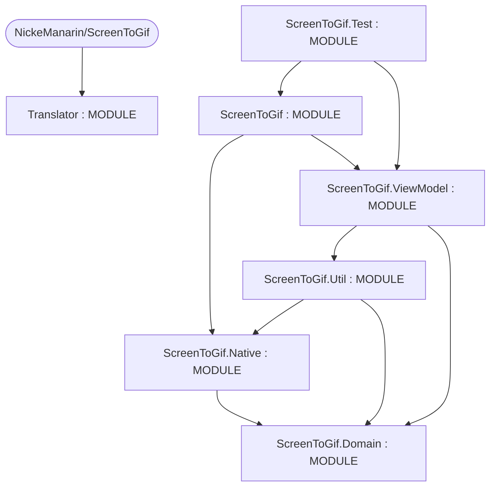
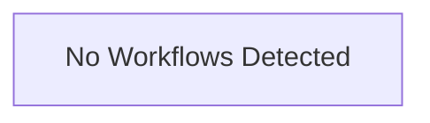

# Repository Architecture Analysis: NickeManarin/ScreenToGif

## Metadata
- **SHA**: `a4d0a67c2131cd048ceec86cd40afc2f1a06f2fd`
- **Primary Ecosystem**: .NET

## Quality Metrics
- **avg_cyclomatic_complexity**: 8.5
- **component_count**: 7
- **files_analyzed**: 1296
- **framework**: Unknown
- **loc**: 187126
- **max_cyclomatic_complexity**: 608
- **sloc**: 128082

# Architecture: NickeManarin/ScreenToGif

## Context
- **Repository**: `NickeManarin/ScreenToGif`
- **SHA**: `a4d0a67c2131cd048ceec86cd40afc2f1a06f2fd`
- **Ecosystem**: .NET
- **Framework**: Unknown

## Building Block View

## Component Details
- **Translator** (`Other/Translator/Translator.csproj`): MODULE
- **ScreenToGif** (`ScreenToGif/ScreenToGif.csproj`): MODULE (deps: ScreenToGif.Native, ScreenToGif.ViewModel)
- **ScreenToGif.Domain** (`ScreenToGif.Model/ScreenToGif.Domain.csproj`): MODULE
- **ScreenToGif.Native** (`ScreenToGif.Native/ScreenToGif.Native.csproj`): MODULE (deps: ScreenToGif.Domain)
- **ScreenToGif.Test** (`ScreenToGif.Test/ScreenToGif.Test.csproj`): MODULE (deps: ScreenToGif, ScreenToGif.ViewModel)
- **ScreenToGif.Util** (`ScreenToGif.Util/ScreenToGif.Util.csproj`): MODULE (deps: ScreenToGif.Domain, ScreenToGif.Native)
- **ScreenToGif.ViewModel** (`ScreenToGif.ViewModel/ScreenToGif.ViewModel.csproj`): MODULE (deps: ScreenToGif.Domain, ScreenToGif.Util)

## CI/CD Pipeline Topology

