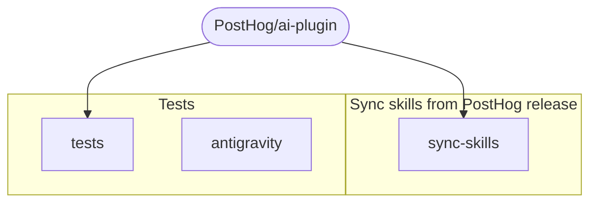

# Repository Architecture Analysis: PostHog/ai-plugin

## Metadata
- **SHA**: `191f2a7a47b0bc1380ec9a52b832d09d39f4f8d8`
- **Primary Ecosystem**: Python

## Quality Metrics
- **ast_engine**: tree-sitter
- **avg_cognitive_complexity**: 4.58
- **avg_cyclomatic_complexity**: 4.44
- **component_count**: 1
- **dead_code_count**: 0
- **dead_code_symbols**: 0 entry(ies)
- **duplication_pct**: 66.3
- **file_complexities**: 25 entry(ies)
- **files_analyzed**: 42
- **fitness_passed**: False
- **fitness_violation_count**: 3
- **framework**: Unknown
- **import_edges**: 100 entry(ies)
- **loc**: 8181
- **max_cognitive_complexity**: 57
- **max_cyclomatic_complexity**: 31
- **sloc**: 6588
- **test_file_count**: 8

# Architecture: PostHog/ai-plugin

## Context
- **Repository**: `PostHog/ai-plugin`
- **SHA**: `191f2a7a47b0bc1380ec9a52b832d09d39f4f8d8`
- **Ecosystem**: Python
- **Framework**: Unknown

## Building Block View

## Component Details
- **Vocabulary** (`skills/exploring-mcp-tool-original-user-motive/scripts/canonicalize_intentions.py`): DATA_ACCESS_LAYER

## 6-Dimension Repository Scorecard

- **Overall Grade**: `C` (70.05/100)
- **Technical Debt Score**: 29.95
- **Estimated Remediation Effort**: 32.25h

| Dimension | Grade | Score | Weight | Details |
| :--- | :---: | :---: | :---: | :--- |
| Code Quality | `F` | 45.24 | 0.20 | avg_cc=4.44, max_cc=31, duplication=66.30%, dead_code=0 |
| Dependency Health | `A` | 90.00 | 0.15 | dependencies=0 (no manifests parsed) |
| Maintainability | `F` | 47.00 | 0.15 | avg_cognitive=4.58, max_cognitive=57, fitness_violations=3, oversized_files=2 |
| Pipeline Health | `A` | 93.00 | 0.15 | workflows=2, operational_antipatterns=3, parallel_branches=True |
| Security | `B` | 80.00 | 0.20 | vulnerabilities=0, secrets=0, pipeline_security_findings=1 |
| Test Coverage | `C` | 70.00 | 0.15 | coverage=unavailable, ci_test_job=True, test_files_detected=True |

## Architecture Fitness & Workspace Boundaries

- **[MEDIUM] `ATRUSS-ARCH-005` (COMPLEXITY_THRESHOLD)**: Repository duplication_pct (66.3) exceeds policy threshold (15.0).
- **[MEDIUM] `ATRUSS-ARCH-005` (COMPLEXITY_THRESHOLD)**: Repository max_cognitive_complexity (57.0) exceeds policy threshold (25.0).
- **[MEDIUM] `ATRUSS-ARCH-005` (COMPLEXITY_THRESHOLD)**: Repository max_cyclomatic_complexity (31.0) exceeds policy threshold (20.0).

## CI/CD Pipeline Topology

