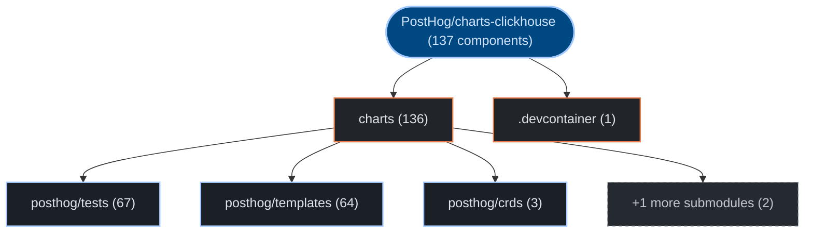
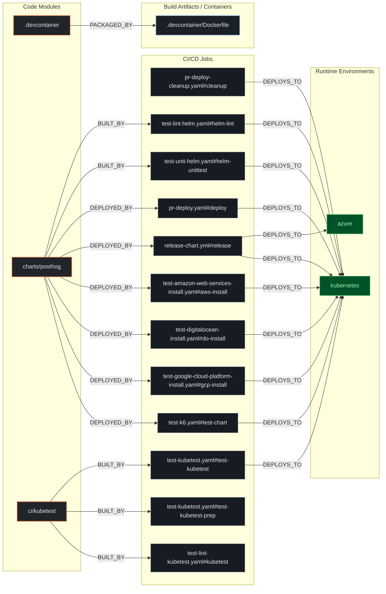

# Repository Architecture Analysis: PostHog/charts-clickhouse

## Metadata
- **SHA**: `7daf90bf9361c17f677aa87142361dc1ae54592a`
- **Primary Ecosystem**: Python

## Quality Metrics
- **ast_engine**: tree-sitter
- **avg_cognitive_complexity**: 1.05
- **avg_cyclomatic_complexity**: 1.73
- **component_count**: 137
- **dead_code_count**: 1
- **dead_code_symbols**: 1 entry(ies)
- **duplication_pct**: 5.47
- **file_complexities**: 25 entry(ies)
- **files_analyzed**: 175
- **fitness_passed**: True
- **fitness_violation_count**: 0
- **framework**: Unknown
- **import_edges**: 100 entry(ies)
- **loc**: 20611
- **max_cognitive_complexity**: 23
- **max_cyclomatic_complexity**: 15
- **sloc**: 17136
- **test_file_count**: 124

# Architecture: PostHog/charts-clickhouse

## Context
- **Repository**: `PostHog/charts-clickhouse`
- **SHA**: `7daf90bf9361c17f677aa87142361dc1ae54592a`
- **Ecosystem**: Python
- **Framework**: Unknown

## Building Block View

## Component Details

Showing top 60 representative components out of 137 across 2 module group(s):

- **Module `charts`** (136 components — module: 136)
- **Module `.devcontainer`** (1 components — module: 1)

- **Chart** (`charts/posthog/Chart.yaml`): module
- **_clickhouse.tpl** (`charts/posthog/tests/_clickhouse.tpl.yaml`): module
- **_initContainers-wait-for-migrations** (`charts/posthog/tests/_initContainers-wait-for-migrations.yaml`): module
- **_postgresql.tpl** (`charts/posthog/tests/_postgresql.tpl.yaml`): module
- **_statsd** (`charts/posthog/tests/_statsd.yaml`): module
- **_topologySpreadConstraints** (`charts/posthog/tests/_topologySpreadConstraints.yaml`): module
- **application-settings** (`charts/posthog/tests/application-settings.yaml`): module
- **cert-issuer** (`charts/posthog/templates/cert-issuer.yaml`): module
- **cert-issuer** (`charts/posthog/tests/cert-issuer.yaml`): module
- **clickhouse-backup-cronjob** (`charts/posthog/templates/clickhouse-backup-cronjob.yaml`): module
- **clickhouse-backup-cronjob** (`charts/posthog/tests/clickhouse-backup-cronjob.yaml`): module
- **clickhouse-instance** (`charts/posthog/tests/clickhouse-instance.yaml`): module
- **clickhouse_instance** (`charts/posthog/templates/clickhouse_instance.yaml`): module
- **clickhouseinstallations.clickhouse.altinity.com** (`charts/posthog/crds/clickhouseinstallations.clickhouse.altinity.com.yaml`): module
- **clickhouseinstallationtemplates.clickhouse.altinity.com** (`charts/posthog/crds/clickhouseinstallationtemplates.clickhouse.altinity.com.yaml`): module
- **clickhouseoperatorconfigurations.clickhouse.altinity.com** (`charts/posthog/crds/clickhouseoperatorconfigurations.clickhouse.altinity.com.yaml`): module
- **cloudwatch** (`charts/posthog/templates/cloudwatch.yaml`): module
- **clusterrole** (`charts/posthog/templates/clickhouse-operator/clusterrole.yaml`): module
- **clusterrole** (`charts/posthog/tests/clickhouse-operator/clusterrole.yaml`): module
- **clusterrolebinding** (`charts/posthog/templates/clickhouse-operator/clusterrolebinding.yaml`): module
- **clusterrolebinding** (`charts/posthog/tests/clickhouse-operator/clusterrolebinding.yaml`): module
- **configmap** (`charts/posthog/templates/clickhouse-operator/configmap.yaml`): module
- **configmap** (`charts/posthog/tests/clickhouse-operator/configmap.yaml`): module
- **cronjob-backup-configmap** (`charts/posthog/templates/cronjob-backup-configmap.yaml`): module
- **decide-deployment** (`charts/posthog/templates/decide-deployment.yaml`): module
- **decide-hpa** (`charts/posthog/templates/decide-hpa.yaml`): module
- **decide-pdb** (`charts/posthog/templates/decide-pdb.yaml`): module
- **decide-service** (`charts/posthog/templates/decide-service.yaml`): module
- **deployment** (`charts/posthog/templates/clickhouse-operator/deployment.yaml`): module
- **deployment** (`charts/posthog/tests/clickhouse-operator/__snapshot__/deployment.yaml`): module
- **deployment** (`charts/posthog/tests/clickhouse-operator/deployment.yaml`): module
- **email-settings** (`charts/posthog/tests/email-settings.yaml`): module
- **error-on-invalid-values** (`charts/posthog/templates/error-on-invalid-values.yaml`): module
- **error-on-invalid-values** (`charts/posthog/tests/error-on-invalid-values.yaml`): module
- **eventrouter** (`charts/posthog/templates/eventrouter.yaml`): module
- **eventrouter** (`charts/posthog/tests/eventrouter.yaml`): module
- **events-deployment** (`charts/posthog/templates/events-deployment.yaml`): module
- **events-deployment** (`charts/posthog/tests/events-deployment.yaml`): module
- **events-hpa** (`charts/posthog/templates/events-hpa.yaml`): module
- **events-hpa** (`charts/posthog/tests/events-hpa.yaml`): module
- **events-pdb** (`charts/posthog/templates/events-pdb.yaml`): module
- **events-service** (`charts/posthog/templates/events-service.yaml`): module
- **events-service** (`charts/posthog/tests/events-service.yaml`): module
- **gce-frontend-config** (`charts/posthog/templates/gce-frontend-config.yaml`): module
- **gke-cert-issuer** (`charts/posthog/templates/gke-cert-issuer.yaml`): module
- **grafana-annotation-post.job** (`charts/posthog/templates/grafana-annotation-post.job.yaml`): module
- **grafana-annotation-pre.job** (`charts/posthog/templates/grafana-annotation-pre.job.yaml`): module
- **grafana-dashboards** (`charts/posthog/templates/grafana-dashboards.yaml`): module
- **grafana-dashboards** (`charts/posthog/tests/grafana-dashboards.yaml`): module
- **ingress** (`charts/posthog/templates/ingress.yaml`): module
- **ingress** (`charts/posthog/tests/ingress.yaml`): module
- **kafka-settings** (`charts/posthog/tests/kafka-settings.yaml`): module
- **migrate-job** (`charts/posthog/tests/migrate-job.yaml`): module
- **migrate.job** (`charts/posthog/templates/migrate.job.yaml`): module
- **object-storage-settings** (`charts/posthog/tests/object-storage-settings.yaml`): module
- **pgbouncer-deployment** (`charts/posthog/templates/pgbouncer-deployment.yaml`): module
- **pgbouncer-deployment** (`charts/posthog/tests/pgbouncer-deployment.yaml`): module
- **pgbouncer-deployment-read** (`charts/posthog/tests/pgbouncer-deployment-read.yaml`): module
- **pgbouncer-hpa** (`charts/posthog/templates/pgbouncer-hpa.yaml`): module
- **pgbouncer-hpa** (`charts/posthog/tests/pgbouncer-hpa.yaml`): module

## 6-Dimension Repository Scorecard

- **Overall Grade**: `F` (55.53/100)
- **Technical Debt Score**: 44.47
- **Estimated Remediation Effort**: 63.46h

| Dimension | Grade | Score | Weight | Details |
| :--- | :---: | :---: | :---: | :--- |
| Code Quality | `B` | 89.80 | 0.20 | avg_cc=1.73, max_cc=15, duplication=5.47%, dead_code=1 |
| Dependency Health | `B` | 85.00 | 0.15 | dependencies=7, outdated=0, vulnerable=0, has_lockfile=False |
| Maintainability | `A` | 95.50 | 0.15 | avg_cognitive=1.05, max_cognitive=23, fitness_violations=0, oversized_files=0 |
| Pipeline Health | `F` | 0.00 | 0.15 | workflows=15, operational_antipatterns=21, parallel_branches=False |
| Security | `F` | 0.00 | 0.20 | vulnerabilities=0, secrets=3, pipeline_security_findings=17 |
| Test Coverage | `C` | 70.00 | 0.15 | coverage=unavailable, ci_test_job=True, test_files_detected=True |

## Supply Chain Dependencies, Vulnerabilities & Secrets

- **Dependencies Parsed**: 7 | **Vulnerabilities**: 0 | **Secrets**: 3

### Secret Findings (Redacted)
- **[HIGH] `ATRUSS-SEC-005`** at `ci/kubetest/custom_k8s_resources/redis_external_with_existing_secret.yaml:57` (`redis-password: c3Rh***REDACTED***`)
- **[HIGH] `ATRUSS-SEC-005`** at `ci/kubetest/custom_k8s_resources/redis_internal_with_existing_secret.yaml:7` (`redis-password: c3Rh***REDACTED***`)
- **[HIGH] `ATRUSS-SEC-005`** at `perf-testing/README.md:8` (`export API_KEY='ws6x***REDACTED***'`)

### Inventory Sample
- `black` `21.12b0` (PyPI, `ci/kubetest/requirements.txt`)
- `click` `8.0.4` (PyPI, `ci/kubetest/requirements.txt`)
- `flake8` `4.0.1` (PyPI, `ci/kubetest/requirements.txt`)
- `isort` `5.10.1` (PyPI, `ci/kubetest/requirements.txt`)
- `kubernetes` `17.17.0` (PyPI, `ci/kubetest/requirements.txt`)
- `kubetest` `0.9.5` (PyPI, `ci/kubetest/requirements.txt`)
- `eslint` `8.27.0` (npm, `package.json`)

## Section 7: Code-to-Cloud Deployment Traceability

- `pr-deploy-cleanup.yaml#cleanup` (ci_job) --[DEPLOYS_TO]--> `kubernetes` (environment)
- `pr-deploy.yaml#deploy` (ci_job) --[DEPLOYS_TO]--> `kubernetes` (environment)
- `release-chart.yml#release` (ci_job) --[DEPLOYS_TO]--> `azure` (environment)
- `release-chart.yml#release` (ci_job) --[DEPLOYS_TO]--> `kubernetes` (environment)
- `test-amazon-web-services-install.yaml#aws-install` (ci_job) --[DEPLOYS_TO]--> `kubernetes` (environment)
- `test-digitalocean-install.yaml#do-install` (ci_job) --[DEPLOYS_TO]--> `kubernetes` (environment)
- `test-google-cloud-platform-install.yaml#gcp-install` (ci_job) --[DEPLOYS_TO]--> `kubernetes` (environment)
- `test-k6.yaml#test-chart` (ci_job) --[DEPLOYS_TO]--> `kubernetes` (environment)
- `test-kubetest.yaml#test-kubetest` (ci_job) --[DEPLOYS_TO]--> `kubernetes` (environment)
- `test-lint-helm.yaml#helm-lint` (ci_job) --[DEPLOYS_TO]--> `kubernetes` (environment)
- `test-unit-helm.yaml#helm-unittest` (ci_job) --[DEPLOYS_TO]--> `kubernetes` (environment)
- `.devcontainer` (code_module) --[PACKAGED_BY]--> `.devcontainer/Dockerfile` (container)
- `charts/posthog` (code_module) --[BUILT_BY]--> `test-lint-helm.yaml#helm-lint` (ci_job)
- `charts/posthog` (code_module) --[BUILT_BY]--> `test-unit-helm.yaml#helm-unittest` (ci_job)
- `charts/posthog` (code_module) --[DEPLOYED_BY]--> `pr-deploy.yaml#deploy` (ci_job)
- `charts/posthog` (code_module) --[DEPLOYED_BY]--> `release-chart.yml#release` (ci_job)
- `charts/posthog` (code_module) --[DEPLOYED_BY]--> `test-amazon-web-services-install.yaml#aws-install` (ci_job)
- `charts/posthog` (code_module) --[DEPLOYED_BY]--> `test-digitalocean-install.yaml#do-install` (ci_job)
- `charts/posthog` (code_module) --[DEPLOYED_BY]--> `test-google-cloud-platform-install.yaml#gcp-install` (ci_job)
- `charts/posthog` (code_module) --[DEPLOYED_BY]--> `test-k6.yaml#test-chart` (ci_job)
- `ci/kubetest` (code_module) --[BUILT_BY]--> `test-kubetest.yaml#test-kubetest` (ci_job)
- `ci/kubetest` (code_module) --[BUILT_BY]--> `test-kubetest.yaml#test-kubetest-prep` (ci_job)
- `ci/kubetest` (code_module) --[BUILT_BY]--> `test-lint-kubetest.yaml#kubetest` (ci_job)

## CI/CD Pipeline Topology

```mermaid
graph TD;
  classDef atlasRoot fill:#004882,stroke:#a3c9ff,stroke-width:2px,color:#d3e4ff
  classDef atlasCategory fill:#212428,stroke:#E87A48,stroke-width:1.5px,color:#dfe3eb
  classDef atlasWorkflow fill:#1b2026,stroke:#a3c9ff,stroke-width:1.5px,color:#dfe3eb
  classDef atlasJob fill:#171c22,stroke:#8d9199,stroke-width:1px,color:#dfe3eb
  classDef atlasTarget fill:#005227,stroke:#8bd99b,stroke-width:1.5px,color:#a7f6b6
  classDef atlasAlert fill:#93000a,stroke:#ffb4ab,stroke-width:1.5px,color:#ffdad6
  classDef atlasMore fill:#252a31,stroke:#8d9199,stroke-dasharray:4 4,color:#c3c6cf
  pipeline_root(["PostHog/charts-clickhouse (15 workflows)"]):::atlasRoot
  subgraph sg_grp_0_Scheduled___Manual["Scheduled & Manual (10 workflows · 11 jobs)"]
    direction TB
    subgraph sg_wf_8_e2e___kubetest["e2e - kubetest (2 jobs)"]
      direction TB
      wf_8_e2e___kubetest(["Trigger: e2e - kubetest"]):::atlasWorkflow
      job_8_test_kubetest_prep["test-kubetest-prep"]:::atlasJob
      job_8_test_kubetest["test-kubetest"]:::atlasJob
      wf_8_e2e___kubetest --> job_8_test_kubetest_prep
      job_8_test_kubetest_prep --> job_8_test_kubetest
    end
    pipeline_root --> wf_8_e2e___kubetest
    subgraph sg_wf_9_Lint_test["Lint test (1 jobs)"]
      direction TB
      wf_9_Lint_test(["Trigger: Lint test"]):::atlasWorkflow
      job_9_eslint["eslint"]:::atlasJob
      wf_9_Lint_test --> job_9_eslint
    end
    pipeline_root --> wf_9_Lint_test
    subgraph sg_wf_10_Lint_test["Lint test (1 jobs)"]
      direction TB
      wf_10_Lint_test(["Trigger: Lint test"]):::atlasWorkflow
      job_10_github_workflows_lint["github-workflows-lint"]:::atlasJob
      wf_10_Lint_test --> job_10_github_workflows_lint
    end
    pipeline_root --> wf_10_Lint_test
    subgraph sg_wf_11_Lint_test["Lint test (1 jobs)"]
      direction TB
      wf_11_Lint_test(["Trigger: Lint test"]):::atlasWorkflow
      job_11_helm_lint["helm-lint"]:::atlasJob
      wf_11_Lint_test --> job_11_helm_lint
    end
    pipeline_root --> wf_11_Lint_test
    subgraph sg_wf_12_Lint_test["Lint test (1 jobs)"]
      direction TB
      wf_12_Lint_test(["Trigger: Lint test"]):::atlasWorkflow
      job_12_kubetest["kubetest"]:::atlasJob
      wf_12_Lint_test --> job_12_kubetest
    end
    pipeline_root --> wf_12_Lint_test
  end
  subgraph sg_grp_1_Release___Deploy["Release & Deploy (3 workflows · 3 jobs)"]
    direction TB
    subgraph sg_wf_1_pr_deploy_cleanup_yaml["pr-deploy-cleanup.yaml (1 jobs)"]
      direction TB
      wf_1_pr_deploy_cleanup_yaml(["Trigger: pr-deploy-cleanup.yaml"]):::atlasWorkflow
      job_1_cleanup["cleanup"]:::atlasJob
      wf_1_pr_deploy_cleanup_yaml --> job_1_cleanup
    end
    pipeline_root --> wf_1_pr_deploy_cleanup_yaml
    subgraph sg_wf_2_PR___Preview_Deploy["PR - Preview Deploy (1 jobs)"]
      direction TB
      wf_2_PR___Preview_Deploy(["Trigger: PR - Preview Deploy"]):::atlasWorkflow
      job_2_deploy["deploy"]:::atlasJob
      wf_2_PR___Preview_Deploy --> job_2_deploy
    end
    pipeline_root --> wf_2_PR___Preview_Deploy
    subgraph sg_wf_3_Release_Chart["Release Chart (1 jobs)"]
      direction TB
      wf_3_Release_Chart(["Trigger: Release Chart"]):::atlasWorkflow
      job_3_release["release"]:::atlasJob
      wf_3_Release_Chart --> job_3_release
    end
    pipeline_root --> wf_3_Release_Chart
  end
  subgraph sg_grp_2_CI___Verification["CI & Verification (2 workflows · 2 jobs)"]
    direction TB
    subgraph sg_wf_0_Codespell["Codespell (1 jobs)"]
      direction TB
      wf_0_Codespell(["Trigger: Codespell"]):::atlasWorkflow
      job_0_codespell["codespell"]:::atlasJob
      wf_0_Codespell --> job_0_codespell
    end
    pipeline_root --> wf_0_Codespell
    subgraph sg_wf_14_Update_docs["Update docs (1 jobs)"]
      direction TB
      wf_14_Update_docs(["Trigger: Update docs"]):::atlasWorkflow
      job_14_update_readme["update-readme"]:::atlasJob
      wf_14_Update_docs --> job_14_update_readme
    end
    pipeline_root --> wf_14_Update_docs
  end
  wf_more["+5 more workflows"]:::atlasMore
  pipeline_root --> wf_more
```

