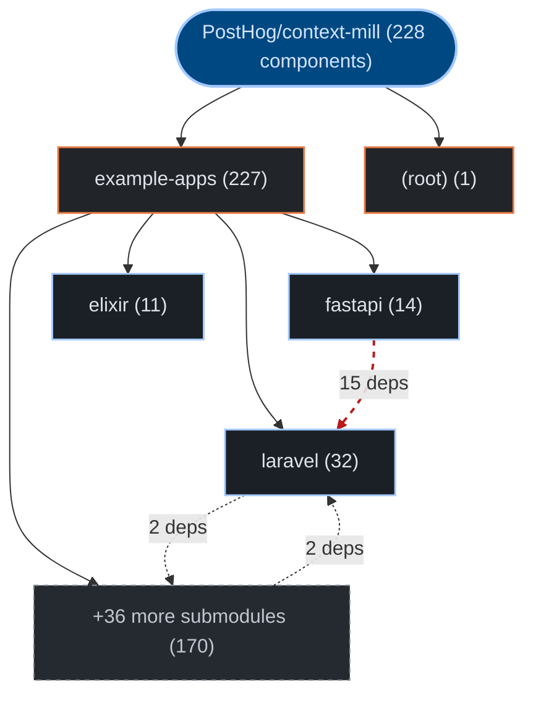
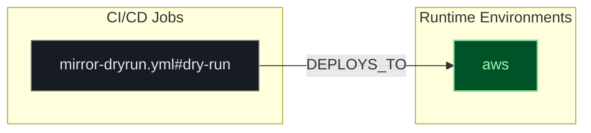

# Repository Architecture Analysis: PostHog/context-mill

## Metadata
- **SHA**: `bb107ab103f56941b88864b7b4fe40a91d72221a`
- **Primary Ecosystem**: JavaScript/TypeScript

## Quality Metrics
- **ast_engine**: tree-sitter
- **avg_cognitive_complexity**: 1.71
- **avg_cyclomatic_complexity**: 2.25
- **component_count**: 228
- **dead_code_count**: 16
- **dead_code_symbols**: 16 entry(ies)
- **duplication_pct**: 67.27
- **file_complexities**: 25 entry(ies)
- **files_analyzed**: 420
- **fitness_passed**: False
- **fitness_violation_count**: 20
- **framework**: Next.js
- **import_edges**: 100 entry(ies)
- **loc**: 28446
- **max_cognitive_complexity**: 61
- **max_cyclomatic_complexity**: 27
- **sloc**: 22542
- **test_file_count**: 48

# Architecture: PostHog/context-mill

## Context
- **Repository**: `PostHog/context-mill`
- **SHA**: `bb107ab103f56941b88864b7b4fe40a91d72221a`
- **Ecosystem**: JavaScript/TypeScript
- **Framework**: Next.js

## Building Block View

## Component Details

Showing top 60 representative components out of 228 across 2 module group(s):

- **Module `example-apps`** (227 components — UI_COMPONENT: 88, API_ROUTE: 51, module: 47)
- **Module `(root)`** (1 components — MODULE: 1)

- **App** (`example-apps/react-react-router-7-framework/app/root.tsx`): UI_COMPONENT (deps: AuthProvider, ErrorBoundary, Header, Layout, Root, RootErrorBoundary (+1 more))
- **App** (`example-apps/react-vite/src/App.jsx`): UI_COMPONENT (deps: AuthProvider, Burrito, BurritoPage, Header, Home, Profile (+1 more))
- **ErrorBoundary** (`example-apps/react-react-router-7-framework/app/root.tsx`): UI_COMPONENT (deps: App, AuthProvider, Header, Layout, Root, RootErrorBoundary (+1 more))
- **Layout** (`example-apps/react-react-router-7-framework/app/root.tsx`): UI_COMPONENT (deps: App, AuthProvider, ErrorBoundary, Header, Root, RootErrorBoundary (+1 more))
- **BurritoPage** (`example-apps/react-react-router-7-framework/app/routes/burrito.tsx`): UI_COMPONENT (deps: API_events_burrito, AuthProvider, Burrito, BurritoScreen, Route)
- **RootNavigator** (`example-apps/react-native/src/navigation/RootNavigator.tsx`): UI_COMPONENT (deps: AuthProvider, BurritoScreen, HomeScreen, ProfileScreen)
- **ProfilePage** (`example-apps/react-react-router-7-framework/app/routes/profile.tsx`): UI_COMPONENT (deps: AuthProvider, ProfileScreen, Route)
- **App** (`example-apps/react-native/App.tsx`): UI_COMPONENT (deps: AuthProvider, RootNavigator)
- **App** (`example-apps/remix/app/root.tsx`): UI_COMPONENT (deps: AuthProvider, PHProvider)
- **Application** (`example-apps/java-spring-boot/src/main/java/com/posthog/example/Application.java`): CONFIG (deps: BurritoController, PostHogConfiguration)
- **BurritoScreen** (`example-apps/react-native/src/screens/BurritoScreen.tsx`): UI_COMPONENT (deps: AuthProvider, RootNavigator)
- **ErrorBoundary** (`example-apps/remix/app/root.tsx`): UI_COMPONENT (deps: AuthProvider, PHProvider)
- **HomeScreen** (`example-apps/react-native/src/screens/HomeScreen.tsx`): UI_COMPONENT (deps: AuthProvider, RootNavigator)
- **Layout** (`example-apps/remix/app/root.tsx`): UI_COMPONENT (deps: AuthProvider, PHProvider)
- **ProfileScreen** (`example-apps/react-native/src/screens/ProfileScreen.tsx`): UI_COMPONENT (deps: AuthProvider, RootNavigator)
- **Root** (`example-apps/react-react-router-6/src/routes/Root.jsx`): UI_COMPONENT (deps: AuthProvider, Header)
- **Root** (`example-apps/react-react-router-7-data/app/root.tsx`): UI_COMPONENT (deps: AuthProvider, Header)
- **Root** (`example-apps/react-react-router-7-declarative/src/routes/Root.tsx`): UI_COMPONENT (deps: AuthProvider, Header)
- **RootErrorBoundary** (`example-apps/react-react-router-7-data/app/root.tsx`): UI_COMPONENT (deps: AuthProvider, Header)
- **Route** (`example-apps/react-tanstack-router-file-based/src/routes/__root.tsx`): UI_COMPONENT (deps: AuthProvider, Header)
- **Route** (`example-apps/tanstack-start/src/routes/__root.tsx`): UI_COMPONENT (deps: AuthProvider, Header)
- **AuthService** (`example-apps/angular/src/app/services/auth.service.ts`): SERVICE (deps: PostHogService)
- **Burrito** (`example-apps/react-vite/src/pages/Burrito.jsx`): UI_COMPONENT (deps: AuthProvider)
- **Burrito** (`example-apps/remix/app/routes/burrito.tsx`): UI_COMPONENT (deps: AuthProvider)
- **BurritoController** (`example-apps/java-spring-boot/src/main/java/com/posthog/example/controller/BurritoController.java`): API_ROUTE (deps: PostHogConfiguration)
- **BurritoPage** (`example-apps/react-react-router-6/src/routes/Burrito.jsx`): UI_COMPONENT (deps: AuthProvider)
- **BurritoPage** (`example-apps/react-react-router-7-data/app/routes/burrito.tsx`): UI_COMPONENT (deps: AuthProvider)
- **BurritoPage** (`example-apps/react-react-router-7-declarative/src/routes/Burrito.tsx`): UI_COMPONENT (deps: AuthProvider)
- **BurritoScreen** (`example-apps/expo/app/burrito.tsx`): UI_COMPONENT (deps: AuthProvider)
- **Header** (`example-apps/react-react-router-6/src/components/Header.jsx`): UI_COMPONENT (deps: AuthProvider)
- **Header** (`example-apps/react-react-router-7-data/app/components/Header.tsx`): UI_COMPONENT (deps: AuthProvider)
- **Header** (`example-apps/react-react-router-7-declarative/src/components/Header.tsx`): UI_COMPONENT (deps: AuthProvider)
- **Header** (`example-apps/react-react-router-7-framework/app/components/Header.tsx`): UI_COMPONENT (deps: AuthProvider)
- **Header** (`example-apps/react-tanstack-router-file-based/src/components/Header.tsx`): UI_COMPONENT (deps: AuthProvider)
- **Header** (`example-apps/react-vite/src/components/Header.jsx`): UI_COMPONENT (deps: AuthProvider)
- **Header** (`example-apps/tanstack-start/src/components/Header.tsx`): UI_COMPONENT (deps: AuthProvider)
- **Home** (`example-apps/react-react-router-6/src/routes/Home.jsx`): UI_COMPONENT (deps: AuthProvider)
- **Home** (`example-apps/react-react-router-7-data/app/routes/home.tsx`): UI_COMPONENT (deps: AuthProvider)
- **Home** (`example-apps/react-react-router-7-declarative/src/routes/Home.tsx`): UI_COMPONENT (deps: AuthProvider)
- **Home** (`example-apps/react-react-router-7-framework/app/routes/home.tsx`): UI_COMPONENT (deps: AuthProvider)
- **Home** (`example-apps/react-vite/src/pages/Home.jsx`): UI_COMPONENT (deps: AuthProvider)
- **HomeScreen** (`example-apps/expo/app/index.tsx`): UI_COMPONENT (deps: AuthProvider)
- **Index** (`example-apps/remix/app/routes/_index.tsx`): UI_COMPONENT (deps: AuthProvider)
- **Profile** (`example-apps/react-vite/src/pages/Profile.jsx`): UI_COMPONENT (deps: AuthProvider)
- **ProfilePage** (`example-apps/react-react-router-6/src/routes/Profile.jsx`): UI_COMPONENT (deps: AuthProvider)
- **ProfilePage** (`example-apps/react-react-router-7-data/app/routes/profile.tsx`): UI_COMPONENT (deps: AuthProvider)
- **ProfilePage** (`example-apps/react-react-router-7-declarative/src/routes/Profile.tsx`): UI_COMPONENT (deps: AuthProvider)
- **ProfileScreen** (`example-apps/expo/app/profile.tsx`): UI_COMPONENT (deps: AuthProvider)
- **RootLayout** (`example-apps/expo/app/_layout.tsx`): UI_COMPONENT (deps: AuthProvider)
- **Route** (`example-apps/react-tanstack-router-file-based/src/routes/burrito.tsx`): UI_COMPONENT (deps: AuthProvider)
- **Route** (`example-apps/react-tanstack-router-file-based/src/routes/index.tsx`): UI_COMPONENT (deps: AuthProvider)
- **Route** (`example-apps/react-tanstack-router-file-based/src/routes/profile.tsx`): UI_COMPONENT (deps: AuthProvider)
- **Route** (`example-apps/tanstack-start/src/routes/burrito.tsx`): UI_COMPONENT (deps: AuthProvider)
- **Route** (`example-apps/tanstack-start/src/routes/index.tsx`): UI_COMPONENT (deps: AuthProvider)
- **Route** (`example-apps/tanstack-start/src/routes/profile.tsx`): UI_COMPONENT (deps: AuthProvider)
- **burrito** (`example-apps/fastapi/app/routers/main.py`): API_ROUTE (deps: User)
- **burrito** (`example-apps/flask/app/main/routes.py`): API_ROUTE (deps: User)
- **dashboard** (`example-apps/fastapi/app/routers/main.py`): API_ROUTE (deps: User)
- **dashboard** (`example-apps/flask/app/main/routes.py`): API_ROUTE (deps: User)
- **home** (`example-apps/fastapi/app/routers/main.py`): API_ROUTE (deps: User)

## 6-Dimension Repository Scorecard

- **Overall Grade**: `F` (47.20/100)
- **Technical Debt Score**: 52.80
- **Estimated Remediation Effort**: 99.65h

| Dimension | Grade | Score | Weight | Details |
| :--- | :---: | :---: | :---: | :--- |
| Code Quality | `F` | 37.00 | 0.20 | avg_cc=2.25, max_cc=27, duplication=67.27%, dead_code=16 |
| Dependency Health | `A` | 100.00 | 0.15 | dependencies=13900, outdated=0, vulnerable=0, has_lockfile=True |
| Maintainability | `F` | 0.00 | 0.15 | avg_cognitive=1.71, max_cognitive=61, fitness_violations=20, oversized_files=2 |
| Pipeline Health | `F` | 2.00 | 0.15 | workflows=9, operational_antipatterns=16, parallel_branches=True |
| Security | `C` | 70.00 | 0.20 | vulnerabilities=0, secrets=0, pipeline_security_findings=4 |
| Test Coverage | `C` | 70.00 | 0.15 | coverage=unavailable, ci_test_job=True, test_files_detected=True |

## Architecture Fitness & Workspace Boundaries

- **[HIGH] `ATRUSS-ARCH-001` (LAYER_VIOLATION)**: API_ROUTE cannot directly import DATA_ACCESS_LAYER when SERVICE components exist. (burrito -> User)
- **[HIGH] `ATRUSS-ARCH-001` (LAYER_VIOLATION)**: API_ROUTE cannot directly import DATA_ACCESS_LAYER when SERVICE components exist. (dashboard -> User)
- **[HIGH] `ATRUSS-ARCH-001` (LAYER_VIOLATION)**: API_ROUTE cannot directly import DATA_ACCESS_LAYER when SERVICE components exist. (home -> User)
- **[HIGH] `ATRUSS-ARCH-001` (LAYER_VIOLATION)**: API_ROUTE cannot directly import DATA_ACCESS_LAYER when SERVICE components exist. (login -> User)
- **[HIGH] `ATRUSS-ARCH-001` (LAYER_VIOLATION)**: API_ROUTE cannot directly import DATA_ACCESS_LAYER when SERVICE components exist. (logout -> User)
- **[HIGH] `ATRUSS-ARCH-001` (LAYER_VIOLATION)**: API_ROUTE cannot directly import DATA_ACCESS_LAYER when SERVICE components exist. (profile -> User)
- **[HIGH] `ATRUSS-ARCH-001` (LAYER_VIOLATION)**: API_ROUTE cannot directly import DATA_ACCESS_LAYER when SERVICE components exist. (signup -> User)
- **[HIGH] `ATRUSS-ARCH-001` (LAYER_VIOLATION)**: API_ROUTE cannot directly import DATA_ACCESS_LAYER when SERVICE components exist. (signup_page -> User)
- **[HIGH] `ATRUSS-ARCH-001` (LAYER_VIOLATION)**: API_ROUTE cannot directly import DATA_ACCESS_LAYER when SERVICE components exist. (update_profile -> User)
- **[HIGH] `ATRUSS-ARCH-004` (CIRCULAR_DEPENDENCY)**: Circular dependency detected between architectural components. (App -> ErrorBoundary -> App)
- **[HIGH] `ATRUSS-ARCH-004` (CIRCULAR_DEPENDENCY)**: Circular dependency detected between architectural components. (App -> ErrorBoundary -> Layout -> App)
- **[HIGH] `ATRUSS-ARCH-004` (CIRCULAR_DEPENDENCY)**: Circular dependency detected between architectural components. (App -> Layout -> App)
- **[HIGH] `ATRUSS-ARCH-004` (CIRCULAR_DEPENDENCY)**: Circular dependency detected between architectural components. (App -> Layout -> ErrorBoundary -> App)
- **[HIGH] `ATRUSS-ARCH-004` (CIRCULAR_DEPENDENCY)**: Circular dependency detected between architectural components. (BurritoScreen -> RootNavigator -> BurritoScreen)
- **[HIGH] `ATRUSS-ARCH-004` (CIRCULAR_DEPENDENCY)**: Circular dependency detected between architectural components. (ErrorBoundary -> Layout -> ErrorBoundary)
- **[HIGH] `ATRUSS-ARCH-004` (CIRCULAR_DEPENDENCY)**: Circular dependency detected between architectural components. (HomeScreen -> RootNavigator -> HomeScreen)
- **[HIGH] `ATRUSS-ARCH-004` (CIRCULAR_DEPENDENCY)**: Circular dependency detected between architectural components. (ProfileScreen -> RootNavigator -> ProfileScreen)
- **[MEDIUM] `ATRUSS-ARCH-005` (COMPLEXITY_THRESHOLD)**: Repository duplication_pct (67.27) exceeds policy threshold (15.0).
- **[MEDIUM] `ATRUSS-ARCH-005` (COMPLEXITY_THRESHOLD)**: Repository max_cognitive_complexity (61.0) exceeds policy threshold (25.0).
- **[MEDIUM] `ATRUSS-ARCH-005` (COMPLEXITY_THRESHOLD)**: Repository max_cyclomatic_complexity (27.0) exceeds policy threshold (20.0).

## Supply Chain Dependencies, Vulnerabilities & Secrets

- **Dependencies Parsed**: 13900 | **Vulnerabilities**: 0 | **Secrets**: 0

### Inventory Sample
- `com.android.tools.build:gradle` `*` (Maven, `example-apps/react-native/android/build.gradle`)
- `com.facebook.react:hermes-android` `*` (Maven, `example-apps/react-native/android/app/build.gradle`)
- `com.facebook.react:react-android` `*` (Maven, `example-apps/react-native/android/app/build.gradle`)
- `com.facebook.react:react-native-gradle-plugin` `*` (Maven, `example-apps/react-native/android/build.gradle`)
- `com.posthog:posthog-server` `2.+` (Maven, `example-apps/java-spring-boot/build.gradle`)
- `org.jetbrains.kotlin:kotlin-gradle-plugin` `*` (Maven, `example-apps/react-native/android/build.gradle`)
- `org.springframework.boot:spring-boot-starter-thymeleaf` `*` (Maven, `example-apps/java-spring-boot/build.gradle`)
- `org.springframework.boot:spring-boot-starter-web` `*` (Maven, `example-apps/java-spring-boot/build.gradle`)
- `PostHog.AspNetCore` `2.9.12` (NuGet, `example-apps/dotnet/PostHogExample.csproj`)
- `Django` `4.2` (PyPI, `example-apps/django/requirements.txt`)
- `Flask` `3.1.0` (PyPI, `example-apps/flask/requirements.txt`)
- `Flask-Login` `0.6.3` (PyPI, `example-apps/flask/requirements.txt`)
- `Flask-SQLAlchemy` `3.1.0` (PyPI, `example-apps/flask/requirements.txt`)
- `Werkzeug` `3.0.0` (PyPI, `example-apps/flask/requirements.txt`)
- `fastapi` `0.109.0` (PyPI, `example-apps/fastapi/requirements.txt`)
- `itsdangerous` `2.0.0` (PyPI, `example-apps/fastapi/requirements.txt`)
- `jinja2` `3.0.0` (PyPI, `example-apps/fastapi/requirements.txt`)
- `posthog` `7` (PyPI, `example-apps/django/requirements.txt`)
- `posthog` `7` (PyPI, `example-apps/fastapi/requirements.txt`)
- `posthog` `7` (PyPI, `example-apps/flask/requirements.txt`)
- `posthog` `7` (PyPI, `example-apps/python/requirements.txt`)
- `pydantic` `2.0.0` (PyPI, `example-apps/fastapi/requirements.txt`)
- `pydantic-settings` `2.0.0` (PyPI, `example-apps/fastapi/requirements.txt`)
- `python-dotenv` `1.0.0` (PyPI, `example-apps/django/requirements.txt`)
- `python-dotenv` `1.0.0` (PyPI, `example-apps/fastapi/requirements.txt`)
- `python-dotenv` `1.0.0` (PyPI, `example-apps/flask/requirements.txt`)
- `python-dotenv` `1.0.0` (PyPI, `example-apps/python/requirements.txt`)
- `python-multipart` `0.0.9` (PyPI, `example-apps/fastapi/requirements.txt`)
- `sqlalchemy` `2.0.0` (PyPI, `example-apps/fastapi/requirements.txt`)
- `uvicorn` `0.27.0` (PyPI, `example-apps/fastapi/requirements.txt`)
- ... (+13870 more dependencies)

## Section 7: Code-to-Cloud Deployment Traceability

- `mirror-dryrun.yml#dry-run` (ci_job) --[DEPLOYS_TO]--> `aws` (environment)

## CI/CD Pipeline Topology

```mermaid
graph TD;
  classDef atlasRoot fill:#004882,stroke:#a3c9ff,stroke-width:2px,color:#d3e4ff
  classDef atlasCategory fill:#212428,stroke:#E87A48,stroke-width:1.5px,color:#dfe3eb
  classDef atlasWorkflow fill:#1b2026,stroke:#a3c9ff,stroke-width:1.5px,color:#dfe3eb
  classDef atlasJob fill:#171c22,stroke:#8d9199,stroke-width:1px,color:#dfe3eb
  classDef atlasTarget fill:#005227,stroke:#8bd99b,stroke-width:1.5px,color:#a7f6b6
  classDef atlasAlert fill:#93000a,stroke:#ffb4ab,stroke-width:1.5px,color:#ffdad6
  classDef atlasMore fill:#252a31,stroke:#8d9199,stroke-dasharray:4 4,color:#c3c6cf
  pipeline_root(["PostHog/context-mill (9 workflows)"]):::atlasRoot
  grp_0_Scheduled___Manual["Scheduled & Manual (5 workflows · 8 jobs)"]:::atlasCategory
  pipeline_root --> grp_0_Scheduled___Manual
  wf_2_PostHog_Context_Mill___E2E_tests["PostHog Context Mill - E2E tests (2 jobs)"]:::atlasWorkflow
  grp_0_Scheduled___Manual --> wf_2_PostHog_Context_Mill___E2E_tests
  job_2_discover["discover"]:::atlasJob
  job_2_test["test"]:::atlasJob
  wf_2_PostHog_Context_Mill___E2E_tests --> job_2_discover
  job_2_discover --> job_2_test
  wf_3_Install_skill_evals["Install skill evals (1 jobs)"]:::atlasWorkflow
  grp_0_Scheduled___Manual --> wf_3_Install_skill_evals
  job_3_run["run"]:::atlasJob
  wf_3_Install_skill_evals --> job_3_run
  wf_4_PostHog_Context_Mill___Integration_tests["PostHog Context Mill - Integration tests (2 jobs)"]:::atlasWorkflow
  grp_0_Scheduled___Manual --> wf_4_PostHog_Context_Mill___Integration_tests
  job_4_discover["discover"]:::atlasJob
  job_4_test["test"]:::atlasJob
  wf_4_PostHog_Context_Mill___Integration_tests --> job_4_discover
  job_4_discover --> job_4_test
  wf_5_Mirror_dry_run["Mirror dry run (1 jobs)"]:::atlasWorkflow
  grp_0_Scheduled___Manual --> wf_5_Mirror_dry_run
  job_5_dry_run["dry-run"]:::atlasJob
  wf_5_Mirror_dry_run --> job_5_dry_run
  wf_8_Wizard_CI_Trigger["Wizard CI Trigger (2 jobs)"]:::atlasWorkflow
  grp_0_Scheduled___Manual --> wf_8_Wizard_CI_Trigger
  job_8_post_welcome["post-welcome"]:::atlasJob
  job_8_handle_command["handle-command"]:::atlasJob
  wf_8_Wizard_CI_Trigger --> job_8_post_welcome
  wf_8_Wizard_CI_Trigger --> job_8_handle_command
  grp_1_Release___Deploy["Release & Deploy (2 workflows · 3 jobs)"]:::atlasCategory
  pipeline_root --> grp_1_Release___Deploy
  wf_0_Build_and_release["Build and release (2 jobs)"]:::atlasWorkflow
  grp_1_Release___Deploy --> wf_0_Build_and_release
  job_0_check_version["check-version"]:::atlasJob
  job_0_build_and_release["build-and-release"]:::atlasJob
  wf_0_Build_and_release --> job_0_check_version
  job_0_check_version --> job_0_build_and_release
  wf_6_release_please["release-please (1 jobs)"]:::atlasWorkflow
  grp_1_Release___Deploy --> wf_6_release_please
  job_6_release_please["release-please"]:::atlasJob
  wf_6_release_please --> job_6_release_please
  grp_2_CI___Verification["CI & Verification (1 workflows · 1 jobs)"]:::atlasCategory
  pipeline_root --> grp_2_CI___Verification
  wf_1_PostHog_Context_Mill___Build["PostHog Context Mill - Build (1 jobs)"]:::atlasWorkflow
  grp_2_CI___Verification --> wf_1_PostHog_Context_Mill___Build
  job_1_build["build"]:::atlasJob
  wf_1_PostHog_Context_Mill___Build --> job_1_build
  grp_3_Security___Governance["Security & Governance (1 workflows · 1 jobs)"]:::atlasCategory
  pipeline_root --> grp_3_Security___Governance
  wf_7_Security["Security (1 jobs)"]:::atlasWorkflow
  grp_3_Security___Governance --> wf_7_Security
  job_7_semgrep_general["semgrep-general"]:::atlasJob
  wf_7_Security --> job_7_semgrep_general
```

