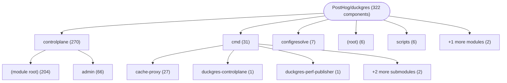
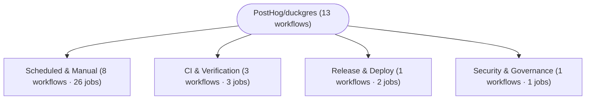

# Repository Architecture Analysis: PostHog/duckgres

## Metadata
- **SHA**: `7fb3ac9bb32d8d75858119e7ec2ca2621375051e`
- **Primary Ecosystem**: Go

## Quality Metrics
- **ast_engine**: tree-sitter
- **avg_cognitive_complexity**: 5.14
- **avg_cyclomatic_complexity**: 4.45
- **component_count**: 322
- **dead_code_count**: 0
- **dead_code_symbols**: 0 entry(ies)
- **duplication_pct**: 4.84
- **file_complexities**: 25 entry(ies)
- **files_analyzed**: 1013
- **fitness_passed**: False
- **fitness_violation_count**: 2
- **framework**: Go Gin / Echo / Fiber
- **import_edges**: 100 entry(ies)
- **loc**: 325843
- **max_cognitive_complexity**: 730
- **max_cyclomatic_complexity**: 92
- **sloc**: 260213
- **test_file_count**: 607

# Architecture: PostHog/duckgres

## Context
- **Repository**: `PostHog/duckgres`
- **SHA**: `7fb3ac9bb32d8d75858119e7ec2ca2621375051e`
- **Ecosystem**: Go
- **Framework**: Go Gin / Echo / Fiber

## Building Block View

## Component Details

Showing top 60 representative components out of 322 across 6 module group(s):

- **Module `controlplane`** (270 components — module: 204, UI_COMPONENT: 65, MODULE: 1)
- **Module `cmd`** (31 components — module: 31)
- **Module `configresolve`** (7 components — module: 7)
- **Module `(root)`** (6 components — module: 6)
- **Module `scripts`** (6 components — module: 4, MODULE: 2)
- **Module `configloader`** (2 components — module: 2)

- **TrinoCluster** (`controlplane/admin/ui/src/pages/TrinoCluster.tsx`): UI_COMPONENT (deps: TrinoRecovery)
- **AddOrgDialog** (`controlplane/admin/ui/src/components/AddOrgDialog.tsx`): UI_COMPONENT
- **AdminGate** (`controlplane/admin/ui/src/components/AdminOnly.tsx`): UI_COMPONENT
- **App** (`controlplane/admin/ui/src/App.tsx`): UI_COMPONENT
- **AppShell** (`controlplane/admin/ui/src/components/AppShell.tsx`): UI_COMPONENT
- **Audit** (`controlplane/admin/ui/src/pages/Audit.tsx`): UI_COMPONENT
- **BackfillBadge** (`controlplane/admin/ui/src/components/OrgTeamDialogs.tsx`): UI_COMPONENT
- **ConfigStore** (`controlplane/admin/ui/src/pages/ConfigStore.tsx`): UI_COMPONENT
- **CopyButton** (`controlplane/admin/ui/src/components/CopyButton.tsx`): UI_COMPONENT
- **CreateTeamDialog** (`controlplane/admin/ui/src/components/OrgTeamDialogs.tsx`): UI_COMPONENT
- **DataTable** (`controlplane/admin/ui/src/components/DataTable.tsx`): UI_COMPONENT
- **DeleteTeamDialog** (`controlplane/admin/ui/src/components/OrgTeamDialogs.tsx`): UI_COMPONENT
- **DeprecationBanner** (`controlplane/admin/ui/src/components/DeprecationBanner.tsx`): UI_COMPONENT
- **EarliestEventDateCell** (`controlplane/admin/ui/src/components/OrgTeamDialogs.tsx`): UI_COMPONENT
- **EditTeamDialog** (`controlplane/admin/ui/src/components/OrgTeamDialogs.tsx`): UI_COMPONENT
- **EmptyState** (`controlplane/admin/ui/src/components/states.tsx`): UI_COMPONENT
- **ErrorState** (`controlplane/admin/ui/src/components/states.tsx`): UI_COMPONENT
- **Errors** (`controlplane/admin/ui/src/pages/Errors.tsx`): UI_COMPONENT
- **IdentityProvider** (`controlplane/admin/ui/src/components/IdentityProvider.tsx`): UI_COMPONENT
- **Impersonate** (`controlplane/admin/ui/src/pages/Impersonate.tsx`): UI_COMPONENT
- **InfoTooltip** (`controlplane/admin/ui/src/components/InfoTooltip.tsx`): UI_COMPONENT
- **JsonValue** (`controlplane/admin/ui/src/components/JsonView.tsx`): UI_COMPONENT
- **LegacyNamesBadge** (`controlplane/admin/ui/src/components/OrgTeamDialogs.tsx`): UI_COMPONENT
- **Live** (`controlplane/admin/ui/src/pages/Live.tsx`): UI_COMPONENT
- **LoadingState** (`controlplane/admin/ui/src/components/states.tsx`): UI_COMPONENT
- **Metrics** (`controlplane/admin/ui/src/pages/Metrics.tsx`): UI_COMPONENT
- **NAV** (`controlplane/admin/ui/src/components/nav.ts`): UI_COMPONENT
- **Nodes** (`controlplane/admin/ui/src/pages/Nodes.tsx`): UI_COMPONENT
- **NotAuthorized** (`controlplane/admin/ui/src/pages/NotAuthorized.tsx`): UI_COMPONENT
- **NotFound** (`controlplane/admin/ui/src/pages/NotFound.tsx`): UI_COMPONENT
- **Operators** (`controlplane/admin/ui/src/pages/Operators.tsx`): UI_COMPONENT
- **OrgDetail** (`controlplane/admin/ui/src/pages/OrgDetail.tsx`): UI_COMPONENT
- **OrgRef** (`controlplane/admin/ui/src/components/OrgRef.tsx`): UI_COMPONENT
- **OrgTeams** (`controlplane/admin/ui/src/pages/OrgTeams.tsx`): UI_COMPONENT
- **OrgTrinoCard** (`controlplane/admin/ui/src/pages/OrgTrinoCard.tsx`): UI_COMPONENT
- **OrgTrinoSettings** (`controlplane/admin/ui/src/pages/OrgTrinoSettings.tsx`): UI_COMPONENT
- **OrgUsageSection** (`controlplane/admin/ui/src/pages/OrgUsage.tsx`): UI_COMPONENT
- **Orgs** (`controlplane/admin/ui/src/pages/Orgs.tsx`): UI_COMPONENT
- **Overview** (`controlplane/admin/ui/src/pages/Overview.tsx`): UI_COMPONENT
- **POLL** (`controlplane/admin/ui/src/lib/query.ts`): UI_COMPONENT
- **PageBody** (`controlplane/admin/ui/src/components/AppShell.tsx`): UI_COMPONENT
- **PageHeader** (`controlplane/admin/ui/src/components/AppShell.tsx`): UI_COMPONENT
- **ProgressBar** (`controlplane/admin/ui/src/components/ProgressBar.tsx`): UI_COMPONENT
- **QueryDetailDialog** (`controlplane/admin/ui/src/components/QueryDetailDialog.tsx`): UI_COMPONENT
- **RESHARD_LOG_CATCHUP_PAGE** (`controlplane/admin/ui/src/hooks/useApi.ts`): UI_COMPONENT
- **REVEAL_TICKS_TARGET** (`controlplane/admin/ui/src/lib/logReplay.ts`): UI_COMPONENT
- **REVEAL_TICK_MS** (`controlplane/admin/ui/src/lib/logReplay.ts`): UI_COMPONENT
- **ReshardForm** (`controlplane/admin/ui/src/pages/ReshardForm.tsx`): UI_COMPONENT
- **ReshardOperation** (`controlplane/admin/ui/src/pages/ReshardOperation.tsx`): UI_COMPONENT
- **Reshards** (`controlplane/admin/ui/src/pages/Reshards.tsx`): UI_COMPONENT
- **Separator** (`controlplane/admin/ui/src/components/ui/separator.tsx`): UI_COMPONENT
- **ShardBadge** (`controlplane/admin/ui/src/components/ShardBadge.tsx`): UI_COMPONENT
- **Sidebar** (`controlplane/admin/ui/src/components/Sidebar.tsx`): UI_COMPONENT
- **Sparkline** (`controlplane/admin/ui/src/components/Sparkline.tsx`): UI_COMPONENT
- **StatCard** (`controlplane/admin/ui/src/components/StatCard.tsx`): UI_COMPONENT
- **StateBadge** (`controlplane/admin/ui/src/components/StateBadge.tsx`): UI_COMPONENT
- **TableSkeleton** (`controlplane/admin/ui/src/components/states.tsx`): UI_COMPONENT
- **Topbar** (`controlplane/admin/ui/src/components/Topbar.tsx`): UI_COMPONENT
- **TrinoCellPicker** (`controlplane/admin/ui/src/components/TrinoCellPicker.tsx`): UI_COMPONENT
- **TrinoQueries** (`controlplane/admin/ui/src/pages/TrinoQueries.tsx`): UI_COMPONENT

## 6-Dimension Repository Scorecard

- **Overall Grade**: `F` (54.48/100)
- **Technical Debt Score**: 45.52
- **Estimated Remediation Effort**: 62.35h

| Dimension | Grade | Score | Weight | Details |
| :--- | :---: | :---: | :---: | :--- |
| Code Quality | `D` | 61.94 | 0.20 | avg_cc=4.45, max_cc=92, duplication=4.84%, dead_code=0 |
| Dependency Health | `A` | 100.00 | 0.15 | dependencies=778, outdated=0, vulnerable=0, has_lockfile=True |
| Maintainability | `F` | 42.58 | 0.15 | avg_cognitive=5.14, max_cognitive=730, fitness_violations=2, oversized_files=6 |
| Pipeline Health | `F` | 0.00 | 0.15 | workflows=13, operational_antipatterns=37, parallel_branches=True |
| Security | `F` | 51.00 | 0.20 | vulnerabilities=0, secrets=1, pipeline_security_findings=3 |
| Test Coverage | `C` | 70.00 | 0.15 | coverage=unavailable, ci_test_job=True, test_files_detected=True |

## Architecture Fitness & Workspace Boundaries

- **[MEDIUM] `ATRUSS-ARCH-005` (COMPLEXITY_THRESHOLD)**: Repository max_cognitive_complexity (730.0) exceeds policy threshold (25.0).
- **[MEDIUM] `ATRUSS-ARCH-005` (COMPLEXITY_THRESHOLD)**: Repository max_cyclomatic_complexity (92.0) exceeds policy threshold (20.0).

## Supply Chain Dependencies, Vulnerabilities & Secrets

- **Dependencies Parsed**: 778 | **Vulnerabilities**: 0 | **Secrets**: 1

### Secret Findings (Redacted)
- **[CRITICAL] `ATRUSS-SEC-004`** at `server/tlscert/acme_dns_test.go:73` (`-----BEGIN ... PRIVATE KEY----- [REDACTED]`)

### Inventory Sample
- `org.postgresql:postgresql` `42.7.12` (Maven, `scripts/client-compat/clients/jdbc/pom.xml`)
- `org.yaml:snakeyaml` `2.3` (Maven, `scripts/client-compat/clients/jdbc/pom.xml`)
- `native-tls` `0.2` (cargo, `scripts/client-compat/clients/tokio-postgres/Cargo.toml`)
- `postgres-native-tls` `0.5` (cargo, `scripts/client-compat/clients/tokio-postgres/Cargo.toml`)
- `reqwest` `0.12` (cargo, `scripts/client-compat/clients/tokio-postgres/Cargo.toml`)
- `serde` `1` (cargo, `scripts/client-compat/clients/tokio-postgres/Cargo.toml`)
- `serde_json` `1` (cargo, `scripts/client-compat/clients/tokio-postgres/Cargo.toml`)
- `serde_yaml` `0.9` (cargo, `scripts/client-compat/clients/tokio-postgres/Cargo.toml`)
- `tokio` `1` (cargo, `scripts/client-compat/clients/tokio-postgres/Cargo.toml`)
- `tokio-postgres` `0.7` (cargo, `scripts/client-compat/clients/tokio-postgres/Cargo.toml`)
- `github.com/apache/arrow-go/v18` `18.5.1` (golang, `go.mod`)
- `github.com/aws/aws-sdk-go-v2` `1.45.1` (golang, `go.mod`)
- `github.com/aws/aws-sdk-go-v2/config` `1.32.29` (golang, `go.mod`)
- `github.com/aws/aws-sdk-go-v2/credentials` `1.19.28` (golang, `go.mod`)
- `github.com/aws/aws-sdk-go-v2/feature/s3/manager` `1.22.32` (golang, `go.mod`)
- `github.com/aws/aws-sdk-go-v2/service/athena` `1.64.0` (golang, `go.mod`)
- `github.com/aws/aws-sdk-go-v2/service/glue` `1.155.0` (golang, `go.mod`)
- `github.com/aws/aws-sdk-go-v2/service/route53` `1.62.3` (golang, `go.mod`)
- `github.com/aws/aws-sdk-go-v2/service/s3` `1.105.0` (golang, `go.mod`)
- `github.com/aws/aws-sdk-go-v2/service/sts` `1.44.0` (golang, `go.mod`)
- `github.com/cloudflare/tableflip` `1.2.3` (golang, `go.mod`)
- `github.com/duckdb/duckdb-go-bindings` `0.10505.0` (golang, `go.mod`)
- `github.com/duckdb/duckdb-go/v2` `2.10505.0` (golang, `go.mod`)
- `github.com/gin-contrib/gzip` `1.2.6` (golang, `go.mod`)
- `github.com/gin-gonic/gin` `1.12.0` (golang, `go.mod`)
- `github.com/google/uuid` `1.6.0` (golang, `go.mod`)
- `github.com/hashicorp/golang-lru/v2` `2.0.7` (golang, `go.mod`)
- `github.com/jackc/pgx/v5` `5.9.2` (golang, `go.mod`)
- `github.com/jackc/pgx/v5` `5.9.2` (golang, `scripts/client-compat/clients/pgx/go.mod`)
- `github.com/lib/pq` `1.10.9` (golang, `go.mod`)
- ... (+748 more dependencies)

## Section 7: Code-to-Cloud Deployment Traceability

```mermaid
flowchart LR
    subgraph code_modules["Code Modules"]
        mod_b28807bf_dc5b_4a18_9055_854894d4e803["b28807bf-dc5b-4a18-9055-854894d4e803"]
        mod_cmd_cache_proxy["cmd/cache-proxy"]
        mod_controlplane_admin_ui["controlplane/admin/ui"]
        mod_scripts_client_compat["scripts/client-compat"]
        mod_scripts_client_compat_clients_dbt["scripts/client-compat/clients/dbt"]
        mod_scripts_client_compat_clients_harlequin["scripts/client-compat/clients/harlequin"]
        mod_scripts_client_compat_clients_jdbc["scripts/client-compat/clients/jdbc"]
        mod_scripts_client_compat_clients_node_postgres["scripts/client-compat/clients/node-postgres"]
        mod_scripts_client_compat_clients_pgadmin["scripts/client-compat/clients/pgadmin"]
        mod_scripts_client_compat_clients_pgx["scripts/client-compat/clients/pgx"]
        mod_scripts_client_compat_clients_psql["scripts/client-compat/clients/psql"]
        mod_scripts_client_compat_clients_psycopg["scripts/client-compat/clients/psycopg"]
        mod_scripts_client_compat_clients_sqlalchemy["scripts/client-compat/clients/sqlalchemy"]
        mod_scripts_client_compat_clients_tokio_postgres["scripts/client-compat/clients/tokio-postgres"]
        mod_tests_integration["tests/integration"]
        mod_tests_integration_trino["tests/integration/trino"]
        mod_tests_mw_dev_scenario["tests/mw-dev/scenario"]
    end
    subgraph build_artifacts["Build Artifacts / Containers"]
        art_____inputs_dockerfile___["${{ inputs.dockerfile }}"]
        art_Dockerfile["Dockerfile"]
        art_Dockerfile_controlplane["Dockerfile.controlplane"]
        art_Dockerfile_worker["Dockerfile.worker"]
        art_cmd_cache_proxy_Dockerfile["cmd/cache-proxy/Dockerfile"]
        art_docker_compose_yaml["docker-compose.yaml"]
        art_k8s_control_plane_multitenant_local_yaml["k8s/control-plane-multitenant-local.yaml"]
        art_k8s_kind_control_plane_yaml["k8s/kind/control-plane.yaml"]
        art_scripts_client_compat_Dockerfile_results["scripts/client-compat/Dockerfile.results"]
        art_scripts_client_compat_clients_dbt_Dockerfile["scripts/client-compat/clients/dbt/Dockerfile"]
        art_scripts_client_compat_clients_harlequin_Dockerfile["scripts/client-compat/clients/harlequin/Dockerfile"]
        art_scripts_client_compat_clients_jdbc_Dockerfile["scripts/client-compat/clients/jdbc/Dockerfile"]
        art_scripts_client_compat_clients_node_postgres_Dockerfile["scripts/client-compat/clients/node-postgres/Dockerfile"]
        art_scripts_client_compat_clients_pgadmin_Dockerfile["scripts/client-compat/clients/pgadmin/Dockerfile"]
        art_scripts_client_compat_clients_pgx_Dockerfile["scripts/client-compat/clients/pgx/Dockerfile"]
        art_scripts_client_compat_clients_psql_Dockerfile["scripts/client-compat/clients/psql/Dockerfile"]
        art_scripts_client_compat_clients_psycopg_Dockerfile["scripts/client-compat/clients/psycopg/Dockerfile"]
        art_scripts_client_compat_clients_sqlalchemy_Dockerfile["scripts/client-compat/clients/sqlalchemy/Dockerfile"]
        art_scripts_client_compat_clients_tokio_postgres_Dockerfile["scripts/client-compat/clients/tokio-postgres/Dockerfile"]
        art_scripts_client_compat_docker_compose_yml["scripts/client-compat/docker-compose.yml"]
        art_tests_integration_docker_compose_yml["tests/integration/docker-compose.yml"]
        art_tests_integration_trino_Dockerfile["tests/integration/trino/Dockerfile"]
        art_tests_mw_dev_scenario_Dockerfile["tests/mw-dev/scenario/Dockerfile"]
    end
    subgraph ci_jobs["CI/CD Jobs"]
        job__image_build_yml_build["_image-build.yml#build"]
        job_ci_yml_integration_tests["ci.yml#integration-tests"]
        job_container_image_cache_proxy_cd_yml_build["container-image-cache-proxy-cd.yml#build"]
        job_container_image_cd_yml_build["container-image-cd.yml#build"]
        job_container_image_controlplane_cd_yml_build["container-image-controlplane-cd.yml#build"]
        job_container_image_worker_cd_yml_build["container-image-worker-cd.yml#build"]
        job_e2e_mw_dev_yml_e2e_cleanup["e2e-mw-dev.yml#e2e-cleanup"]
        job_e2e_mw_dev_yml_e2e_teardown["e2e-mw-dev.yml#e2e-teardown"]
        job_e2e_mw_dev_yml_e2e_lanes["e2e-mw-dev.yml#e2e_lanes"]
        job_scenario_dev_yml_scenario["scenario-dev.yml#scenario"]
    end
    subgraph runtime_envs["Runtime Environments"]
        env_azure["azure"]
    end
    job_e2e_mw_dev_yml_e2e_cleanup -->|DEPLOYS_TO| env_azure
    job_e2e_mw_dev_yml_e2e_teardown -->|DEPLOYS_TO| env_azure
    job_e2e_mw_dev_yml_e2e_lanes -->|DEPLOYS_TO| env_azure
    job_scenario_dev_yml_scenario -->|DEPLOYS_TO| env_azure
    mod_b28807bf_dc5b_4a18_9055_854894d4e803 -->|DEPLOYED_BY| job__image_build_yml_build
    mod_b28807bf_dc5b_4a18_9055_854894d4e803 -->|DEPLOYED_BY| job_container_image_cache_proxy_cd_yml_build
    mod_b28807bf_dc5b_4a18_9055_854894d4e803 -->|DEPLOYED_BY| job_container_image_cd_yml_build
    mod_b28807bf_dc5b_4a18_9055_854894d4e803 -->|DEPLOYED_BY| job_container_image_controlplane_cd_yml_build
    mod_b28807bf_dc5b_4a18_9055_854894d4e803 -->|DEPLOYED_BY| job_container_image_worker_cd_yml_build
    mod_b28807bf_dc5b_4a18_9055_854894d4e803 -->|PACKAGED_BY| art_____inputs_dockerfile___
    mod_b28807bf_dc5b_4a18_9055_854894d4e803 -->|PACKAGED_BY| art_Dockerfile
    mod_b28807bf_dc5b_4a18_9055_854894d4e803 -->|PACKAGED_BY| art_Dockerfile_controlplane
    mod_b28807bf_dc5b_4a18_9055_854894d4e803 -->|PACKAGED_BY| art_Dockerfile_worker
    mod_b28807bf_dc5b_4a18_9055_854894d4e803 -->|PACKAGED_BY| art_docker_compose_yaml
    mod_b28807bf_dc5b_4a18_9055_854894d4e803 -->|PACKAGED_BY| art_scripts_client_compat_docker_compose_yml
    mod_b28807bf_dc5b_4a18_9055_854894d4e803 -->|PACKAGED_BY| art_tests_integration_docker_compose_yml
    mod_cmd_cache_proxy -->|PACKAGED_BY| art_cmd_cache_proxy_Dockerfile
    mod_controlplane_admin_ui -->|PACKAGED_BY| art_Dockerfile
    mod_controlplane_admin_ui -->|PACKAGED_BY| art_Dockerfile_controlplane
    mod_controlplane_admin_ui -->|PACKAGED_BY| art_Dockerfile_worker
    mod_controlplane_admin_ui -->|PACKAGED_BY| art_cmd_cache_proxy_Dockerfile
    mod_controlplane_admin_ui -->|PACKAGED_BY| art_scripts_client_compat_clients_harlequin_Dockerfile
    mod_controlplane_admin_ui -->|PACKAGED_BY| art_scripts_client_compat_clients_jdbc_Dockerfile
    mod_controlplane_admin_ui -->|PACKAGED_BY| art_scripts_client_compat_clients_pgx_Dockerfile
    mod_controlplane_admin_ui -->|PACKAGED_BY| art_scripts_client_compat_clients_tokio_postgres_Dockerfile
    mod_controlplane_admin_ui -->|PACKAGED_BY| art_scripts_client_compat_docker_compose_yml
    mod_controlplane_admin_ui -->|PACKAGED_BY| art_tests_integration_docker_compose_yml
    mod_controlplane_admin_ui -->|PACKAGED_BY| art_k8s_control_plane_multitenant_local_yaml
    mod_controlplane_admin_ui -->|PACKAGED_BY| art_k8s_kind_control_plane_yaml
    mod_scripts_client_compat -->|PACKAGED_BY| art_scripts_client_compat_Dockerfile_results
    mod_scripts_client_compat -->|PACKAGED_BY| art_scripts_client_compat_docker_compose_yml
    mod_scripts_client_compat_clients_dbt -->|PACKAGED_BY| art_scripts_client_compat_clients_dbt_Dockerfile
    mod_scripts_client_compat_clients_dbt -->|PACKAGED_BY| art_scripts_client_compat_docker_compose_yml
    mod_scripts_client_compat_clients_dbt -->|PACKAGED_BY| art_tests_mw_dev_scenario_Dockerfile
    mod_scripts_client_compat_clients_harlequin -->|PACKAGED_BY| art_scripts_client_compat_clients_harlequin_Dockerfile
    mod_scripts_client_compat_clients_jdbc -->|PACKAGED_BY| art_scripts_client_compat_clients_jdbc_Dockerfile
    mod_scripts_client_compat_clients_jdbc -->|PACKAGED_BY| art_scripts_client_compat_docker_compose_yml
    mod_scripts_client_compat_clients_node_postgres -->|PACKAGED_BY| art_scripts_client_compat_clients_node_postgres_Dockerfile
    mod_scripts_client_compat_clients_node_postgres -->|PACKAGED_BY| art_scripts_client_compat_docker_compose_yml
    mod_scripts_client_compat_clients_pgadmin -->|PACKAGED_BY| art_scripts_client_compat_clients_pgadmin_Dockerfile
    mod_scripts_client_compat_clients_pgadmin -->|PACKAGED_BY| art_scripts_client_compat_docker_compose_yml
    mod_scripts_client_compat_clients_pgx -->|PACKAGED_BY| art_scripts_client_compat_clients_pgx_Dockerfile
    mod_scripts_client_compat_clients_pgx -->|PACKAGED_BY| art_scripts_client_compat_docker_compose_yml
    mod_scripts_client_compat_clients_psql -->|PACKAGED_BY| art_scripts_client_compat_clients_psql_Dockerfile
    mod_scripts_client_compat_clients_psql -->|PACKAGED_BY| art_scripts_client_compat_docker_compose_yml
    mod_scripts_client_compat_clients_psql -->|PACKAGED_BY| art_tests_integration_docker_compose_yml
    mod_scripts_client_compat_clients_psycopg -->|PACKAGED_BY| art_scripts_client_compat_clients_harlequin_Dockerfile
    mod_scripts_client_compat_clients_psycopg -->|PACKAGED_BY| art_scripts_client_compat_clients_pgadmin_Dockerfile
    mod_scripts_client_compat_clients_psycopg -->|PACKAGED_BY| art_scripts_client_compat_clients_psycopg_Dockerfile
    mod_scripts_client_compat_clients_psycopg -->|PACKAGED_BY| art_scripts_client_compat_clients_sqlalchemy_Dockerfile
    mod_scripts_client_compat_clients_psycopg -->|PACKAGED_BY| art_scripts_client_compat_docker_compose_yml
    mod_scripts_client_compat_clients_sqlalchemy -->|PACKAGED_BY| art_scripts_client_compat_clients_sqlalchemy_Dockerfile
    mod_scripts_client_compat_clients_sqlalchemy -->|PACKAGED_BY| art_scripts_client_compat_docker_compose_yml
    mod_scripts_client_compat_clients_tokio_postgres -->|PACKAGED_BY| art_scripts_client_compat_clients_tokio_postgres_Dockerfile
    mod_scripts_client_compat_clients_tokio_postgres -->|PACKAGED_BY| art_scripts_client_compat_docker_compose_yml
    mod_tests_integration -->|BUILT_BY| job_ci_yml_integration_tests
    mod_tests_integration -->|PACKAGED_BY| art_tests_integration_docker_compose_yml
    mod_tests_integration_trino -->|PACKAGED_BY| art_tests_integration_docker_compose_yml
    mod_tests_integration_trino -->|PACKAGED_BY| art_tests_integration_trino_Dockerfile
    mod_tests_mw_dev_scenario -->|DEPLOYED_BY| job_scenario_dev_yml_scenario
    mod_tests_mw_dev_scenario -->|PACKAGED_BY| art_tests_mw_dev_scenario_Dockerfile
    art_Dockerfile -->|BUILT_BY| job__image_build_yml_build
    art_Dockerfile -->|BUILT_BY| job_container_image_cache_proxy_cd_yml_build
    art_Dockerfile -->|BUILT_BY| job_container_image_cd_yml_build
    art_Dockerfile -->|BUILT_BY| job_container_image_controlplane_cd_yml_build
    art_Dockerfile -->|BUILT_BY| job_container_image_worker_cd_yml_build
    art_Dockerfile_controlplane -->|BUILT_BY| job_container_image_controlplane_cd_yml_build
    art_Dockerfile_worker -->|BUILT_BY| job_container_image_worker_cd_yml_build
    art_cmd_cache_proxy_Dockerfile -->|BUILT_BY| job_container_image_cache_proxy_cd_yml_build
    art_tests_integration_docker_compose_yml -->|BUILT_BY| job_ci_yml_integration_tests
    art_tests_mw_dev_scenario_Dockerfile -->|DEPLOYED_BY| job_scenario_dev_yml_scenario
```

- `e2e-mw-dev.yml#e2e-cleanup` (ci_job) --[DEPLOYS_TO]--> `azure` (environment)
- `e2e-mw-dev.yml#e2e-teardown` (ci_job) --[DEPLOYS_TO]--> `azure` (environment)
- `e2e-mw-dev.yml#e2e_lanes` (ci_job) --[DEPLOYS_TO]--> `azure` (environment)
- `scenario-dev.yml#scenario` (ci_job) --[DEPLOYS_TO]--> `azure` (environment)
- `b28807bf-dc5b-4a18-9055-854894d4e803` (code_module) --[DEPLOYED_BY]--> `_image-build.yml#build` (ci_job)
- `b28807bf-dc5b-4a18-9055-854894d4e803` (code_module) --[DEPLOYED_BY]--> `container-image-cache-proxy-cd.yml#build` (ci_job)
- `b28807bf-dc5b-4a18-9055-854894d4e803` (code_module) --[DEPLOYED_BY]--> `container-image-cd.yml#build` (ci_job)
- `b28807bf-dc5b-4a18-9055-854894d4e803` (code_module) --[DEPLOYED_BY]--> `container-image-controlplane-cd.yml#build` (ci_job)
- `b28807bf-dc5b-4a18-9055-854894d4e803` (code_module) --[DEPLOYED_BY]--> `container-image-worker-cd.yml#build` (ci_job)
- `b28807bf-dc5b-4a18-9055-854894d4e803` (code_module) --[PACKAGED_BY]--> `${{ inputs.dockerfile }}` (container)
- `b28807bf-dc5b-4a18-9055-854894d4e803` (code_module) --[PACKAGED_BY]--> `Dockerfile` (container)
- `b28807bf-dc5b-4a18-9055-854894d4e803` (code_module) --[PACKAGED_BY]--> `Dockerfile.controlplane` (container)
- `b28807bf-dc5b-4a18-9055-854894d4e803` (code_module) --[PACKAGED_BY]--> `Dockerfile.worker` (container)
- `b28807bf-dc5b-4a18-9055-854894d4e803` (code_module) --[PACKAGED_BY]--> `docker-compose.yaml` (container)
- `b28807bf-dc5b-4a18-9055-854894d4e803` (code_module) --[PACKAGED_BY]--> `scripts/client-compat/docker-compose.yml` (container)
- `b28807bf-dc5b-4a18-9055-854894d4e803` (code_module) --[PACKAGED_BY]--> `tests/integration/docker-compose.yml` (container)
- `cmd/cache-proxy` (code_module) --[PACKAGED_BY]--> `cmd/cache-proxy/Dockerfile` (container)
- `controlplane/admin/ui` (code_module) --[PACKAGED_BY]--> `Dockerfile` (container)
- `controlplane/admin/ui` (code_module) --[PACKAGED_BY]--> `Dockerfile.controlplane` (container)
- `controlplane/admin/ui` (code_module) --[PACKAGED_BY]--> `Dockerfile.worker` (container)
- `controlplane/admin/ui` (code_module) --[PACKAGED_BY]--> `cmd/cache-proxy/Dockerfile` (container)
- `controlplane/admin/ui` (code_module) --[PACKAGED_BY]--> `scripts/client-compat/clients/harlequin/Dockerfile` (container)
- `controlplane/admin/ui` (code_module) --[PACKAGED_BY]--> `scripts/client-compat/clients/jdbc/Dockerfile` (container)
- `controlplane/admin/ui` (code_module) --[PACKAGED_BY]--> `scripts/client-compat/clients/pgx/Dockerfile` (container)
- `controlplane/admin/ui` (code_module) --[PACKAGED_BY]--> `scripts/client-compat/clients/tokio-postgres/Dockerfile` (container)
- `controlplane/admin/ui` (code_module) --[PACKAGED_BY]--> `scripts/client-compat/docker-compose.yml` (container)
- `controlplane/admin/ui` (code_module) --[PACKAGED_BY]--> `tests/integration/docker-compose.yml` (container)
- `controlplane/admin/ui` (code_module) --[PACKAGED_BY]--> `k8s/control-plane-multitenant-local.yaml` (iac)
- `controlplane/admin/ui` (code_module) --[PACKAGED_BY]--> `k8s/kind/control-plane.yaml` (iac)
- `scripts/client-compat` (code_module) --[PACKAGED_BY]--> `scripts/client-compat/Dockerfile.results` (container)
- `scripts/client-compat` (code_module) --[PACKAGED_BY]--> `scripts/client-compat/docker-compose.yml` (container)
- `scripts/client-compat/clients/dbt` (code_module) --[PACKAGED_BY]--> `scripts/client-compat/clients/dbt/Dockerfile` (container)
- `scripts/client-compat/clients/dbt` (code_module) --[PACKAGED_BY]--> `scripts/client-compat/docker-compose.yml` (container)
- `scripts/client-compat/clients/dbt` (code_module) --[PACKAGED_BY]--> `tests/mw-dev/scenario/Dockerfile` (container)
- `scripts/client-compat/clients/harlequin` (code_module) --[PACKAGED_BY]--> `scripts/client-compat/clients/harlequin/Dockerfile` (container)
- `scripts/client-compat/clients/jdbc` (code_module) --[PACKAGED_BY]--> `scripts/client-compat/clients/jdbc/Dockerfile` (container)
- `scripts/client-compat/clients/jdbc` (code_module) --[PACKAGED_BY]--> `scripts/client-compat/docker-compose.yml` (container)
- `scripts/client-compat/clients/node-postgres` (code_module) --[PACKAGED_BY]--> `scripts/client-compat/clients/node-postgres/Dockerfile` (container)
- `scripts/client-compat/clients/node-postgres` (code_module) --[PACKAGED_BY]--> `scripts/client-compat/docker-compose.yml` (container)
- `scripts/client-compat/clients/pgadmin` (code_module) --[PACKAGED_BY]--> `scripts/client-compat/clients/pgadmin/Dockerfile` (container)

## CI/CD Pipeline Topology

