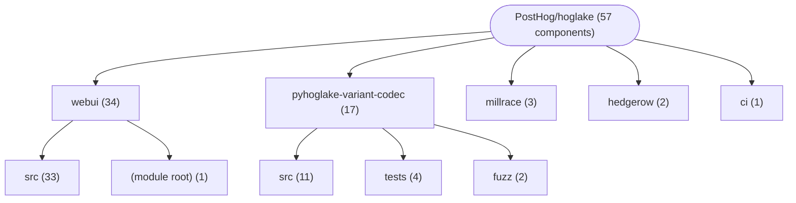
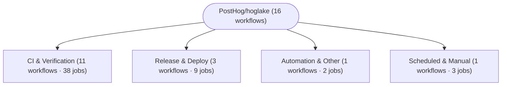

# Repository Architecture Analysis: PostHog/hoglake

## Metadata
- **SHA**: `91bd3373eaf9271227506f7436ff4bc3ed2f4811`
- **Primary Ecosystem**: Java

## Quality Metrics
- **ast_engine**: tree-sitter
- **avg_cognitive_complexity**: 5.47
- **avg_cyclomatic_complexity**: 7.43
- **component_count**: 57
- **dead_code_count**: 1
- **dead_code_symbols**: 1 entry(ies)
- **duplication_pct**: 79.91
- **file_complexities**: 25 entry(ies)
- **files_analyzed**: 927
- **fitness_passed**: False
- **fitness_violation_count**: 3
- **framework**: Unknown
- **import_edges**: 100 entry(ies)
- **loc**: 366534
- **max_cognitive_complexity**: 460
- **max_cyclomatic_complexity**: 690
- **sloc**: 273588
- **test_file_count**: 1708

# Architecture: PostHog/hoglake

## Context
- **Repository**: `PostHog/hoglake`
- **SHA**: `91bd3373eaf9271227506f7436ff4bc3ed2f4811`
- **Ecosystem**: Java
- **Framework**: Unknown

## Building Block View

## Component Details
- **docker-compose.live-millrace** (`ci/docker-compose.live-millrace.yml`): module
- **BufferedService** (`hedgerow/src/hedgerow/buffered_service.py`): SERVICE
- **Service** (`hedgerow/tests/test_buffered_cli.py`): SERVICE (deps: BufferedService)
- **MaintenanceService** (`millrace/maintenance.py`): SERVICE
- **StageManager** (`millrace/stage.py`): SERVICE
- **JournalingStageManager** (`millrace/tests/test_consumer.py`): SERVICE (deps: StageManager)
- **decode** (`pyhoglake-variant-codec/fuzz/fuzz_targets/decode.rs`): module
- **encode_json** (`pyhoglake-variant-codec/fuzz/fuzz_targets/encode_json.rs`): module
- **consts** (`pyhoglake-variant-codec/src/consts.rs`): module
- **lib** (`pyhoglake-variant-codec/src/lib.rs`): module
- **python** (`pyhoglake-variant-codec/src/python.rs`): module
- **mod** (`pyhoglake-variant-codec/src/decode/mod.rs`): module
- **storage** (`pyhoglake-variant-codec/src/decode/storage.rs`): module
- **tagged** (`pyhoglake-variant-codec/src/decode/tagged.rs`): module
- **value** (`pyhoglake-variant-codec/src/decode/value.rs`): module
- **mod** (`pyhoglake-variant-codec/src/encode/mod.rs`): module
- **parse** (`pyhoglake-variant-codec/src/encode/parse.rs`): module
- **shred** (`pyhoglake-variant-codec/src/encode/shred.rs`): module
- **write** (`pyhoglake-variant-codec/src/encode/write.rs`): module
- **decode** (`pyhoglake-variant-codec/tests/decode.rs`): module
- **encode** (`pyhoglake-variant-codec/tests/encode.rs`): module
- **shred** (`pyhoglake-variant-codec/tests/shred.rs`): module
- **mod** (`pyhoglake-variant-codec/tests/oracle/mod.rs`): module
- **hoglake-webui** (`webui/package.json`): MODULE
- **App** (`webui/src/App.tsx`): UI_COMPONENT (deps: CatalogPage, CatalogsPage, CentralMaintenancePage, ConsumersPage, DatabasePage, Layout, MaintenancePage, MetricsPage, NamespacePage, PartitionsPage, TablePage)
- **AuthStatus** (`webui/src/components/Auth.tsx`): UI_COMPONENT (deps: EXPIRY_WARNING_SECONDS)
- **SignInPanel** (`webui/src/components/Auth.tsx`): UI_COMPONENT (deps: EXPIRY_WARNING_SECONDS)
- **OperatorTokenNotice** (`webui/src/components/Auth.tsx`): UI_COMPONENT (deps: EXPIRY_WARNING_SECONDS)
- **ClampedText** (`webui/src/components/ClampedText.tsx`): UI_COMPONENT (deps: CopyButton)
- **CopyButton** (`webui/src/components/CopyButton.tsx`): UI_COMPONENT
- **ErrorBox** (`webui/src/components/ErrorBox.tsx`): UI_COMPONENT (deps: EXPIRY_WARNING_SECONDS)
- **Layout** (`webui/src/components/Layout.tsx`): UI_COMPONENT (deps: AuthStatus, OperatorTokenNotice, SignInPanel)
- **PartitionLookupPanel** (`webui/src/components/PartitionLookupPanel.tsx`): UI_COMPONENT (deps: ChangeBadge, CopyButton, ErrorBox, SkeletonBlock, SkeletonRows, SnapshotId, StatsStateBadge)
- **SkeletonRows** (`webui/src/components/Skeleton.tsx`): UI_COMPONENT
- **SkeletonBlock** (`webui/src/components/Skeleton.tsx`): UI_COMPONENT
- **SnapshotId** (`webui/src/components/SnapshotId.tsx`): UI_COMPONENT
- **SortableTh** (`webui/src/components/SortableTh.tsx`): UI_COMPONENT
- **TimeSeriesChart** (`webui/src/components/TimeSeriesChart.tsx`): UI_COMPONENT
- **StatsStateBadge** (`webui/src/components/badges.tsx`): UI_COMPONENT
- **ChangeBadge** (`webui/src/components/badges.tsx`): UI_COMPONENT
- **RunStateBadge** (`webui/src/components/maintenance.tsx`): UI_COMPONENT (deps: ErrorBox, SkeletonBlock, SkeletonRows)
- **RunOutcomeBadge** (`webui/src/components/maintenance.tsx`): UI_COMPONENT (deps: ErrorBox, SkeletonBlock, SkeletonRows)
- **RunSummary** (`webui/src/components/maintenance.tsx`): UI_COMPONENT (deps: ErrorBox, SkeletonBlock, SkeletonRows)
- **RUN_TASK_FILTERS** (`webui/src/components/maintenance.tsx`): UI_COMPONENT (deps: ErrorBox, SkeletonBlock, SkeletonRows)
- **RunsTable** (`webui/src/components/maintenance.tsx`): UI_COMPONENT (deps: ErrorBox, SkeletonBlock, SkeletonRows)
- **LedgerUnavailableNotice** (`webui/src/components/maintenance.tsx`): UI_COMPONENT (deps: ErrorBox, SkeletonBlock, SkeletonRows)
- **EXPIRY_WARNING_SECONDS** (`webui/src/lib/auth.ts`): UI_COMPONENT
- **CatalogPage** (`webui/src/pages/CatalogPage.tsx`): UI_COMPONENT (deps: ChangeBadge, ClampedText, ErrorBox, LedgerUnavailableNotice, RUN_TASK_FILTERS, RunOutcomeBadge, RunStateBadge, RunSummary, RunsTable, SkeletonBlock, SkeletonRows, SnapshotId, StatsStateBadge)
- **CatalogsPage** (`webui/src/pages/CatalogsPage.tsx`): UI_COMPONENT (deps: ErrorBox, SkeletonBlock, SkeletonRows, SnapshotId, SortableTh)
- **CentralMaintenancePage** (`webui/src/pages/CentralMaintenancePage.tsx`): UI_COMPONENT (deps: AuthStatus, ErrorBox, LedgerUnavailableNotice, OperatorTokenNotice, RUN_TASK_FILTERS, RunOutcomeBadge, RunStateBadge, RunSummary, RunsTable, SignInPanel, SkeletonBlock, SkeletonRows)
- **ConsumersPage** (`webui/src/pages/ConsumersPage.tsx`): UI_COMPONENT (deps: ErrorBox, SkeletonBlock, SkeletonRows, SnapshotId, SortableTh)
- **DatabasePage** (`webui/src/pages/DatabasePage.tsx`): UI_COMPONENT (deps: AuthStatus, ErrorBox, OperatorTokenNotice, SignInPanel, SkeletonBlock, SkeletonRows, SortableTh)
- **MaintenancePage** (`webui/src/pages/MaintenancePage.tsx`): UI_COMPONENT (deps: ErrorBox, LedgerUnavailableNotice, RUN_TASK_FILTERS, RunOutcomeBadge, RunStateBadge, RunSummary, RunsTable, SkeletonBlock, SkeletonRows, SnapshotId)
- **MetricsPage** (`webui/src/pages/MetricsPage.tsx`): UI_COMPONENT (deps: AuthStatus, ErrorBox, OperatorTokenNotice, SignInPanel, SkeletonBlock, SkeletonRows, TimeSeriesChart)
- **NamespacePage** (`webui/src/pages/NamespacePage.tsx`): UI_COMPONENT (deps: ClampedText, ErrorBox, SkeletonBlock, SkeletonRows, SnapshotId, SortableTh)
- **PartitionsPage** (`webui/src/pages/PartitionsPage.tsx`): UI_COMPONENT (deps: ErrorBox, SkeletonBlock, SkeletonRows, SortableTh)
- **TablePage** (`webui/src/pages/TablePage.tsx`): UI_COMPONENT (deps: ChangeBadge, ClampedText, CopyButton, ErrorBox, PartitionLookupPanel, SkeletonBlock, SkeletonRows, SnapshotId, SortableTh, StatsStateBadge)

## 6-Dimension Repository Scorecard

- **Overall Grade**: `F` (36.89/100)
- **Technical Debt Score**: 63.11
- **Estimated Remediation Effort**: 130.01h

| Dimension | Grade | Score | Weight | Details |
| :--- | :---: | :---: | :---: | :--- |
| Code Quality | `F` | 30.28 | 0.20 | avg_cc=7.43, max_cc=690, duplication=79.91%, dead_code=1 |
| Dependency Health | `A` | 100.00 | 0.15 | dependencies=565, outdated=0, vulnerable=0, has_lockfile=True |
| Maintainability | `F` | 35.59 | 0.15 | avg_cognitive=5.47, max_cognitive=460, fitness_violations=3, oversized_files=25 |
| Pipeline Health | `F` | 0.00 | 0.15 | workflows=16, operational_antipatterns=26, parallel_branches=True |
| Security | `F` | 0.00 | 0.20 | vulnerabilities=0, secrets=14, pipeline_security_findings=1 |
| Test Coverage | `C` | 70.00 | 0.15 | coverage=unavailable, ci_test_job=True, test_files_detected=True |

## Architecture Fitness & Workspace Boundaries

- **[MEDIUM] `ATRUSS-ARCH-005` (COMPLEXITY_THRESHOLD)**: Repository duplication_pct (79.91) exceeds policy threshold (15.0).
- **[MEDIUM] `ATRUSS-ARCH-005` (COMPLEXITY_THRESHOLD)**: Repository max_cognitive_complexity (460.0) exceeds policy threshold (25.0).
- **[MEDIUM] `ATRUSS-ARCH-005` (COMPLEXITY_THRESHOLD)**: Repository max_cyclomatic_complexity (690.0) exceeds policy threshold (20.0).

### Workspace Packages
- **hoglake-bench** (`bench`, python, uv) -> internal deps: `pyhoglake`
- **hedgerow** (`hedgerow`, python, uv) -> internal deps: `pyhoglake`
- **millrace** (`millrace`, python, uv) -> internal deps: `pyhoglake`
- **pyhoglake** (`pyhoglake`, python, uv) -> internal deps: `pyhoglake-variant-codec`
- **pyhoglake-variant-codec** (`pyhoglake-variant-codec`, python, uv)

## Supply Chain Dependencies, Vulnerabilities & Secrets

- **Dependencies Parsed**: 565 | **Vulnerabilities**: 0 | **Secrets**: 14

### Secret Findings (Redacted)
- **[HIGH] `ATRUSS-SEC-005`** at `server/src/test/kotlin/com/posthog/hoglake/auth/ContractVectors.kt:62` (`private const val KEY_X = "DJAd***REDACTED***"`)
- **[HIGH] `ATRUSS-SEC-005`** at `server/src/test/kotlin/com/posthog/hoglake/auth/ContractVectors.kt:63` (`private const val KEY_Y = "HIhw***REDACTED***"`)
- **[HIGH] `ATRUSS-SEC-005`** at `server/src/test/resources/oauth/contract-vectors.json:45` (`"token": "eyJh***REDACTED***",`)
- **[HIGH] `ATRUSS-SEC-005`** at `server/src/test/resources/oauth/contract-vectors.json:85` (`"token": "eyJh***REDACTED***",`)
- **[HIGH] `ATRUSS-SEC-005`** at `server/src/test/resources/oauth/contract-vectors.json:126` (`"token": "eyJh***REDACTED***",`)
- **[HIGH] `ATRUSS-SEC-005`** at `server/src/test/resources/oauth/contract-vectors.json:163` (`"token": "eyJh***REDACTED***",`)
- **[HIGH] `ATRUSS-SEC-005`** at `server/src/test/resources/oauth/contract-vectors.json:205` (`"token": "eyJh***REDACTED***",`)
- **[HIGH] `ATRUSS-SEC-005`** at `server/src/test/resources/oauth/contract-vectors.json:258` (`"token": "eyJh***REDACTED***",`)
- **[HIGH] `ATRUSS-SEC-005`** at `server/src/test/resources/oauth/contract-vectors.json:317` (`"token": "eyJh***REDACTED***",`)
- **[HIGH] `ATRUSS-SEC-005`** at `server/src/test/resources/oauth/contract-vectors.json:377` (`"token": "eyJh***REDACTED***",`)
- **[HIGH] `ATRUSS-SEC-005`** at `server/src/test/resources/oauth/contract-vectors.json:426` (`"token": "eyJh***REDACTED***",`)
- **[HIGH] `ATRUSS-SEC-005`** at `server/src/test/resources/oauth/contract-vectors.json:471` (`"token": "eyJh***REDACTED***",`)
- **[HIGH] `ATRUSS-SEC-005`** at `server/src/test/resources/oauth/contract-vectors.json:515` (`"token": "eyJh***REDACTED***",`)
- **[HIGH] `ATRUSS-SEC-005`** at `server/src/test/resources/oauth/contract-vectors.json:557` (`"token": "eyJh***REDACTED***",`)

### Inventory Sample
- `ch.qos.logback:logback-classic` `1.6.6` (Maven, `server/build.gradle.kts`)
- `com.code-intelligence:jazzer-junit` `0.30.0` (Maven, `server/build.gradle.kts`)
- `com.fasterxml.jackson.core:jackson-databind` `2.22.4` (Maven, `server/trino/build.gradle.kts`)
- `com.fasterxml.jackson.datatype:jackson-datatype-jsr310` `2.22.4` (Maven, `server/build.gradle.kts`)
- `com.fasterxml.jackson.module:jackson-module-kotlin` `2.22.4` (Maven, `server/build.gradle.kts`)
- `com.zaxxer:HikariCP` `7.1.0` (Maven, `server/build.gradle.kts`)
- `com.zaxxer:HikariCP` `7.1.0` (Maven, `server/trino/build.gradle.kts`)
- `dev.hardwood:hardwood-core` `1.1.0.Beta3` (Maven, `server/trino/build.gradle.kts`)
- `io.github.oshai:kotlin-logging-jvm` `8.0.4` (Maven, `server/build.gradle.kts`)
- `io.kotest:kotest-property` `6.2.6` (Maven, `server/build.gradle.kts`)
- `io.ktor:ktor-client-content-negotiation` `3.6.1` (Maven, `server/build.gradle.kts`)
- `io.ktor:ktor-serialization-jackson` `3.6.1` (Maven, `server/build.gradle.kts`)
- `io.ktor:ktor-server-call-logging` `3.6.1` (Maven, `server/build.gradle.kts`)
- `io.ktor:ktor-server-content-negotiation` `3.6.1` (Maven, `server/build.gradle.kts`)
- `io.ktor:ktor-server-core` `3.6.1` (Maven, `server/build.gradle.kts`)
- `io.ktor:ktor-server-core` `3.6.1` (Maven, `server/trino/build.gradle.kts`)
- `io.ktor:ktor-server-metrics-micrometer` `3.6.1` (Maven, `server/build.gradle.kts`)
- `io.ktor:ktor-server-netty` `3.6.1` (Maven, `server/build.gradle.kts`)
- `io.ktor:ktor-server-netty` `3.6.1` (Maven, `server/trino/build.gradle.kts`)
- `io.ktor:ktor-server-status-pages` `3.6.1` (Maven, `server/build.gradle.kts`)
- `io.ktor:ktor-server-test-host` `3.6.1` (Maven, `server/build.gradle.kts`)
- `io.micrometer:micrometer-registry-prometheus` `1.17.2` (Maven, `server/build.gradle.kts`)
- `io.trino:trino-jdbc` `484` (Maven, `server/trino/build.gradle.kts`)
- `net.logstash.logback:logstash-logback-encoder` `8.1` (Maven, `server/build.gradle.kts`)
- `org.apache.hadoop:hadoop-client-api` `3.5.0` (Maven, `server/build.gradle.kts`)
- `org.apache.hadoop:hadoop-client-runtime` `3.5.0` (Maven, `server/build.gradle.kts`)
- `org.apache.parquet:parquet-hadoop` `1.18.1` (Maven, `server/build.gradle.kts`)
- `org.assertj:assertj-core` `3.27.7` (Maven, `server/build.gradle.kts`)
- `org.assertj:assertj-core` `3.27.7` (Maven, `server/trino/build.gradle.kts`)
- `org.awaitility:awaitility` `4.3.0` (Maven, `server/build.gradle.kts`)
- ... (+535 more dependencies)

## Section 7: Code-to-Cloud Deployment Traceability

```mermaid
flowchart LR
    subgraph code_modules["Code Modules"]
        mod_982c8ecb_4a51_4c52_906d_bc6506c36ae0["982c8ecb-4a51-4c52-906d-bc6506c36ae0"]
        mod_bench["bench"]
        mod_ci["ci"]
        mod_hedgerow["hedgerow"]
        mod_millrace["millrace"]
        mod_pyhoglake["pyhoglake"]
        mod_pyhoglake_variant_codec["pyhoglake-variant-codec"]
        mod_pyhoglake_variant_codec_fuzz["pyhoglake-variant-codec/fuzz"]
        mod_server["server"]
        mod_server_trino["server/trino"]
        mod_webui["webui"]
    end
    subgraph build_artifacts["Build Artifacts / Containers"]
        art_bench_Dockerfile["bench/Dockerfile"]
        art_ci_docker_compose_live_millrace_yml["ci/docker-compose.live-millrace.yml"]
        art_millrace_Dockerfile["millrace/Dockerfile"]
        art_server_Dockerfile["server/Dockerfile"]
        art_server_docker_compose_yml["server/docker-compose.yml"]
        art_webui_Dockerfile["webui/Dockerfile"]
    end
    subgraph ci_jobs["CI/CD Jobs"]
        job_bench_image_yml_image["bench-image.yml#image"]
        job_bench_image_yml_publish["bench-image.yml#publish"]
        job_ci_python_yml_codec_version["ci-python.yml#codec-version"]
        job_ci_python_yml_millrace["ci-python.yml#millrace"]
        job_ecr_release_yml_publish["ecr-release.yml#publish"]
        job_fuzz_yml_fuzz["fuzz.yml#fuzz"]
        job_fuzz_yml_variant_codec["fuzz.yml#variant-codec"]
        job_migration_chain_yml_migration_chain["migration-chain.yml#migration-chain"]
        job_millrace_image_yml_image["millrace-image.yml#image"]
        job_millrace_image_yml_publish["millrace-image.yml#publish"]
        job_publish_pyhoglake_variant_codec_yml_github_release["publish-pyhoglake-variant-codec.yml#github-release"]
        job_publish_pyhoglake_variant_codec_yml_publish["publish-pyhoglake-variant-codec.yml#publish"]
        job_publish_pyhoglake_yml_codec["publish-pyhoglake.yml#codec"]
        job_publish_pyhoglake_yml_github_release["publish-pyhoglake.yml#github-release"]
        job_publish_pyhoglake_yml_publish["publish-pyhoglake.yml#publish"]
        job_pyhoglake_checks_yml_build["pyhoglake-checks.yml#build"]
        job_pyhoglake_checks_yml_lint["pyhoglake-checks.yml#lint"]
        job_pyhoglake_checks_yml_pyarrow["pyhoglake-checks.yml#pyarrow"]
        job_pyhoglake_checks_yml_test["pyhoglake-checks.yml#test"]
        job_pyhoglake_checks_yml_variant_codec["pyhoglake-checks.yml#variant-codec"]
        job_python_live_yml_live["python-live.yml#live"]
        job_python_live_yml_live_millrace["python-live.yml#live-millrace"]
        job_semgrep_yml_semgrep_general["semgrep.yml#semgrep-general"]
        job_semgrep_yml_semgrep_jvm["semgrep.yml#semgrep-jvm"]
        job_semgrep_yml_semgrep_python["semgrep.yml#semgrep-python"]
        job_server_yml_deploy["server.yml#deploy"]
        job_server_yml_hoglite_live["server.yml#hoglite-live"]
        job_server_yml_image["server.yml#image"]
        job_server_yml_server_test["server.yml#server-test"]
        job_server_yml_trino_test["server.yml#trino-test"]
        job_variant_codec_wheels_yml_manylinux["variant-codec-wheels.yml#manylinux"]
        job_variant_codec_wheels_yml_others["variant-codec-wheels.yml#others"]
        job_webui_yml_deploy["webui.yml#deploy"]
        job_webui_yml_webui_test["webui.yml#webui-test"]
    end
    subgraph runtime_envs["Runtime Environments"]
        env_pypi["pypi"]
    end
    job_publish_pyhoglake_variant_codec_yml_publish -->|DEPLOYS_TO| env_pypi
    job_publish_pyhoglake_yml_publish -->|DEPLOYS_TO| env_pypi
    mod_982c8ecb_4a51_4c52_906d_bc6506c36ae0 -->|BUILT_BY| job_bench_image_yml_image
    mod_982c8ecb_4a51_4c52_906d_bc6506c36ae0 -->|BUILT_BY| job_millrace_image_yml_image
    mod_982c8ecb_4a51_4c52_906d_bc6506c36ae0 -->|BUILT_BY| job_webui_yml_webui_test
    mod_982c8ecb_4a51_4c52_906d_bc6506c36ae0 -->|DEPLOYED_BY| job_bench_image_yml_publish
    mod_982c8ecb_4a51_4c52_906d_bc6506c36ae0 -->|DEPLOYED_BY| job_millrace_image_yml_publish
    mod_982c8ecb_4a51_4c52_906d_bc6506c36ae0 -->|PACKAGED_BY| art_server_docker_compose_yml
    mod_bench -->|BUILT_BY| job_bench_image_yml_image
    mod_bench -->|BUILT_BY| job_semgrep_yml_semgrep_general
    mod_bench -->|BUILT_BY| job_semgrep_yml_semgrep_python
    mod_bench -->|DEPLOYED_BY| job_bench_image_yml_publish
    mod_bench -->|PACKAGED_BY| art_bench_Dockerfile
    mod_bench -->|PACKAGED_BY| art_millrace_Dockerfile
    mod_ci -->|BUILT_BY| job_bench_image_yml_image
    mod_ci -->|BUILT_BY| job_millrace_image_yml_image
    mod_ci -->|BUILT_BY| job_publish_pyhoglake_yml_codec
    mod_ci -->|BUILT_BY| job_pyhoglake_checks_yml_lint
    mod_ci -->|BUILT_BY| job_pyhoglake_checks_yml_pyarrow
    mod_ci -->|BUILT_BY| job_python_live_yml_live
    mod_ci -->|BUILT_BY| job_python_live_yml_live_millrace
    mod_ci -->|BUILT_BY| job_server_yml_hoglite_live
    mod_ci -->|BUILT_BY| job_server_yml_image
    mod_ci -->|BUILT_BY| job_variant_codec_wheels_yml_manylinux
    mod_ci -->|BUILT_BY| job_variant_codec_wheels_yml_others
    mod_ci -->|BUILT_BY| job_webui_yml_webui_test
    mod_ci -->|DEPLOYED_BY| job_millrace_image_yml_publish
    mod_ci -->|PACKAGED_BY| art_bench_Dockerfile
    mod_ci -->|PACKAGED_BY| art_ci_docker_compose_live_millrace_yml
    mod_ci -->|PACKAGED_BY| art_millrace_Dockerfile
    mod_ci -->|PACKAGED_BY| art_server_Dockerfile
    mod_ci -->|PACKAGED_BY| art_server_docker_compose_yml
    mod_ci -->|PACKAGED_BY| art_webui_Dockerfile
    mod_hedgerow -->|BUILT_BY| job_semgrep_yml_semgrep_general
    mod_hedgerow -->|BUILT_BY| job_semgrep_yml_semgrep_python
    mod_hedgerow -->|PACKAGED_BY| art_bench_Dockerfile
    mod_hedgerow -->|PACKAGED_BY| art_millrace_Dockerfile
    mod_millrace -->|BUILT_BY| job_ci_python_yml_millrace
    mod_millrace -->|BUILT_BY| job_millrace_image_yml_image
    mod_millrace -->|BUILT_BY| job_python_live_yml_live_millrace
    mod_millrace -->|DEPLOYED_BY| job_millrace_image_yml_publish
    mod_millrace -->|PACKAGED_BY| art_bench_Dockerfile
    mod_millrace -->|PACKAGED_BY| art_ci_docker_compose_live_millrace_yml
    mod_millrace -->|PACKAGED_BY| art_millrace_Dockerfile
    mod_pyhoglake -->|BUILT_BY| job_bench_image_yml_image
    mod_pyhoglake -->|BUILT_BY| job_ci_python_yml_codec_version
    mod_pyhoglake -->|BUILT_BY| job_millrace_image_yml_image
    mod_pyhoglake -->|BUILT_BY| job_publish_pyhoglake_yml_codec
    mod_pyhoglake -->|BUILT_BY| job_pyhoglake_checks_yml_build
    mod_pyhoglake -->|BUILT_BY| job_pyhoglake_checks_yml_lint
    mod_pyhoglake -->|BUILT_BY| job_pyhoglake_checks_yml_pyarrow
    mod_pyhoglake -->|BUILT_BY| job_pyhoglake_checks_yml_test
    mod_pyhoglake -->|BUILT_BY| job_pyhoglake_checks_yml_variant_codec
    mod_pyhoglake -->|BUILT_BY| job_semgrep_yml_semgrep_general
    mod_pyhoglake -->|BUILT_BY| job_semgrep_yml_semgrep_python
    mod_pyhoglake -->|BUILT_BY| job_variant_codec_wheels_yml_manylinux
    mod_pyhoglake -->|BUILT_BY| job_variant_codec_wheels_yml_others
    mod_pyhoglake -->|DEPLOYED_BY| job_publish_pyhoglake_variant_codec_yml_github_release
    mod_pyhoglake -->|DEPLOYED_BY| job_publish_pyhoglake_yml_github_release
    mod_pyhoglake -->|PACKAGED_BY| art_bench_Dockerfile
    mod_pyhoglake -->|PACKAGED_BY| art_millrace_Dockerfile
    mod_pyhoglake_variant_codec -->|BUILT_BY| job_ci_python_yml_codec_version
    mod_pyhoglake_variant_codec -->|BUILT_BY| job_publish_pyhoglake_yml_codec
    mod_pyhoglake_variant_codec -->|BUILT_BY| job_pyhoglake_checks_yml_variant_codec
    mod_pyhoglake_variant_codec -->|BUILT_BY| job_variant_codec_wheels_yml_manylinux
    mod_pyhoglake_variant_codec -->|BUILT_BY| job_variant_codec_wheels_yml_others
    mod_pyhoglake_variant_codec -->|DEPLOYED_BY| job_publish_pyhoglake_variant_codec_yml_github_release
    mod_pyhoglake_variant_codec -->|PACKAGED_BY| art_bench_Dockerfile
    mod_pyhoglake_variant_codec -->|PACKAGED_BY| art_millrace_Dockerfile
    mod_pyhoglake_variant_codec_fuzz -->|BUILT_BY| job_fuzz_yml_variant_codec
    mod_server -->|BUILT_BY| job_fuzz_yml_fuzz
    mod_server -->|BUILT_BY| job_migration_chain_yml_migration_chain
    mod_server -->|BUILT_BY| job_semgrep_yml_semgrep_general
    mod_server -->|BUILT_BY| job_semgrep_yml_semgrep_jvm
    mod_server -->|BUILT_BY| job_server_yml_hoglite_live
    mod_server -->|BUILT_BY| job_server_yml_image
    mod_server -->|BUILT_BY| job_server_yml_server_test
    mod_server -->|BUILT_BY| job_server_yml_trino_test
    mod_server -->|BUILT_BY| job_webui_yml_webui_test
    mod_server -->|DEPLOYED_BY| job_ecr_release_yml_publish
    mod_server -->|DEPLOYED_BY| job_server_yml_deploy
    mod_server -->|PACKAGED_BY| art_bench_Dockerfile
    mod_server -->|PACKAGED_BY| art_ci_docker_compose_live_millrace_yml
    mod_server -->|PACKAGED_BY| art_millrace_Dockerfile
    mod_server -->|PACKAGED_BY| art_server_Dockerfile
    mod_server -->|PACKAGED_BY| art_server_docker_compose_yml
    mod_server -->|PACKAGED_BY| art_webui_Dockerfile
    mod_server_trino -->|PACKAGED_BY| art_server_Dockerfile
    mod_webui -->|BUILT_BY| job_webui_yml_webui_test
    mod_webui -->|DEPLOYED_BY| job_ecr_release_yml_publish
    mod_webui -->|DEPLOYED_BY| job_webui_yml_deploy
    mod_webui -->|PACKAGED_BY| art_bench_Dockerfile
    mod_webui -->|PACKAGED_BY| art_server_Dockerfile
    mod_webui -->|PACKAGED_BY| art_server_docker_compose_yml
    mod_webui -->|PACKAGED_BY| art_webui_Dockerfile
    art_bench_Dockerfile -->|BUILT_BY| job_bench_image_yml_image
    art_bench_Dockerfile -->|BUILT_BY| job_bench_image_yml_publish
    art_bench_Dockerfile -->|BUILT_BY| job_semgrep_yml_semgrep_general
    art_bench_Dockerfile -->|BUILT_BY| job_semgrep_yml_semgrep_python
    art_ci_docker_compose_live_millrace_yml -->|BUILT_BY| job_millrace_image_yml_image
    art_ci_docker_compose_live_millrace_yml -->|BUILT_BY| job_publish_pyhoglake_yml_codec
    art_ci_docker_compose_live_millrace_yml -->|BUILT_BY| job_python_live_yml_live
    art_ci_docker_compose_live_millrace_yml -->|BUILT_BY| job_python_live_yml_live_millrace
    art_ci_docker_compose_live_millrace_yml -->|BUILT_BY| job_server_yml_hoglite_live
    art_ci_docker_compose_live_millrace_yml -->|BUILT_BY| job_variant_codec_wheels_yml_manylinux
    art_ci_docker_compose_live_millrace_yml -->|BUILT_BY| job_variant_codec_wheels_yml_others
    art_millrace_Dockerfile -->|BUILT_BY| job_millrace_image_yml_image
    art_millrace_Dockerfile -->|BUILT_BY| job_millrace_image_yml_publish
    art_server_Dockerfile -->|BUILT_BY| job_ecr_release_yml_publish
    art_server_Dockerfile -->|BUILT_BY| job_fuzz_yml_fuzz
    art_server_Dockerfile -->|BUILT_BY| job_migration_chain_yml_migration_chain
    art_server_Dockerfile -->|BUILT_BY| job_semgrep_yml_semgrep_general
    art_server_Dockerfile -->|BUILT_BY| job_semgrep_yml_semgrep_jvm
    art_server_Dockerfile -->|BUILT_BY| job_server_yml_deploy
    art_server_Dockerfile -->|BUILT_BY| job_server_yml_hoglite_live
    art_server_Dockerfile -->|BUILT_BY| job_server_yml_image
    art_server_Dockerfile -->|BUILT_BY| job_server_yml_server_test
    art_server_Dockerfile -->|BUILT_BY| job_server_yml_trino_test
    art_server_docker_compose_yml -->|BUILT_BY| job_fuzz_yml_fuzz
    art_server_docker_compose_yml -->|BUILT_BY| job_migration_chain_yml_migration_chain
    art_server_docker_compose_yml -->|BUILT_BY| job_semgrep_yml_semgrep_general
    art_server_docker_compose_yml -->|BUILT_BY| job_semgrep_yml_semgrep_jvm
    art_server_docker_compose_yml -->|BUILT_BY| job_server_yml_hoglite_live
    art_server_docker_compose_yml -->|BUILT_BY| job_server_yml_server_test
    art_server_docker_compose_yml -->|BUILT_BY| job_server_yml_trino_test
    art_webui_Dockerfile -->|BUILT_BY| job_ecr_release_yml_publish
    art_webui_Dockerfile -->|BUILT_BY| job_webui_yml_deploy
    art_webui_Dockerfile -->|BUILT_BY| job_webui_yml_webui_test
```

- `publish-pyhoglake-variant-codec.yml#publish` (ci_job) --[DEPLOYS_TO]--> `pypi` (environment)
- `publish-pyhoglake.yml#publish` (ci_job) --[DEPLOYS_TO]--> `pypi` (environment)
- `982c8ecb-4a51-4c52-906d-bc6506c36ae0` (code_module) --[BUILT_BY]--> `bench-image.yml#image` (ci_job)
- `982c8ecb-4a51-4c52-906d-bc6506c36ae0` (code_module) --[BUILT_BY]--> `millrace-image.yml#image` (ci_job)
- `982c8ecb-4a51-4c52-906d-bc6506c36ae0` (code_module) --[BUILT_BY]--> `webui.yml#webui-test` (ci_job)
- `982c8ecb-4a51-4c52-906d-bc6506c36ae0` (code_module) --[DEPLOYED_BY]--> `bench-image.yml#publish` (ci_job)
- `982c8ecb-4a51-4c52-906d-bc6506c36ae0` (code_module) --[DEPLOYED_BY]--> `millrace-image.yml#publish` (ci_job)
- `982c8ecb-4a51-4c52-906d-bc6506c36ae0` (code_module) --[PACKAGED_BY]--> `server/docker-compose.yml` (container)
- `bench` (code_module) --[BUILT_BY]--> `bench-image.yml#image` (ci_job)
- `bench` (code_module) --[BUILT_BY]--> `semgrep.yml#semgrep-general` (ci_job)
- `bench` (code_module) --[BUILT_BY]--> `semgrep.yml#semgrep-python` (ci_job)
- `bench` (code_module) --[DEPLOYED_BY]--> `bench-image.yml#publish` (ci_job)
- `bench` (code_module) --[PACKAGED_BY]--> `bench/Dockerfile` (container)
- `bench` (code_module) --[PACKAGED_BY]--> `millrace/Dockerfile` (container)
- `ci` (code_module) --[BUILT_BY]--> `bench-image.yml#image` (ci_job)
- `ci` (code_module) --[BUILT_BY]--> `millrace-image.yml#image` (ci_job)
- `ci` (code_module) --[BUILT_BY]--> `publish-pyhoglake.yml#codec` (ci_job)
- `ci` (code_module) --[BUILT_BY]--> `pyhoglake-checks.yml#lint` (ci_job)
- `ci` (code_module) --[BUILT_BY]--> `pyhoglake-checks.yml#pyarrow` (ci_job)
- `ci` (code_module) --[BUILT_BY]--> `python-live.yml#live` (ci_job)
- `ci` (code_module) --[BUILT_BY]--> `python-live.yml#live-millrace` (ci_job)
- `ci` (code_module) --[BUILT_BY]--> `server.yml#hoglite-live` (ci_job)
- `ci` (code_module) --[BUILT_BY]--> `server.yml#image` (ci_job)
- `ci` (code_module) --[BUILT_BY]--> `variant-codec-wheels.yml#manylinux` (ci_job)
- `ci` (code_module) --[BUILT_BY]--> `variant-codec-wheels.yml#others` (ci_job)
- `ci` (code_module) --[BUILT_BY]--> `webui.yml#webui-test` (ci_job)
- `ci` (code_module) --[DEPLOYED_BY]--> `millrace-image.yml#publish` (ci_job)
- `ci` (code_module) --[PACKAGED_BY]--> `bench/Dockerfile` (container)
- `ci` (code_module) --[PACKAGED_BY]--> `ci/docker-compose.live-millrace.yml` (container)
- `ci` (code_module) --[PACKAGED_BY]--> `millrace/Dockerfile` (container)
- `ci` (code_module) --[PACKAGED_BY]--> `server/Dockerfile` (container)
- `ci` (code_module) --[PACKAGED_BY]--> `server/docker-compose.yml` (container)
- `ci` (code_module) --[PACKAGED_BY]--> `webui/Dockerfile` (container)
- `hedgerow` (code_module) --[BUILT_BY]--> `semgrep.yml#semgrep-general` (ci_job)
- `hedgerow` (code_module) --[BUILT_BY]--> `semgrep.yml#semgrep-python` (ci_job)
- `hedgerow` (code_module) --[PACKAGED_BY]--> `bench/Dockerfile` (container)
- `hedgerow` (code_module) --[PACKAGED_BY]--> `millrace/Dockerfile` (container)
- `millrace` (code_module) --[BUILT_BY]--> `ci-python.yml#millrace` (ci_job)
- `millrace` (code_module) --[BUILT_BY]--> `millrace-image.yml#image` (ci_job)
- `millrace` (code_module) --[BUILT_BY]--> `python-live.yml#live-millrace` (ci_job)

## CI/CD Pipeline Topology

