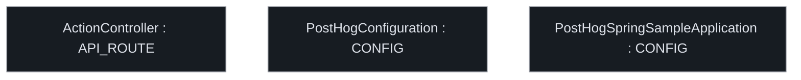
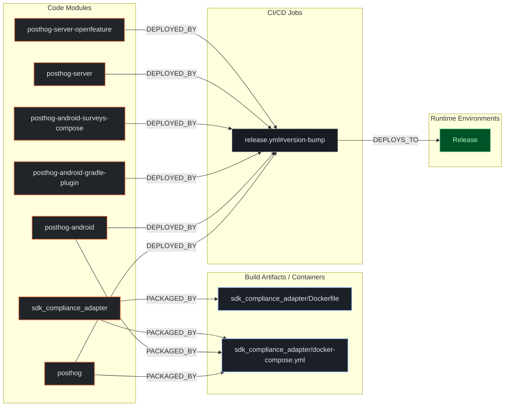

# Repository Architecture Analysis: PostHog/posthog-android

## Metadata
- **SHA**: `9621c396b6d22a03a5f0f653bddc3605ba7fefbb`
- **Primary Ecosystem**: Java

## Quality Metrics
- **ast_engine**: tree-sitter
- **avg_cognitive_complexity**: 13.05
- **avg_cyclomatic_complexity**: 21.39
- **component_count**: 3
- **dead_code_count**: 0
- **dead_code_symbols**: 0 entry(ies)
- **duplication_pct**: 81.35
- **file_complexities**: 25 entry(ies)
- **files_analyzed**: 481
- **fitness_passed**: False
- **fitness_violation_count**: 3
- **framework**: Spring Boot
- **import_edges**: 100 entry(ies)
- **loc**: 117952
- **max_cognitive_complexity**: 984
- **max_cyclomatic_complexity**: 898
- **sloc**: 92153
- **test_file_count**: 240

# Architecture: PostHog/posthog-android

## Context
- **Repository**: `PostHog/posthog-android`
- **SHA**: `9621c396b6d22a03a5f0f653bddc3605ba7fefbb`
- **Ecosystem**: Java
- **Framework**: Spring Boot

## Building Block View

## Component Details
- **ActionController** (`posthog-samples/posthog-spring-sample/src/main/java/com/posthog/spring/sample/ActionController.java`): API_ROUTE
- **PostHogConfiguration** (`posthog-samples/posthog-spring-sample/src/main/java/com/posthog/spring/sample/PostHogConfiguration.java`): CONFIG
- **PostHogSpringSampleApplication** (`posthog-samples/posthog-spring-sample/src/main/java/com/posthog/spring/sample/PostHogSpringSampleApplication.java`): CONFIG

## 6-Dimension Repository Scorecard

- **Overall Grade**: `F` (38.63/100)
- **Technical Debt Score**: 61.37
- **Estimated Remediation Effort**: 103.61h

| Dimension | Grade | Score | Weight | Details |
| :--- | :---: | :---: | :---: | :--- |
| Code Quality | `F` | 20.00 | 0.20 | avg_cc=21.39, max_cc=898, duplication=81.35%, dead_code=0 |
| Dependency Health | `A` | 100.00 | 0.15 | dependencies=131, outdated=0, vulnerable=0, has_lockfile=True |
| Maintainability | `F` | 12.85 | 0.15 | avg_cognitive=13.05, max_cognitive=984, fitness_violations=3, oversized_files=14 |
| Pipeline Health | `F` | 48.00 | 0.15 | workflows=10, operational_antipatterns=17, parallel_branches=True |
| Security | `F` | 0.00 | 0.20 | vulnerabilities=0, secrets=18, pipeline_security_findings=1 |
| Test Coverage | `C` | 70.00 | 0.15 | coverage=unavailable, ci_test_job=True, test_files_detected=True |

## Architecture Fitness & Workspace Boundaries

- **[MEDIUM] `ATRUSS-ARCH-005` (COMPLEXITY_THRESHOLD)**: Repository duplication_pct (81.35) exceeds policy threshold (15.0).
- **[MEDIUM] `ATRUSS-ARCH-005` (COMPLEXITY_THRESHOLD)**: Repository max_cognitive_complexity (984.0) exceeds policy threshold (25.0).
- **[MEDIUM] `ATRUSS-ARCH-005` (COMPLEXITY_THRESHOLD)**: Repository max_cyclomatic_complexity (898.0) exceeds policy threshold (20.0).

### Workspace Packages
- **posthog** (`posthog`, react_ts_js, pnpm)
- **posthog-android** (`posthog-android`, react_ts_js, pnpm)
- **posthog-android-gradle-plugin** (`posthog-android-gradle-plugin`, react_ts_js, pnpm)
- **posthog-android-surveys-compose** (`posthog-android-surveys-compose`, react_ts_js, pnpm)
- **posthog-server** (`posthog-server`, react_ts_js, pnpm)
- **posthog-server-openfeature** (`posthog-server-openfeature`, react_ts_js, pnpm)

## Supply Chain Dependencies, Vulnerabilities & Secrets

- **Dependencies Parsed**: 131 | **Vulnerabilities**: 0 | **Secrets**: 18

### Secret Findings (Redacted)
- **[HIGH] `ATRUSS-SEC-005`** at `posthog-android/src/main/java/com/posthog/android/internal/errortracking/NativeCrashOptOutIntervalStore.kt:19` (`private val closedKey = "$CLO***REDACTED***"`)
- **[HIGH] `ATRUSS-SEC-005`** at `posthog-android/src/test/resources/json/snapshots/batch-request.json:11` (`"api_key": "_6SG***REDACTED***",`)
- **[HIGH] `ATRUSS-SEC-005`** at `posthog-android/src/test/resources/json/snapshots/flags-request.json:14` (`"api_key": "_6SG***REDACTED***",`)
- **[HIGH] `ATRUSS-SEC-005`** at `posthog-android/src/test/resources/json/snapshots/session-replay-request.json:41` (`"api_key": "_6SG***REDACTED***"`)
- **[HIGH] `ATRUSS-SEC-005`** at `posthog-samples/posthog-android-sample/src/main/java/com/posthog/android/sample/MyApp.kt:16` (`//        val projectToken = "_6SG***REDACTED***"`)
- **[HIGH] `ATRUSS-SEC-005`** at `posthog-samples/posthog-android-sample/src/main/java/com/posthog/android/sample/MyApp.kt:18` (`val projectToken = "phc_***REDACTED***"`)
- **[HIGH] `ATRUSS-SEC-005`** at `posthog-samples/posthog-android-sample/src/main/java/com/posthog/android/sample/MyApp.kt:20` (`//        val projectToken = "phc_***REDACTED***"`)
- **[HIGH] `ATRUSS-SEC-005`** at `posthog/src/test/java/com/posthog/internal/PostHogSerializerTest.kt:98` (`"api_key": "_6SG***REDACTED***",`)
- **[HIGH] `ATRUSS-SEC-005`** at `posthog/src/test/java/com/posthog/internal/PostHogSerializerTest.kt:233` (`"api_key": "_6SG***REDACTED***",`)
- **[HIGH] `ATRUSS-SEC-005`** at `posthog/src/test/resources/json/basic-remote-config-features-disabled.json:2` (`"token": "phc_***REDACTED***",`)
- **[HIGH] `ATRUSS-SEC-005`** at `posthog/src/test/resources/json/basic-remote-config-features-enabled.json:2` (`"token": "phc_***REDACTED***",`)
- **[HIGH] `ATRUSS-SEC-005`** at `posthog/src/test/resources/json/basic-remote-config-no-flags.json:2` (`"token": "phc_***REDACTED***",`)
- **[HIGH] `ATRUSS-SEC-005`** at `posthog/src/test/resources/json/basic-remote-config-with-event-triggers.json:2` (`"token": "phc_***REDACTED***",`)
- **[HIGH] `ATRUSS-SEC-005`** at `posthog/src/test/resources/json/basic-remote-config-with-sample-rate.json:2` (`"token": "phc_***REDACTED***",`)
- **[HIGH] `ATRUSS-SEC-005`** at `posthog/src/test/resources/json/basic-remote-config-with-surveys.json:2` (`"token": "phc_***REDACTED***",`)
- **[HIGH] `ATRUSS-SEC-005`** at `posthog/src/test/resources/json/basic-remote-config.json:2` (`"token": "phc_***REDACTED***",`)
- **[HIGH] `ATRUSS-SEC-005`** at `posthog/src/test/resources/json/batch-request.json:2` (`"api_key": "_6SG***REDACTED***",`)
- **[HIGH] `ATRUSS-SEC-005`** at `posthog/src/test/resources/json/flags-request.json:2` (`"api_key": "_6SG***REDACTED***",`)

### Inventory Sample
- `androidx.activity:activity` `*` (Maven, `posthog-android-surveys-compose/build.gradle.kts`)
- `androidx.activity:activity-compose` `1.13.0` (Maven, `posthog-android/build.gradle.kts`)
- `androidx.activity:activity-compose` `1.13.0` (Maven, `posthog-samples/posthog-android-sample/build.gradle.kts`)
- `androidx.compose.foundation:foundation` `*` (Maven, `posthog-android-surveys-compose/build.gradle.kts`)
- `androidx.compose.material3:material3` `*` (Maven, `posthog-android-surveys-compose/build.gradle.kts`)
- `androidx.compose.material3:material3` `*` (Maven, `posthog-android/build.gradle.kts`)
- `androidx.compose.material3:material3` `*` (Maven, `posthog-samples/posthog-android-sample/build.gradle.kts`)
- `androidx.compose.material:material-icons-core` `*` (Maven, `posthog-android-surveys-compose/build.gradle.kts`)
- `androidx.compose.ui:ui` `*` (Maven, `posthog-android-surveys-compose/build.gradle.kts`)
- `androidx.compose.ui:ui` `*` (Maven, `posthog-android/build.gradle.kts`)
- `androidx.compose.ui:ui` `*` (Maven, `posthog-android/build.gradle.kts`)
- `androidx.compose.ui:ui` `*` (Maven, `posthog-samples/posthog-android-sample/build.gradle.kts`)
- `androidx.compose.ui:ui-graphics` `*` (Maven, `posthog-samples/posthog-android-sample/build.gradle.kts`)
- `androidx.compose.ui:ui-test-junit4` `*` (Maven, `posthog-android-surveys-compose/build.gradle.kts`)
- `androidx.compose.ui:ui-test-junit4` `*` (Maven, `posthog-android/build.gradle.kts`)
- `androidx.compose.ui:ui-test-manifest` `*` (Maven, `posthog-android-surveys-compose/build.gradle.kts`)
- `androidx.compose.ui:ui-test-manifest` `*` (Maven, `posthog-samples/posthog-android-sample/build.gradle.kts`)
- `androidx.compose.ui:ui-tooling` `*` (Maven, `posthog-android-surveys-compose/build.gradle.kts`)
- `androidx.compose.ui:ui-tooling` `*` (Maven, `posthog-samples/posthog-android-sample/build.gradle.kts`)
- `androidx.compose.ui:ui-tooling-preview` `*` (Maven, `posthog-android-surveys-compose/build.gradle.kts`)
- `androidx.compose.ui:ui-tooling-preview` `*` (Maven, `posthog-samples/posthog-android-sample/build.gradle.kts`)
- `androidx.core:core` `*` (Maven, `posthog-android/build.gradle.kts`)
- `androidx.lifecycle:lifecycle-common-java8` `*` (Maven, `posthog-android/build.gradle.kts`)
- `androidx.lifecycle:lifecycle-process` `*` (Maven, `posthog-android-surveys-compose/build.gradle.kts`)
- `androidx.lifecycle:lifecycle-process` `*` (Maven, `posthog-android/build.gradle.kts`)
- `androidx.test.ext:junit` `*` (Maven, `posthog-android-surveys-compose/build.gradle.kts`)
- `androidx.test.ext:junit` `*` (Maven, `posthog-android/build.gradle.kts`)
- `androidx.test:core` `*` (Maven, `posthog-android/build.gradle.kts`)
- `androidx.test:core-ktx` `*` (Maven, `posthog-android/build.gradle.kts`)
- `androidx.test:rules` `*` (Maven, `posthog-android/build.gradle.kts`)
- ... (+101 more dependencies)

## Section 7: Code-to-Cloud Deployment Traceability

- `release.yml#version-bump` (ci_job) --[DEPLOYS_TO]--> `Release` (environment)
- `posthog` (code_module) --[DEPLOYED_BY]--> `release.yml#version-bump` (ci_job)
- `posthog` (code_module) --[PACKAGED_BY]--> `sdk_compliance_adapter/docker-compose.yml` (container)
- `posthog-android` (code_module) --[DEPLOYED_BY]--> `release.yml#version-bump` (ci_job)
- `posthog-android` (code_module) --[PACKAGED_BY]--> `sdk_compliance_adapter/docker-compose.yml` (container)
- `posthog-android-gradle-plugin` (code_module) --[DEPLOYED_BY]--> `release.yml#version-bump` (ci_job)
- `posthog-android-surveys-compose` (code_module) --[DEPLOYED_BY]--> `release.yml#version-bump` (ci_job)
- `posthog-server` (code_module) --[DEPLOYED_BY]--> `release.yml#version-bump` (ci_job)
- `posthog-server-openfeature` (code_module) --[DEPLOYED_BY]--> `release.yml#version-bump` (ci_job)
- `sdk_compliance_adapter` (code_module) --[PACKAGED_BY]--> `sdk_compliance_adapter/Dockerfile` (container)
- `sdk_compliance_adapter` (code_module) --[PACKAGED_BY]--> `sdk_compliance_adapter/docker-compose.yml` (container)

## CI/CD Pipeline Topology

```mermaid
graph TD;
  classDef atlasRoot fill:#004882,stroke:#a3c9ff,stroke-width:2px,color:#d3e4ff
  classDef atlasCategory fill:#212428,stroke:#E87A48,stroke-width:1.5px,color:#dfe3eb
  classDef atlasWorkflow fill:#1b2026,stroke:#a3c9ff,stroke-width:1.5px,color:#dfe3eb
  classDef atlasJob fill:#171c22,stroke:#8d9199,stroke-width:1px,color:#dfe3eb
  classDef atlasTarget fill:#005227,stroke:#8bd99b,stroke-width:1.5px,color:#a7f6b6
  classDef atlasAlert fill:#93000a,stroke:#ffb4ab,stroke-width:1.5px,color:#ffdad6
  classDef atlasMore fill:#252a31,stroke:#8d9199,stroke-dasharray:4 4,color:#c3c6cf
  pipeline_root(["PostHog/posthog-android (10 workflows)"]):::atlasRoot
  grp_0_CI___Verification["CI & Verification (4 workflows · 5 jobs)"]:::atlasCategory
  pipeline_root --> grp_0_CI___Verification
  wf_0_Build___Test["Build & Test (2 jobs)"]:::atlasWorkflow
  grp_0_CI___Verification --> wf_0_Build___Test
  job_0_detect_markdown_only["detect-markdown-only"]:::atlasJob
  job_0_build["build"]:::atlasJob
  wf_0_Build___Test --> job_0_detect_markdown_only
  job_0_detect_markdown_only --> job_0_build
  wf_1_Changeset_hygiene["Changeset hygiene (1 jobs)"]:::atlasWorkflow
  grp_0_CI___Verification --> wf_1_Changeset_hygiene
  job_1_check["check"]:::atlasJob
  wf_1_Changeset_hygiene --> job_1_check
  wf_4_Validate_Gradle_Wrapper["Validate Gradle Wrapper (1 jobs)"]:::atlasWorkflow
  grp_0_CI___Verification --> wf_4_Validate_Gradle_Wrapper
  job_4_validation["validation"]:::atlasJob
  wf_4_Validate_Gradle_Wrapper --> job_4_validation
  wf_5_Lint_PR["Lint PR (1 jobs)"]:::atlasWorkflow
  grp_0_CI___Verification --> wf_5_Lint_PR
  job_5_lint_pr["lint-pr"]:::atlasJob
  wf_5_Lint_PR --> job_5_lint_pr
  grp_1_Release___Deploy["Release & Deploy (2 workflows · 8 jobs)"]:::atlasCategory
  pipeline_root --> grp_1_Release___Deploy
  wf_6_Release_failure_notification["Release failure notification (1 jobs)"]:::atlasWorkflow
  grp_1_Release___Deploy --> wf_6_Release_failure_notification
  job_6_notify_failed["notify-failed"]:::atlasJob
  wf_6_Release_failure_notification --> job_6_notify_failed
  wf_7_Release["Release (7 jobs)"]:::atlasWorkflow
  grp_1_Release___Deploy --> wf_7_Release
  job_7_check_changesets["check-changesets"]:::atlasJob
  job_7_notify_approval_needed["notify-approval-needed"]:::atlasJob
  job_7_preserve_slack_thread["preserve-slack-thread"]:::atlasJob
  wf_7_Release --> job_7_check_changesets
  job_7_check_changesets --> job_7_notify_approval_needed
  job_7_notify_approval_needed --> job_7_preserve_slack_thread
  grp_2_Scheduled___Manual["Scheduled & Manual (2 workflows · 2 jobs)"]:::atlasCategory
  pipeline_root --> grp_2_Scheduled___Manual
  wf_3_Generate_references["Generate references (1 jobs)"]:::atlasWorkflow
  grp_2_Scheduled___Manual --> wf_3_Generate_references
  job_3_generate_references["generate-references"]:::atlasJob
  wf_3_Generate_references --> job_3_generate_references
  wf_8_SDK_Compliance_Tests["SDK Compliance Tests (1 jobs)"]:::atlasWorkflow
  grp_2_Scheduled___Manual --> wf_8_SDK_Compliance_Tests
  job_8_test_android_sdk["test-android-sdk"]:::atlasJob
  wf_8_SDK_Compliance_Tests --> job_8_test_android_sdk
  grp_3_Security___Governance["Security & Governance (2 workflows · 2 jobs)"]:::atlasCategory
  pipeline_root --> grp_3_Security___Governance
  wf_2_CodeQL_Advanced["CodeQL Advanced (1 jobs)"]:::atlasWorkflow
  grp_3_Security___Governance --> wf_2_CodeQL_Advanced
  job_2_analyze["analyze"]:::atlasJob
  wf_2_CodeQL_Advanced --> job_2_analyze
  wf_9_Handle_stale_issues_and_PRs["Handle stale issues and PRs (1 jobs)"]:::atlasWorkflow
  grp_3_Security___Governance --> wf_9_Handle_stale_issues_and_PRs
  job_9_stale["stale"]:::atlasJob
  wf_9_Handle_stale_issues_and_PRs --> job_9_stale
```

