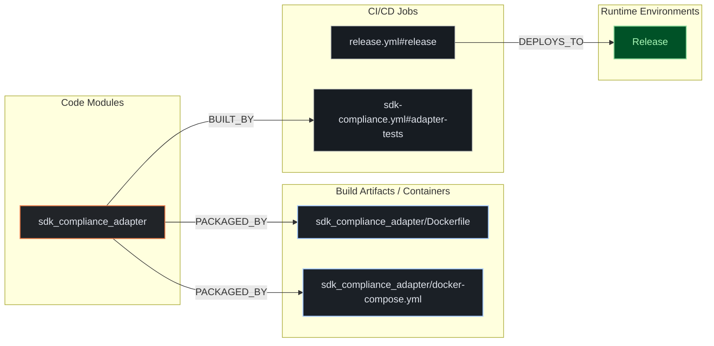

# Repository Architecture Analysis: PostHog/posthog-elixir

## Metadata
- **SHA**: `5d37478809de22150006168be1d74c9b70a1dc8f`
- **Primary Ecosystem**: Elixir

## Quality Metrics
- **ast_engine**: fallback
- **avg_cognitive_complexity**: 0.0
- **avg_cyclomatic_complexity**: 0.0
- **component_count**: 94
- **dead_code_count**: 0
- **dead_code_symbols**: 0 entry(ies)
- **duplication_pct**: 0.0
- **file_complexities**: 0 entry(ies)
- **files_analyzed**: 94
- **fitness_passed**: True
- **fitness_violation_count**: 0
- **framework**: Elixir Mix
- **import_edges**: 0 entry(ies)
- **loc**: 30276
- **max_cognitive_complexity**: 0
- **max_cyclomatic_complexity**: 0
- **sloc**: 24663
- **test_file_count**: 48

# Architecture: PostHog/posthog-elixir

## Context
- **Repository**: `PostHog/posthog-elixir`
- **SHA**: `5d37478809de22150006168be1d74c9b70a1dc8f`
- **Ecosystem**: Elixir
- **Framework**: Elixir Mix

## Building Block View

```mermaid
graph TD;
    %% title: Building Block View — PostHog/posthog-elixir
  classDef atlasRoot fill:#004882,stroke:#a3c9ff,stroke-width:2px,color:#d3e4ff
  classDef atlasCategory fill:#212428,stroke:#E87A48,stroke-width:1.5px,color:#dfe3eb
  classDef atlasWorkflow fill:#1b2026,stroke:#a3c9ff,stroke-width:1.5px,color:#dfe3eb
  classDef atlasJob fill:#171c22,stroke:#8d9199,stroke-width:1px,color:#dfe3eb
  classDef atlasTarget fill:#005227,stroke:#8bd99b,stroke-width:1.5px,color:#a7f6b6
  classDef atlasAlert fill:#93000a,stroke:#ffb4ab,stroke-width:1.5px,color:#ffdad6
  classDef atlasMore fill:#252a31,stroke:#8d9199,stroke-dasharray:4 4,color:#c3c6cf
    repo_root(["PostHog/posthog-elixir (94 components)"]):::atlasRoot
    subgraph sg_dir_0_test["test (43)"]
      direction TB
      dir_0_test["test (43)"]:::atlasCategory
      sub_0_0_posthog["posthog (34)"]:::atlasWorkflow
      dir_0_test --> sub_0_0_posthog
      sub_0_1_support["support (4)"]:::atlasWorkflow
      dir_0_test --> sub_0_1_support
      sub_0_2__module_root_["(module root) (3)"]:::atlasWorkflow
      dir_0_test --> sub_0_2__module_root_
      sub_0_more["+1 more submodules (2)"]:::atlasMore
      dir_0_test --> sub_0_more
    end
    repo_root --> dir_0_test
    subgraph sg_dir_1_lib["lib (35)"]
      direction TB
      dir_1_lib["lib (35)"]:::atlasCategory
      sub_1_0_posthog["posthog (32)"]:::atlasWorkflow
      dir_1_lib --> sub_1_0_posthog
      sub_1_1_mix["mix (2)"]:::atlasWorkflow
      dir_1_lib --> sub_1_1_mix
      sub_1_2__module_root_["(module root) (1)"]:::atlasWorkflow
      dir_1_lib --> sub_1_2__module_root_
    end
    repo_root --> dir_1_lib
    subgraph sg_dir_2_sdk_compliance_adapter["sdk_compliance_adapter (9)"]
      direction TB
      dir_2_sdk_compliance_adapter["sdk_compliance_adapter (9)"]:::atlasCategory
      sub_2_0_lib["lib (5)"]:::atlasWorkflow
      dir_2_sdk_compliance_adapter --> sub_2_0_lib
      sub_2_1_test["test (2)"]:::atlasWorkflow
      dir_2_sdk_compliance_adapter --> sub_2_1_test
      sub_2_2__module_root_["(module root) (1)"]:::atlasWorkflow
      dir_2_sdk_compliance_adapter --> sub_2_2__module_root_
      sub_2_more["+1 more submodules (1)"]:::atlasMore
      dir_2_sdk_compliance_adapter --> sub_2_more
    end
    repo_root --> dir_2_sdk_compliance_adapter
    dir_3_config["config (4)"]:::atlasCategory
    repo_root --> dir_3_config
    dir_4__root_["(root) (3)"]:::atlasCategory
    repo_root --> dir_4__root_
```

## Component Details

Showing top 60 representative components out of 94 across 5 module group(s):

- **Module `test`** (43 components — module: 43)
- **Module `lib`** (35 components — module: 35)
- **Module `sdk_compliance_adapter`** (9 components — module: 9)
- **Module `config`** (4 components — module: 4)
- **Module `(root)`** (3 components — module: 3)

- **.credo** (`.credo.exs`): module
- **.formatter** (`.formatter.exs`): module
- **api** (`lib/posthog/api.ex`): module
- **application** (`lib/posthog/application.ex`): module
- **application** (`sdk_compliance_adapter/lib/sdk_compliance_adapter/application.ex`): module
- **application_config_test** (`test/posthog/application_config_test.exs`): module
- **attachments** (`lib/posthog/emails/attachments.ex`): module
- **called_cache** (`lib/posthog/feature_flags/called_cache.ex`): module
- **called_cache_test** (`test/posthog/feature_flags/called_cache_test.exs`): module
- **case** (`test/support/case.ex`): module
- **client** (`lib/posthog/api/client.ex`): module
- **client_test** (`test/posthog/api/client_test.exs`): module
- **config** (`config/config.exs`): module
- **config** (`lib/posthog/config.ex`): module
- **config** (`sdk_compliance_adapter/config/config.exs`): module
- **config_schema** (`lib/posthog/config_schema.ex`): module
- **config_test** (`test/posthog/config_test.exs`): module
- **context** (`lib/posthog/context.ex`): module
- **context_span_processor** (`lib/posthog/open_telemetry/context_span_processor.ex`): module
- **context_span_processor_test** (`test/posthog/context_span_processor_test.exs`): module
- **context_test** (`test/posthog/context_test.exs`): module
- **definition_loader** (`lib/posthog/feature_flags/definition_loader.ex`): module
- **definition_loader_test** (`test/posthog/feature_flags/definition_loader_test.exs`): module
- **definition_loader_warning_test** (`test/posthog/feature_flags/definition_loader_warning_test.exs`): module
- **dev** (`config/dev.exs`): module
- **emails** (`lib/posthog/emails.ex`): module
- **emails_default_instance_test** (`test/posthog/emails_default_instance_test.exs`): module
- **emails_test** (`test/posthog/emails_test.exs`): module
- **error** (`lib/posthog/emails/error.ex`): module
- **error** (`lib/posthog/error.ex`): module
- **error_test** (`test/posthog/error_test.exs`): module
- **evaluations** (`lib/posthog/feature_flags/evaluations.ex`): module
- **evaluations_test** (`test/posthog/feature_flags/evaluations_test.exs`): module
- **feature_flags** (`lib/posthog/feature_flags.ex`): module
- **feature_flags_test** (`test/posthog/feature_flags_test.exs`): module
- **flag_definition_cache_provider** (`lib/posthog/feature_flags/flag_definition_cache_provider.ex`): module
- **flag_definition_cache_provider_test** (`test/posthog/feature_flags/flag_definition_cache_provider_test.exs`): module
- **handler** (`lib/posthog/handler.ex`): module
- **handler_test** (`test/posthog/handler_test.exs`): module
- **handler_trace_context_isolation_test** (`test/posthog/handler_trace_context_isolation_test.exs`): module
- **integration.example** (`config/integration.example.exs`): module
- **integration_test** (`test/integration_test.exs`): module
- **lib** (`lib/posthog/lib.ex`): module
- **llm_analytics** (`lib/posthog/llm_analytics.ex`): module
- **llm_analytics_test** (`test/posthog/llm_analytics_test.exs`): module
- **local_evaluation_integration_test** (`test/posthog/feature_flags/local_evaluation_integration_test.exs`): module
- **local_evaluator** (`lib/posthog/feature_flags/local_evaluator.ex`): module
- **local_evaluator_normalization_test** (`test/posthog/feature_flags/local_evaluator_normalization_test.exs`): module
- **local_evaluator_structs** (`test/support/local_evaluator_structs.ex`): module
- **local_evaluator_test** (`test/posthog/feature_flags/local_evaluator_test.exs`): module
- **missing_key_knowledge_test** (`test/posthog/feature_flags/missing_key_knowledge_test.exs`): module
- **missing_probe_coordinator** (`lib/posthog/feature_flags/missing_probe_coordinator.ex`): module
- **mix** (`mix.exs`): module
- **mix** (`sdk_compliance_adapter/mix.exs`): module
- **mocks** (`test/support/api/mocks.ex`): module
- **open_feature** (`lib/posthog/open_feature.ex`): module
- **open_feature_test** (`test/posthog/open_feature_test.exs`): module
- **plug** (`lib/posthog/integrations/plug.ex`): module
- **plug_test** (`test/posthog/integrations/plug_test.exs`): module
- **posthog** (`lib/posthog.ex`): module

## 6-Dimension Repository Scorecard

- **Overall Grade**: `D` (68.96/100)
- **Technical Debt Score**: 31.04
- **Estimated Remediation Effort**: 43.76h

| Dimension | Grade | Score | Weight | Details |
| :--- | :---: | :---: | :---: | :--- |
| Code Quality | `A` | 100.00 | 0.20 | avg_cc=0.00, max_cc=0, duplication=0.00%, dead_code=0 |
| Dependency Health | `A` | 96.43 | 0.15 | dependencies=14, outdated=0, vulnerable=1, has_lockfile=False |
| Maintainability | `A` | 100.00 | 0.15 | avg_cognitive=0.00, max_cognitive=0, fitness_violations=0, oversized_files=0 |
| Pipeline Health | `D` | 60.00 | 0.15 | workflows=8, operational_antipatterns=15, parallel_branches=True |
| Security | `F` | 0.00 | 0.20 | vulnerabilities=27, secrets=0, pipeline_security_findings=1 |
| Test Coverage | `C` | 70.00 | 0.15 | coverage=unavailable, ci_test_job=True, test_files_detected=True |

## Supply Chain Dependencies, Vulnerabilities & Secrets

- **Dependencies Parsed**: 14 | **Vulnerabilities**: 27 | **Secrets**: 0

### Known Vulnerabilities (OSV)
- **[MEDIUM] `EEF-CVE-2026-105659`** `bandit` `1.7` (fixed: `none`, UNREACHABLE_DORMANT)
- **[MEDIUM] `EEF-CVE-2026-105660`** `bandit` `1.7` (fixed: `none`, UNREACHABLE_DORMANT)
- **[MEDIUM] `EEF-CVE-2026-108525`** `bandit` `1.7` (fixed: `none`, UNREACHABLE_DORMANT)
- **[MEDIUM] `EEF-CVE-2026-108529`** `bandit` `1.7` (fixed: `none`, UNREACHABLE_DORMANT)
- **[MEDIUM] `EEF-CVE-2026-109584`** `bandit` `1.7` (fixed: `none`, UNREACHABLE_DORMANT)
- **[MEDIUM] `EEF-CVE-2026-110314`** `bandit` `1.7` (fixed: `none`, UNREACHABLE_DORMANT)
- **[MEDIUM] `EEF-CVE-2026-110499`** `bandit` `1.7` (fixed: `none`, UNREACHABLE_DORMANT)
- **[MEDIUM] `EEF-CVE-2026-111101`** `bandit` `1.7` (fixed: `none`, UNREACHABLE_DORMANT)
- **[MEDIUM] `EEF-CVE-2026-113436`** `bandit` `1.7` (fixed: `none`, UNREACHABLE_DORMANT)
- **[MEDIUM] `EEF-CVE-2026-115269`** `bandit` `1.7` (fixed: `none`, UNREACHABLE_DORMANT)
- **[MEDIUM] `EEF-CVE-2026-116078`** `bandit` `1.7` (fixed: `none`, UNREACHABLE_DORMANT)
- **[MEDIUM] `EEF-CVE-2026-39803`** `bandit` `1.7` (fixed: `none`, UNREACHABLE_DORMANT)
- **[MEDIUM] `EEF-CVE-2026-39804`** `bandit` `1.7` (fixed: `none`, UNREACHABLE_DORMANT)
- **[MEDIUM] `EEF-CVE-2026-39805`** `bandit` `1.7` (fixed: `none`, UNREACHABLE_DORMANT)
- **[MEDIUM] `EEF-CVE-2026-39806`** `bandit` `1.7` (fixed: `none`, UNREACHABLE_DORMANT)
- **[MEDIUM] `EEF-CVE-2026-39807`** `bandit` `1.7` (fixed: `none`, UNREACHABLE_DORMANT)
- **[MEDIUM] `EEF-CVE-2026-42786`** `bandit` `1.7` (fixed: `none`, UNREACHABLE_DORMANT)
- **[MEDIUM] `EEF-CVE-2026-42788`** `bandit` `1.7` (fixed: `none`, UNREACHABLE_DORMANT)
- **[MEDIUM] `EEF-CVE-2026-74836`** `bandit` `1.7` (fixed: `none`, UNREACHABLE_DORMANT)
- **[MEDIUM] `EEF-CVE-2026-75484`** `bandit` `1.7` (fixed: `none`, UNREACHABLE_DORMANT)
- **[MEDIUM] `GHSA-375f-4r2h-f99j`** `bandit` `1.7` (fixed: `none`, UNREACHABLE_DORMANT)
- **[MEDIUM] `GHSA-9q9q-324x-93r2`** `bandit` `1.7` (fixed: `none`, UNREACHABLE_DORMANT)
- **[MEDIUM] `GHSA-c67r-gc9j-2qf7`** `bandit` `1.7` (fixed: `none`, UNREACHABLE_DORMANT)
- **[MEDIUM] `GHSA-frh3-6pv6-rc8j`** `bandit` `1.7` (fixed: `none`, UNREACHABLE_DORMANT)
- **[MEDIUM] `GHSA-pf94-94m9-536p`** `bandit` `1.7` (fixed: `none`, UNREACHABLE_DORMANT)
- **[MEDIUM] `GHSA-q6v9-r226-v65f`** `bandit` `1.7` (fixed: `none`, UNREACHABLE_DORMANT)
- **[MEDIUM] `GHSA-rf5q-vwxw-gmrf`** `bandit` `1.7` (fixed: `none`, UNREACHABLE_DORMANT)

### Inventory Sample
- `bandit` `1.7` (hex, `mix.exs`)
- `credo` `1.7` (hex, `mix.exs`)
- `ex_doc` `0.37` (hex, `mix.exs`)
- `logger_handler_kit` `0.4` (hex, `mix.exs`)
- `logger_json` `7.0` (hex, `mix.exs`)
- `mox` `1.1` (hex, `mix.exs`)
- `nimble_options` `1.1` (hex, `mix.exs`)
- `nimble_ownership` `1.0` (hex, `mix.exs`)
- `open_feature` `0.1` (hex, `mix.exs`)
- `opentelemetry` `1.7` (hex, `mix.exs`)
- `opentelemetry_api` `1.5` (hex, `mix.exs`)
- `plug_cowboy` `2.8.1` (hex, `sdk_compliance_adapter/mix.exs`)
- `req` `0.6.1` (hex, `mix.exs`)
- `uuid_v7` `0.6` (hex, `mix.exs`)

## Section 7: Code-to-Cloud Deployment Traceability

- `release.yml#release` (ci_job) --[DEPLOYS_TO]--> `Release` (environment)
- `sdk_compliance_adapter` (code_module) --[BUILT_BY]--> `sdk-compliance.yml#adapter-tests` (ci_job)
- `sdk_compliance_adapter` (code_module) --[PACKAGED_BY]--> `sdk_compliance_adapter/Dockerfile` (container)
- `sdk_compliance_adapter` (code_module) --[PACKAGED_BY]--> `sdk_compliance_adapter/docker-compose.yml` (container)

## CI/CD Pipeline Topology

```mermaid
graph TD;
  %% title: CI/CD Pipeline Topology — PostHog/posthog-elixir
  classDef atlasRoot fill:#004882,stroke:#a3c9ff,stroke-width:2px,color:#d3e4ff
  classDef atlasCategory fill:#212428,stroke:#E87A48,stroke-width:1.5px,color:#dfe3eb
  classDef atlasWorkflow fill:#1b2026,stroke:#a3c9ff,stroke-width:1.5px,color:#dfe3eb
  classDef atlasJob fill:#171c22,stroke:#8d9199,stroke-width:1px,color:#dfe3eb
  classDef atlasTarget fill:#005227,stroke:#8bd99b,stroke-width:1.5px,color:#a7f6b6
  classDef atlasAlert fill:#93000a,stroke:#ffb4ab,stroke-width:1.5px,color:#ffdad6
  classDef atlasMore fill:#252a31,stroke:#8d9199,stroke-dasharray:4 4,color:#c3c6cf
  pipeline_root(["PostHog/posthog-elixir (8 workflows)"]):::atlasRoot
  subgraph sg_grp_0_CI___Verification["CI & Verification (4 workflows · 9 jobs)"]
    direction TB
    subgraph sg_wf_0_Call_Feature_Flags_Project_Workflow["Call Feature Flags Project Workflow (1 jobs)"]
      direction TB
      wf_0_Call_Feature_Flags_Project_Workflow(["Trigger: Call Feature Flags Project Workflow"]):::atlasWorkflow
      job_0_call_flags_project["call-flags-project"]:::atlasJob
      wf_0_Call_Feature_Flags_Project_Workflow --> job_0_call_flags_project
    end
    pipeline_root --> wf_0_Call_Feature_Flags_Project_Workflow
    subgraph sg_wf_1_CI["CI (5 jobs)"]
      direction TB
      wf_1_CI(["Trigger: CI"]):::atlasWorkflow
      job_1_test["test"]:::atlasJob
      job_1_format["format"]:::atlasJob
      job_1_credo["credo"]:::atlasJob
      wf_1_CI --> job_1_test
      wf_1_CI --> job_1_format
      wf_1_CI --> job_1_credo
    end
    pipeline_root --> wf_1_CI
    subgraph sg_wf_3_Lint_PR["Lint PR (1 jobs)"]
      direction TB
      wf_3_Lint_PR(["Trigger: Lint PR"]):::atlasWorkflow
      job_3_lint_pr["lint-pr"]:::atlasJob
      wf_3_Lint_PR --> job_3_lint_pr
    end
    pipeline_root --> wf_3_Lint_PR
    subgraph sg_wf_6_SDK_Compliance_Tests["SDK Compliance Tests (2 jobs)"]
      direction TB
      wf_6_SDK_Compliance_Tests(["Trigger: SDK Compliance Tests"]):::atlasWorkflow
      job_6_adapter_tests["adapter-tests"]:::atlasJob
      job_6_compliance["compliance"]:::atlasJob
      wf_6_SDK_Compliance_Tests --> job_6_adapter_tests
      wf_6_SDK_Compliance_Tests --> job_6_compliance
    end
    pipeline_root --> wf_6_SDK_Compliance_Tests
  end
  subgraph sg_grp_1_Release___Deploy["Release & Deploy (2 workflows · 6 jobs)"]
    direction TB
    subgraph sg_wf_4_Release_failure_notification["Release failure notification (1 jobs)"]
      direction TB
      wf_4_Release_failure_notification(["Trigger: Release failure notification"]):::atlasWorkflow
      job_4_notify_failed["notify-failed"]:::atlasJob
      wf_4_Release_failure_notification --> job_4_notify_failed
    end
    pipeline_root --> wf_4_Release_failure_notification
    subgraph sg_wf_5_Release["Release (5 jobs)"]
      direction TB
      wf_5_Release(["Trigger: Release"]):::atlasWorkflow
      job_5_check_changesets["check-changesets"]:::atlasJob
      job_5_notify_approval_needed["notify-approval-needed"]:::atlasJob
      job_5_preserve_slack_thread["preserve-slack-thread"]:::atlasJob
      wf_5_Release --> job_5_check_changesets
      job_5_check_changesets --> job_5_notify_approval_needed
      job_5_notify_approval_needed --> job_5_preserve_slack_thread
    end
    pipeline_root --> wf_5_Release
  end
  subgraph sg_grp_2_Security___Governance["Security & Governance (2 workflows · 2 jobs)"]
    direction TB
    subgraph sg_wf_2_CodeQL_Advanced["CodeQL Advanced (1 jobs)"]
      direction TB
      wf_2_CodeQL_Advanced(["Trigger: CodeQL Advanced"]):::atlasWorkflow
      job_2_analyze["analyze"]:::atlasJob
      wf_2_CodeQL_Advanced --> job_2_analyze
    end
    pipeline_root --> wf_2_CodeQL_Advanced
    subgraph sg_wf_7_Handle_stale_issues_and_PRs["Handle stale issues and PRs (1 jobs)"]
      direction TB
      wf_7_Handle_stale_issues_and_PRs(["Trigger: Handle stale issues and PRs"]):::atlasWorkflow
      job_7_stale["stale"]:::atlasJob
      wf_7_Handle_stale_issues_and_PRs --> job_7_stale
    end
    pipeline_root --> wf_7_Handle_stale_issues_and_PRs
  end
```

