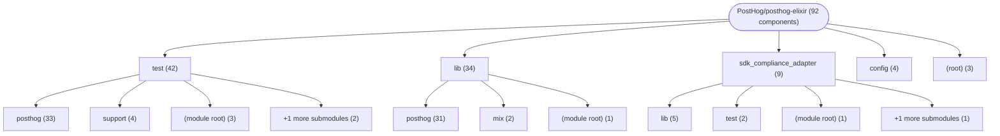
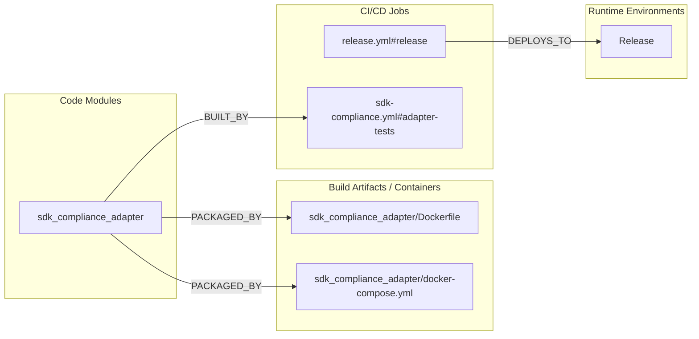
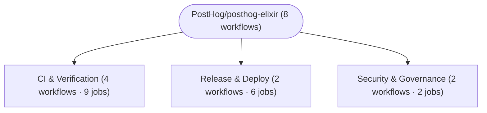

# Repository Architecture Analysis: PostHog/posthog-elixir

## Metadata
- **SHA**: `febb4c67ab9cf8892bcafbe3ce179162d375c98e`
- **Primary Ecosystem**: Elixir

## Quality Metrics
- **ast_engine**: fallback
- **avg_cognitive_complexity**: 0.0
- **avg_cyclomatic_complexity**: 0.0
- **component_count**: 92
- **dead_code_count**: 0
- **dead_code_symbols**: 0 entry(ies)
- **duplication_pct**: 0.0
- **file_complexities**: 0 entry(ies)
- **files_analyzed**: 92
- **fitness_passed**: True
- **fitness_violation_count**: 0
- **framework**: Elixir Mix
- **import_edges**: 0 entry(ies)
- **loc**: 27981
- **max_cognitive_complexity**: 0
- **max_cyclomatic_complexity**: 0
- **sloc**: 22832
- **test_file_count**: 47

# Architecture: PostHog/posthog-elixir

## Context
- **Repository**: `PostHog/posthog-elixir`
- **SHA**: `febb4c67ab9cf8892bcafbe3ce179162d375c98e`
- **Ecosystem**: Elixir
- **Framework**: Elixir Mix

## Building Block View

## Component Details

Showing top 60 representative components out of 92 across 5 module group(s):

- **Module `test`** (42 components — module: 42)
- **Module `lib`** (34 components — module: 34)
- **Module `sdk_compliance_adapter`** (9 components — module: 9)
- **Module `config`** (4 components — module: 4)
- **Module `(root)`** (3 components — module: 3)

- **.credo** (`.credo.exs`): module
- **.formatter** (`.formatter.exs`): module
- **api** (`lib/posthog/api.ex`): module
- **application** (`lib/posthog/application.ex`): module
- **application** (`sdk_compliance_adapter/lib/sdk_compliance_adapter/application.ex`): module
- **application_config_test** (`test/posthog/application_config_test.exs`): module
- **attachments** (`lib/posthog/emails/attachments.ex`): module
- **called_cache** (`lib/posthog/feature_flags/called_cache.ex`): module
- **called_cache_test** (`test/posthog/feature_flags/called_cache_test.exs`): module
- **case** (`test/support/case.ex`): module
- **client** (`lib/posthog/api/client.ex`): module
- **client_test** (`test/posthog/api/client_test.exs`): module
- **config** (`config/config.exs`): module
- **config** (`lib/posthog/config.ex`): module
- **config** (`sdk_compliance_adapter/config/config.exs`): module
- **config_schema** (`lib/posthog/config_schema.ex`): module
- **config_test** (`test/posthog/config_test.exs`): module
- **context** (`lib/posthog/context.ex`): module
- **context_span_processor** (`lib/posthog/open_telemetry/context_span_processor.ex`): module
- **context_span_processor_test** (`test/posthog/context_span_processor_test.exs`): module
- **context_test** (`test/posthog/context_test.exs`): module
- **definition_loader** (`lib/posthog/feature_flags/definition_loader.ex`): module
- **definition_loader_test** (`test/posthog/feature_flags/definition_loader_test.exs`): module
- **definition_loader_warning_test** (`test/posthog/feature_flags/definition_loader_warning_test.exs`): module
- **dev** (`config/dev.exs`): module
- **emails** (`lib/posthog/emails.ex`): module
- **emails_default_instance_test** (`test/posthog/emails_default_instance_test.exs`): module
- **emails_test** (`test/posthog/emails_test.exs`): module
- **error** (`lib/posthog/emails/error.ex`): module
- **error** (`lib/posthog/error.ex`): module
- **error_test** (`test/posthog/error_test.exs`): module
- **evaluations** (`lib/posthog/feature_flags/evaluations.ex`): module
- **evaluations_test** (`test/posthog/feature_flags/evaluations_test.exs`): module
- **feature_flags** (`lib/posthog/feature_flags.ex`): module
- **feature_flags_test** (`test/posthog/feature_flags_test.exs`): module
- **flag_definition_cache_provider** (`lib/posthog/feature_flags/flag_definition_cache_provider.ex`): module
- **flag_definition_cache_provider_test** (`test/posthog/feature_flags/flag_definition_cache_provider_test.exs`): module
- **handler** (`lib/posthog/handler.ex`): module
- **handler_test** (`test/posthog/handler_test.exs`): module
- **handler_trace_context_isolation_test** (`test/posthog/handler_trace_context_isolation_test.exs`): module
- **integration.example** (`config/integration.example.exs`): module
- **integration_test** (`test/integration_test.exs`): module
- **lib** (`lib/posthog/lib.ex`): module
- **llm_analytics** (`lib/posthog/llm_analytics.ex`): module
- **llm_analytics_test** (`test/posthog/llm_analytics_test.exs`): module
- **local_evaluation_integration_test** (`test/posthog/feature_flags/local_evaluation_integration_test.exs`): module
- **local_evaluator** (`lib/posthog/feature_flags/local_evaluator.ex`): module
- **local_evaluator_normalization_test** (`test/posthog/feature_flags/local_evaluator_normalization_test.exs`): module
- **local_evaluator_structs** (`test/support/local_evaluator_structs.ex`): module
- **local_evaluator_test** (`test/posthog/feature_flags/local_evaluator_test.exs`): module
- **missing_key_knowledge_test** (`test/posthog/feature_flags/missing_key_knowledge_test.exs`): module
- **mix** (`mix.exs`): module
- **mix** (`sdk_compliance_adapter/mix.exs`): module
- **mocks** (`test/support/api/mocks.ex`): module
- **open_feature** (`lib/posthog/open_feature.ex`): module
- **open_feature_test** (`test/posthog/open_feature_test.exs`): module
- **plug** (`lib/posthog/integrations/plug.ex`): module
- **plug_test** (`test/posthog/integrations/plug_test.exs`): module
- **posthog** (`lib/posthog.ex`): module
- **posthog.package_source_code** (`lib/mix/tasks/posthog.package_source_code.ex`): module

## 6-Dimension Repository Scorecard

- **Overall Grade**: `B` (87.10/100)
- **Technical Debt Score**: 12.90
- **Estimated Remediation Effort**: 12.22h

| Dimension | Grade | Score | Weight | Details |
| :--- | :---: | :---: | :---: | :--- |
| Code Quality | `A` | 100.00 | 0.20 | avg_cc=0.00, max_cc=0, duplication=0.00%, dead_code=0 |
| Dependency Health | `A` | 100.00 | 0.15 | dependencies=14, outdated=0, vulnerable=0, has_lockfile=False |
| Maintainability | `A` | 100.00 | 0.15 | avg_cognitive=0.00, max_cognitive=0, fitness_violations=0, oversized_files=0 |
| Pipeline Health | `D` | 60.00 | 0.15 | workflows=8, operational_antipatterns=15, parallel_branches=True |
| Security | `B` | 88.00 | 0.20 | vulnerabilities=0, secrets=0, pipeline_security_findings=1 |
| Test Coverage | `C` | 70.00 | 0.15 | coverage=unavailable, ci_test_job=True, test_files_detected=True |

## Supply Chain Dependencies, Vulnerabilities & Secrets

- **Dependencies Parsed**: 14 | **Vulnerabilities**: 0 | **Secrets**: 0

### Inventory Sample
- `bandit` `1.7` (hex, `mix.exs`)
- `credo` `1.7` (hex, `mix.exs`)
- `ex_doc` `0.37` (hex, `mix.exs`)
- `logger_handler_kit` `0.4` (hex, `mix.exs`)
- `logger_json` `7.0` (hex, `mix.exs`)
- `mox` `1.1` (hex, `mix.exs`)
- `nimble_options` `1.1` (hex, `mix.exs`)
- `nimble_ownership` `1.0` (hex, `mix.exs`)
- `open_feature` `0.1` (hex, `mix.exs`)
- `opentelemetry` `1.7` (hex, `mix.exs`)
- `opentelemetry_api` `1.5` (hex, `mix.exs`)
- `plug_cowboy` `2.8.1` (hex, `sdk_compliance_adapter/mix.exs`)
- `req` `0.6.1` (hex, `mix.exs`)
- `uuid_v7` `0.6` (hex, `mix.exs`)

## Section 7: Code-to-Cloud Deployment Traceability

- `release.yml#release` (ci_job) --[DEPLOYS_TO]--> `Release` (environment)
- `sdk_compliance_adapter` (code_module) --[BUILT_BY]--> `sdk-compliance.yml#adapter-tests` (ci_job)
- `sdk_compliance_adapter` (code_module) --[PACKAGED_BY]--> `sdk_compliance_adapter/Dockerfile` (container)
- `sdk_compliance_adapter` (code_module) --[PACKAGED_BY]--> `sdk_compliance_adapter/docker-compose.yml` (container)

## CI/CD Pipeline Topology

