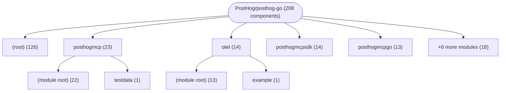
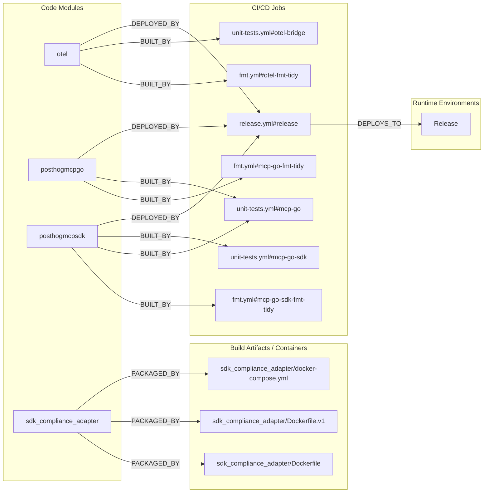
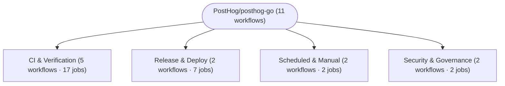

# Repository Architecture Analysis: PostHog/posthog-go

## Metadata
- **SHA**: `cde0aa1f97a1a4438f14597a2a2bd244b0cf5a17`
- **Primary Ecosystem**: Go

## Quality Metrics
- **ast_engine**: fallback
- **avg_cognitive_complexity**: 0.0
- **avg_cyclomatic_complexity**: 0.0
- **component_count**: 208
- **dead_code_count**: 0
- **dead_code_symbols**: 0 entry(ies)
- **duplication_pct**: 0.0
- **file_complexities**: 0 entry(ies)
- **files_analyzed**: 208
- **fitness_passed**: True
- **fitness_violation_count**: 0
- **framework**: Go Service
- **import_edges**: 0 entry(ies)
- **loc**: 65658
- **max_cognitive_complexity**: 0
- **max_cyclomatic_complexity**: 0
- **sloc**: 54558
- **test_file_count**: 112

# Architecture: PostHog/posthog-go

## Context
- **Repository**: `PostHog/posthog-go`
- **SHA**: `cde0aa1f97a1a4438f14597a2a2bd244b0cf5a17`
- **Ecosystem**: Go
- **Framework**: Go Service

## Building Block View

## Component Details

Showing top 60 representative components out of 208 across 11 module group(s):

- **Module `(root)`** (126 components — module: 126)
- **Module `posthogmcp`** (23 components — module: 23)
- **Module `otel`** (14 components — module: 14)
- **Module `posthogmcpsdk`** (14 components — module: 14)
- **Module `posthogmcpgo`** (13 components — module: 13)
- **Module `examples`** (7 components — module: 7)
- **Module `extras`** (5 components — module: 5)
- **Module `sdk_compliance_adapter`** (3 components — module: 3)
- **Module `cmd`** (1 components — module: 1)
- **Module `internal`** (1 components — module: 1)
- **Module `testdata`** (1 components — module: 1)

- **alias** (`alias.go`): module
- **alias_test** (`alias_test.go`): module
- **analytics** (`posthogmcp/analytics.go`): module
- **analytics_test** (`posthogmcp/analytics_test.go`): module
- **arguments** (`posthogmcpgo/arguments.go`): module
- **arguments** (`posthogmcpsdk/arguments.go`): module
- **async_test** (`async_test.go`): module
- **backoff** (`backoff.go`): module
- **backoff_test** (`backoff_test.go`): module
- **batching_test** (`batching_test.go`): module
- **before_send_test** (`before_send_test.go`): module
- **benchmark_test** (`benchmark_test.go`): module
- **calls** (`posthogmcpgo/calls.go`): module
- **calls_test** (`posthogmcpgo/calls_test.go`): module
- **capture** (`capture.go`): module
- **capture** (`examples/capture.go`): module
- **capture_local_eval_test** (`capture_local_eval_test.go`): module
- **capture_test** (`capture_test.go`): module
- **capture_v1** (`capture_v1.go`): module
- **capture_v1_errors** (`capture_v1_errors.go`): module
- **capture_v1_errors_test** (`capture_v1_errors_test.go`): module
- **capture_v1_integration_test** (`capture_v1_integration_test.go`): module
- **capture_v1_send** (`capture_v1_send.go`): module
- **capture_v1_send_test** (`capture_v1_send_test.go`): module
- **capture_v1_test** (`capture_v1_test.go`): module
- **capturer** (`capturer.go`): module
- **compression_test** (`compression_test.go`): module
- **concurrency_test** (`concurrency_test.go`): module
- **config** (`config.go`): module
- **config** (`otel/config.go`): module
- **config_test** (`config_test.go`): module
- **constants** (`posthogmcp/constants.go`): module
- **context_span_processor** (`otel/context_span_processor.go`): module
- **context_span_processor_test** (`otel/context_span_processor_test.go`): module
- **contextmarshaler** (`testdata/contextmarshaler/contextmarshaler.go`): module
- **conversation_test** (`posthogmcpsdk/conversation_test.go`): module
- **doc** (`otel/doc.go`): module
- **doc** (`posthogmcp/doc.go`): module
- **doc** (`posthogmcpgo/doc.go`): module
- **doc** (`posthogmcpsdk/doc.go`): module
- **docker-compose** (`sdk_compliance_adapter/docker-compose.yml`): module
- **emails** (`emails.go`): module
- **emails_attachments** (`emails_attachments.go`): module
- **emails_attachments_test** (`emails_attachments_test.go`): module
- **emails_error** (`emails_error.go`): module
- **emails_fakes_test** (`emails_fakes_test.go`): module
- **emails_test** (`emails_test.go`): module
- **eof_test** (`extras/eof_test.go`): module
- **error** (`error.go`): module
- **error_test** (`error_test.go`): module
- **error_tracking** (`error_tracking.go`): module
- **error_tracking** (`examples/error_tracking.go`): module
- **error_tracking_debug_images** (`error_tracking_debug_images.go`): module
- **error_tracking_debug_images_darwin** (`error_tracking_debug_images_darwin.go`): module
- **error_tracking_debug_images_darwin_test** (`error_tracking_debug_images_darwin_test.go`): module
- **error_tracking_debug_images_linux** (`error_tracking_debug_images_linux.go`): module
- **error_tracking_debug_images_linux_test** (`error_tracking_debug_images_linux_test.go`): module
- **error_tracking_debug_images_other** (`error_tracking_debug_images_other.go`): module
- **error_tracking_debug_images_test** (`error_tracking_debug_images_test.go`): module
- **error_tracking_slog** (`error_tracking_slog.go`): module

## 6-Dimension Repository Scorecard

- **Overall Grade**: `D` (66.45/100)
- **Technical Debt Score**: 33.55
- **Estimated Remediation Effort**: 30.39h

| Dimension | Grade | Score | Weight | Details |
| :--- | :---: | :---: | :---: | :--- |
| Code Quality | `A` | 100.00 | 0.20 | avg_cc=0.00, max_cc=0, duplication=0.00%, dead_code=0 |
| Dependency Health | `A` | 100.00 | 0.15 | dependencies=124, outdated=0, vulnerable=0, has_lockfile=True |
| Maintainability | `A` | 100.00 | 0.15 | avg_cognitive=0.00, max_cognitive=0, fitness_violations=0, oversized_files=0 |
| Pipeline Health | `F` | 21.00 | 0.15 | workflows=11, operational_antipatterns=27, parallel_branches=True |
| Security | `F` | 14.00 | 0.20 | vulnerabilities=0, secrets=4, pipeline_security_findings=0 |
| Test Coverage | `C` | 70.00 | 0.15 | coverage=unavailable, ci_test_job=True, test_files_detected=True |

## Supply Chain Dependencies, Vulnerabilities & Secrets

- **Dependencies Parsed**: 124 | **Vulnerabilities**: 0 | **Secrets**: 4

### Secret Findings (Redacted)
- **[HIGH] `ATRUSS-SEC-005`** at `posthogmcp/analytics_test.go:282` (`token := "phc_***REDACTED***"`)
- **[HIGH] `ATRUSS-SEC-005`** at `posthogmcp/sanitize_test.go:16` (`token := "phc_***REDACTED***"`)
- **[CRITICAL] `ATRUSS-SEC-004`** at `posthogmcp/secrets_test.go:41` (`-----BEGIN ... PRIVATE KEY----- [REDACTED]`)
- **[CRITICAL] `ATRUSS-SEC-004`** at `posthogmcp/secrets_test.go:42` (`-----BEGIN ... PRIVATE KEY----- [REDACTED]`)

### Inventory Sample
- `github.com/andybalholm/brotli` `1.1.1` (golang, `go.mod`)
- `github.com/goccy/go-json` `0.10.6` (golang, `go.mod`)
- `github.com/google/go-cmp` `0.7.0` (golang, `go.mod`)
- `github.com/google/uuid` `1.6.0` (golang, `go.mod`)
- `github.com/google/uuid` `1.6.0` (golang, `posthogmcpgo/go.mod`)
- `github.com/google/uuid` `1.6.0` (golang, `posthogmcpsdk/go.mod`)
- `github.com/hashicorp/golang-lru/v2` `2.0.7` (golang, `go.mod`)
- `github.com/joho/godotenv` `1.5.1` (golang, `go.mod`)
- `github.com/klauspost/compress` `1.17.11` (golang, `go.mod`)
- `github.com/mark3labs/mcp-go` `0.58.0` (golang, `posthogmcpgo/go.mod`)
- `github.com/modelcontextprotocol/go-sdk` `1.6.1` (golang, `posthogmcpgo/go.mod`)
- `github.com/modelcontextprotocol/go-sdk` `1.6.1` (golang, `posthogmcpsdk/go.mod`)
- `github.com/orian/flakyhttp` `0.1.1` (golang, `go.mod`)
- `github.com/posthog/posthog-go` `1.44.1` (golang, `otel/go.mod`)
- `github.com/posthog/posthog-go` `1.44.1` (golang, `posthogmcpgo/go.mod`)
- `github.com/posthog/posthog-go` `1.44.1` (golang, `posthogmcpsdk/go.mod`)
- `github.com/posthog/posthog-go/posthogmcpsdk` `1.39.0` (golang, `posthogmcpgo/go.mod`)
- `github.com/stretchr/testify` `1.11.1` (golang, `go.mod`)
- `github.com/stretchr/testify` `1.11.1` (golang, `posthogmcpgo/go.mod`)
- `github.com/stretchr/testify` `1.11.1` (golang, `posthogmcpsdk/go.mod`)
- `github.com/urfave/cli` `1.22.17` (golang, `go.mod`)
- `go.opentelemetry.io/otel` `1.46.0` (golang, `otel/go.mod`)
- `go.opentelemetry.io/otel/exporters/otlp/otlptrace/otlptracehttp` `1.46.0` (golang, `otel/go.mod`)
- `go.opentelemetry.io/otel/sdk` `1.46.0` (golang, `otel/go.mod`)
- `go.opentelemetry.io/otel/trace` `1.46.0` (golang, `otel/go.mod`)
- `go.opentelemetry.io/proto/otlp` `1.11.0` (golang, `otel/go.mod`)
- `golang.org/x/sys` `0.21.0` (golang, `go.mod`)
- `golang.org/x/text` `0.21.0` (golang, `go.mod`)
- `google.golang.org/protobuf` `1.36.12` (golang, `otel/go.mod`)
- `@changesets/cli` `3.0.3` (npm, `package.json`)
- ... (+94 more dependencies)

## Section 7: Code-to-Cloud Deployment Traceability

- `release.yml#release` (ci_job) --[DEPLOYS_TO]--> `Release` (environment)
- `otel` (code_module) --[BUILT_BY]--> `fmt.yml#otel-fmt-tidy` (ci_job)
- `otel` (code_module) --[BUILT_BY]--> `unit-tests.yml#otel-bridge` (ci_job)
- `otel` (code_module) --[DEPLOYED_BY]--> `release.yml#release` (ci_job)
- `posthogmcpgo` (code_module) --[BUILT_BY]--> `fmt.yml#mcp-go-fmt-tidy` (ci_job)
- `posthogmcpgo` (code_module) --[BUILT_BY]--> `unit-tests.yml#mcp-go` (ci_job)
- `posthogmcpgo` (code_module) --[DEPLOYED_BY]--> `release.yml#release` (ci_job)
- `posthogmcpsdk` (code_module) --[BUILT_BY]--> `fmt.yml#mcp-go-sdk-fmt-tidy` (ci_job)
- `posthogmcpsdk` (code_module) --[BUILT_BY]--> `unit-tests.yml#mcp-go` (ci_job)
- `posthogmcpsdk` (code_module) --[BUILT_BY]--> `unit-tests.yml#mcp-go-sdk` (ci_job)
- `posthogmcpsdk` (code_module) --[DEPLOYED_BY]--> `release.yml#release` (ci_job)
- `sdk_compliance_adapter` (code_module) --[PACKAGED_BY]--> `sdk_compliance_adapter/Dockerfile` (container)
- `sdk_compliance_adapter` (code_module) --[PACKAGED_BY]--> `sdk_compliance_adapter/Dockerfile.v1` (container)
- `sdk_compliance_adapter` (code_module) --[PACKAGED_BY]--> `sdk_compliance_adapter/docker-compose.yml` (container)

## CI/CD Pipeline Topology

