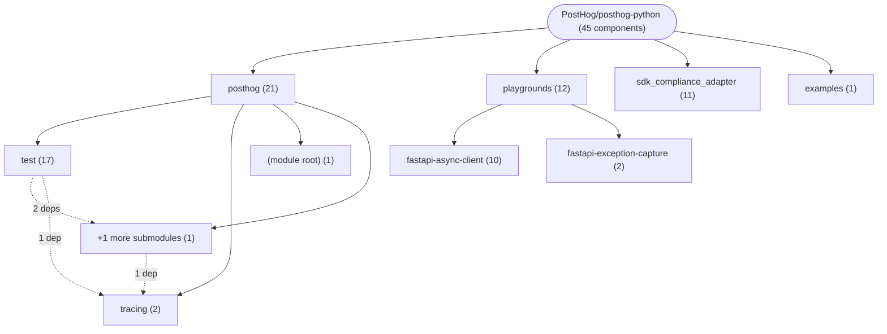
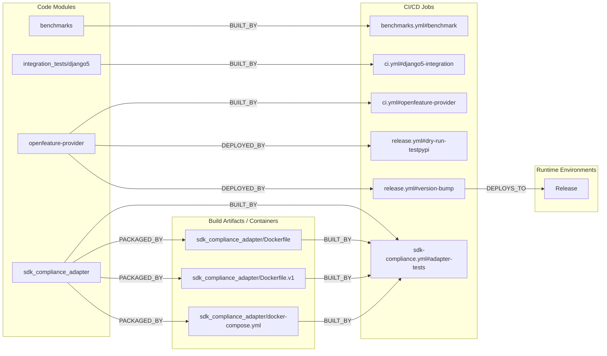
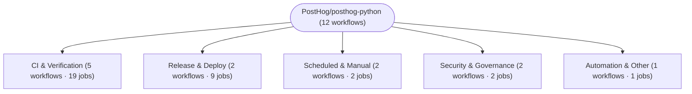

# Repository Architecture Analysis: PostHog/posthog-python

## Metadata
- **SHA**: `ec112a6201569e1cf5e9b8827a01793de523f643`
- **Primary Ecosystem**: Python

## Quality Metrics
- **ast_engine**: tree-sitter
- **avg_cognitive_complexity**: 1.52
- **avg_cyclomatic_complexity**: 2.08
- **component_count**: 45
- **dead_code_count**: 40
- **dead_code_symbols**: 40 entry(ies)
- **duplication_pct**: 82.71
- **file_complexities**: 25 entry(ies)
- **files_analyzed**: 410
- **fitness_passed**: False
- **fitness_violation_count**: 3
- **framework**: FastAPI
- **import_edges**: 100 entry(ies)
- **loc**: 164011
- **max_cognitive_complexity**: 57
- **max_cyclomatic_complexity**: 24
- **sloc**: 134186
- **test_file_count**: 192

# Architecture: PostHog/posthog-python

## Context
- **Repository**: `PostHog/posthog-python`
- **SHA**: `ec112a6201569e1cf5e9b8827a01793de523f643`
- **Ecosystem**: Python
- **Framework**: FastAPI

## Building Block View

## Component Details
- **UserInfo** (`examples/example-ai-instructor/extract.py`): DATA_ACCESS_LAYER
- **root** (`playgrounds/fastapi-async-client/main.py`): API_ROUTE
- **capture** (`playgrounds/fastapi-async-client/main.py`): API_ROUTE
- **capture_immediate** (`playgrounds/fastapi-async-client/main.py`): API_ROUTE
- **identify** (`playgrounds/fastapi-async-client/main.py`): API_ROUTE
- **group_identify** (`playgrounds/fastapi-async-client/main.py`): API_ROUTE
- **alias** (`playgrounds/fastapi-async-client/main.py`): API_ROUTE
- **evaluate_flags** (`playgrounds/fastapi-async-client/main.py`): API_ROUTE
- **remote_config** (`playgrounds/fastapi-async-client/main.py`): API_ROUTE
- **flush** (`playgrounds/fastapi-async-client/main.py`): API_ROUTE
- **test_exception** (`playgrounds/fastapi-async-client/main.py`): API_ROUTE
- **root** (`playgrounds/fastapi-exception-capture/app.py`): API_ROUTE
- **test_exception** (`playgrounds/fastapi-exception-capture/app.py`): API_ROUTE
- **_GatedExporter** (`posthog/_metrics_autocapture.py`): SERVICE
- **PostHogTraceExporter** (`posthog/ai/otel/exporter.py`): SERVICE (deps: SpanExporter)
- **ModelV2** (`posthog/test/test_utils.py`): DATA_ACCESS_LAYER
- **NestedModel** (`posthog/test/test_utils.py`): DATA_ACCESS_LAYER
- **_Parsed** (`posthog/test/ai/test_privacy_mode.py`): DATA_ACCESS_LAYER (deps: PostHogTraceExporter)
- **TestPostHogTraceExporter** (`posthog/test/ai/otel/test_exporter.py`): SERVICE (deps: PostHogTraceExporter)
- **view** (`posthog/test/integrations/test_flask_integration.py`): API_ROUTE
- **privacy_failure** (`posthog/test/integrations/test_flask_integration.py`): API_ROUTE
- **failure** (`posthog/test/integrations/test_flask_integration.py`): API_ROUTE
- **handled** (`posthog/test/integrations/test_flask_integration.py`): API_ROUTE
- **missing** (`posthog/test/integrations/test_flask_integration.py`): API_ROUTE
- **capture_event** (`posthog/test/integrations/test_flask_integration.py`): API_ROUTE
- **ignored** (`posthog/test/integrations/test_flask_integration.py`): API_ROUTE
- **identity** (`posthog/test/integrations/test_flask_integration.py`): API_ROUTE
- **view** (`posthog/test/integrations/test_flask_spans.py`): API_ROUTE
- **view** (`posthog/test/integrations/test_tracing_headers.py`): API_ROUTE
- **Totals** (`posthog/test/mcp/test_review_fixes.py`): DATA_ACCESS_LAYER
- **RecordingExporter** (`posthog/test/tracing/helpers.py`): SERVICE (deps: SpanExporter)
- **TestContextManager** (`posthog/test/tracing/test_span.py`): SERVICE
- **SpanExporter** (`posthog/tracing/_export.py`): SERVICE
- **Exporter** (`posthog/tracing/_pipeline.py`): SERVICE
- **health** (`sdk_compliance_adapter/adapter.py`): API_ROUTE
- **init** (`sdk_compliance_adapter/adapter.py`): API_ROUTE
- **capture** (`sdk_compliance_adapter/adapter.py`): API_ROUTE
- **capture_ai** (`sdk_compliance_adapter/adapter.py`): API_ROUTE
- **identify** (`sdk_compliance_adapter/adapter.py`): API_ROUTE
- **flush** (`sdk_compliance_adapter/adapter.py`): API_ROUTE
- **get_state** (`sdk_compliance_adapter/adapter.py`): API_ROUTE
- **reload_feature_flag_definitions** (`sdk_compliance_adapter/adapter.py`): API_ROUTE
- **get_feature_flag** (`sdk_compliance_adapter/adapter.py`): API_ROUTE
- **get_feature_flag_payload** (`sdk_compliance_adapter/adapter.py`): API_ROUTE
- **reset** (`sdk_compliance_adapter/adapter.py`): API_ROUTE

## 6-Dimension Repository Scorecard

- **Overall Grade**: `F` (39.35/100)
- **Technical Debt Score**: 60.65
- **Estimated Remediation Effort**: 115.70h

| Dimension | Grade | Score | Weight | Details |
| :--- | :---: | :---: | :---: | :--- |
| Code Quality | `F` | 41.50 | 0.20 | avg_cc=2.08, max_cc=24, duplication=82.71%, dead_code=40 |
| Dependency Health | `A` | 100.00 | 0.15 | dependencies=2418, outdated=0, vulnerable=0, has_lockfile=True |
| Maintainability | `F` | 37.00 | 0.15 | avg_cognitive=1.52, max_cognitive=57, fitness_violations=3, oversized_files=24 |
| Pipeline Health | `F` | 0.00 | 0.15 | workflows=12, operational_antipatterns=30, parallel_branches=True |
| Security | `F` | 0.00 | 0.20 | vulnerabilities=0, secrets=6, pipeline_security_findings=2 |
| Test Coverage | `C` | 70.00 | 0.15 | coverage=unavailable, ci_test_job=True, test_files_detected=True |

## Architecture Fitness & Workspace Boundaries

- **[MEDIUM] `ATRUSS-ARCH-005` (COMPLEXITY_THRESHOLD)**: Repository duplication_pct (82.71) exceeds policy threshold (15.0).
- **[MEDIUM] `ATRUSS-ARCH-005` (COMPLEXITY_THRESHOLD)**: Repository max_cognitive_complexity (57.0) exceeds policy threshold (25.0).
- **[MEDIUM] `ATRUSS-ARCH-005` (COMPLEXITY_THRESHOLD)**: Repository max_cyclomatic_complexity (24.0) exceeds policy threshold (20.0).

### Workspace Packages
- **openfeature-provider-posthog** (`openfeature-provider`, python, uv)

## Supply Chain Dependencies, Vulnerabilities & Secrets

- **Dependencies Parsed**: 2418 | **Vulnerabilities**: 0 | **Secrets**: 6

### Secret Findings (Redacted)
- **[CRITICAL] `ATRUSS-SEC-003`** at `posthog/test/mcp/test_error_properties.py:302` (`error=ValueError("auth failed for sk-p***REDACTED***"),`)
- **[HIGH] `ATRUSS-SEC-005`** at `posthog/test/test_code_variables.py:532` (`secret = "n8fK***REDACTED***"`)
- **[CRITICAL] `ATRUSS-SEC-004`** at `posthog/test/test_code_variables.py:1214` (`-----BEGIN ... PRIVATE KEY----- [REDACTED]`)
- **[CRITICAL] `ATRUSS-SEC-004`** at `posthog/test/test_code_variables.py:1215` (`-----BEGIN ... PRIVATE KEY----- [REDACTED]`)
- **[HIGH] `ATRUSS-SEC-005`** at `posthog/test/test_code_variables.py:1355` (`secret = "n8fK***REDACTED***"`)
- **[HIGH] `ATRUSS-SEC-005`** at `posthog/test/test_utils.py:22` (`TEST_API_KEY = "kOOl***REDACTED***"`)

### Inventory Sample
- `anthropic` `0.72` (PyPI, `pyproject.toml`)
- `anthropic` `0.80.0` (PyPI, `examples/example-ai-anthropic/pyproject.toml`)
- `anthropic` `0.87.0` (PyPI, `examples/example-ai-anthropic/uv.lock`)
- `anthropic` `1.13.0` (PyPI, `uv.lock`)
- `autogen-agentchat` `0.4.0` (PyPI, `examples/example-ai-autogen/pyproject.toml`)
- `autogen-agentchat` `0.7.5` (PyPI, `examples/example-ai-autogen/uv.lock`)
- `autogen-ext` `0.4.0` (PyPI, `examples/example-ai-autogen/pyproject.toml`)
- `autogen-ext` `0.7.5` (PyPI, `examples/example-ai-autogen/uv.lock`)
- `azure-ai-agents` `1.2.0b6` (PyPI, `examples/example-ai-semantic-kernel/pyproject.toml`)
- `azure-ai-agents` `1.2.0b6` (PyPI, `examples/example-ai-semantic-kernel/uv.lock`)
- `backoff` `1.10.0` (PyPI, `pyproject.toml`)
- `backoff` `2.2.1` (PyPI, `uv.lock`)
- `boto3` `1.35.0` (PyPI, `examples/example-ai-aws-bedrock/pyproject.toml`)
- `boto3` `1.42.76` (PyPI, `examples/example-ai-aws-bedrock/uv.lock`)
- `celery` `5.3` (PyPI, `pyproject.toml`)
- `celery` `5.6.3` (PyPI, `uv.lock`)
- `claude-agent-sdk` `*` (PyPI, `examples/example-ai-claude-agent-sdk/requirements.txt`)
- `claude-agent-sdk` `*` (PyPI, `pyproject.toml`)
- `claude-agent-sdk` `0.2.121` (PyPI, `uv.lock`)
- `coverage` `*` (PyPI, `pyproject.toml`)
- `coverage` `7.9.2` (PyPI, `uv.lock`)
- `crewai` `0.80.0` (PyPI, `examples/example-ai-crewai/pyproject.toml`)
- `crewai` `0.95.0` (PyPI, `examples/example-ai-crewai/uv.lock`)
- `distro` `1.5.0` (PyPI, `pyproject.toml`)
- `distro` `1.9.0` (PyPI, `uv.lock`)
- `django` `5.2.15` (PyPI, `pyproject.toml`)
- `django` `5.2.17` (PyPI, `integration_tests/django5/pyproject.toml`)
- `django` `5.2.17` (PyPI, `integration_tests/django5/uv.lock`)
- `django` `5.2.17` (PyPI, `uv.lock`)
- `django-stubs` `*` (PyPI, `pyproject.toml`)
- ... (+2388 more dependencies)

## Section 7: Code-to-Cloud Deployment Traceability

- `release.yml#version-bump` (ci_job) --[DEPLOYS_TO]--> `Release` (environment)
- `benchmarks` (code_module) --[BUILT_BY]--> `benchmarks.yml#benchmark` (ci_job)
- `integration_tests/django5` (code_module) --[BUILT_BY]--> `ci.yml#django5-integration` (ci_job)
- `openfeature-provider` (code_module) --[BUILT_BY]--> `ci.yml#openfeature-provider` (ci_job)
- `openfeature-provider` (code_module) --[DEPLOYED_BY]--> `release.yml#dry-run-testpypi` (ci_job)
- `openfeature-provider` (code_module) --[DEPLOYED_BY]--> `release.yml#version-bump` (ci_job)
- `sdk_compliance_adapter` (code_module) --[BUILT_BY]--> `sdk-compliance.yml#adapter-tests` (ci_job)
- `sdk_compliance_adapter` (code_module) --[PACKAGED_BY]--> `sdk_compliance_adapter/Dockerfile` (container)
- `sdk_compliance_adapter` (code_module) --[PACKAGED_BY]--> `sdk_compliance_adapter/Dockerfile.v1` (container)
- `sdk_compliance_adapter` (code_module) --[PACKAGED_BY]--> `sdk_compliance_adapter/docker-compose.yml` (container)
- `sdk_compliance_adapter/Dockerfile` (container) --[BUILT_BY]--> `sdk-compliance.yml#adapter-tests` (ci_job)
- `sdk_compliance_adapter/Dockerfile.v1` (container) --[BUILT_BY]--> `sdk-compliance.yml#adapter-tests` (ci_job)
- `sdk_compliance_adapter/docker-compose.yml` (container) --[BUILT_BY]--> `sdk-compliance.yml#adapter-tests` (ci_job)

## CI/CD Pipeline Topology

