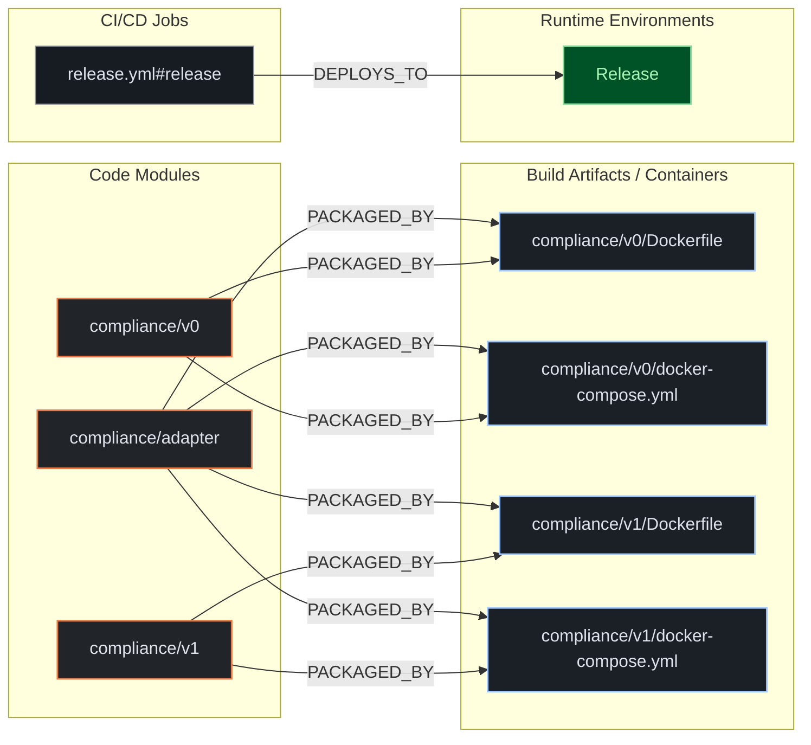

# Repository Architecture Analysis: PostHog/posthog-rs

## Metadata
- **SHA**: `6c5220af26de8a69a5b3d7681576d9080f3f6211`
- **Primary Ecosystem**: Rust

## Quality Metrics
- **ast_engine**: fallback
- **avg_cognitive_complexity**: 0.0
- **avg_cyclomatic_complexity**: 0.0
- **component_count**: 146
- **dead_code_count**: 0
- **dead_code_symbols**: 0 entry(ies)
- **duplication_pct**: 0.0
- **file_complexities**: 0 entry(ies)
- **files_analyzed**: 146
- **fitness_passed**: True
- **fitness_violation_count**: 0
- **framework**: Axum / Actix / Rocket
- **import_edges**: 0 entry(ies)
- **loc**: 47253
- **max_cognitive_complexity**: 0
- **max_cyclomatic_complexity**: 0
- **sloc**: 35732
- **test_file_count**: 42

# Architecture: PostHog/posthog-rs

## Context
- **Repository**: `PostHog/posthog-rs`
- **SHA**: `6c5220af26de8a69a5b3d7681576d9080f3f6211`
- **Ecosystem**: Rust
- **Framework**: Axum / Actix / Rocket

## Building Block View

```mermaid
graph TD;
  classDef atlasRoot fill:#004882,stroke:#a3c9ff,stroke-width:2px,color:#d3e4ff
  classDef atlasCategory fill:#212428,stroke:#E87A48,stroke-width:1.5px,color:#dfe3eb
  classDef atlasWorkflow fill:#1b2026,stroke:#a3c9ff,stroke-width:1.5px,color:#dfe3eb
  classDef atlasJob fill:#171c22,stroke:#8d9199,stroke-width:1px,color:#dfe3eb
  classDef atlasTarget fill:#005227,stroke:#8bd99b,stroke-width:1.5px,color:#a7f6b6
  classDef atlasAlert fill:#93000a,stroke:#ffb4ab,stroke-width:1.5px,color:#ffdad6
  classDef atlasMore fill:#252a31,stroke:#8d9199,stroke-dasharray:4 4,color:#c3c6cf
    repo_root(["PostHog/posthog-rs (146 components)"]):::atlasRoot
    dir_0_src["src (96)"]:::atlasCategory
    repo_root --> dir_0_src
    sub_0_0_mcp["mcp (63)"]:::atlasWorkflow
    dir_0_src --> sub_0_0_mcp
    sub_0_1__module_root_["(module root) (15)"]:::atlasWorkflow
    dir_0_src --> sub_0_1__module_root_
    sub_0_2_client["client (12)"]:::atlasWorkflow
    dir_0_src --> sub_0_2_client
    sub_0_more["+1 more submodules (6)"]:::atlasMore
    dir_0_src --> sub_0_more
    dir_1_tests["tests (39)"]:::atlasCategory
    repo_root --> dir_1_tests
    sub_1_0__module_root_["(module root) (33)"]:::atlasWorkflow
    dir_1_tests --> sub_1_0__module_root_
    sub_1_1_mcp_support["mcp_support (4)"]:::atlasWorkflow
    dir_1_tests --> sub_1_1_mcp_support
    sub_1_2_common["common (1)"]:::atlasWorkflow
    dir_1_tests --> sub_1_2_common
    sub_1_more["+1 more submodules (1)"]:::atlasMore
    dir_1_tests --> sub_1_more
    dir_2_examples["examples (8)"]:::atlasCategory
    repo_root --> dir_2_examples
    dir_3_compliance["compliance (3)"]:::atlasCategory
    repo_root --> dir_3_compliance
```

## Component Details

Showing top 60 representative components out of 146 across 4 module group(s):

- **Module `src`** (96 components — module: 96)
- **Module `tests`** (39 components — module: 39)
- **Module `examples`** (8 components — module: 8)
- **Module `compliance`** (3 components — module: 3)

- **advanced_config** (`examples/advanced_config.rs`): module
- **analytics** (`src/mcp/analytics.rs`): module
- **arguments** (`src/mcp/contract/arguments.rs`): module
- **async_client** (`src/client/async_client.rs`): module
- **async_emails** (`src/emails/async_emails.rs`): module
- **binary** (`src/mcp/privacy/binary.rs`): module
- **blocking** (`src/client/blocking.rs`): module
- **blocking_emails** (`src/emails/blocking_emails.rs`): module
- **call_tool** (`src/mcp/server/call_tool.rs`): module
- **cards** (`src/mcp/privacy/pii/cards.rs`): module
- **catalog** (`src/mcp/tools/catalog.rs`): module
- **common** (`src/client/common.rs`): module
- **compression** (`src/compression.rs`): module
- **connection** (`src/mcp/session/connection.rs`): module
- **constants** (`src/constants.rs`): module
- **context** (`src/mcp/capture/context.rs`): module
- **conversation** (`src/mcp/session/conversation.rs`): module
- **custom_http_clients** (`examples/custom_http_clients.rs`): module
- **delivery** (`src/mcp/capture/delivery.rs`): module
- **docker-compose** (`compliance/v0/docker-compose.yml`): module
- **docker-compose** (`compliance/v1/docker-compose.yml`): module
- **embedded** (`src/mcp/privacy/urls/embedded.rs`): module
- **endpoints** (`src/endpoints.rs`): module
- **error** (`src/emails/error.rs`): module
- **error** (`src/error.rs`): module
- **error_tracking** (`examples/error_tracking.rs`): module
- **error_tracking** (`src/error_tracking.rs`): module
- **evaluate_flags** (`examples/evaluate_flags.rs`): module
- **event** (`src/event.rs`): module
- **event_size** (`src/mcp/bounds/event_size.rs`): module
- **event_v1** (`src/event_v1.rs`): module
- **events** (`src/mcp/contract/events.rs`): module
- **failure** (`src/mcp/capture/failure.rs`): module
- **feature_flag_evaluations** (`src/feature_flag_evaluations.rs`): module
- **feature_flags** (`examples/feature_flags.rs`): module
- **feature_flags** (`src/feature_flags.rs`): module
- **fields** (`src/mcp/privacy/urls/fields.rs`): module
- **finish** (`src/mcp/call/finish.rs`): module
- **fragments** (`src/mcp/privacy/urls/fragments.rs`): module
- **global** (`src/global.rs`): module
- **handle_delivery** (`src/mcp/call/handle_delivery.rs`): module
- **handler** (`src/mcp/server/handler.rs`): module
- **http** (`tests/mcp_support/http.rs`): module
- **identity** (`src/mcp/identity.rs`): module
- **ids** (`src/mcp/session/ids.rs`): module
- **initialize** (`src/mcp/server/initialize.rs`): module
- **injection** (`src/mcp/tools/injection.rs`): module
- **intent** (`src/mcp/call/intent.rs`): module
- **json_members** (`src/mcp/privacy/json_members.rs`): module
- **keys** (`src/mcp/privacy/keys.rs`): module
- **lib** (`src/lib.rs`): module
- **limits** (`src/mcp/contract/limits.rs`): module
- **list_tools** (`src/mcp/server/list_tools.rs`): module
- **listing** (`src/mcp/call/listing.rs`): module
- **local_evaluation** (`examples/local_evaluation.rs`): module
- **local_evaluation** (`src/local_evaluation.rs`): module
- **local_payload_test_support** (`src/client/local_payload_test_support.rs`): module
- **main** (`compliance/adapter/src/main.rs`): module
- **manual** (`src/mcp/manual.rs`): module
- **mcp_server** (`examples/mcp_server.rs`): module

## 6-Dimension Repository Scorecard

- **Overall Grade**: `B` (80.15/100)
- **Technical Debt Score**: 19.85
- **Estimated Remediation Effort**: 17.96h

| Dimension | Grade | Score | Weight | Details |
| :--- | :---: | :---: | :---: | :--- |
| Code Quality | `A` | 100.00 | 0.20 | avg_cc=0.00, max_cc=0, duplication=0.00%, dead_code=0 |
| Dependency Health | `A` | 100.00 | 0.15 | dependencies=390, outdated=0, vulnerable=0, has_lockfile=True |
| Maintainability | `A` | 100.00 | 0.15 | avg_cognitive=0.00, max_cognitive=0, fitness_violations=0, oversized_files=0 |
| Pipeline Health | `F` | 31.00 | 0.15 | workflows=9, operational_antipatterns=18, parallel_branches=True |
| Security | `C` | 75.00 | 0.20 | vulnerabilities=0, secrets=1, pipeline_security_findings=0 |
| Test Coverage | `C` | 70.00 | 0.15 | coverage=unavailable, ci_test_job=True, test_files_detected=True |

## Architecture Fitness & Workspace Boundaries

### Workspace Packages
- **posthog-rs** (`.`, rust, cargo)
- **sdk-adapter** (`compliance/adapter`, rust, cargo) -> internal deps: `posthog-rs`

## Supply Chain Dependencies, Vulnerabilities & Secrets

- **Dependencies Parsed**: 390 | **Vulnerabilities**: 0 | **Secrets**: 1

### Secret Findings (Redacted)
- **[CRITICAL] `ATRUSS-SEC-002`** at `src/mcp/privacy/secrets.rs:196` (`let text = "key ghp_***REDACTED*** and Zx9-Qw7_Lm3.Rt8+Yp2!Kd5 here";`)

### Inventory Sample
- `axum` `0.8` (cargo, `compliance/adapter/Cargo.toml`)
- `backtrace` `0.3.74` (cargo, `Cargo.toml`)
- `base64` `0.22` (cargo, `Cargo.toml`)
- `brotli` `9.0` (cargo, `Cargo.toml`)
- `bytes` `1` (cargo, `Cargo.toml`)
- `chrono` `0.4` (cargo, `compliance/adapter/Cargo.toml`)
- `chrono` `0.4.19` (cargo, `Cargo.toml`)
- `derive_builder` `0.20.2` (cargo, `Cargo.toml`)
- `fancy-regex` `0.19` (cargo, `Cargo.toml`)
- `findshlibs` `0.10` (cargo, `Cargo.toml`)
- `flate2` `1.0` (cargo, `Cargo.toml`)
- `futures-util` `0.3` (cargo, `Cargo.toml`)
- `http` `1` (cargo, `Cargo.toml`)
- `os_info` `3.14` (cargo, `Cargo.toml`)
- `posthog-rs` `*` (cargo, `compliance/adapter/Cargo.toml`)
- `regex` `1.10` (cargo, `Cargo.toml`)
- `reqwest` `0.13.2` (cargo, `Cargo.toml`)
- `rmcp` `3.7` (cargo, `Cargo.toml`)
- `semver` `1.0.24` (cargo, `Cargo.toml`)
- `serde` `1` (cargo, `compliance/adapter/Cargo.toml`)
- `serde` `1.0.125` (cargo, `Cargo.toml`)
- `serde_json` `1` (cargo, `compliance/adapter/Cargo.toml`)
- `serde_json` `1.0.64` (cargo, `Cargo.toml`)
- `sha1` `0.10.7` (cargo, `Cargo.toml`)
- `sha2` `0.10` (cargo, `Cargo.toml`)
- `tokio` `1` (cargo, `Cargo.toml`)
- `tokio` `1` (cargo, `compliance/adapter/Cargo.toml`)
- `tower-layer` `0.3` (cargo, `Cargo.toml`)
- `tower-service` `0.3` (cargo, `Cargo.toml`)
- `tracing` `0.1` (cargo, `Cargo.toml`)
- ... (+360 more dependencies)

## Section 7: Code-to-Cloud Deployment Traceability

- `release.yml#release` (ci_job) --[DEPLOYS_TO]--> `Release` (environment)
- `compliance/adapter` (code_module) --[PACKAGED_BY]--> `compliance/v0/Dockerfile` (container)
- `compliance/adapter` (code_module) --[PACKAGED_BY]--> `compliance/v0/docker-compose.yml` (container)
- `compliance/adapter` (code_module) --[PACKAGED_BY]--> `compliance/v1/Dockerfile` (container)
- `compliance/adapter` (code_module) --[PACKAGED_BY]--> `compliance/v1/docker-compose.yml` (container)
- `compliance/v0` (code_module) --[PACKAGED_BY]--> `compliance/v0/Dockerfile` (container)
- `compliance/v0` (code_module) --[PACKAGED_BY]--> `compliance/v0/docker-compose.yml` (container)
- `compliance/v1` (code_module) --[PACKAGED_BY]--> `compliance/v1/Dockerfile` (container)
- `compliance/v1` (code_module) --[PACKAGED_BY]--> `compliance/v1/docker-compose.yml` (container)

## CI/CD Pipeline Topology

```mermaid
graph TD;
  classDef atlasRoot fill:#004882,stroke:#a3c9ff,stroke-width:2px,color:#d3e4ff
  classDef atlasCategory fill:#212428,stroke:#E87A48,stroke-width:1.5px,color:#dfe3eb
  classDef atlasWorkflow fill:#1b2026,stroke:#a3c9ff,stroke-width:1.5px,color:#dfe3eb
  classDef atlasJob fill:#171c22,stroke:#8d9199,stroke-width:1px,color:#dfe3eb
  classDef atlasTarget fill:#005227,stroke:#8bd99b,stroke-width:1.5px,color:#a7f6b6
  classDef atlasAlert fill:#93000a,stroke:#ffb4ab,stroke-width:1.5px,color:#ffdad6
  classDef atlasMore fill:#252a31,stroke:#8d9199,stroke-dasharray:4 4,color:#c3c6cf
  pipeline_root(["PostHog/posthog-rs (9 workflows)"]):::atlasRoot
  subgraph sg_grp_0_Scheduled___Manual["Scheduled & Manual (4 workflows · 4 jobs)"]
    direction TB
    subgraph sg_wf_2_Generate_references["Generate references (1 jobs)"]
      direction TB
      wf_2_Generate_references(["Trigger: Generate references"]):::atlasWorkflow
      job_2_generate_references["generate-references"]:::atlasJob
      wf_2_Generate_references --> job_2_generate_references
    end
    pipeline_root --> wf_2_Generate_references
    subgraph sg_wf_3_PostHog_Upgrade["PostHog Upgrade (1 jobs)"]
      direction TB
      wf_3_PostHog_Upgrade(["Trigger: PostHog Upgrade"]):::atlasWorkflow
      job_3_posthog_upgrade["posthog-upgrade"]:::atlasJob
      wf_3_PostHog_Upgrade --> job_3_posthog_upgrade
    end
    pipeline_root --> wf_3_PostHog_Upgrade
    subgraph sg_wf_6_SDK_Compliance_Tests__V0_Capture_["SDK Compliance Tests (V0 Capture) (1 jobs)"]
      direction TB
      wf_6_SDK_Compliance_Tests__V0_Capture_(["Trigger: SDK Compliance Tests (V0 Capture)"]):::atlasWorkflow
      job_6_test_rust_sdk_v0["test-rust-sdk-v0"]:::atlasJob
      wf_6_SDK_Compliance_Tests__V0_Capture_ --> job_6_test_rust_sdk_v0
    end
    pipeline_root --> wf_6_SDK_Compliance_Tests__V0_Capture_
    subgraph sg_wf_7_SDK_Compliance_Tests__V1_Capture_["SDK Compliance Tests (V1 Capture) (1 jobs)"]
      direction TB
      wf_7_SDK_Compliance_Tests__V1_Capture_(["Trigger: SDK Compliance Tests (V1 Capture)"]):::atlasWorkflow
      job_7_test_rust_sdk_v1["test-rust-sdk-v1"]:::atlasJob
      wf_7_SDK_Compliance_Tests__V1_Capture_ --> job_7_test_rust_sdk_v1
    end
    pipeline_root --> wf_7_SDK_Compliance_Tests__V1_Capture_
  end
  subgraph sg_grp_1_Release___Deploy["Release & Deploy (2 workflows · 6 jobs)"]
    direction TB
    subgraph sg_wf_4_Release_failure_notification["Release failure notification (1 jobs)"]
      direction TB
      wf_4_Release_failure_notification(["Trigger: Release failure notification"]):::atlasWorkflow
      job_4_notify_failed["notify-failed"]:::atlasJob
      wf_4_Release_failure_notification --> job_4_notify_failed
    end
    pipeline_root --> wf_4_Release_failure_notification
    subgraph sg_wf_5_Release["Release (5 jobs)"]
      direction TB
      wf_5_Release(["Trigger: Release"]):::atlasWorkflow
      job_5_check_changesets["check-changesets"]:::atlasJob
      job_5_notify_approval_needed["notify-approval-needed"]:::atlasJob
      job_5_preserve_slack_thread["preserve-slack-thread"]:::atlasJob
      wf_5_Release --> job_5_check_changesets
      job_5_check_changesets --> job_5_notify_approval_needed
      job_5_notify_approval_needed --> job_5_preserve_slack_thread
    end
    pipeline_root --> wf_5_Release
  end
  subgraph sg_grp_2_Security___Governance["Security & Governance (2 workflows · 2 jobs)"]
    direction TB
    subgraph sg_wf_1_CodeQL_Advanced["CodeQL Advanced (1 jobs)"]
      direction TB
      wf_1_CodeQL_Advanced(["Trigger: CodeQL Advanced"]):::atlasWorkflow
      job_1_analyze["analyze"]:::atlasJob
      wf_1_CodeQL_Advanced --> job_1_analyze
    end
    pipeline_root --> wf_1_CodeQL_Advanced
    subgraph sg_wf_8_Handle_stale_issues_and_PRs["Handle stale issues and PRs (1 jobs)"]
      direction TB
      wf_8_Handle_stale_issues_and_PRs(["Trigger: Handle stale issues and PRs"]):::atlasWorkflow
      job_8_stale["stale"]:::atlasJob
      wf_8_Handle_stale_issues_and_PRs --> job_8_stale
    end
    pipeline_root --> wf_8_Handle_stale_issues_and_PRs
  end
  subgraph sg_grp_3_CI___Verification["CI & Verification (1 workflows · 6 jobs)"]
    direction TB
    subgraph sg_wf_0_CI["CI (6 jobs)"]
      direction TB
      wf_0_CI(["Trigger: CI"]):::atlasWorkflow
      job_0_fmt["fmt"]:::atlasJob
      job_0_clippy["clippy"]:::atlasJob
      job_0_public_api["public-api"]:::atlasJob
      wf_0_CI --> job_0_fmt
      wf_0_CI --> job_0_clippy
      wf_0_CI --> job_0_public_api
    end
    pipeline_root --> wf_0_CI
  end
```

