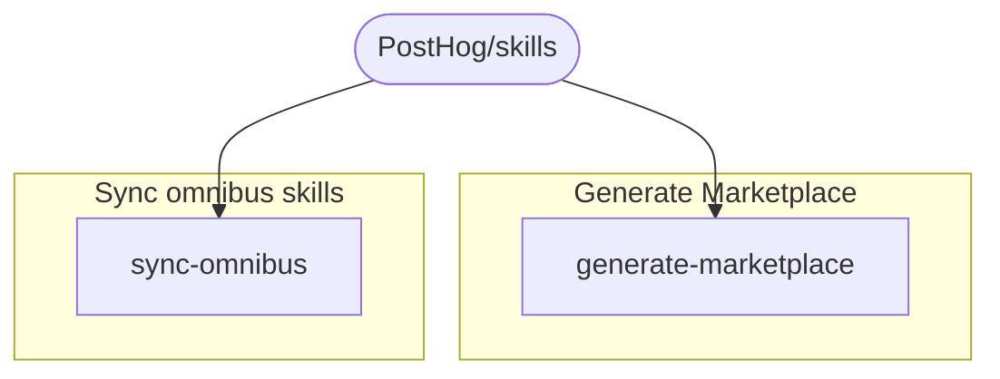

# Repository Architecture Analysis: PostHog/skills

## Metadata
- **SHA**: `7981e575a06f19bd216f1d8b0413605e393eebb4`
- **Primary Ecosystem**: Python

## Quality Metrics
- **ast_engine**: tree-sitter
- **avg_cognitive_complexity**: 6.46
- **avg_cyclomatic_complexity**: 6.12
- **component_count**: 1
- **dead_code_count**: 0
- **dead_code_symbols**: 0 entry(ies)
- **duplication_pct**: 57.81
- **file_complexities**: 25 entry(ies)
- **files_analyzed**: 28
- **fitness_passed**: False
- **fitness_violation_count**: 3
- **framework**: Unknown
- **import_edges**: 100 entry(ies)
- **loc**: 4682
- **max_cognitive_complexity**: 44
- **max_cyclomatic_complexity**: 31
- **sloc**: 3713

# Architecture: PostHog/skills

## Context
- **Repository**: `PostHog/skills`
- **SHA**: `7981e575a06f19bd216f1d8b0413605e393eebb4`
- **Ecosystem**: Python
- **Framework**: Unknown

## Building Block View

## Component Details
- **Vocabulary** (`skills/omnibus/exploring-mcp-tool-original-user-motive/scripts/canonicalize_intentions.py`): DATA_ACCESS_LAYER

## 6-Dimension Repository Scorecard

- **Overall Grade**: `D` (66.05/100)
- **Technical Debt Score**: 33.95
- **Estimated Remediation Effort**: 28.55h

| Dimension | Grade | Score | Weight | Details |
| :--- | :---: | :---: | :---: | :--- |
| Code Quality | `F` | 38.52 | 0.20 | avg_cc=6.12, max_cc=31, duplication=57.81%, dead_code=0 |
| Dependency Health | `A` | 90.00 | 0.15 | dependencies=0 (no manifests parsed) |
| Maintainability | `F` | 47.62 | 0.15 | avg_cognitive=6.46, max_cognitive=44, fitness_violations=3, oversized_files=1 |
| Pipeline Health | `A` | 94.00 | 0.15 | workflows=2, operational_antipatterns=2, parallel_branches=False |
| Security | `B` | 88.00 | 0.20 | vulnerabilities=0, secrets=0, pipeline_security_findings=1 |
| Test Coverage | `F` | 40.00 | 0.15 | coverage=unavailable, ci_test_job=False, test_files_detected=False |

## Architecture Fitness & Workspace Boundaries

- **[MEDIUM] `ATRUSS-ARCH-005` (COMPLEXITY_THRESHOLD)**: Repository duplication_pct (57.81) exceeds policy threshold (15.0).
- **[MEDIUM] `ATRUSS-ARCH-005` (COMPLEXITY_THRESHOLD)**: Repository max_cognitive_complexity (44.0) exceeds policy threshold (25.0).
- **[MEDIUM] `ATRUSS-ARCH-005` (COMPLEXITY_THRESHOLD)**: Repository max_cyclomatic_complexity (31.0) exceeds policy threshold (20.0).

## CI/CD Pipeline Topology

