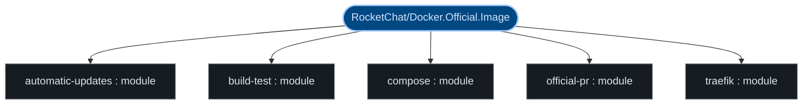
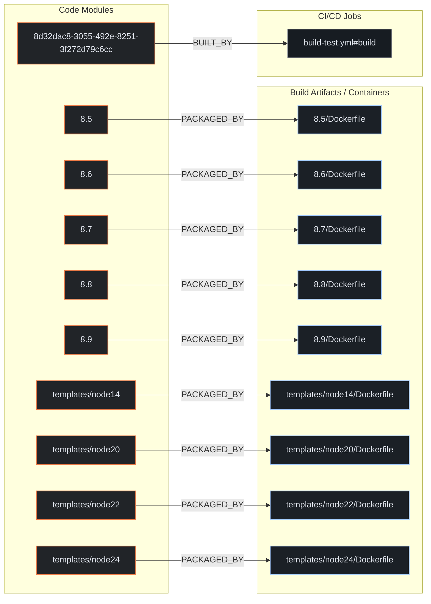
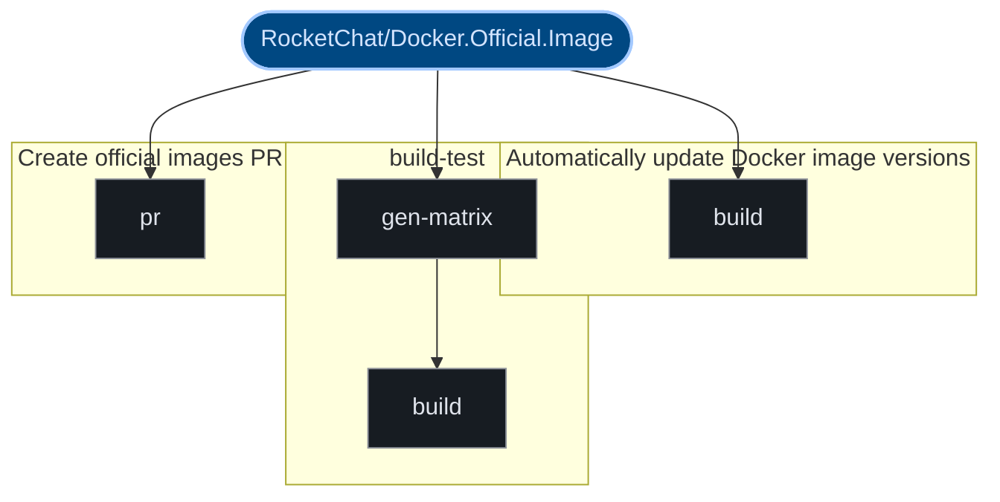

# Repository Architecture Analysis: RocketChat/Docker.Official.Image

## Metadata
- **SHA**: `81d2a27dffb0af550a80bfd7fcd8d5c8298d44a6`
- **Primary Ecosystem**: Container / Helm / IaC

## Quality Metrics
- **ast_engine**: fallback
- **avg_cognitive_complexity**: 0.0
- **avg_cyclomatic_complexity**: 0.0
- **component_count**: 5
- **dead_code_count**: 0
- **dead_code_symbols**: 0 entry(ies)
- **duplication_pct**: 0.0
- **file_complexities**: 0 entry(ies)
- **files_analyzed**: 5
- **fitness_passed**: True
- **fitness_violation_count**: 0
- **framework**: Docker Compose
- **import_edges**: 0 entry(ies)
- **loc**: 319
- **max_cognitive_complexity**: 0
- **max_cyclomatic_complexity**: 0
- **sloc**: 277

# Architecture: RocketChat/Docker.Official.Image

## Context
- **Repository**: `RocketChat/Docker.Official.Image`
- **SHA**: `81d2a27dffb0af550a80bfd7fcd8d5c8298d44a6`
- **Ecosystem**: Container / Helm / IaC
- **Framework**: Docker Compose

## Building Block View

## Component Details
- **compose** (`compose.yml`): module
- **traefik** (`traefik.yml`): module
- **automatic-updates** (`.github/workflows/automatic-updates.yml`): module
- **build-test** (`.github/workflows/build-test.yml`): module
- **official-pr** (`.github/workflows/official-pr.yml`): module

## 6-Dimension Repository Scorecard

- **Overall Grade**: `B` (86.35/100)
- **Technical Debt Score**: 13.65
- **Estimated Remediation Effort**: 6.41h

| Dimension | Grade | Score | Weight | Details |
| :--- | :---: | :---: | :---: | :--- |
| Code Quality | `A` | 100.00 | 0.20 | avg_cc=0.00, max_cc=0, duplication=0.00%, dead_code=0 |
| Dependency Health | `A` | 90.00 | 0.15 | dependencies=0 (no manifests parsed) |
| Maintainability | `A` | 100.00 | 0.15 | avg_cognitive=0.00, max_cognitive=0, fitness_violations=0, oversized_files=0 |
| Pipeline Health | `C` | 79.00 | 0.15 | workflows=3, operational_antipatterns=4, parallel_branches=False |
| Security | `A` | 100.00 | 0.20 | vulnerabilities=0, secrets=0, pipeline_security_findings=0 |
| Test Coverage | `F` | 40.00 | 0.15 | coverage=unavailable, ci_test_job=False, test_files_detected=False |

## Section 7: Code-to-Cloud Deployment Traceability

- `8.5` (code_module) --[PACKAGED_BY]--> `8.5/Dockerfile` (container)
- `8.6` (code_module) --[PACKAGED_BY]--> `8.6/Dockerfile` (container)
- `8.7` (code_module) --[PACKAGED_BY]--> `8.7/Dockerfile` (container)
- `8.8` (code_module) --[PACKAGED_BY]--> `8.8/Dockerfile` (container)
- `8.9` (code_module) --[PACKAGED_BY]--> `8.9/Dockerfile` (container)
- `8d32dac8-3055-492e-8251-3f272d79c6cc` (code_module) --[BUILT_BY]--> `build-test.yml#build` (ci_job)
- `templates/node14` (code_module) --[PACKAGED_BY]--> `templates/node14/Dockerfile` (container)
- `templates/node20` (code_module) --[PACKAGED_BY]--> `templates/node20/Dockerfile` (container)
- `templates/node22` (code_module) --[PACKAGED_BY]--> `templates/node22/Dockerfile` (container)
- `templates/node24` (code_module) --[PACKAGED_BY]--> `templates/node24/Dockerfile` (container)

## CI/CD Pipeline Topology

