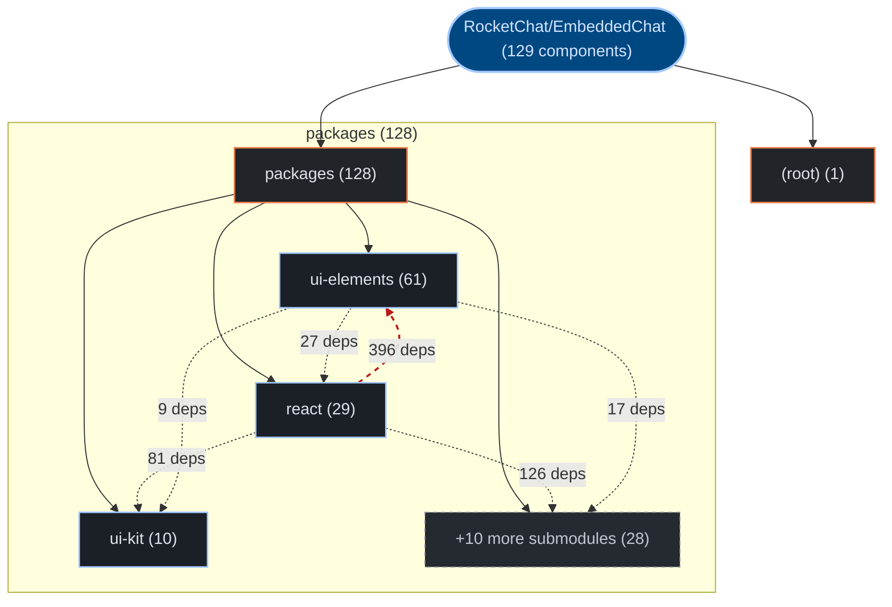
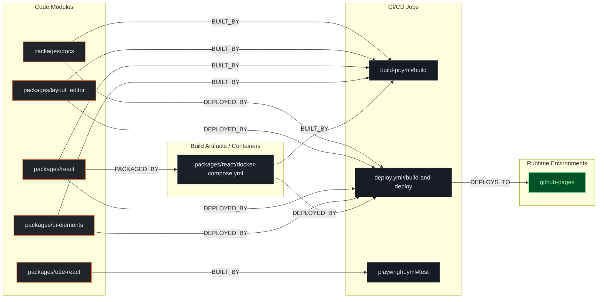

# Repository Architecture Analysis: RocketChat/EmbeddedChat

## Metadata
- **SHA**: `24b623cdd58f6155a7af040073433d8056e01632`
- **Primary Ecosystem**: JavaScript/TypeScript

## Quality Metrics
- **ast_engine**: tree-sitter
- **avg_cognitive_complexity**: 3.45
- **avg_cyclomatic_complexity**: 3.48
- **component_count**: 129
- **dead_code_count**: 8
- **dead_code_symbols**: 8 entry(ies)
- **duplication_pct**: 84.32
- **file_complexities**: 25 entry(ies)
- **files_analyzed**: 710
- **fitness_passed**: False
- **fitness_violation_count**: 53
- **framework**: React (Vite)
- **import_edges**: 100 entry(ies)
- **loc**: 46278
- **max_cognitive_complexity**: 235
- **max_cyclomatic_complexity**: 168
- **sloc**: 42177
- **test_file_count**: 4

# Architecture: RocketChat/EmbeddedChat

## Context
- **Repository**: `RocketChat/EmbeddedChat`
- **SHA**: `24b623cdd58f6155a7af040073433d8056e01632`
- **Ecosystem**: JavaScript/TypeScript
- **Framework**: React (Vite)

## Building Block View

## Component Details

Showing top 60 representative components out of 129 across 2 module group(s):

- **Module `packages`** (128 components — UI_COMPONENT: 114, MODULE: 13, API_ROUTE: 1)
- **Module `(root)`** (1 components — MODULE: 1)

- **Azure_Sky** (`packages/react/src/stories/RCVariantStories/Simplistic.stories.js`): UI_COMPONENT (deps: API_src_index, Avatar, AvatarContainer, CircleVariant, CodeBlockStyles, ColorElementStyles (+86 more))
- **Default** (`packages/react/src/stories/RCVariantStories/Simplistic.stories.js`): UI_COMPONENT (deps: API_src_index, Avatar, AvatarContainer, Azure_Sky, CircleVariant, CodeBlockStyles (+86 more))
- **Pine_Whisper** (`packages/react/src/stories/CurveVariantStories/Simplistic.stories.js`): UI_COMPONENT (deps: API_src_index, Avatar, AvatarContainer, Azure_Sky, CircleVariant, CodeBlockStyles (+86 more))
- **Secure_Auth** (`packages/react/src/stories/EmbeddedChatSecureAuth.stories.js`): UI_COMPONENT (deps: API_src_index, Avatar, AvatarContainer, Azure_Sky, CircleVariant, CodeBlockStyles (+86 more))
- **Simple** (`packages/react/src/stories/EmbeddedChat.stories.js`): UI_COMPONENT (deps: API_src_index, Avatar, AvatarContainer, Azure_Sky, CircleVariant, CodeBlockStyles (+86 more))
- **Stormy_Seas** (`packages/react/src/stories/ModernVariantStories/Simplistic.stories.js`): UI_COMPONENT (deps: API_src_index, Avatar, AvatarContainer, Azure_Sky, CircleVariant, CodeBlockStyles (+86 more))
- **WithAIAdapter** (`packages/react/src/stories/WithAIAdapter.stories.js`): UI_COMPONENT (deps: API_src_index, Avatar, AvatarContainer, Azure_Sky, CircleVariant, CodeBlockStyles (+86 more))
- **WithAuthToken** (`packages/react/src/stories/EmbeddedChatAuthToken.stories.js`): UI_COMPONENT (deps: API_src_index, Avatar, AvatarContainer, Azure_Sky, CircleVariant, CodeBlockStyles (+86 more))
- **WithOAuth** (`packages/react/src/stories/EmbeddedChatWithOAuth.stories.js`): UI_COMPONENT (deps: API_src_index, Avatar, AvatarContainer, Azure_Sky, CircleVariant, CodeBlockStyles (+86 more))
- **Azure_Sky** (`packages/react/src/stories/CurveVariantStories/Simplistic.stories.js`): UI_COMPONENT (deps: API_src_index, Avatar, AvatarContainer, CircleVariant, CodeBlockStyles, ColorElementStyles (+85 more))
- **ModalThumb** (`packages/ui-elements/src/components/Modal/ModalThumb.js`): UI_COMPONENT (deps: Avatar, ModalContentStyles, ModalFooterStyles, ModalHeaderStyles, ModalThumbStyles, ModalTitleStyles)
- **Modal** (`packages/ui-elements/src/components/Modal/Modal.js`): UI_COMPONENT (deps: ModalContentStyles, ModalFooterStyles, ModalHeaderStyles, ModalThumbStyles, ModalTitleStyles)
- **ModalContent** (`packages/ui-elements/src/components/Modal/ModalContent.js`): UI_COMPONENT (deps: ModalContentStyles, ModalFooterStyles, ModalHeaderStyles, ModalThumbStyles, ModalTitleStyles)
- **ModalFooter** (`packages/ui-elements/src/components/Modal/ModalFooter.js`): UI_COMPONENT (deps: ModalContentStyles, ModalFooterStyles, ModalHeaderStyles, ModalThumbStyles, ModalTitleStyles)
- **ModalHeader** (`packages/ui-elements/src/components/Modal/ModalHeader.js`): UI_COMPONENT (deps: ModalContentStyles, ModalFooterStyles, ModalHeaderStyles, ModalThumbStyles, ModalTitleStyles)
- **ModalTitle** (`packages/ui-elements/src/components/Modal/ModalTitle.js`): UI_COMPONENT (deps: ModalContentStyles, ModalFooterStyles, ModalHeaderStyles, ModalThumbStyles, ModalTitleStyles)
- **Default** (`packages/ui-elements/src/components/Avatar/Avatar.stories.js`): UI_COMPONENT (deps: Avatar, ThemeContext, ThemeProvider)
- **Default** (`packages/ui-elements/src/components/Divider/Divider.stories.js`): UI_COMPONENT (deps: MessageDivider, ThemeContext, ThemeProvider)
- **Default** (`packages/ui-elements/src/components/Tooltip/Tooltip.stories.js`): UI_COMPONENT (deps: IconSet, ThemeContext, ThemeProvider)
- **MessageMetrics** (`packages/react/src/views/Message/MessageMetrics.js`): UI_COMPONENT (deps: MessageBodyStyles, MessageMetricsStyles, RCInstanceProvider)
- **MessageToolbox** (`packages/react/src/views/Message/MessageToolbox.js`): UI_COMPONENT (deps: MessageBodyStyles, MessageMetricsStyles, RCInstanceProvider)
- **Avatar** (`packages/ui-elements/src/components/Avatar/Avatar.js`): UI_COMPONENT (deps: AvatarContainer, IconSet)
- **CircleVariant** (`packages/ui-elements/src/components/Skeleton/Skeleton.stories.js`): UI_COMPONENT (deps: ThemeContext, ThemeProvider)
- **CustomSize** (`packages/ui-elements/src/components/Icon/Icon.stories.js`): UI_COMPONENT (deps: ThemeContext, ThemeProvider)
- **CustomStyle** (`packages/ui-elements/src/components/Icon/Icon.stories.js`): UI_COMPONENT (deps: ThemeContext, ThemeProvider)
- **Default** (`packages/ui-elements/src/components/CheckBox/CheckBox.stories.js`): UI_COMPONENT (deps: ThemeContext, ThemeProvider)
- **Default** (`packages/ui-elements/src/components/Flex/Flex.stories.js`): UI_COMPONENT (deps: ThemeContext, ThemeProvider)
- **Default** (`packages/ui-elements/src/components/GenericModal/GenericModal.stories.js`): UI_COMPONENT (deps: ThemeContext, ThemeProvider)
- **Default** (`packages/ui-elements/src/components/Grid/Grid.stories.js`): UI_COMPONENT (deps: ThemeContext, ThemeProvider)
- **Default** (`packages/ui-elements/src/components/Menu/Menu.stories.js`): UI_COMPONENT (deps: ThemeContext, ThemeProvider)
- **Default** (`packages/ui-elements/src/components/Modal/Modal.stories.js`): UI_COMPONENT (deps: ThemeContext, ThemeProvider)
- **Default** (`packages/ui-elements/src/components/MultiSelect/MultiSelect.stories.js`): UI_COMPONENT (deps: ThemeContext, ThemeProvider)
- **Default** (`packages/ui-elements/src/components/Popup/Popup.stories.js`): UI_COMPONENT (deps: ThemeContext, ThemeProvider)
- **Default** (`packages/ui-elements/src/components/Sidebar/Sidebar.stories.js`): UI_COMPONENT (deps: ThemeContext, ThemeProvider)
- **Default** (`packages/ui-elements/src/components/StaticSelect/StaticSelect.stories.js`): UI_COMPONENT (deps: ThemeContext, ThemeProvider)
- **Default** (`packages/ui-elements/src/components/Throbber/Throbber.stories.js`): UI_COMPONENT (deps: ThemeContext, ThemeProvider)
- **Default** (`packages/ui-elements/src/components/ToastBar/ToastBar.stories.js`): UI_COMPONENT (deps: ThemeContext, ThemeProvider)
- **Disabled** (`packages/ui-elements/src/components/Throbber/Throbber.stories.js`): UI_COMPONENT (deps: ThemeContext, ThemeProvider)
- **Div** (`packages/ui-elements/src/components/Box/Box.stories.js`): UI_COMPONENT (deps: ThemeContext, ThemeProvider)
- **Ghost** (`packages/ui-elements/src/components/ActionButton/ActionButton.stories.js`): UI_COMPONENT (deps: ThemeContext, ThemeProvider)
- **GoogleIcon** (`packages/ui-elements/src/components/Icon/Icon.stories.js`): UI_COMPONENT (deps: ThemeContext, ThemeProvider)
- **Large** (`packages/ui-elements/src/components/Button/Button.stories.js`): UI_COMPONENT (deps: ThemeContext, ThemeProvider)
- **Level1** (`packages/ui-elements/src/components/Heading/Heading.stories.js`): UI_COMPONENT (deps: ThemeContext, ThemeProvider)
- **Level2** (`packages/ui-elements/src/components/Heading/Heading.stories.js`): UI_COMPONENT (deps: ThemeContext, ThemeProvider)
- **Level3** (`packages/ui-elements/src/components/Heading/Heading.stories.js`): UI_COMPONENT (deps: ThemeContext, ThemeProvider)
- **Level4** (`packages/ui-elements/src/components/Heading/Heading.stories.js`): UI_COMPONENT (deps: ThemeContext, ThemeProvider)
- **Level5** (`packages/ui-elements/src/components/Heading/Heading.stories.js`): UI_COMPONENT (deps: ThemeContext, ThemeProvider)
- **Level6** (`packages/ui-elements/src/components/Heading/Heading.stories.js`): UI_COMPONENT (deps: ThemeContext, ThemeProvider)
- **MessageAggregator** (`packages/react/src/views/MessageAggregators/common/MessageAggregator.js`): UI_COMPONENT (deps: MessageDivider, RCInstanceProvider)
- **MessageBody** (`packages/layout_editor/src/views/Message/MessageBody.jsx`): UI_COMPONENT (deps: MessageBodyStyles, MessageMetricsStyles)
- **MessageBody** (`packages/react/src/views/Message/MessageBody.js`): UI_COMPONENT (deps: MessageBodyStyles, MessageMetricsStyles)
- **MessageDivider** (`packages/layout_editor/src/views/Message/MessageDivider.jsx`): UI_COMPONENT (deps: MessageBodyStyles, MessageMetricsStyles)
- **MessageDivider** (`packages/react/src/views/Message/MessageDivider.js`): UI_COMPONENT (deps: MessageBodyStyles, MessageMetricsStyles)
- **MessageReactions** (`packages/react/src/views/Message/MessageReactions.js`): UI_COMPONENT (deps: MessageBodyStyles, MessageMetricsStyles)
- **MessageToolbox** (`packages/layout_editor/src/views/Message/MessageToolbox.jsx`): UI_COMPONENT (deps: MessageBodyStyles, MessageMetricsStyles)
- **MultiSelect** (`packages/ui-elements/src/components/ListBox/ListBox.stories.js`): UI_COMPONENT (deps: ThemeContext, ThemeProvider)
- **Password** (`packages/ui-elements/src/components/Input/Input.stories.js`): UI_COMPONENT (deps: ThemeContext, ThemeProvider)
- **Primary** (`packages/ui-elements/src/components/ActionButton/ActionButton.stories.js`): UI_COMPONENT (deps: ThemeContext, ThemeProvider)
- **Primary** (`packages/ui-elements/src/components/Button/Button.stories.js`): UI_COMPONENT (deps: ThemeContext, ThemeProvider)
- **RectVariant** (`packages/ui-elements/src/components/Skeleton/Skeleton.stories.js`): UI_COMPONENT (deps: ThemeContext, ThemeProvider)

## 6-Dimension Repository Scorecard

- **Overall Grade**: `F` (34.62/100)
- **Technical Debt Score**: 65.38
- **Estimated Remediation Effort**: 196.21h

| Dimension | Grade | Score | Weight | Details |
| :--- | :---: | :---: | :---: | :--- |
| Code Quality | `F` | 32.08 | 0.20 | avg_cc=3.48, max_cc=168, duplication=84.32%, dead_code=8 |
| Dependency Health | `B` | 85.00 | 0.15 | dependencies=341, outdated=0, vulnerable=0, has_lockfile=False |
| Maintainability | `F` | 0.00 | 0.15 | avg_cognitive=3.45, max_cognitive=235, fitness_violations=53, oversized_files=4 |
| Pipeline Health | `F` | 33.00 | 0.15 | workflows=6, operational_antipatterns=9, parallel_branches=False |
| Security | `F` | 0.00 | 0.20 | vulnerabilities=0, secrets=0, pipeline_security_findings=11 |
| Test Coverage | `C` | 70.00 | 0.15 | coverage=unavailable, ci_test_job=True, test_files_detected=True |

## Architecture Fitness & Workspace Boundaries

- **[HIGH] `ATRUSS-ARCH-004` (CIRCULAR_DEPENDENCY)**: Circular dependency detected between architectural components. (Azure_Sky -> Default -> Azure_Sky)
- **[HIGH] `ATRUSS-ARCH-004` (CIRCULAR_DEPENDENCY)**: Circular dependency detected between architectural components. (Azure_Sky -> Default -> Pine_Whisper -> Azure_Sky)
- **[HIGH] `ATRUSS-ARCH-004` (CIRCULAR_DEPENDENCY)**: Circular dependency detected between architectural components. (Azure_Sky -> Default -> Pine_Whisper -> Secure_Auth -> Azure_Sky)
- **[HIGH] `ATRUSS-ARCH-004` (CIRCULAR_DEPENDENCY)**: Circular dependency detected between architectural components. (Azure_Sky -> Default -> Pine_Whisper -> Secure_Auth -> Simple -> Azure_Sky)
- **[HIGH] `ATRUSS-ARCH-004` (CIRCULAR_DEPENDENCY)**: Circular dependency detected between architectural components. (Azure_Sky -> Default -> Pine_Whisper -> Secure_Auth -> Simple -> Stormy_Seas -> Azure_Sky)
- **[HIGH] `ATRUSS-ARCH-004` (CIRCULAR_DEPENDENCY)**: Circular dependency detected between architectural components. (Azure_Sky -> Default -> Pine_Whisper -> Secure_Auth -> Simple -> Stormy_Seas -> WithAIAdapter -> Azure_Sky)
- **[HIGH] `ATRUSS-ARCH-004` (CIRCULAR_DEPENDENCY)**: Circular dependency detected between architectural components. (Azure_Sky -> Default -> Pine_Whisper -> Secure_Auth -> Simple -> Stormy_Seas -> WithAIAdapter -> WithAuthToken -> Azure_Sky)
- **[HIGH] `ATRUSS-ARCH-004` (CIRCULAR_DEPENDENCY)**: Circular dependency detected between architectural components. (Azure_Sky -> Default -> Pine_Whisper -> Secure_Auth -> Simple -> Stormy_Seas -> WithAIAdapter -> WithAuthToken -> WithOAuth -> Azure_Sky)
- **[HIGH] `ATRUSS-ARCH-004` (CIRCULAR_DEPENDENCY)**: Circular dependency detected between architectural components. (Azure_Sky -> Default -> Pine_Whisper -> Secure_Auth -> Simple -> Stormy_Seas -> WithAIAdapter -> WithOAuth -> Azure_Sky)
- **[HIGH] `ATRUSS-ARCH-004` (CIRCULAR_DEPENDENCY)**: Circular dependency detected between architectural components. (Azure_Sky -> Default -> Pine_Whisper -> Secure_Auth -> Simple -> Stormy_Seas -> WithAIAdapter -> WithOAuth -> WithAuthToken -> Azure_Sky)
- **[HIGH] `ATRUSS-ARCH-004` (CIRCULAR_DEPENDENCY)**: Circular dependency detected between architectural components. (Azure_Sky -> Default -> Pine_Whisper -> Secure_Auth -> Simple -> Stormy_Seas -> WithAuthToken -> Azure_Sky)
- **[HIGH] `ATRUSS-ARCH-004` (CIRCULAR_DEPENDENCY)**: Circular dependency detected between architectural components. (Azure_Sky -> Default -> Pine_Whisper -> Secure_Auth -> Simple -> Stormy_Seas -> WithAuthToken -> WithAIAdapter -> Azure_Sky)
- **[HIGH] `ATRUSS-ARCH-004` (CIRCULAR_DEPENDENCY)**: Circular dependency detected between architectural components. (Azure_Sky -> Default -> Pine_Whisper -> Secure_Auth -> Simple -> Stormy_Seas -> WithAuthToken -> WithAIAdapter -> WithOAuth -> Azure_Sky)
- **[HIGH] `ATRUSS-ARCH-004` (CIRCULAR_DEPENDENCY)**: Circular dependency detected between architectural components. (Azure_Sky -> Default -> Pine_Whisper -> Secure_Auth -> Simple -> Stormy_Seas -> WithAuthToken -> WithOAuth -> Azure_Sky)
- **[HIGH] `ATRUSS-ARCH-004` (CIRCULAR_DEPENDENCY)**: Circular dependency detected between architectural components. (Azure_Sky -> Default -> Pine_Whisper -> Secure_Auth -> Simple -> Stormy_Seas -> WithAuthToken -> WithOAuth -> WithAIAdapter -> Azure_Sky)
- **[HIGH] `ATRUSS-ARCH-004` (CIRCULAR_DEPENDENCY)**: Circular dependency detected between architectural components. (Azure_Sky -> Default -> Pine_Whisper -> Secure_Auth -> Simple -> Stormy_Seas -> WithOAuth -> Azure_Sky)
- **[HIGH] `ATRUSS-ARCH-004` (CIRCULAR_DEPENDENCY)**: Circular dependency detected between architectural components. (Azure_Sky -> Default -> Pine_Whisper -> Secure_Auth -> Simple -> Stormy_Seas -> WithOAuth -> WithAIAdapter -> Azure_Sky)
- **[HIGH] `ATRUSS-ARCH-004` (CIRCULAR_DEPENDENCY)**: Circular dependency detected between architectural components. (Azure_Sky -> Default -> Pine_Whisper -> Secure_Auth -> Simple -> Stormy_Seas -> WithOAuth -> WithAIAdapter -> WithAuthToken -> Azure_Sky)
- **[HIGH] `ATRUSS-ARCH-004` (CIRCULAR_DEPENDENCY)**: Circular dependency detected between architectural components. (Azure_Sky -> Default -> Pine_Whisper -> Secure_Auth -> Simple -> Stormy_Seas -> WithOAuth -> WithAuthToken -> Azure_Sky)
- **[HIGH] `ATRUSS-ARCH-004` (CIRCULAR_DEPENDENCY)**: Circular dependency detected between architectural components. (Azure_Sky -> Default -> Pine_Whisper -> Secure_Auth -> Simple -> Stormy_Seas -> WithOAuth -> WithAuthToken -> WithAIAdapter -> Azure_Sky)
- **[HIGH] `ATRUSS-ARCH-004` (CIRCULAR_DEPENDENCY)**: Circular dependency detected between architectural components. (Azure_Sky -> Default -> Pine_Whisper -> Secure_Auth -> Simple -> WithAIAdapter -> Azure_Sky)
- **[HIGH] `ATRUSS-ARCH-004` (CIRCULAR_DEPENDENCY)**: Circular dependency detected between architectural components. (Azure_Sky -> Default -> Pine_Whisper -> Secure_Auth -> Simple -> WithAIAdapter -> Stormy_Seas -> Azure_Sky)
- **[HIGH] `ATRUSS-ARCH-004` (CIRCULAR_DEPENDENCY)**: Circular dependency detected between architectural components. (Azure_Sky -> Default -> Pine_Whisper -> Secure_Auth -> Simple -> WithAIAdapter -> Stormy_Seas -> WithAuthToken -> Azure_Sky)
- **[HIGH] `ATRUSS-ARCH-004` (CIRCULAR_DEPENDENCY)**: Circular dependency detected between architectural components. (Azure_Sky -> Default -> Pine_Whisper -> Secure_Auth -> Simple -> WithAIAdapter -> Stormy_Seas -> WithAuthToken -> WithOAuth -> Azure_Sky)
- **[HIGH] `ATRUSS-ARCH-004` (CIRCULAR_DEPENDENCY)**: Circular dependency detected between architectural components. (Azure_Sky -> Default -> Pine_Whisper -> Secure_Auth -> Simple -> WithAIAdapter -> Stormy_Seas -> WithOAuth -> Azure_Sky)
- **[HIGH] `ATRUSS-ARCH-004` (CIRCULAR_DEPENDENCY)**: Circular dependency detected between architectural components. (Azure_Sky -> Default -> Pine_Whisper -> Secure_Auth -> Simple -> WithAIAdapter -> Stormy_Seas -> WithOAuth -> WithAuthToken -> Azure_Sky)
- **[HIGH] `ATRUSS-ARCH-004` (CIRCULAR_DEPENDENCY)**: Circular dependency detected between architectural components. (Azure_Sky -> Default -> Pine_Whisper -> Secure_Auth -> Simple -> WithAIAdapter -> WithAuthToken -> Azure_Sky)
- **[HIGH] `ATRUSS-ARCH-004` (CIRCULAR_DEPENDENCY)**: Circular dependency detected between architectural components. (Azure_Sky -> Default -> Pine_Whisper -> Secure_Auth -> Simple -> WithAIAdapter -> WithAuthToken -> Stormy_Seas -> Azure_Sky)
- **[HIGH] `ATRUSS-ARCH-004` (CIRCULAR_DEPENDENCY)**: Circular dependency detected between architectural components. (Azure_Sky -> Default -> Pine_Whisper -> Secure_Auth -> Simple -> WithAIAdapter -> WithAuthToken -> Stormy_Seas -> WithOAuth -> Azure_Sky)
- **[HIGH] `ATRUSS-ARCH-004` (CIRCULAR_DEPENDENCY)**: Circular dependency detected between architectural components. (Azure_Sky -> Default -> Pine_Whisper -> Secure_Auth -> Simple -> WithAIAdapter -> WithAuthToken -> WithOAuth -> Azure_Sky)
- **[HIGH] `ATRUSS-ARCH-004` (CIRCULAR_DEPENDENCY)**: Circular dependency detected between architectural components. (Azure_Sky -> Default -> Pine_Whisper -> Secure_Auth -> Simple -> WithAIAdapter -> WithAuthToken -> WithOAuth -> Stormy_Seas -> Azure_Sky)
- **[HIGH] `ATRUSS-ARCH-004` (CIRCULAR_DEPENDENCY)**: Circular dependency detected between architectural components. (Azure_Sky -> Default -> Pine_Whisper -> Secure_Auth -> Simple -> WithAIAdapter -> WithOAuth -> Azure_Sky)
- **[HIGH] `ATRUSS-ARCH-004` (CIRCULAR_DEPENDENCY)**: Circular dependency detected between architectural components. (Azure_Sky -> Default -> Pine_Whisper -> Secure_Auth -> Simple -> WithAIAdapter -> WithOAuth -> Stormy_Seas -> Azure_Sky)
- **[HIGH] `ATRUSS-ARCH-004` (CIRCULAR_DEPENDENCY)**: Circular dependency detected between architectural components. (Azure_Sky -> Default -> Pine_Whisper -> Secure_Auth -> Simple -> WithAIAdapter -> WithOAuth -> Stormy_Seas -> WithAuthToken -> Azure_Sky)
- **[HIGH] `ATRUSS-ARCH-004` (CIRCULAR_DEPENDENCY)**: Circular dependency detected between architectural components. (Azure_Sky -> Default -> Pine_Whisper -> Secure_Auth -> Simple -> WithAIAdapter -> WithOAuth -> WithAuthToken -> Azure_Sky)
- **[HIGH] `ATRUSS-ARCH-004` (CIRCULAR_DEPENDENCY)**: Circular dependency detected between architectural components. (Azure_Sky -> Default -> Pine_Whisper -> Secure_Auth -> Simple -> WithAIAdapter -> WithOAuth -> WithAuthToken -> Stormy_Seas -> Azure_Sky)
- **[HIGH] `ATRUSS-ARCH-004` (CIRCULAR_DEPENDENCY)**: Circular dependency detected between architectural components. (Azure_Sky -> Default -> Pine_Whisper -> Secure_Auth -> Simple -> WithAuthToken -> Azure_Sky)
- **[HIGH] `ATRUSS-ARCH-004` (CIRCULAR_DEPENDENCY)**: Circular dependency detected between architectural components. (Azure_Sky -> Default -> Pine_Whisper -> Secure_Auth -> Simple -> WithAuthToken -> Stormy_Seas -> Azure_Sky)
- **[HIGH] `ATRUSS-ARCH-004` (CIRCULAR_DEPENDENCY)**: Circular dependency detected between architectural components. (Azure_Sky -> Default -> Pine_Whisper -> Secure_Auth -> Simple -> WithAuthToken -> Stormy_Seas -> WithAIAdapter -> Azure_Sky)
- **[HIGH] `ATRUSS-ARCH-004` (CIRCULAR_DEPENDENCY)**: Circular dependency detected between architectural components. (Azure_Sky -> Default -> Pine_Whisper -> Secure_Auth -> Simple -> WithAuthToken -> Stormy_Seas -> WithAIAdapter -> WithOAuth -> Azure_Sky)
- ... (+13 more fitness violations)

### Workspace Packages
- **@embeddedchat/ai-adapter** (`packages/ai-adapter`, react_ts_js, yarn)
- **@embeddedchat/api** (`packages/api`, react_ts_js, yarn) -> internal deps: `@embeddedchat/auth`
- **@embeddedchat/auth** (`packages/auth`, react_ts_js, yarn)
- **e2e-react** (`packages/e2e-react`, react_ts_js, yarn) -> internal deps: `@embeddedchat/react`
- **@embeddedchat/htmlembed** (`packages/htmlembed`, react_ts_js, yarn) -> internal deps: `@embeddedchat/react`
- **layout_editor** (`packages/layout_editor`, react_ts_js, yarn) -> internal deps: `@embeddedchat/ai-adapter, @embeddedchat/markups, @embeddedchat/ui-elements`
- **@embeddedchat/markups** (`packages/markups`, react_ts_js, yarn) -> internal deps: `@embeddedchat/ui-elements`
- **@embeddedchat/rc-app** (`packages/rc-app`, react_ts_js, yarn)
- **@embeddedchat/react** (`packages/react`, react_ts_js, yarn) -> internal deps: `@embeddedchat/ai-adapter, @embeddedchat/api, @embeddedchat/markups, @embeddedchat/ui-elements, @embeddedchat/ui-kit`
- **@embeddedchat/react-native** (`packages/react-native`, react_ts_js, yarn) -> internal deps: `@embeddedchat/api`
- **@embeddedchat/ui-elements** (`packages/ui-elements`, react_ts_js, yarn)
- **@embeddedchat/ui-kit** (`packages/ui-kit`, react_ts_js, yarn) -> internal deps: `@embeddedchat/markups`

## Supply Chain Dependencies, Vulnerabilities & Secrets

- **Dependencies Parsed**: 341 | **Vulnerabilities**: 0 | **Secrets**: 0

### Inventory Sample
- `@babel/core` `7.17.7` (npm, `packages/markups/package.json`)
- `@babel/core` `7.17.7` (npm, `packages/react/package.json`)
- `@babel/core` `7.17.7` (npm, `packages/ui-elements/package.json`)
- `@babel/core` `7.17.7` (npm, `packages/ui-kit/package.json`)
- `@babel/core` `7.19.3` (npm, `packages/react-native/package.json`)
- `@babel/eslint-parser` `7.22.15` (npm, `packages/react-native/package.json`)
- `@babel/plugin-proposal-private-property-in-object` `7.21.11` (npm, `packages/markups/package.json`)
- `@babel/plugin-proposal-private-property-in-object` `7.21.11` (npm, `packages/react/package.json`)
- `@babel/plugin-proposal-private-property-in-object` `7.21.11` (npm, `packages/ui-elements/package.json`)
- `@babel/plugin-proposal-private-property-in-object` `7.21.11` (npm, `packages/ui-kit/package.json`)
- `@babel/preset-env` `7.16.11` (npm, `packages/markups/package.json`)
- `@babel/preset-env` `7.16.11` (npm, `packages/react/package.json`)
- `@babel/preset-env` `7.16.11` (npm, `packages/ui-elements/package.json`)
- `@babel/preset-env` `7.16.11` (npm, `packages/ui-kit/package.json`)
- `@babel/preset-react` `7.16.7` (npm, `packages/markups/package.json`)
- `@babel/preset-react` `7.16.7` (npm, `packages/react/package.json`)
- `@babel/preset-react` `7.16.7` (npm, `packages/ui-elements/package.json`)
- `@babel/preset-react` `7.16.7` (npm, `packages/ui-kit/package.json`)
- `@changesets/cli` `2.26.2` (npm, `package.json`)
- `@dnd-kit/core` `6.1.0` (npm, `packages/layout_editor/package.json`)
- `@dnd-kit/sortable` `8.0.0` (npm, `packages/layout_editor/package.json`)
- `@docusaurus/core` `3.5.1` (npm, `packages/docs/package.json`)
- `@docusaurus/module-type-aliases` `3.5.1` (npm, `packages/docs/package.json`)
- `@docusaurus/preset-classic` `3.5.1` (npm, `packages/docs/package.json`)
- `@docusaurus/types` `3.5.1` (npm, `packages/docs/package.json`)
- `@embeddedchat/ai-adapter` `*` (npm, `packages/layout_editor/package.json`)
- `@embeddedchat/ai-adapter` `*` (npm, `packages/react/package.json`)
- `@embeddedchat/api` `*` (npm, `packages/react-native/package.json`)
- `@embeddedchat/api` `*` (npm, `packages/react/package.json`)
- `@embeddedchat/auth` `*` (npm, `packages/api/package.json`)
- ... (+311 more dependencies)

## Section 7: Code-to-Cloud Deployment Traceability

- `deploy.yml#build-and-deploy` (ci_job) --[DEPLOYS_TO]--> `github-pages` (environment)
- `packages/docs` (code_module) --[BUILT_BY]--> `build-pr.yml#build` (ci_job)
- `packages/docs` (code_module) --[DEPLOYED_BY]--> `deploy.yml#build-and-deploy` (ci_job)
- `packages/e2e-react` (code_module) --[BUILT_BY]--> `playwright.yml#test` (ci_job)
- `packages/layout_editor` (code_module) --[BUILT_BY]--> `build-pr.yml#build` (ci_job)
- `packages/layout_editor` (code_module) --[DEPLOYED_BY]--> `deploy.yml#build-and-deploy` (ci_job)
- `packages/react` (code_module) --[BUILT_BY]--> `build-pr.yml#build` (ci_job)
- `packages/react` (code_module) --[DEPLOYED_BY]--> `deploy.yml#build-and-deploy` (ci_job)
- `packages/react` (code_module) --[PACKAGED_BY]--> `packages/react/docker-compose.yml` (container)
- `packages/ui-elements` (code_module) --[BUILT_BY]--> `build-pr.yml#build` (ci_job)
- `packages/ui-elements` (code_module) --[DEPLOYED_BY]--> `deploy.yml#build-and-deploy` (ci_job)
- `packages/react/docker-compose.yml` (container) --[BUILT_BY]--> `build-pr.yml#build` (ci_job)
- `packages/react/docker-compose.yml` (container) --[DEPLOYED_BY]--> `deploy.yml#build-and-deploy` (ci_job)

## CI/CD Pipeline Topology

```mermaid
graph TD;
  classDef atlasRoot fill:#004882,stroke:#a3c9ff,stroke-width:2px,color:#d3e4ff
  classDef atlasCategory fill:#212428,stroke:#E87A48,stroke-width:1.5px,color:#dfe3eb
  classDef atlasWorkflow fill:#1b2026,stroke:#a3c9ff,stroke-width:1.5px,color:#dfe3eb
  classDef atlasJob fill:#171c22,stroke:#8d9199,stroke-width:1px,color:#dfe3eb
  classDef atlasTarget fill:#005227,stroke:#8bd99b,stroke-width:1.5px,color:#a7f6b6
  classDef atlasAlert fill:#93000a,stroke:#ffb4ab,stroke-width:1.5px,color:#ffdad6
  classDef atlasMore fill:#252a31,stroke:#8d9199,stroke-dasharray:4 4,color:#c3c6cf
  pipeline_root(["RocketChat/EmbeddedChat (6 workflows)"]):::atlasRoot
  subgraph sg_grp_0_CI___Verification["CI & Verification (4 workflows · 4 jobs)"]
    direction TB
    subgraph sg_wf_0_Build_and_Lint["Build and Lint (1 jobs)"]
      direction TB
      wf_0_Build_and_Lint(["Trigger: Build and Lint"]):::atlasWorkflow
      job_0_build_and_lint["build-and-lint"]:::atlasJob
      wf_0_Build_and_Lint --> job_0_build_and_lint
    end
    pipeline_root --> wf_0_Build_and_Lint
    subgraph sg_wf_1_Build_PR_Preview["Build PR-Preview (1 jobs)"]
      direction TB
      wf_1_Build_PR_Preview(["Trigger: Build PR-Preview"]):::atlasWorkflow
      job_1_build["build"]:::atlasJob
      wf_1_Build_PR_Preview --> job_1_build
    end
    pipeline_root --> wf_1_Build_PR_Preview
    subgraph sg_wf_4_Playwright_Tests["Playwright Tests (1 jobs)"]
      direction TB
      wf_4_Playwright_Tests(["Trigger: Playwright Tests"]):::atlasWorkflow
      job_4_test["test"]:::atlasJob
      wf_4_Playwright_Tests --> job_4_test
    end
    pipeline_root --> wf_4_Playwright_Tests
    subgraph sg_wf_5_Pull_Request_Cleanup["Pull Request Cleanup (1 jobs)"]
      direction TB
      wf_5_Pull_Request_Cleanup(["Trigger: Pull Request Cleanup"]):::atlasWorkflow
      job_5_cleanup["cleanup"]:::atlasJob
      wf_5_Pull_Request_Cleanup --> job_5_cleanup
    end
    pipeline_root --> wf_5_Pull_Request_Cleanup
  end
  subgraph sg_grp_1_Release___Deploy["Release & Deploy (2 workflows · 2 jobs)"]
    direction TB
    subgraph sg_wf_2_Deploy_PR_Preview["Deploy PR-Preview (1 jobs)"]
      direction TB
      wf_2_Deploy_PR_Preview(["Trigger: Deploy PR-Preview"]):::atlasWorkflow
      job_2_deploy["deploy"]:::atlasJob
      wf_2_Deploy_PR_Preview --> job_2_deploy
    end
    pipeline_root --> wf_2_Deploy_PR_Preview
    subgraph sg_wf_3_Build_and_Publish["Build and Publish (1 jobs)"]
      direction TB
      wf_3_Build_and_Publish(["Trigger: Build and Publish"]):::atlasWorkflow
      job_3_build_and_deploy["build-and-deploy"]:::atlasJob
      wf_3_Build_and_Publish --> job_3_build_and_deploy
    end
    pipeline_root --> wf_3_Build_and_Publish
  end
```

