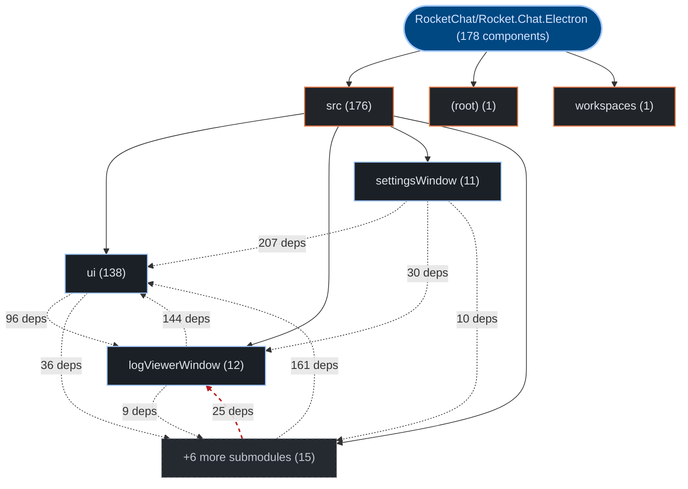
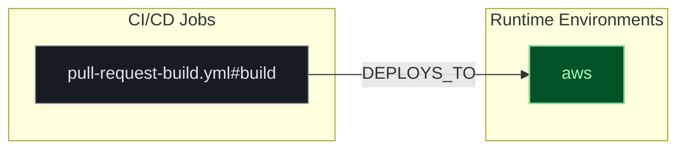
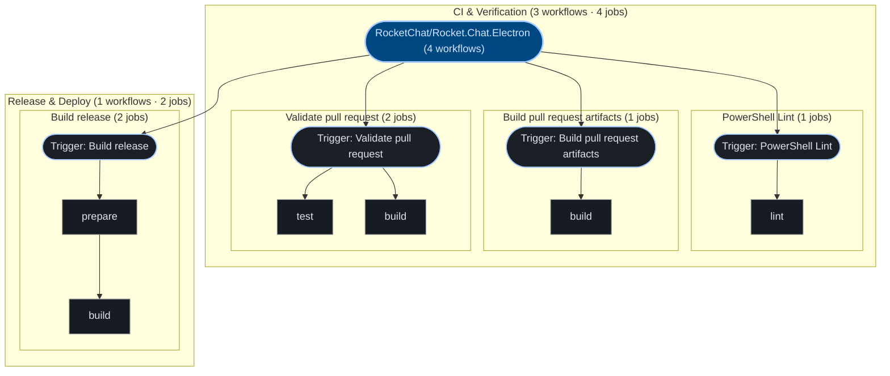

# Repository Architecture Analysis: RocketChat/Rocket.Chat.Electron

## Metadata
- **SHA**: `3464c10bff4cc615100b31c3fa5d82c084a8c7fe`
- **Primary Ecosystem**: JavaScript/TypeScript

## Quality Metrics
- **ast_engine**: tree-sitter
- **avg_cognitive_complexity**: 3.42
- **avg_cyclomatic_complexity**: 3.51
- **component_count**: 178
- **dead_code_count**: 27
- **dead_code_symbols**: 27 entry(ies)
- **duplication_pct**: 86.22
- **file_complexities**: 25 entry(ies)
- **files_analyzed**: 743
- **fitness_passed**: False
- **fitness_violation_count**: 4
- **framework**: React (Vite)
- **import_edges**: 100 entry(ies)
- **loc**: 122250
- **max_cognitive_complexity**: 199
- **max_cyclomatic_complexity**: 126
- **sloc**: 101639
- **test_file_count**: 284

# Architecture: RocketChat/Rocket.Chat.Electron

## Context
- **Repository**: `RocketChat/Rocket.Chat.Electron`
- **SHA**: `3464c10bff4cc615100b31c3fa5d82c084a8c7fe`
- **Ecosystem**: JavaScript/TypeScript
- **Framework**: React (Vite)

## Building Block View

## Component Details

Showing top 60 representative components out of 178 across 3 module group(s):

- **Module `src`** (176 components — UI_COMPONENT: 162, SERVICE: 14)
- **Module `(root)`** (1 components — MODULE: 1)
- **Module `workspaces`** (1 components — MODULE: 1)

- **Shell** (`src/ui/components/Shell/index.tsx`): UI_COMPONENT (deps: BadgeWrapper, CLIENT_CHROME_CORNER_RADIUS_PX, CaptureIndicator, DOWNLOAD_NAME_CLASS, DRAG_REGION_CLASS, Divider (+42 more))
- **DownloadsWindow** (`src/downloadsWindow/DownloadsWindow.tsx`): UI_COMPONENT (deps: BadgeWrapper, CLIENT_CHROME_CORNER_RADIUS_PX, CaptureIndicator, DOWNLOAD_NAME_CLASS, DRAG_REGION_CLASS, DayHeader (+41 more))
- **SettingsWindow** (`src/settingsWindow/SettingsWindow.tsx`): UI_COMPONENT (deps: BadgeWrapper, CLIENT_CHROME_CORNER_RADIUS_PX, CaptureIndicator, DOWNLOAD_NAME_CLASS, DRAG_REGION_CLASS, Divider (+40 more))
- **WindowControls** (`src/ui/components/TabBar/WindowControls.tsx`): UI_COMPONENT (deps: BadgeWrapper, CLIENT_CHROME_CORNER_RADIUS_PX, CaptureIndicator, CloseGlyph, DOWNLOAD_NAME_CLASS, DRAG_REGION_CLASS (+40 more))
- **WindowControls** (`src/ui/windowChrome/WindowControls.tsx`): UI_COMPONENT (deps: BadgeWrapper, CLIENT_CHROME_CORNER_RADIUS_PX, CaptureIndicator, CloseGlyph, DOWNLOAD_NAME_CLASS, DRAG_REGION_CLASS (+40 more))
- **DownloadsSidebar** (`src/downloadsWindow/DownloadsSidebar.tsx`): UI_COMPONENT (deps: BadgeWrapper, CLIENT_CHROME_CORNER_RADIUS_PX, CaptureIndicator, DOWNLOAD_NAME_CLASS, DRAG_REGION_CLASS, Divider (+39 more))
- **CertificatesSection** (`src/settingsWindow/sections/CertificatesSection.tsx`): UI_COMPONENT (deps: BadgeWrapper, CLIENT_CHROME_CORNER_RADIUS_PX, CaptureIndicator, CertificateRow, DOWNLOAD_NAME_CLASS, DRAG_REGION_CLASS (+38 more))
- **DownloadRow** (`src/downloadsWindow/DownloadRow.tsx`): UI_COMPONENT (deps: BadgeWrapper, CLIENT_CHROME_CORNER_RADIUS_PX, CaptureIndicator, CopiedStatus, DOWNLOAD_NAME_CLASS, DRAG_REGION_CLASS (+38 more))
- **LogViewerSidebar** (`src/logViewerWindow/LogViewerSidebar.tsx`): UI_COMPONENT (deps: BadgeWrapper, CLIENT_CHROME_CORNER_RADIUS_PX, CaptureIndicator, DOWNLOAD_NAME_CLASS, DRAG_REGION_CLASS, Divider (+38 more))
- **LogViewerToolbar** (`src/logViewerWindow/LogViewerToolbar.tsx`): UI_COMPONENT (deps: BadgeWrapper, CLIENT_CHROME_CORNER_RADIUS_PX, CaptureIndicator, CopiedStatus, DOWNLOAD_NAME_CLASS, DRAG_REGION_CLASS (+38 more))
- **AddServerView** (`src/ui/components/AddServerView/index.tsx`): UI_COMPONENT (deps: BadgeWrapper, CLIENT_CHROME_CORNER_RADIUS_PX, CaptureIndicator, DOWNLOAD_NAME_CLASS, DRAG_REGION_CLASS, Divider (+37 more))
- **DocumentViewerWindow** (`src/documentViewerWindow/DocumentViewerWindow.tsx`): UI_COMPONENT (deps: BadgeWrapper, CLIENT_CHROME_CORNER_RADIUS_PX, CaptureIndicator, DOWNLOAD_NAME_CLASS, DRAG_REGION_CLASS, Divider (+37 more))
- **DownloadsIndicator** (`src/ui/components/TopBar/DownloadsIndicator.tsx`): UI_COMPONENT (deps: BadgeWrapper, CLIENT_CHROME_CORNER_RADIUS_PX, CaptureIndicator, DOWNLOAD_NAME_CLASS, DRAG_REGION_CLASS, Divider (+37 more))
- **LogEntry** (`src/logViewerWindow/LogEntry.tsx`): UI_COMPONENT (deps: BadgeWrapper, CLIENT_CHROME_CORNER_RADIUS_PX, CaptureIndicator, CopiedStatus, DOWNLOAD_NAME_CLASS, DRAG_REGION_CLASS (+37 more))
- **LogTimeline** (`src/logViewerWindow/LogTimeline.tsx`): UI_COMPONENT (deps: BadgeWrapper, CLIENT_CHROME_CORNER_RADIUS_PX, CaptureIndicator, DOWNLOAD_NAME_CLASS, DRAG_REGION_CLASS, Divider (+37 more))
- **SETTINGS_TABPANEL_ID** (`src/settingsWindow/SettingsSidebar.tsx`): UI_COMPONENT (deps: BadgeWrapper, CLIENT_CHROME_CORNER_RADIUS_PX, CaptureIndicator, DOWNLOAD_NAME_CLASS, DRAG_REGION_CLASS, Divider (+37 more))
- **ServerPane** (`src/ui/components/ServersView/ServerPane.tsx`): UI_COMPONENT (deps: BadgeWrapper, CLIENT_CHROME_CORNER_RADIUS_PX, CaptureIndicator, DOWNLOAD_NAME_CLASS, DRAG_REGION_CLASS, Divider (+37 more))
- **SettingsSidebar** (`src/settingsWindow/SettingsSidebar.tsx`): UI_COMPONENT (deps: BadgeWrapper, CLIENT_CHROME_CORNER_RADIUS_PX, CaptureIndicator, DOWNLOAD_NAME_CLASS, DRAG_REGION_CLASS, Divider (+37 more))
- **SupportedVersionDialog** (`src/ui/components/SupportedVersionDialog/index.tsx`): UI_COMPONENT (deps: BadgeWrapper, CLIENT_CHROME_CORNER_RADIUS_PX, CaptureIndicator, DOWNLOAD_NAME_CLASS, DRAG_REGION_CLASS, Divider (+37 more))
- **WindowToolbar** (`src/ui/windowChrome/WindowToolbar.tsx`): UI_COMPONENT (deps: BadgeWrapper, CLIENT_CHROME_CORNER_RADIUS_PX, CaptureIndicator, DOWNLOAD_NAME_CLASS, DRAG_REGION_CLASS, Divider (+37 more))
- **CertificateRow** (`src/settingsWindow/sections/CertificateRow.tsx`): UI_COMPONENT (deps: BadgeWrapper, CLIENT_CHROME_CORNER_RADIUS_PX, CaptureIndicator, DOWNLOAD_NAME_CLASS, DRAG_REGION_CLASS, Divider (+36 more))
- **Dialog** (`src/ui/components/Dialog/index.tsx`): UI_COMPONENT (deps: BadgeWrapper, CLIENT_CHROME_CORNER_RADIUS_PX, CaptureIndicator, DOWNLOAD_NAME_CLASS, DRAG_REGION_CLASS, Divider (+36 more))
- **FilterRow** (`src/ui/windowChrome/FilterRow.tsx`): UI_COMPONENT (deps: BadgeWrapper, CLIENT_CHROME_CORNER_RADIUS_PX, CaptureIndicator, DOWNLOAD_NAME_CLASS, DRAG_REGION_CLASS, Divider (+36 more))
- **MeatballMenuButton** (`src/ui/components/TabBar/MeatballMenuButton.tsx`): UI_COMPONENT (deps: BadgeWrapper, CLIENT_CHROME_CORNER_RADIUS_PX, CaptureIndicator, DOWNLOAD_NAME_CLASS, DRAG_REGION_CLASS, Divider (+36 more))
- **NavRow** (`src/ui/windowChrome/NavRow.tsx`): UI_COMPONENT (deps: BadgeWrapper, CLIENT_CHROME_CORNER_RADIUS_PX, CaptureIndicator, DOWNLOAD_NAME_CLASS, DRAG_REGION_CLASS, Divider (+36 more))
- **ScreenSharingDialog** (`src/ui/components/ScreenSharingDialog/index.tsx`): UI_COMPONENT (deps: BadgeWrapper, CLIENT_CHROME_CORNER_RADIUS_PX, CaptureIndicator, DOWNLOAD_NAME_CLASS, DRAG_REGION_CLASS, Divider (+36 more))
- **TabBar** (`src/ui/components/TabBar/index.tsx`): UI_COMPONENT (deps: BadgeWrapper, CLIENT_CHROME_CORNER_RADIUS_PX, CaptureIndicator, DOWNLOAD_NAME_CLASS, DRAG_REGION_CLASS, Divider (+36 more))
- **TextButton** (`src/ui/windowChrome/TextButton.tsx`): UI_COMPONENT (deps: BadgeWrapper, CLIENT_CHROME_CORNER_RADIUS_PX, CaptureIndicator, DOWNLOAD_NAME_CLASS, DRAG_REGION_CLASS, Divider (+36 more))
- **TopBar** (`src/ui/components/TopBar/index.tsx`): UI_COMPONENT (deps: BadgeWrapper, CLIENT_CHROME_CORNER_RADIUS_PX, CaptureIndicator, DOWNLOAD_NAME_CLASS, DRAG_REGION_CLASS, Divider (+36 more))
- **TestService** (`src/store/__tests__/index.spec.ts`): SERVICE (deps: AddServerView, ClearCacheDialog, Dialog, OutlookCredentialsDialog, ScreenSharingDialog, SelectClientCertificateDialog (+9 more))
- **GeneralSection** (`src/settingsWindow/sections/GeneralSection.tsx`): UI_COMPONENT (deps: AvailableBrowsers, CheckForUpdates, DownloadsPercentage, E2ePdfPreviewSizeLimit, FlashFrame, MenuBar (+7 more))
- **AdvancedSection** (`src/settingsWindow/sections/AdvancedSection.tsx`): UI_COMPONENT (deps: DebugLogging, DetailedEventsLogging, HardwareAcceleration, ReportErrors, ResetWindowBounds, SettingGroupDivider (+2 more))
- **ChromeThumbnailOption** (`src/ui/components/SettingsView/features/ChromeThumbnailOption.tsx`): UI_COMPONENT (deps: THUMBNAIL_FRAME_BORDER, THUMBNAIL_FRAME_PADDING, THUMBNAIL_GAP, THUMBNAIL_HEIGHT, THUMBNAIL_OPTION_WIDTH, THUMBNAIL_ROW_LENGTH (+2 more))
- **NavigationLayout** (`src/ui/components/SettingsView/features/NavigationLayout.tsx`): UI_COMPONENT (deps: ChromeThumbnailOption, THUMBNAIL_FRAME_BORDER, THUMBNAIL_FRAME_PADDING, THUMBNAIL_GAP, THUMBNAIL_HEIGHT, THUMBNAIL_OPTION_WIDTH (+2 more))
- **ThemeAppearance** (`src/ui/components/SettingsView/features/ThemeAppearance.tsx`): UI_COMPONENT (deps: ChromeThumbnailOption, THUMBNAIL_FRAME_BORDER, THUMBNAIL_FRAME_PADDING, THUMBNAIL_GAP, THUMBNAIL_HEIGHT, THUMBNAIL_OPTION_WIDTH (+2 more))
- **WindowChromeThumbnail** (`src/ui/components/SettingsView/features/WindowChromeThumbnail.tsx`): UI_COMPONENT (deps: THUMBNAIL_FRAME_BORDER, THUMBNAIL_FRAME_PADDING, THUMBNAIL_GAP, THUMBNAIL_HEIGHT, THUMBNAIL_OPTION_WIDTH, THUMBNAIL_ROW_LENGTH (+1 more))
- **SETTINGS_SECTIONS** (`src/settingsWindow/sections.ts`): UI_COMPONENT (deps: AdvancedSection, AppearanceSection, CertificatesSection, GeneralSection, TelephonySection, VideoCallsSection)
- **AppearanceSection** (`src/settingsWindow/sections/AppearanceSection.tsx`): UI_COMPONENT (deps: NavigationLayout, SettingGroupDivider, ThemeAppearance, TransparentWindow, UiPreview)
- **DownloadsStatusBar** (`src/downloadsWindow/DownloadsStatusBar.tsx`): UI_COMPONENT (deps: LogStatusBar, StatusBar, StatusItem, TextButton)
- **LogStatusBar** (`src/logViewerWindow/LogStatusBar.tsx`): UI_COMPONENT (deps: DownloadsStatusBar, StatusBar, StatusItem, TextButton)
- **VideoCallsSection** (`src/settingsWindow/sections/VideoCallsSection.tsx`): UI_COMPONENT (deps: ClearPermittedScreenCaptureServers, InternalVideoChatWindow, ScreenCaptureFallback, VideoCallWindowPersistence)
- **TelephonySection** (`src/settingsWindow/sections/TelephonySection.tsx`): UI_COMPONENT (deps: Telephony, TelephonyGlobalShortcut, TelephonyServer)
- **FilterSection** (`src/ui/windowChrome/FilterSection.tsx`): UI_COMPONENT (deps: SectionLabel, TextButton)
- **ServersView** (`src/ui/components/ServersView/index.tsx`): UI_COMPONENT (deps: ReparentingContainer, ServerPane)
- **Telephony** (`src/ui/components/SettingsView/features/Telephony.tsx`): UI_COMPONENT (deps: TelephonyDiagnostics, ToggleField)
- **UiPreview** (`src/ui/components/SettingsView/features/UiPreview.tsx`): UI_COMPONENT (deps: UiPreviewHistory, UiPreviewRow)
- **AvailableBrowsers** (`src/ui/components/SettingsView/features/AvailableBrowsers.tsx`): UI_COMPONENT (deps: SettingField)
- **CheckForUpdates** (`src/ui/components/SettingsView/features/CheckForUpdates.tsx`): UI_COMPONENT (deps: ToggleField)
- **DayHeader** (`src/ui/windowChrome/DayHeader.tsx`): UI_COMPONENT (deps: SectionLabel)
- **DebugLogging** (`src/ui/components/SettingsView/features/DebugLogging.tsx`): UI_COMPONENT (deps: ToggleField)
- **DetailedEventsLogging** (`src/ui/components/SettingsView/features/DetailedEventsLogging.tsx`): UI_COMPONENT (deps: ToggleField)
- **DownloadsPercentage** (`src/ui/components/SettingsView/features/DownloadsPercentage.tsx`): UI_COMPONENT (deps: ToggleField)
- **DownloadsToolbar** (`src/downloadsWindow/DownloadsToolbar.tsx`): UI_COMPONENT (deps: WindowToolbar)
- **E2ePdfPreviewSizeLimit** (`src/ui/components/SettingsView/features/E2ePdfPreviewSizeLimit.tsx`): UI_COMPONENT (deps: SettingField)
- **FlashFrame** (`src/ui/components/SettingsView/features/FlashFrame.tsx`): UI_COMPONENT (deps: ToggleField)
- **HardwareAcceleration** (`src/ui/components/SettingsView/features/HardwareAcceleration.tsx`): UI_COMPONENT (deps: ToggleField)
- **InternalVideoChatWindow** (`src/ui/components/SettingsView/features/InternalVideoChatWindow.tsx`): UI_COMPONENT (deps: ToggleField)
- **MenuBar** (`src/ui/components/SettingsView/features/MenuBar.tsx`): UI_COMPONENT (deps: ToggleField)
- **MenuBarUnreadCount** (`src/ui/components/SettingsView/features/MenuBarUnreadCount.tsx`): UI_COMPONENT (deps: ToggleField)
- **MinimizeOnClose** (`src/ui/components/SettingsView/features/MinimizeOnClose.tsx`): UI_COMPONENT (deps: ToggleField)

## 6-Dimension Repository Scorecard

- **Overall Grade**: `F` (47.44/100)
- **Technical Debt Score**: 52.56
- **Estimated Remediation Effort**: 77.63h

| Dimension | Grade | Score | Weight | Details |
| :--- | :---: | :---: | :---: | :--- |
| Code Quality | `F` | 27.96 | 0.20 | avg_cc=3.51, max_cc=126, duplication=86.22%, dead_code=27 |
| Dependency Health | `B` | 85.00 | 0.15 | dependencies=124, outdated=0, vulnerable=0, has_lockfile=False |
| Maintainability | `F` | 25.00 | 0.15 | avg_cognitive=3.42, max_cognitive=199, fitness_violations=4, oversized_files=13 |
| Pipeline Health | `A` | 99.00 | 0.15 | workflows=4, operational_antipatterns=2, parallel_branches=True |
| Security | `F` | 0.00 | 0.20 | vulnerabilities=0, secrets=0, pipeline_security_findings=8 |
| Test Coverage | `C` | 70.00 | 0.15 | coverage=unavailable, ci_test_job=True, test_files_detected=True |

## Architecture Fitness & Workspace Boundaries

- **[HIGH] `ATRUSS-ARCH-004` (CIRCULAR_DEPENDENCY)**: Circular dependency detected between architectural components. (DownloadsStatusBar -> LogStatusBar -> DownloadsStatusBar)
- **[MEDIUM] `ATRUSS-ARCH-005` (COMPLEXITY_THRESHOLD)**: Repository duplication_pct (86.22) exceeds policy threshold (15.0).
- **[MEDIUM] `ATRUSS-ARCH-005` (COMPLEXITY_THRESHOLD)**: Repository max_cognitive_complexity (199.0) exceeds policy threshold (25.0).
- **[MEDIUM] `ATRUSS-ARCH-005` (COMPLEXITY_THRESHOLD)**: Repository max_cyclomatic_complexity (126.0) exceeds policy threshold (20.0).

### Workspace Packages
- **@rocket.chat/desktop-release-action** (`workspaces/desktop-release-action`, react_ts_js, yarn)

## Supply Chain Dependencies, Vulnerabilities & Secrets

- **Dependencies Parsed**: 124 | **Vulnerabilities**: 0 | **Secrets**: 0

### Inventory Sample
- `@actions/core` `1.10.1` (npm, `workspaces/desktop-release-action/package.json`)
- `@actions/exec` `1.1.1` (npm, `workspaces/desktop-release-action/package.json`)
- `@actions/github` `6.0.0` (npm, `workspaces/desktop-release-action/package.json`)
- `@babel/core` `7.23.9` (npm, `package.json`)
- `@babel/eslint-parser` `7.23.3` (npm, `package.json`)
- `@babel/plugin-proposal-class-properties` `7.18.6` (npm, `package.json`)
- `@babel/plugin-proposal-function-bind` `7.23.3` (npm, `package.json`)
- `@babel/preset-env` `7.23.7` (npm, `package.json`)
- `@babel/preset-react` `7.23.3` (npm, `package.json`)
- `@babel/preset-typescript` `7.23.3` (npm, `package.json`)
- `@bugsnag/js` `8.8.1` (npm, `package.json`)
- `@electron/fuses` `1.8.0` (npm, `package.json`)
- `@emotion/css` `11.11.2` (npm, `package.json`)
- `@emotion/react` `11.11.3` (npm, `package.json`)
- `@emotion/styled` `11.11.0` (npm, `package.json`)
- `@ewsjs/xhr` `*` (npm, `package.json`)
- `@fiahfy/icns-convert` `0.0.12` (npm, `package.json`)
- `@fiahfy/ico-convert` `0.0.12` (npm, `package.json`)
- `@kayahr/jest-electron-runner` `29.14.0` (npm, `package.json`)
- `@octokit/webhooks-types` `7.3.1` (npm, `workspaces/desktop-release-action/package.json`)
- `@rocket.chat/css-in-js` `0.32.0` (npm, `package.json`)
- `@rocket.chat/desktop-api` `1.1.0` (npm, `package.json`)
- `@rocket.chat/eslint-config` `0.7.0` (npm, `package.json`)
- `@rocket.chat/eslint-config` `0.7.0` (npm, `workspaces/desktop-release-action/package.json`)
- `@rocket.chat/fuselage` `0.80.0` (npm, `package.json`)
- `@rocket.chat/fuselage-hooks` `0.42.0` (npm, `package.json`)
- `@rocket.chat/fuselage-polyfills` `0.31.25` (npm, `package.json`)
- `@rocket.chat/icons` `0.37.0` (npm, `package.json`)
- `@rocket.chat/prettier-config` `0.31.25` (npm, `package.json`)
- `@rocket.chat/prettier-config` `0.31.25` (npm, `workspaces/desktop-release-action/package.json`)
- ... (+94 more dependencies)

## Section 7: Code-to-Cloud Deployment Traceability

- `pull-request-build.yml#build` (ci_job) --[DEPLOYS_TO]--> `aws` (environment)

## CI/CD Pipeline Topology

