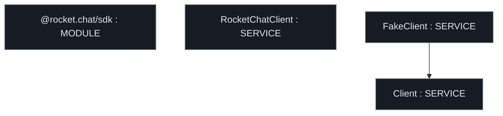
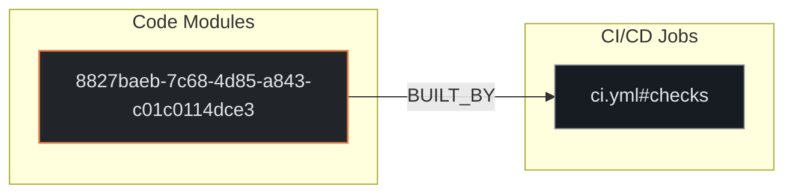
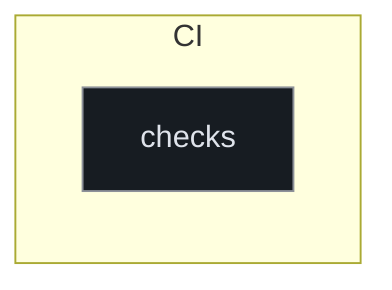

# Repository Architecture Analysis: RocketChat/Rocket.Chat.js.SDK

## Metadata
- **SHA**: `ecf4fedcf8ab6121e62a6b95bb48823afd805afd`
- **Primary Ecosystem**: JavaScript/TypeScript

## Quality Metrics
- **ast_engine**: tree-sitter
- **avg_cognitive_complexity**: 0.39
- **avg_cyclomatic_complexity**: 1.39
- **component_count**: 4
- **dead_code_count**: 1
- **dead_code_symbols**: 1 entry(ies)
- **duplication_pct**: 77.25
- **file_complexities**: 25 entry(ies)
- **files_analyzed**: 63
- **fitness_passed**: False
- **fitness_violation_count**: 1
- **framework**: TypeScript
- **import_edges**: 100 entry(ies)
- **loc**: 9312
- **max_cognitive_complexity**: 7
- **max_cyclomatic_complexity**: 9
- **sloc**: 6804
- **test_file_count**: 44

# Architecture: RocketChat/Rocket.Chat.js.SDK

## Context
- **Repository**: `RocketChat/Rocket.Chat.js.SDK`
- **SHA**: `ecf4fedcf8ab6121e62a6b95bb48823afd805afd`
- **Ecosystem**: JavaScript/TypeScript
- **Framework**: TypeScript

## Building Block View

## Component Details
- **@rocket.chat/sdk** (`package.json`): MODULE
- **Client** (`lib/api/api.ts`): SERVICE
- **RocketChatClient** (`lib/clients/Rocketchat.ts`): SERVICE
- **FakeClient** (`test/fakeClient.ts`): SERVICE (deps: Client)

## 6-Dimension Repository Scorecard

- **Overall Grade**: `B` (83.35/100)
- **Technical Debt Score**: 16.65
- **Estimated Remediation Effort**: 30.86h

| Dimension | Grade | Score | Weight | Details |
| :--- | :---: | :---: | :---: | :--- |
| Code Quality | `C` | 73.00 | 0.20 | avg_cc=1.39, max_cc=9, duplication=77.25%, dead_code=1 |
| Dependency Health | `A` | 100.00 | 0.15 | dependencies=568, outdated=0, vulnerable=0, has_lockfile=True |
| Maintainability | `C` | 74.00 | 0.15 | avg_cognitive=0.39, max_cognitive=7, fitness_violations=1, oversized_files=5 |
| Pipeline Health | `A` | 97.00 | 0.15 | workflows=1, operational_antipatterns=1, parallel_branches=False |
| Security | `B` | 88.00 | 0.20 | vulnerabilities=0, secrets=0, pipeline_security_findings=1 |
| Test Coverage | `C` | 70.00 | 0.15 | coverage=unavailable, ci_test_job=True, test_files_detected=True |

## Architecture Fitness & Workspace Boundaries

- **[MEDIUM] `ATRUSS-ARCH-005` (COMPLEXITY_THRESHOLD)**: Repository duplication_pct (77.25) exceeds policy threshold (15.0).

## Supply Chain Dependencies, Vulnerabilities & Secrets

- **Dependencies Parsed**: 568 | **Vulnerabilities**: 0 | **Secrets**: 0

### Inventory Sample
- `@babel/core` `8.0.1` (npm, `package-lock.json`)
- `@babel/core` `8.0.1` (npm, `package.json`)
- `@babel/preset-env` `8.0.2` (npm, `package-lock.json`)
- `@babel/preset-env` `8.0.2` (npm, `package.json`)
- `@babel/preset-typescript` `8.0.1` (npm, `package-lock.json`)
- `@babel/preset-typescript` `8.0.1` (npm, `package.json`)
- `@types/jest` `30.0.0` (npm, `package-lock.json`)
- `@types/jest` `30.0.0` (npm, `package.json`)
- `@types/node` `25.0.3` (npm, `package.json`)
- `@types/node` `25.9.5` (npm, `package-lock.json`)
- `babel-jest` `30.4.1` (npm, `package-lock.json`)
- `babel-jest` `30.4.1` (npm, `package.json`)
- `jest` `30.4.2` (npm, `package-lock.json`)
- `jest` `30.4.2` (npm, `package.json`)
- `js-sha256` `0.9.0` (npm, `package-lock.json`)
- `js-sha256` `0.9.0` (npm, `package.json`)
- `oxlint` `1.75.0` (npm, `package.json`)
- `oxlint` `1.78.0` (npm, `package-lock.json`)
- `tiny-events` `1.0.1` (npm, `package-lock.json`)
- `tiny-events` `1.0.1` (npm, `package.json`)
- `typescript` `7.0.2` (npm, `package-lock.json`)
- `typescript` `7.0.2` (npm, `package.json`)
- `universal-websocket-client` `1.0.2` (npm, `package.json`)
- `universal-websocket-client` `1.0.3` (npm, `package-lock.json`)
- `@babel/code-frame` `7.29.7` (npm, `package-lock.json`)
- `@babel/code-frame` `7.29.7` (npm, `package-lock.json`)
- `@babel/code-frame` `7.29.7` (npm, `package-lock.json`)
- `@babel/code-frame` `7.29.7` (npm, `package-lock.json`)
- `@babel/code-frame` `7.29.7` (npm, `package-lock.json`)
- `@babel/code-frame` `7.29.7` (npm, `package-lock.json`)
- ... (+538 more dependencies)

## Section 7: Code-to-Cloud Deployment Traceability

- `8827baeb-7c68-4d85-a843-c01c0114dce3` (code_module) --[BUILT_BY]--> `ci.yml#checks` (ci_job)

## CI/CD Pipeline Topology

