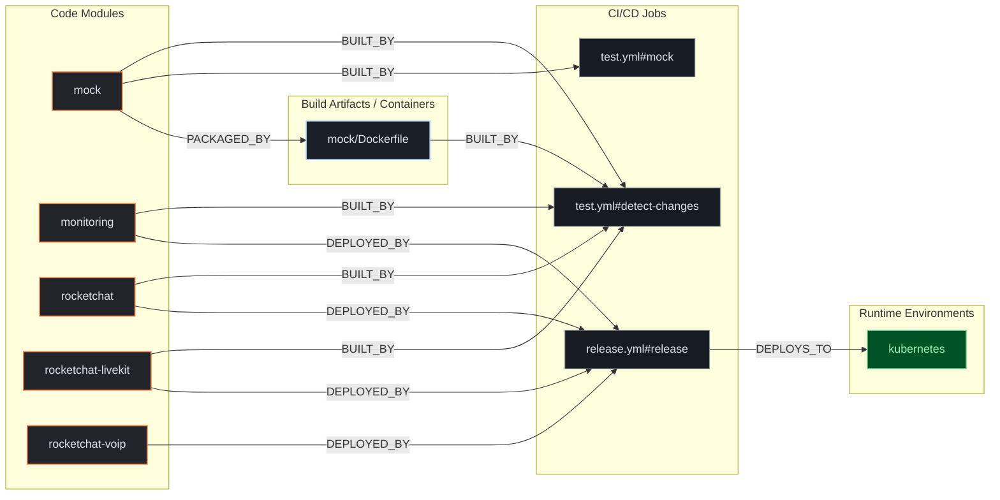
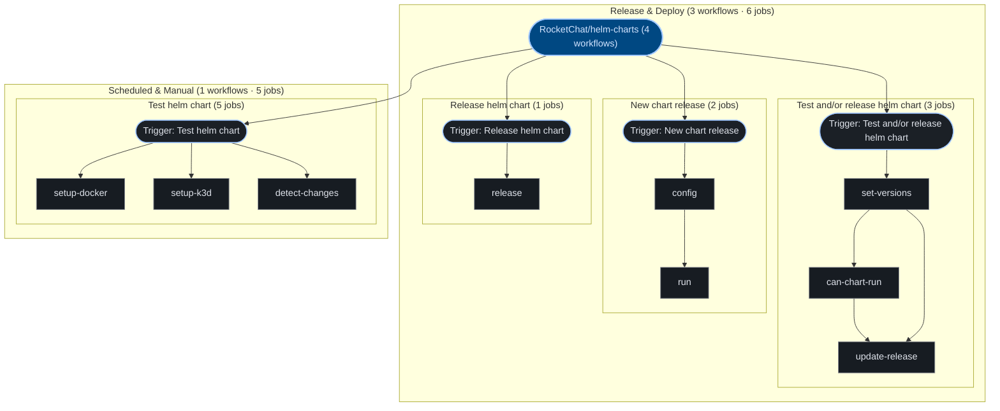

# Repository Architecture Analysis: RocketChat/helm-charts

## Metadata
- **SHA**: `c3c3f5bfde5f1757f57220a10815eee02c69447f`
- **Primary Ecosystem**: Container / Helm / IaC

## Quality Metrics
- **ast_engine**: fallback
- **avg_cognitive_complexity**: 0.0
- **avg_cyclomatic_complexity**: 0.0
- **component_count**: 77
- **dead_code_count**: 0
- **dead_code_symbols**: 0 entry(ies)
- **duplication_pct**: 0.0
- **file_complexities**: 0 entry(ies)
- **files_analyzed**: 77
- **fitness_passed**: True
- **fitness_violation_count**: 0
- **framework**: Helm Chart
- **import_edges**: 0 entry(ies)
- **loc**: 5590
- **max_cognitive_complexity**: 0
- **max_cyclomatic_complexity**: 0
- **sloc**: 4705
- **test_file_count**: 9

# Architecture: RocketChat/helm-charts

## Context
- **Repository**: `RocketChat/helm-charts`
- **SHA**: `c3c3f5bfde5f1757f57220a10815eee02c69447f`
- **Ecosystem**: Container / Helm / IaC
- **Framework**: Helm Chart

## Building Block View

```mermaid
graph TD;
  classDef atlasRoot fill:#004882,stroke:#a3c9ff,stroke-width:2px,color:#d3e4ff
  classDef atlasCategory fill:#212428,stroke:#E87A48,stroke-width:1.5px,color:#dfe3eb
  classDef atlasWorkflow fill:#1b2026,stroke:#a3c9ff,stroke-width:1.5px,color:#dfe3eb
  classDef atlasJob fill:#171c22,stroke:#8d9199,stroke-width:1px,color:#dfe3eb
  classDef atlasTarget fill:#005227,stroke:#8bd99b,stroke-width:1.5px,color:#a7f6b6
  classDef atlasAlert fill:#93000a,stroke:#ffb4ab,stroke-width:1.5px,color:#ffdad6
  classDef atlasMore fill:#252a31,stroke:#8d9199,stroke-dasharray:4 4,color:#c3c6cf
    repo_root(["RocketChat/helm-charts (77 components)"]):::atlasRoot
    dir_0_rocketchat["rocketchat (30)"]:::atlasCategory
    repo_root --> dir_0_rocketchat
    sub_0_0_templates["templates (26)"]:::atlasWorkflow
    dir_0_rocketchat --> sub_0_0_templates
    sub_0_1__module_root_["(module root) (2)"]:::atlasWorkflow
    dir_0_rocketchat --> sub_0_1__module_root_
    sub_0_2_tests["tests (2)"]:::atlasWorkflow
    dir_0_rocketchat --> sub_0_2_tests
    dir_1_rocketchat_voip["rocketchat-voip (15)"]:::atlasCategory
    repo_root --> dir_1_rocketchat_voip
    sub_1_0_templates["templates (12)"]:::atlasWorkflow
    dir_1_rocketchat_voip --> sub_1_0_templates
    sub_1_1__module_root_["(module root) (3)"]:::atlasWorkflow
    dir_1_rocketchat_voip --> sub_1_1__module_root_
    dir_2_rocketchat_livekit["rocketchat-livekit (14)"]:::atlasCategory
    repo_root --> dir_2_rocketchat_livekit
    sub_2_0_templates["templates (9)"]:::atlasWorkflow
    dir_2_rocketchat_livekit --> sub_2_0_templates
    sub_2_1__module_root_["(module root) (4)"]:::atlasWorkflow
    dir_2_rocketchat_livekit --> sub_2_1__module_root_
    sub_2_2_tests["tests (1)"]:::atlasWorkflow
    dir_2_rocketchat_livekit --> sub_2_2_tests
    dir_3_monitoring["monitoring (13)"]:::atlasCategory
    repo_root --> dir_3_monitoring
    sub_3_0_templates["templates (8)"]:::atlasWorkflow
    dir_3_monitoring --> sub_3_0_templates
    sub_3_1__module_root_["(module root) (2)"]:::atlasWorkflow
    dir_3_monitoring --> sub_3_1__module_root_
    sub_3_2_config["config (2)"]:::atlasWorkflow
    dir_3_monitoring --> sub_3_2_config
    sub_3_more["+1 more submodules (1)"]:::atlasMore
    dir_3_monitoring --> sub_3_more
    dir_4_mock["mock (5)"]:::atlasCategory
    repo_root --> dir_4_mock
```

## Component Details

Showing top 60 representative components out of 77 across 5 module group(s):

- **Module `rocketchat`** (30 components — module: 30)
- **Module `rocketchat-voip`** (15 components — module: 15)
- **Module `rocketchat-livekit`** (14 components — module: 14)
- **Module `monitoring`** (13 components — module: 13)
- **Module `mock`** (5 components — module: 5)

- **Chart** (`monitoring/Chart.yaml`): module
- **Chart** (`rocketchat-livekit/Chart.yaml`): module
- **Chart** (`rocketchat-voip/Chart.yaml`): module
- **Chart** (`rocketchat/Chart.yaml`): module
- **_validations** (`rocketchat/templates/_validations.yaml`): module
- **chat-deployment** (`rocketchat/templates/chat-deployment.yaml`): module
- **compose** (`mock/compose.yaml`): module
- **configmap** (`rocketchat-livekit/templates/configmap.yaml`): module
- **deployment** (`rocketchat-livekit/templates/deployment.yaml`): module
- **drachtio-deployment** (`rocketchat-voip/templates/drachtio-deployment.yaml`): module
- **drachtio-secret** (`rocketchat-voip/templates/drachtio-secret.yaml`): module
- **drachtio-service** (`rocketchat-voip/templates/drachtio-service.yaml`): module
- **drachtio-servicemonitor** (`rocketchat-voip/templates/drachtio-servicemonitor.yaml`): module
- **events** (`monitoring/config/opentelemetry/events.yaml`): module
- **freeswitch-configmap** (`rocketchat-voip/templates/freeswitch-configmap.yaml`): module
- **freeswitch-deployment** (`rocketchat-voip/templates/freeswitch-deployment.yaml`): module
- **freeswitch-ingress** (`rocketchat-voip/templates/freeswitch-ingress.yaml`): module
- **freeswitch-rtp-service-nlb** (`rocketchat-voip/templates/freeswitch-rtp-service-nlb.yaml`): module
- **freeswitch-secret** (`rocketchat-voip/templates/freeswitch-secret.yaml`): module
- **freeswitch-service** (`rocketchat-voip/templates/freeswitch-service.yaml`): module
- **freeswitch-servicemonitor** (`rocketchat-voip/templates/freeswitch-servicemonitor.yaml`): module
- **grafana** (`monitoring/templates/grafana.yaml`): module
- **grafana-dashboards** (`monitoring/templates/grafana-dashboards.yaml`): module
- **ingress** (`monitoring/templates/ingress.yaml`): module
- **ingress** (`rocketchat-livekit/templates/ingress.yaml`): module
- **ingress** (`rocketchat/templates/ingress.yaml`): module
- **kubeconfig** (`mock/kubeconfig.yaml`): module
- **lighttpd** (`rocketchat/templates/lighttpd.yaml`): module
- **logs** (`monitoring/config/opentelemetry/logs.yaml`): module
- **media-service** (`rocketchat-livekit/templates/media-service.yaml`): module
- **microservices-account-deployment** (`rocketchat/templates/microservices-account-deployment.yaml`): module
- **microservices-account-service** (`rocketchat/templates/microservices-account-service.yaml`): module
- **microservices-authorization-deployment** (`rocketchat/templates/microservices-authorization-deployment.yaml`): module
- **microservices-authorization-service** (`rocketchat/templates/microservices-authorization-service.yaml`): module
- **microservices-ddp-streamer-deployment** (`rocketchat/templates/microservices-ddp-streamer-deployment.yaml`): module
- **microservices-ddp-streamer-service** (`rocketchat/templates/microservices-ddp-streamer-service.yaml`): module
- **microservices-presence-deployment** (`rocketchat/templates/microservices-presence-deployment.yaml`): module
- **microservices-presence-service** (`rocketchat/templates/microservices-presence-service.yaml`): module
- **microservices-stream-hub-deployment** (`rocketchat/templates/microservices-stream-hub-deployment.yaml`): module
- **microservices-stream-hub-service** (`rocketchat/templates/microservices-stream-hub-service.yaml`): module
- **microservices-values** (`rocketchat/tests/microservices-values.yaml`): module
- **mongodb-init-configmap** (`rocketchat/templates/mongodb-init-configmap.yaml`): module
- **mongodb-monitor** (`rocketchat/templates/mongodb-monitor.yaml`): module
- **monolith-values** (`rocketchat/tests/monolith-values.yaml`): module
- **nats-monitor** (`rocketchat/templates/nats-monitor.yaml`): module
- **nodes** (`mock/manifests/nodes.yaml`): module
- **otel-collector-configmap** (`monitoring/templates/opentelemetry/otel-collector-configmap.yaml`): module
- **otel-collector-events-deployment** (`monitoring/templates/opentelemetry/otel-collector-events-deployment.yaml`): module
- **otel-collector-logs-daemonset** (`monitoring/templates/opentelemetry/otel-collector-logs-daemonset.yaml`): module
- **otel-collector-service-account** (`monitoring/templates/opentelemetry/otel-collector-service-account.yaml`): module
- **plugin** (`rocketchat-livekit/plugin.yaml`): module
- **poddisruptionbudget** (`rocketchat/templates/poddisruptionbudget.yaml`): module
- **podmonitor** (`rocketchat/templates/podmonitor.yaml`): module
- **pvc** (`rocketchat/templates/pvc.yaml`): module
- **scripts-configmap** (`rocketchat/templates/scripts-configmap.yaml`): module
- **secret** (`rocketchat-livekit/templates/secret.yaml`): module
- **secret** (`rocketchat/templates/secret.yaml`): module
- **service** (`rocketchat-livekit/templates/service.yaml`): module
- **service** (`rocketchat/templates/service.yaml`): module
- **serviceaccount** (`rocketchat-livekit/templates/serviceaccount.yaml`): module

## 6-Dimension Repository Scorecard

- **Overall Grade**: `C` (76.90/100)
- **Technical Debt Score**: 23.10
- **Estimated Remediation Effort**: 20.27h

| Dimension | Grade | Score | Weight | Details |
| :--- | :---: | :---: | :---: | :--- |
| Code Quality | `A` | 100.00 | 0.20 | avg_cc=0.00, max_cc=0, duplication=0.00%, dead_code=0 |
| Dependency Health | `A` | 90.00 | 0.15 | dependencies=0 (no manifests parsed) |
| Maintainability | `A` | 100.00 | 0.15 | avg_cognitive=0.00, max_cognitive=0, fitness_violations=0, oversized_files=0 |
| Pipeline Health | `F` | 34.00 | 0.15 | workflows=4, operational_antipatterns=14, parallel_branches=True |
| Security | `D` | 64.00 | 0.20 | vulnerabilities=0, secrets=0, pipeline_security_findings=3 |
| Test Coverage | `C` | 70.00 | 0.15 | coverage=unavailable, ci_test_job=False, test_files_detected=True |

## Section 7: Code-to-Cloud Deployment Traceability

- `release.yml#release` (ci_job) --[DEPLOYS_TO]--> `kubernetes` (environment)
- `mock` (code_module) --[BUILT_BY]--> `test.yml#detect-changes` (ci_job)
- `mock` (code_module) --[BUILT_BY]--> `test.yml#mock` (ci_job)
- `mock` (code_module) --[PACKAGED_BY]--> `mock/Dockerfile` (container)
- `monitoring` (code_module) --[BUILT_BY]--> `test.yml#detect-changes` (ci_job)
- `monitoring` (code_module) --[DEPLOYED_BY]--> `release.yml#release` (ci_job)
- `rocketchat` (code_module) --[BUILT_BY]--> `test.yml#detect-changes` (ci_job)
- `rocketchat` (code_module) --[DEPLOYED_BY]--> `release.yml#release` (ci_job)
- `rocketchat-livekit` (code_module) --[BUILT_BY]--> `test.yml#detect-changes` (ci_job)
- `rocketchat-livekit` (code_module) --[DEPLOYED_BY]--> `release.yml#release` (ci_job)
- `rocketchat-voip` (code_module) --[DEPLOYED_BY]--> `release.yml#release` (ci_job)
- `mock/Dockerfile` (container) --[BUILT_BY]--> `test.yml#detect-changes` (ci_job)

## CI/CD Pipeline Topology

