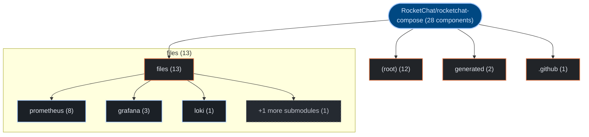
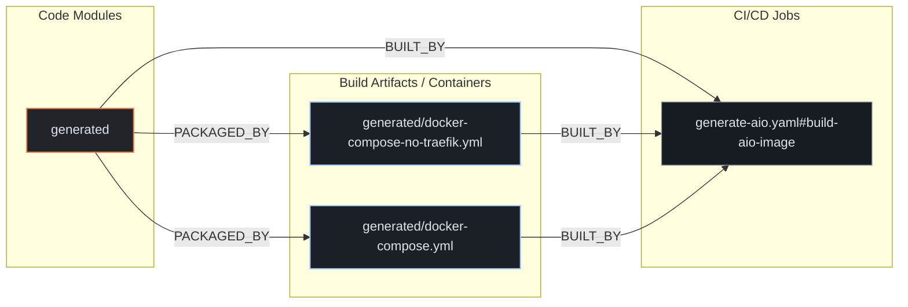
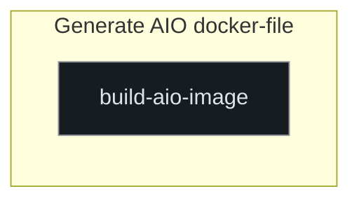

# Repository Architecture Analysis: RocketChat/rocketchat-compose

## Metadata
- **SHA**: `967a4d3a8a7dd8be1836067f447a60cb10f86b00`
- **Primary Ecosystem**: Container / Helm / IaC

## Quality Metrics
- **ast_engine**: fallback
- **avg_cognitive_complexity**: 0.0
- **avg_cyclomatic_complexity**: 0.0
- **component_count**: 28
- **dead_code_count**: 0
- **dead_code_symbols**: 0 entry(ies)
- **duplication_pct**: 0.0
- **file_complexities**: 0 entry(ies)
- **files_analyzed**: 28
- **fitness_passed**: True
- **fitness_violation_count**: 0
- **framework**: Docker Compose
- **import_edges**: 0 entry(ies)
- **loc**: 1453
- **max_cognitive_complexity**: 0
- **max_cyclomatic_complexity**: 0
- **sloc**: 1237

# Architecture: RocketChat/rocketchat-compose

## Context
- **Repository**: `RocketChat/rocketchat-compose`
- **SHA**: `967a4d3a8a7dd8be1836067f447a60cb10f86b00`
- **Ecosystem**: Container / Helm / IaC
- **Framework**: Docker Compose

## Building Block View

## Component Details
- **compose.database** (`compose.database.yml`): module
- **compose.drachtio** (`compose.drachtio.yml`): module
- **compose.freeswitch.external** (`compose.freeswitch.external.yml`): module
- **compose.freeswitch** (`compose.freeswitch.yml`): module
- **compose.manual-cert.traefik** (`compose.manual-cert.traefik.yml`): module
- **compose.monitoring** (`compose.monitoring.yml`): module
- **compose.nats** (`compose.nats.yml`): module
- **compose.traefik** (`compose.traefik.yml`): module
- **compose** (`compose.yml`): module
- **docker** (`docker.yml`): module
- **podman-rootful** (`podman-rootful.yml`): module
- **podman** (`podman.yml`): module
- **generate-aio** (`.github/workflows/generate-aio.yaml`): module
- **from-dir** (`files/grafana/provisioning/dashboards/from-dir.yml`): module
- **loki** (`files/grafana/provisioning/datasources/loki.yml`): module
- **prometheus** (`files/grafana/provisioning/datasources/prometheus.yml`): module
- **config** (`files/loki/config.yaml`): module
- **config** (`files/opentelemetry/config.yaml`): module
- **prometheus** (`files/prometheus/prometheus.yml`): module
- **mongo** (`files/prometheus/file_sd_configs/mongo.yml`): module
- **nats** (`files/prometheus/file_sd_configs/nats.yml`): module
- **node-exporter-docker** (`files/prometheus/file_sd_configs/node-exporter-docker.yml`): module
- **node-exporter-podman** (`files/prometheus/file_sd_configs/node-exporter-podman.yml`): module
- **prometheus** (`files/prometheus/file_sd_configs/prometheus.yml`): module
- **rocketchat** (`files/prometheus/file_sd_configs/rocketchat.yml`): module
- **traefik** (`files/prometheus/file_sd_configs/traefik.yml`): module
- **docker-compose-no-traefik** (`generated/docker-compose-no-traefik.yml`): module
- **docker-compose** (`generated/docker-compose.yml`): module

## 6-Dimension Repository Scorecard

- **Overall Grade**: `B` (84.25/100)
- **Technical Debt Score**: 15.75
- **Estimated Remediation Effort**: 7.44h

| Dimension | Grade | Score | Weight | Details |
| :--- | :---: | :---: | :---: | :--- |
| Code Quality | `A` | 100.00 | 0.20 | avg_cc=0.00, max_cc=0, duplication=0.00%, dead_code=0 |
| Dependency Health | `A` | 90.00 | 0.15 | dependencies=0 (no manifests parsed) |
| Maintainability | `A` | 100.00 | 0.15 | avg_cognitive=0.00, max_cognitive=0, fitness_violations=0, oversized_files=0 |
| Pipeline Health | `A` | 97.00 | 0.15 | workflows=1, operational_antipatterns=1, parallel_branches=False |
| Security | `C` | 76.00 | 0.20 | vulnerabilities=0, secrets=0, pipeline_security_findings=2 |
| Test Coverage | `F` | 40.00 | 0.15 | coverage=unavailable, ci_test_job=False, test_files_detected=False |

## Section 7: Code-to-Cloud Deployment Traceability

- `generated` (code_module) --[BUILT_BY]--> `generate-aio.yaml#build-aio-image` (ci_job)
- `generated` (code_module) --[PACKAGED_BY]--> `generated/docker-compose-no-traefik.yml` (container)
- `generated` (code_module) --[PACKAGED_BY]--> `generated/docker-compose.yml` (container)
- `generated/docker-compose-no-traefik.yml` (container) --[BUILT_BY]--> `generate-aio.yaml#build-aio-image` (ci_job)
- `generated/docker-compose.yml` (container) --[BUILT_BY]--> `generate-aio.yaml#build-aio-image` (ci_job)

## CI/CD Pipeline Topology

