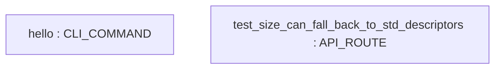

# Repository Architecture Analysis: Textualize/rich

## Metadata
- **SHA**: `3a109ccdffe5b2d0e30684a304fbd388e99ce57b`
- **Primary Ecosystem**: Python

## Quality Metrics
- **avg_cyclomatic_complexity**: 3.01
- **component_count**: 2
- **files_analyzed**: 213
- **framework**: Unknown
- **loc**: 51747
- **max_cyclomatic_complexity**: 49
- **sloc**: 45068

# Architecture: Textualize/rich

## Context
- **Repository**: `Textualize/rich`
- **SHA**: `3a109ccdffe5b2d0e30684a304fbd388e99ce57b`
- **Ecosystem**: Python
- **Framework**: Unknown

## Building Block View

## Component Details
- **hello** (`examples/suppress.py`): CLI_COMMAND
- **test_size_can_fall_back_to_std_descriptors** (`tests/test_console.py`): API_ROUTE

## CI/CD Pipeline Topology

