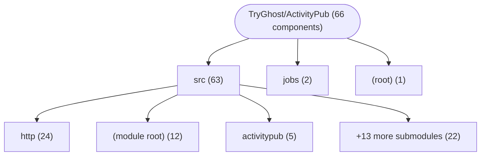
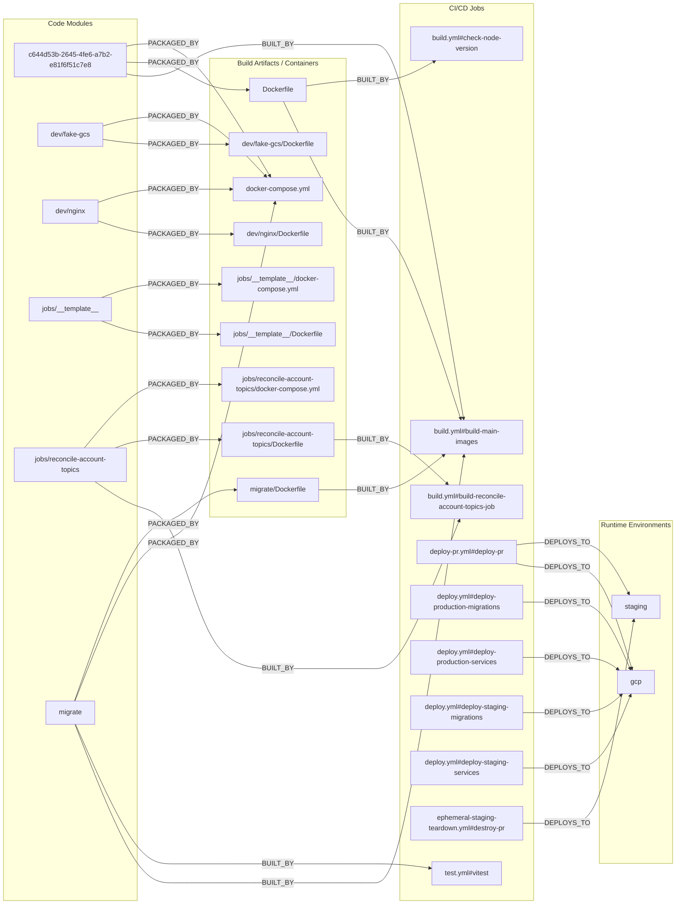
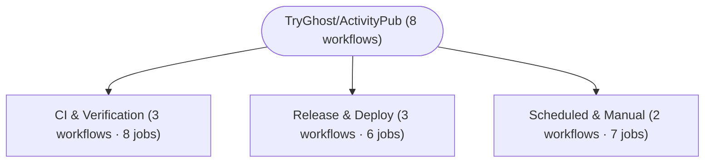

# Repository Architecture Analysis: TryGhost/ActivityPub

## Metadata
- **SHA**: `6a28ff8930161f1b755d218766acbc340a9436cc`
- **Primary Ecosystem**: JavaScript/TypeScript

## Quality Metrics
- **ast_engine**: tree-sitter
- **avg_cognitive_complexity**: 2.51
- **avg_cyclomatic_complexity**: 3.27
- **component_count**: 66
- **dead_code_count**: 1
- **dead_code_symbols**: 1 entry(ies)
- **duplication_pct**: 91.23
- **file_complexities**: 25 entry(ies)
- **files_analyzed**: 293
- **fitness_passed**: False
- **fitness_violation_count**: 3
- **framework**: TypeScript
- **import_edges**: 100 entry(ies)
- **loc**: 75070
- **max_cognitive_complexity**: 90
- **max_cyclomatic_complexity**: 44
- **sloc**: 60997
- **test_file_count**: 121

# Architecture: TryGhost/ActivityPub

## Context
- **Repository**: `TryGhost/ActivityPub`
- **SHA**: `6a28ff8930161f1b755d218766acbc340a9436cc`
- **Ecosystem**: JavaScript/TypeScript
- **Framework**: TypeScript

## Building Block View

## Component Details

Showing top 60 representative components out of 66 across 3 module group(s):

- **Module `src`** (63 components — API_ROUTE: 35, SERVICE: 23, DATA_ACCESS_LAYER: 5)
- **Module `jobs`** (2 components — MODULE: 1, module: 1)
- **Module `(root)`** (1 components — MODULE: 1)

- **AccountController** (`src/http/api/account.controller.ts`): API_ROUTE
- **AccountEntity** (`src/account/account.entity.ts`): DATA_ACCESS_LAYER
- **AccountMoveService** (`src/account/account-move.service.ts`): SERVICE
- **AccountService** (`src/account/account.service.ts`): SERVICE
- **BaseEntity** (`src/core/base.entity.ts`): DATA_ACCESS_LAYER
- **BlockController** (`src/http/api/block.controller.ts`): API_ROUTE
- **BlueskyApiClient** (`src/integration/bluesky-api.client.ts`): SERVICE
- **BlueskyController** (`src/http/api/bluesky.controller.ts`): API_ROUTE
- **BlueskyService** (`src/integration/bluesky.service.ts`): SERVICE
- **ClientConfigController** (`src/http/api/client-config.controller.ts`): API_ROUTE
- **DELETE_.ghost_activitypub_v1_site** (`src/app.ts`): API_ROUTE
- **ExploreController** (`src/http/api/explore.controller.ts`): API_ROUTE
- **FailingGetKvStore** (`src/activitypub/nodeinfo.service.unit.test.ts`): SERVICE
- **FailingSetKvStore** (`src/activitypub/nodeinfo.service.unit.test.ts`): SERVICE
- **FakeKvStore** (`src/activitypub/nodeinfo.service.unit.test.ts`): SERVICE
- **FakeKvStore** (`src/http/middleware/role-guard.unit.test.ts`): SERVICE
- **FeedController** (`src/http/api/feed.controller.ts`): API_ROUTE
- **FeedService** (`src/feed/feed.service.ts`): SERVICE
- **FeedUpdateService** (`src/feed/feed-update.service.ts`): SERVICE
- **FlagService** (`src/flag/flag.service.ts`): SERVICE
- **FollowController** (`src/http/api/follow.controller.ts`): API_ROUTE
- **FollowersService** (`src/activitypub/followers.service.ts`): SERVICE
- **GET_.ghost_activitypub_gcs_*** (`src/app.ts`): API_ROUTE
- **GET_.ghost_activitypub_v1_site** (`src/app.ts`): API_ROUTE
- **GET_.well-known_webfinger** (`src/app.ts`): API_ROUTE
- **GET_ping** (`src/app.ts`): API_ROUTE
- **GET_test** (`src/http/middleware/deployment-headers.unit.test.ts`): API_ROUTE
- **GET_test** (`src/http/middleware/host-data-context.unit.test.ts`): API_ROUTE
- **GET_test** (`src/http/middleware/role-guard.unit.test.ts`): API_ROUTE
- **GhostPostService** (`src/ghost/ghost-post.service.ts`): SERVICE
- **ImageStorageService** (`src/storage/image-storage.service.ts`): SERVICE
- **KnexAccountRepository** (`src/account/account.repository.knex.ts`): DATA_ACCESS_LAYER
- **KnexKvStore** (`src/knex.kvstore.ts`): SERVICE
- **KnexPostRepository** (`src/post/post.repository.knex.ts`): DATA_ACCESS_LAYER
- **KnexUserRepository** (`src/user/user.repository.knex.ts`): DATA_ACCESS_LAYER
- **LikeController** (`src/http/api/like.controller.ts`): API_ROUTE
- **MediaController** (`src/http/api/media.controller.ts`): API_ROUTE
- **ModerationService** (`src/moderation/moderation.service.ts`): SERVICE
- **NodeInfoService** (`src/activitypub/nodeinfo.service.ts`): SERVICE
- **NotificationController** (`src/http/api/notification.controller.ts`): API_ROUTE
- **NotificationEventService** (`src/notification/notification-event.service.ts`): SERVICE
- **NotificationService** (`src/notification/notification.service.ts`): SERVICE
- **POST_.ghost_activitypub_pubsub_fedify_push** (`src/app.ts`): API_ROUTE
- **POST_.ghost_activitypub_pubsub_ghost_push** (`src/app.ts`): API_ROUTE
- **POST_.ghost_activitypub_v1_webhooks_post_deleted** (`src/app.ts`): API_ROUTE
- **POST_.ghost_activitypub_v1_webhooks_post_published** (`src/app.ts`): API_ROUTE
- **POST_.ghost_activitypub_v1_webhooks_post_unpublished** (`src/app.ts`): API_ROUTE
- **POST_.ghost_activitypub_v1_webhooks_post_updated** (`src/app.ts`): API_ROUTE
- **POST_mq** (`src/mq/gcloud-pubsub-push/mq.ts`): API_ROUTE
- **PostController** (`src/http/api/post.controller.ts`): API_ROUTE
- **PostInteractionCountsService** (`src/post/post-interaction-counts.service.ts`): SERVICE
- **PostService** (`src/post/post.service.ts`): SERVICE
- **PreferencesController** (`src/http/api/preferences.controller.ts`): API_ROUTE
- **RecommendationsController** (`src/http/api/recommendations.controller.ts`): API_ROUTE
- **ReplyChainController** (`src/http/api/reply-chain.controller.ts`): API_ROUTE
- **SearchController** (`src/http/api/search.controller.ts`): API_ROUTE
- **SiteController** (`src/http/api/site.controller.ts`): API_ROUTE
- **SiteService** (`src/site/site.service.ts`): SERVICE
- **TestController** (`src/http/decorators/route.decorator.unit.test.ts`): API_ROUTE
- **TopicController** (`src/http/api/topic.controller.ts`): API_ROUTE

## 6-Dimension Repository Scorecard

- **Overall Grade**: `F` (38.18/100)
- **Technical Debt Score**: 61.82
- **Estimated Remediation Effort**: 100.45h

| Dimension | Grade | Score | Weight | Details |
| :--- | :---: | :---: | :---: | :--- |
| Code Quality | `F` | 46.92 | 0.20 | avg_cc=3.27, max_cc=44, duplication=91.23%, dead_code=1 |
| Dependency Health | `B` | 85.00 | 0.15 | dependencies=51, outdated=0, vulnerable=0, has_lockfile=False |
| Maintainability | `F` | 37.00 | 0.15 | avg_cognitive=2.51, max_cognitive=90, fitness_violations=3, oversized_files=15 |
| Pipeline Health | `F` | 0.00 | 0.15 | workflows=8, operational_antipatterns=31, parallel_branches=True |
| Security | `F` | 0.00 | 0.20 | vulnerabilities=0, secrets=1, pipeline_security_findings=6 |
| Test Coverage | `C` | 70.00 | 0.15 | coverage=unavailable, ci_test_job=True, test_files_detected=True |

## Architecture Fitness & Workspace Boundaries

- **[MEDIUM] `ATRUSS-ARCH-005` (COMPLEXITY_THRESHOLD)**: Repository duplication_pct (91.23) exceeds policy threshold (15.0).
- **[MEDIUM] `ATRUSS-ARCH-005` (COMPLEXITY_THRESHOLD)**: Repository max_cognitive_complexity (90.0) exceeds policy threshold (25.0).
- **[MEDIUM] `ATRUSS-ARCH-005` (COMPLEXITY_THRESHOLD)**: Repository max_cyclomatic_complexity (44.0) exceeds policy threshold (20.0).

## Supply Chain Dependencies, Vulnerabilities & Secrets

- **Dependencies Parsed**: 51 | **Vulnerabilities**: 0 | **Secrets**: 1

### Secret Findings (Redacted)
- **[CRITICAL] `ATRUSS-SEC-004`** at `features/fixtures/private.key:1` (`-----BEGIN ... PRIVATE KEY----- [REDACTED]`)

### Inventory Sample
- `@biomejs/biome` `2.6.6` (npm, `package.json`)
- `@cucumber/cucumber` `13.3.0` (npm, `package.json`)
- `@faker-js/faker` `10.6.0` (npm, `package.json`)
- `@fedify/cli` `2.4.5` (npm, `package.json`)
- `@fedify/fedify` `2.4.5` (npm, `package.json`)
- `@fedify/hono` `2.4.5` (npm, `package.json`)
- `@fedify/redis` `2.4.5` (npm, `package.json`)
- `@fedify/vocab` `2.4.5` (npm, `jobs/reconcile-account-topics/package.json`)
- `@fedify/vocab` `2.4.5` (npm, `package.json`)
- `@fedify/vocab-runtime` `2.4.5` (npm, `package.json`)
- `@fedify/webfinger` `2.4.5` (npm, `jobs/reconcile-account-topics/package.json`)
- `@fedify/webfinger` `2.4.5` (npm, `package.json`)
- `@google-cloud/pubsub` `6.3.2` (npm, `package.json`)
- `@google-cloud/storage` `8.4.0` (npm, `package.json`)
- `@hono/node-server` `2.1.6` (npm, `package.json`)
- `@js-temporal/polyfill` `0.5.1` (npm, `package.json`)
- `@logtape/logtape` `2.4.2` (npm, `package.json`)
- `@opentelemetry/api` `1.10.0` (npm, `package.json`)
- `@opentelemetry/core` `3.1.0` (npm, `package.json`)
- `@sentry/node` `11.11.0` (npm, `package.json`)
- `@types/html-to-text` `9.0.4` (npm, `package.json`)
- `@types/jsonwebtoken` `9.0.10` (npm, `package.json`)
- `@types/node` `26.6.6` (npm, `package.json`)
- `@types/sanitize-html` `2.16.2` (npm, `package.json`)
- `@vitest/coverage-v8` `5.1.0` (npm, `package.json`)
- `awilix` `13.0.5` (npm, `package.json`)
- `concurrently` `10.0.7` (npm, `package.json`)
- `es-toolkit` `1.53.2` (npm, `package.json`)
- `esbuild` `0.28.2` (npm, `package.json`)
- `hono` `4.13.17` (npm, `package.json`)
- ... (+21 more dependencies)

## Section 7: Code-to-Cloud Deployment Traceability

- `deploy-pr.yml#deploy-pr` (ci_job) --[DEPLOYS_TO]--> `gcp` (environment)
- `deploy-pr.yml#deploy-pr` (ci_job) --[DEPLOYS_TO]--> `staging` (environment)
- `deploy.yml#deploy-production-migrations` (ci_job) --[DEPLOYS_TO]--> `gcp` (environment)
- `deploy.yml#deploy-production-services` (ci_job) --[DEPLOYS_TO]--> `gcp` (environment)
- `deploy.yml#deploy-staging-migrations` (ci_job) --[DEPLOYS_TO]--> `gcp` (environment)
- `deploy.yml#deploy-staging-services` (ci_job) --[DEPLOYS_TO]--> `gcp` (environment)
- `ephemeral-staging-teardown.yml#destroy-pr` (ci_job) --[DEPLOYS_TO]--> `staging` (environment)
- `c644d53b-2645-4fe6-a7b2-e81f6f51c7e8` (code_module) --[BUILT_BY]--> `build.yml#build-main-images` (ci_job)
- `c644d53b-2645-4fe6-a7b2-e81f6f51c7e8` (code_module) --[PACKAGED_BY]--> `Dockerfile` (container)
- `c644d53b-2645-4fe6-a7b2-e81f6f51c7e8` (code_module) --[PACKAGED_BY]--> `docker-compose.yml` (container)
- `dev/fake-gcs` (code_module) --[PACKAGED_BY]--> `dev/fake-gcs/Dockerfile` (container)
- `dev/fake-gcs` (code_module) --[PACKAGED_BY]--> `docker-compose.yml` (container)
- `dev/nginx` (code_module) --[PACKAGED_BY]--> `dev/nginx/Dockerfile` (container)
- `dev/nginx` (code_module) --[PACKAGED_BY]--> `docker-compose.yml` (container)
- `jobs/__template__` (code_module) --[PACKAGED_BY]--> `jobs/__template__/Dockerfile` (container)
- `jobs/__template__` (code_module) --[PACKAGED_BY]--> `jobs/__template__/docker-compose.yml` (container)
- `jobs/reconcile-account-topics` (code_module) --[BUILT_BY]--> `build.yml#build-reconcile-account-topics-job` (ci_job)
- `jobs/reconcile-account-topics` (code_module) --[PACKAGED_BY]--> `jobs/reconcile-account-topics/Dockerfile` (container)
- `jobs/reconcile-account-topics` (code_module) --[PACKAGED_BY]--> `jobs/reconcile-account-topics/docker-compose.yml` (container)
- `migrate` (code_module) --[BUILT_BY]--> `build.yml#build-main-images` (ci_job)
- `migrate` (code_module) --[BUILT_BY]--> `test.yml#vitest` (ci_job)
- `migrate` (code_module) --[PACKAGED_BY]--> `docker-compose.yml` (container)
- `migrate` (code_module) --[PACKAGED_BY]--> `migrate/Dockerfile` (container)
- `Dockerfile` (container) --[BUILT_BY]--> `build.yml#build-main-images` (ci_job)
- `Dockerfile` (container) --[BUILT_BY]--> `build.yml#check-node-version` (ci_job)
- `jobs/reconcile-account-topics/Dockerfile` (container) --[BUILT_BY]--> `build.yml#build-reconcile-account-topics-job` (ci_job)
- `migrate/Dockerfile` (container) --[BUILT_BY]--> `build.yml#build-main-images` (ci_job)

## CI/CD Pipeline Topology

