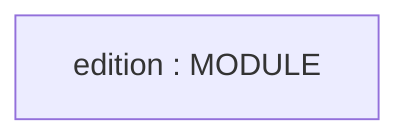
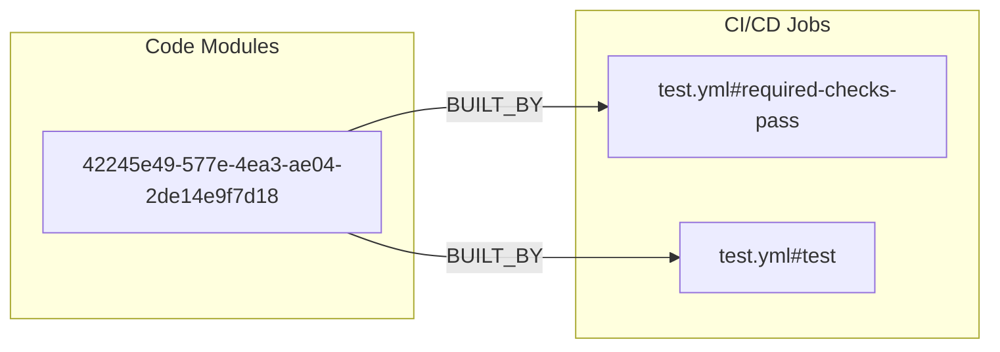
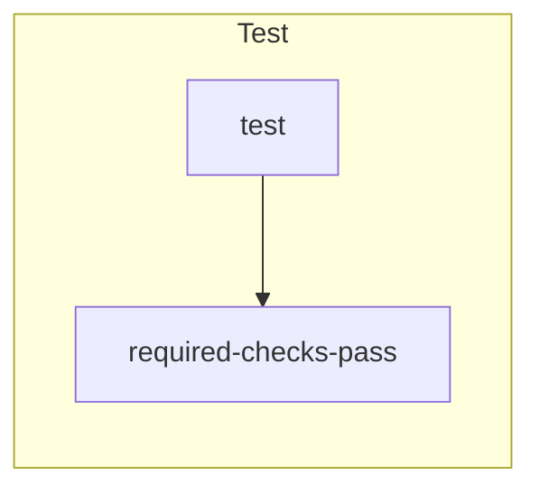

# Repository Architecture Analysis: TryGhost/Edition

## Metadata
- **SHA**: `405d716b199b2b34376e71a74afe9b2ebd355a25`
- **Primary Ecosystem**: JavaScript/TypeScript

## Quality Metrics
- **ast_engine**: tree-sitter
- **avg_cognitive_complexity**: 22.47
- **avg_cyclomatic_complexity**: 6.83
- **component_count**: 1
- **dead_code_count**: 0
- **dead_code_symbols**: 0 entry(ies)
- **duplication_pct**: 48.05
- **file_complexities**: 4 entry(ies)
- **files_analyzed**: 4
- **fitness_passed**: False
- **fitness_violation_count**: 3
- **framework**: Unknown
- **import_edges**: 35 entry(ies)
- **loc**: 3409
- **max_cognitive_complexity**: 1769
- **max_cyclomatic_complexity**: 272
- **sloc**: 2585

# Architecture: TryGhost/Edition

## Context
- **Repository**: `TryGhost/Edition`
- **SHA**: `405d716b199b2b34376e71a74afe9b2ebd355a25`
- **Ecosystem**: JavaScript/TypeScript
- **Framework**: Unknown

## Building Block View

## Component Details
- **edition** (`package.json`): MODULE

## 6-Dimension Repository Scorecard

- **Overall Grade**: `D` (67.44/100)
- **Technical Debt Score**: 32.56
- **Estimated Remediation Effort**: 25.75h

| Dimension | Grade | Score | Weight | Details |
| :--- | :---: | :---: | :---: | :--- |
| Code Quality | `F` | 34.68 | 0.20 | avg_cc=6.83, max_cc=272, duplication=48.05%, dead_code=0 |
| Dependency Health | `B` | 85.00 | 0.15 | dependencies=16, outdated=0, vulnerable=0, has_lockfile=False |
| Maintainability | `F` | 27.00 | 0.15 | avg_cognitive=22.47, max_cognitive=1769, fitness_violations=3, oversized_files=1 |
| Pipeline Health | `B` | 88.00 | 0.15 | workflows=1, operational_antipatterns=3, parallel_branches=False |
| Security | `A` | 100.00 | 0.20 | vulnerabilities=0, secrets=0, pipeline_security_findings=0 |
| Test Coverage | `C` | 70.00 | 0.15 | coverage=unavailable, ci_test_job=True, test_files_detected=False |

## Architecture Fitness & Workspace Boundaries

- **[MEDIUM] `ATRUSS-ARCH-005` (COMPLEXITY_THRESHOLD)**: Repository duplication_pct (48.05) exceeds policy threshold (15.0).
- **[MEDIUM] `ATRUSS-ARCH-005` (COMPLEXITY_THRESHOLD)**: Repository max_cognitive_complexity (1769.0) exceeds policy threshold (25.0).
- **[MEDIUM] `ATRUSS-ARCH-005` (COMPLEXITY_THRESHOLD)**: Repository max_cyclomatic_complexity (272.0) exceeds policy threshold (20.0).

## Supply Chain Dependencies, Vulnerabilities & Secrets

- **Dependencies Parsed**: 16 | **Vulnerabilities**: 0 | **Secrets**: 0

### Inventory Sample
- `@tryghost/shared-theme-assets` `2.7.5` (npm, `package.json`)
- `@tryghost/theme-translations` `0.0.9` (npm, `package.json`)
- `autoprefixer` `10.6.2` (npm, `package.json`)
- `beeper` `2.1.0` (npm, `package.json`)
- `cssnano` `9.9.0` (npm, `package.json`)
- `gscan` `6.7.0` (npm, `package.json`)
- `gulp` `5.0.1` (npm, `package.json`)
- `gulp-concat` `2.6.1` (npm, `package.json`)
- `gulp-livereload` `4.0.2` (npm, `package.json`)
- `gulp-postcss` `10.0.0` (npm, `package.json`)
- `gulp-uglify` `3.0.2` (npm, `package.json`)
- `gulp-zip` `5.1.0` (npm, `package.json`)
- `ordered-read-streams` `2.0.0` (npm, `package.json`)
- `postcss` `8.5.32` (npm, `package.json`)
- `postcss-easy-import` `4.0.0` (npm, `package.json`)
- `pump` `3.0.4` (npm, `package.json`)

## Section 7: Code-to-Cloud Deployment Traceability

- `42245e49-577e-4ea3-ae04-2de14e9f7d18` (code_module) --[BUILT_BY]--> `test.yml#required-checks-pass` (ci_job)
- `42245e49-577e-4ea3-ae04-2de14e9f7d18` (code_module) --[BUILT_BY]--> `test.yml#test` (ci_job)

## CI/CD Pipeline Topology

