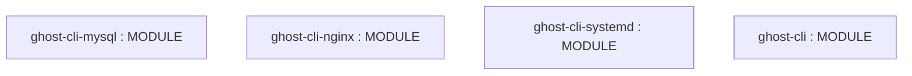
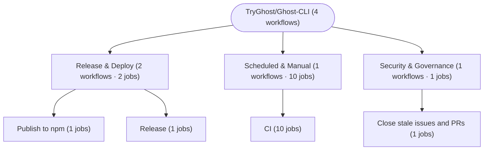

# Repository Architecture Analysis: TryGhost/Ghost-CLI

## Metadata
- **SHA**: `f5213960b37f3d82d15fe059d9bc94818eb2acec`
- **Primary Ecosystem**: JavaScript/TypeScript

## Quality Metrics
- **ast_engine**: tree-sitter
- **avg_cognitive_complexity**: 2.84
- **avg_cyclomatic_complexity**: 3.09
- **component_count**: 4
- **dead_code_count**: 3
- **dead_code_symbols**: 3 entry(ies)
- **duplication_pct**: 89.11
- **file_complexities**: 25 entry(ies)
- **files_analyzed**: 217
- **fitness_passed**: False
- **fitness_violation_count**: 3
- **framework**: Unknown
- **import_edges**: 100 entry(ies)
- **loc**: 37541
- **max_cognitive_complexity**: 60
- **max_cyclomatic_complexity**: 25
- **sloc**: 30072
- **test_file_count**: 133

# Architecture: TryGhost/Ghost-CLI

## Context
- **Repository**: `TryGhost/Ghost-CLI`
- **SHA**: `f5213960b37f3d82d15fe059d9bc94818eb2acec`
- **Ecosystem**: JavaScript/TypeScript
- **Framework**: Unknown

## Building Block View

## Component Details
- **ghost-cli-mysql** (`extensions/mysql/package.json`): MODULE
- **ghost-cli-nginx** (`extensions/nginx/package.json`): MODULE
- **ghost-cli-systemd** (`extensions/systemd/package.json`): MODULE
- **ghost-cli** (`package.json`): MODULE

## 6-Dimension Repository Scorecard

- **Overall Grade**: `F` (48.23/100)
- **Technical Debt Score**: 51.77
- **Estimated Remediation Effort**: 78.51h

| Dimension | Grade | Score | Weight | Details |
| :--- | :---: | :---: | :---: | :--- |
| Code Quality | `F` | 53.64 | 0.20 | avg_cc=3.09, max_cc=25, duplication=89.11%, dead_code=3 |
| Dependency Health | `B` | 85.00 | 0.15 | dependencies=42, outdated=0, vulnerable=0, has_lockfile=False |
| Maintainability | `F` | 42.00 | 0.15 | avg_cognitive=2.84, max_cognitive=60, fitness_violations=3, oversized_files=3 |
| Pipeline Health | `F` | 53.00 | 0.15 | workflows=4, operational_antipatterns=6, parallel_branches=True |
| Security | `F` | 0.00 | 0.20 | vulnerabilities=0, secrets=8, pipeline_security_findings=8 |
| Test Coverage | `C` | 70.00 | 0.15 | coverage=unavailable, ci_test_job=True, test_files_detected=True |

## Architecture Fitness & Workspace Boundaries

- **[MEDIUM] `ATRUSS-ARCH-005` (COMPLEXITY_THRESHOLD)**: Repository duplication_pct (89.11) exceeds policy threshold (15.0).
- **[MEDIUM] `ATRUSS-ARCH-005` (COMPLEXITY_THRESHOLD)**: Repository max_cognitive_complexity (60.0) exceeds policy threshold (25.0).
- **[MEDIUM] `ATRUSS-ARCH-005` (COMPLEXITY_THRESHOLD)**: Repository max_cyclomatic_complexity (25.0) exceeds policy threshold (20.0).

## Supply Chain Dependencies, Vulnerabilities & Secrets

- **Dependencies Parsed**: 42 | **Vulnerabilities**: 0 | **Secrets**: 8

### Secret Findings (Redacted)
- **[HIGH] `ATRUSS-SEC-005`** at `test/unit/tasks/import/fixtures/0.11.x.json:1` (`...est 0.x User","slug":"test","password":"$2a$***REDACTED***","email":"test@example.com","image":nul...`)
- **[HIGH] `ATRUSS-SEC-005`** at `test/unit/tasks/import/fixtures/1.x.json:1` (`...":null,"ghost_auth_id":null,"password":"$2a$***REDACTED***","email":"ghost-author@example.com","pr...`)
- **[HIGH] `ATRUSS-SEC-005`** at `test/unit/tasks/import/fixtures/1.x.json:1` (`...":null,"ghost_auth_id":null,"password":"$2a$***REDACTED***","email":"test@example.com","profile_im...`)
- **[HIGH] `ATRUSS-SEC-005`** at `test/unit/tasks/import/fixtures/1.x.json:1` (`...ibers":[],"invites":[],"brute":[{"key":"4bh+***REDACTED***","firstRequest":1572933876544,"lastRequ...`)
- **[CRITICAL] `ATRUSS-SEC-004`** at `test/unit/tasks/import/fixtures/2.x.json:1` (`-----BEGIN ... PRIVATE KEY----- [REDACTED]`)
- **[CRITICAL] `ATRUSS-SEC-004`** at `test/unit/tasks/import/fixtures/3.x.json:1` (`-----BEGIN ... PRIVATE KEY----- [REDACTED]`)
- **[CRITICAL] `ATRUSS-SEC-004`** at `test/unit/tasks/import/fixtures/4.x.json:1` (`-----BEGIN ... PRIVATE KEY----- [REDACTED]`)
- **[CRITICAL] `ATRUSS-SEC-004`** at `test/unit/tasks/import/fixtures/5.x.json:1` (`-----BEGIN ... PRIVATE KEY----- [REDACTED]`)

### Inventory Sample
- `@tryghost/zip` `4.0.3` (npm, `package.json`)
- `@vitest/coverage-v8` `5.1.0` (npm, `package.json`)
- `abbrev` `5.0.0` (npm, `package.json`)
- `boxen` `9.0.0` (npm, `package.json`)
- `chalk` `6.0.1` (npm, `package.json`)
- `cli-table3` `0.5.0` (npm, `package.json`)
- `debug` `4.4.3` (npm, `package.json`)
- `execa` `10.2.1` (npm, `package.json`)
- `find-plugins` `1.1.7` (npm, `package.json`)
- `fkill` `10.0.3` (npm, `package.json`)
- `global-modules` `2.0.0` (npm, `package.json`)
- `has-ansi` `6.0.2` (npm, `package.json`)
- `ini` `7.0.0` (npm, `package.json`)
- `inquirer` `14.3.0` (npm, `package.json`)
- `jsonwebtoken` `9.0.3` (npm, `package.json`)
- `ky` `1.14.3` (npm, `package.json`)
- `listr2` `11.4.1` (npm, `package.json`)
- `lodash` `4.18.1` (npm, `package.json`)
- `log-symbols` `7.0.1` (npm, `package.json`)
- `mysql2` `3.24.6` (npm, `package.json`)
- `nock` `15.0.6` (npm, `package.json`)
- `node-stream-zip` `1.16.0` (npm, `package.json`)
- `ora` `10.0.0` (npm, `package.json`)
- `oxfmt` `0.77.0` (npm, `package.json`)
- `oxlint` `1.92.0` (npm, `package.json`)
- `package-json` `10.0.1` (npm, `package.json`)
- `portfinder` `1.0.38` (npm, `package.json`)
- `prettyjson` `1.2.5` (npm, `package.json`)
- `proxyquire` `2.1.3` (npm, `package.json`)
- `read-last-lines` `1.10.0` (npm, `package.json`)
- ... (+12 more dependencies)

## CI/CD Pipeline Topology

