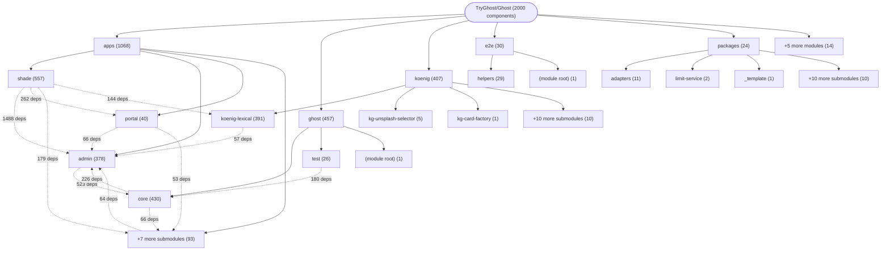
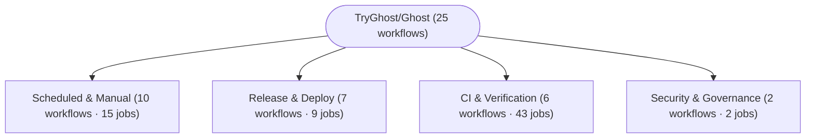

# Repository Architecture Analysis: TryGhost/Ghost

## Metadata
- **SHA**: `c2617d08d01ccc96ce88f3f8bd99c9383b518a7b`
- **Primary Ecosystem**: JavaScript/TypeScript

## Quality Metrics
- **ast_engine**: tree-sitter
- **avg_cognitive_complexity**: 4.37
- **avg_cyclomatic_complexity**: 4.04
- **component_count**: 2000
- **dead_code_count**: 13
- **dead_code_symbols**: 13 entry(ies)
- **duplication_pct**: 88.86
- **file_complexities**: 25 entry(ies)
- **files_analyzed**: 7432
- **fitness_passed**: False
- **fitness_violation_count**: 58
- **framework**: React (Vite)
- **import_edges**: 100 entry(ies)
- **loc**: 1254592
- **max_cognitive_complexity**: 356
- **max_cyclomatic_complexity**: 120
- **sloc**: 1031503
- **test_file_count**: 2990

# Architecture: TryGhost/Ghost

## Context
- **Repository**: `TryGhost/Ghost`
- **SHA**: `c2617d08d01ccc96ce88f3f8bd99c9383b518a7b`
- **Ecosystem**: JavaScript/TypeScript
- **Framework**: React (Vite)

## Building Block View



## Component Details

Showing top 60 representative components out of 2000 across 10 module group(s):

- **Module `apps`** (1068 components — UI_COMPONENT: 1058, MODULE: 10)
- **Module `ghost`** (457 components — API_ROUTE: 323, SERVICE: 97, DATA_ACCESS_LAYER: 30)
- **Module `koenig`** (407 components — UI_COMPONENT: 392, MODULE: 13, SERVICE: 2)
- **Module `e2e`** (30 components — API_ROUTE: 23, SERVICE: 6, MODULE: 1)
- **Module `packages`** (24 components — MODULE: 20, SERVICE: 4)
- **Module `tools`** (9 components — MODULE: 9)
- **Module `contracts`** (2 components — MODULE: 2)
- **Module `(root)`** (1 components — MODULE: 1)
- **Module `.github`** (1 components — MODULE: 1)
- **Module `docker`** (1 components — module: 1)

- **AppDetails** (`apps/admin/src/apps/app-details.tsx`): UI_COMPONENT (deps: ACCOUNT_ACCESS_INTRO, AccessIndicator, AppAuthor, AppBanner, AppIcon, AppNavIcon (+269 more))
- **AppPage** (`apps/admin/src/apps/app-page.tsx`): UI_COMPONENT (deps: AdminFrame, AppsGate, BillingFrame, CommentsFrame, DELETE_:id, DELETE_:id_dislike (+264 more))
- **InMemoryClickEventRepository** (`ghost/test/unit/server/services/recommendations/service/recommendation-service.test.ts`): DATA_ACCESS_LAYER (deps: ActivityPubService, AppInstallationsService, AudienceFeedbackService, AutomationsService, BatchSendingService, BrowserService (+85 more))
- **InMemoryRecommendationRepository** (`ghost/test/unit/server/services/recommendations/service/in-memory-recommendation-repository.ts`): DATA_ACCESS_LAYER (deps: ActivityPubService, AppInstallationsService, AudienceFeedbackService, AutomationsService, BatchSendingService, BrowserService (+84 more))
- **CheckoutService** (`ghost/core/server/services/stripe-checkout-config/checkout-service.ts`): SERVICE (deps: ActivityPubService, AppInstallationsService, AudienceFeedbackService, AutomationsService, BatchSendingService, BrowserService (+82 more))
- **EMAIL_EDITOR_CARD_CONFIG** (`koenig/koenig-lexical/src/components/EmailEditor.tsx`): UI_COMPONENT (deps: BASIC_TRANSFORMERS, BookmarkPlugin, ButtonPlugin, CODE_BLOCK, CUSTOM_TEXT_FORMAT_TRANSFORMERS, CallToActionPlugin (+31 more))
- **API_endpoints_index** (`ghost/core/server/api/endpoints/index.js`): API_ROUTE (deps: AUTOMATIONS_MASK_ATTRIBUTE, ArchivedListField, AutomationPerformanceStatsSchema, AutomationRunSchema, AutomationRunsResponseSchema, CollectRow (+28 more))
- **AllDefaultPlugins** (`koenig/koenig-lexical/src/plugins/AllDefaultPlugins.tsx`): UI_COMPONENT (deps: AudioPlugin, BookmarkPlugin, ButtonPlugin, CallToActionPlugin, CalloutPlugin, CardMenuPlugin (+22 more))
- **CompleteExample** (`apps/shade/src/components/ui/field.stories.tsx`): UI_COMPONENT (deps: ActionButtonStyles, AppPinButton, BackButtonStyles, BackgroundColorField, BodyFontField, ButtonColorField (+20 more))
- **FieldsetExample** (`apps/shade/src/components/ui/field.stories.tsx`): UI_COMPONENT (deps: ActionButtonStyles, AppPinButton, BackButtonStyles, BackgroundColorField, BodyFontField, ButtonColorField (+20 more))
- **HorizontalOrientation** (`apps/shade/src/components/ui/field.stories.tsx`): UI_COMPONENT (deps: ActionButtonStyles, AppPinButton, BackButtonStyles, BackgroundColorField, BodyFontField, ButtonColorField (+20 more))
- **InputField** (`apps/shade/src/components/ui/field.stories.tsx`): UI_COMPONENT (deps: ActionButtonStyles, AppPinButton, BackButtonStyles, BackgroundColorField, BodyFontField, ButtonColorField (+20 more))
- **LegendVariants** (`apps/shade/src/components/ui/field.stories.tsx`): UI_COMPONENT (deps: ActionButtonStyles, AppPinButton, BackButtonStyles, BackgroundColorField, BodyFontField, ButtonColorField (+20 more))
- **MultipleErrors** (`apps/shade/src/components/ui/field.stories.tsx`): UI_COMPONENT (deps: ActionButtonStyles, AppPinButton, BackButtonStyles, BackgroundColorField, BodyFontField, ButtonColorField (+20 more))
- **NestedFieldGroups** (`apps/shade/src/components/ui/field.stories.tsx`): UI_COMPONENT (deps: ActionButtonStyles, AppPinButton, BackButtonStyles, BackgroundColorField, BodyFontField, ButtonColorField (+20 more))
- **ResponsiveLayout** (`apps/shade/src/components/ui/field.stories.tsx`): UI_COMPONENT (deps: ActionButtonStyles, AppPinButton, BackButtonStyles, BackgroundColorField, BodyFontField, ButtonColorField (+20 more))
- **SelectField** (`apps/shade/src/components/ui/field.stories.tsx`): UI_COMPONENT (deps: ActionButtonStyles, AppPinButton, BackButtonStyles, BackgroundColorField, BodyFontField, ButtonColorField (+20 more))
- **SeparatorWithContent** (`apps/shade/src/components/ui/field.stories.tsx`): UI_COMPONENT (deps: ActionButtonStyles, AppPinButton, BackButtonStyles, BackgroundColorField, BodyFontField, ButtonColorField (+20 more))
- **TextareaField** (`apps/shade/src/components/ui/field.stories.tsx`): UI_COMPONENT (deps: ActionButtonStyles, AppPinButton, BackButtonStyles, BackgroundColorField, BodyFontField, ButtonColorField (+20 more))
- **TitleDescriptionSpacing** (`apps/shade/src/components/ui/field.stories.tsx`): UI_COMPONENT (deps: ActionButtonStyles, AppPinButton, BackButtonStyles, BackgroundColorField, BodyFontField, ButtonColorField (+20 more))
- **VerticalOrientation** (`apps/shade/src/components/ui/field.stories.tsx`): UI_COMPONENT (deps: ActionButtonStyles, AppPinButton, BackButtonStyles, BackgroundColorField, BodyFontField, ButtonColorField (+20 more))
- **WithFieldContent** (`apps/shade/src/components/ui/field.stories.tsx`): UI_COMPONENT (deps: ActionButtonStyles, AppPinButton, BackButtonStyles, BackgroundColorField, BodyFontField, ButtonColorField (+20 more))
- **WithValidationError** (`apps/shade/src/components/ui/field.stories.tsx`): UI_COMPONENT (deps: ActionButtonStyles, AppPinButton, BackButtonStyles, BackgroundColorField, BodyFontField, ButtonColorField (+20 more))
- **API_output_index** (`ghost/core/server/api/endpoints/utils/serializers/output/index.js`): API_ROUTE (deps: AUTOMATIONS_MASK_ATTRIBUTE, ArchivedListField, CollectRow, DEV_BASE, Destination, FacebookCardPreview (+18 more))
- **Default** (`apps/shade/src/components/primitives/text.stories.tsx`): UI_COMPONENT (deps: ActivityPubHostLayoutProvider, AnalyticsContext, AppContext, AppContextProvider, ConfirmationContext, CustomFieldFormContext (+17 more))
- **HeadingTone** (`apps/shade/src/components/primitives/text.stories.tsx`): UI_COMPONENT (deps: ActivityPubHostLayoutProvider, AnalyticsContext, AppContext, AppContextProvider, ConfirmationContext, CustomFieldFormContext (+17 more))
- **SecondaryAndTruncated** (`apps/shade/src/components/primitives/text.stories.tsx`): UI_COMPONENT (deps: ActivityPubHostLayoutProvider, AnalyticsContext, AppContext, AppContextProvider, ConfirmationContext, CustomFieldFormContext (+17 more))
- **Default** (`apps/shade/src/components/ui/dialog.stories.tsx`): UI_COMPONENT (deps: ActionButtonStyles, AppPinButton, AskAdminDialog, BackButtonStyles, CreateCustomFieldPopover, DirtyConfirmDialog (+16 more))
- **HeaderCard** (`koenig/koenig-lexical/src/components/ui/cards/HeaderCard/v2/HeaderCard.tsx`): UI_COMPONENT (deps: Button, ButtonGroupSetting, ColorOptionSetting, ColorPickerSetting, DropdownSetting, EMAIL_CARD_EASE (+16 more))
- **NestedOverlayEscape** (`apps/shade/src/components/ui/dialog.stories.tsx`): UI_COMPONENT (deps: ActionButtonStyles, AppPinButton, AskAdminDialog, BackButtonStyles, CreateCustomFieldPopover, DirtyConfirmDialog (+16 more))
- **PlacementExample** (`apps/shade/src/components/ui/dialog.stories.tsx`): UI_COMPONENT (deps: ActionButtonStyles, AppPinButton, AskAdminDialog, BackButtonStyles, CreateCustomFieldPopover, DirtyConfirmDialog (+16 more))
- **ScrollingOverlay** (`apps/shade/src/components/ui/dialog.stories.tsx`): UI_COMPONENT (deps: ActionButtonStyles, AppPinButton, AskAdminDialog, BackButtonStyles, CreateCustomFieldPopover, DirtyConfirmDialog (+16 more))
- **SignupCard** (`koenig/koenig-lexical/src/components/ui/cards/SignupCard.tsx`): UI_COMPONENT (deps: ButtonGroupSetting, ColorOptionSetting, ColorPickerSetting, DropdownSetting, EMAIL_CARD_EASE, EmailCardClickedLinks (+15 more))
- **Default** (`apps/shade/src/components/ui/card.stories.tsx`): UI_COMPONENT (deps: ActionButtonStyles, AppPinButton, AutomationCard, AutomationCardHeader, BackButtonStyles, DislikeButton (+13 more))
- **EditableCards** (`koenig/koenig-lexical/src/components/ui/ToolbarMenu.stories.tsx`): UI_COMPONENT (deps: Add, Bold, Edit, HeadingThree, HeadingTwo, ImgFull (+13 more))
- **Gallery** (`koenig/koenig-lexical/src/components/ui/ToolbarMenu.stories.tsx`): UI_COMPONENT (deps: Add, Bold, Edit, HeadingThree, HeadingTwo, ImgFull (+13 more))
- **Image** (`koenig/koenig-lexical/src/components/ui/ToolbarMenu.stories.tsx`): UI_COMPONENT (deps: Add, Bold, Edit, HeadingThree, HeadingTwo, ImgFull (+13 more))
- **NonEditableCards** (`koenig/koenig-lexical/src/components/ui/ToolbarMenu.stories.tsx`): UI_COMPONENT (deps: Add, Bold, Edit, HeadingThree, HeadingTwo, ImgFull (+13 more))
- **PopupModal** (`apps/sodo-search/src/components/popup-modal.tsx`): UI_COMPONENT (deps: AdminFrame, AppContext, AppContextProvider, BillingFrame, CircleAnimatedIcon, ClearIcon (+13 more))
- **Ruled** (`apps/shade/src/components/ui/card.stories.tsx`): UI_COMPONENT (deps: ActionButtonStyles, AppPinButton, AutomationCard, AutomationCardHeader, BackButtonStyles, DislikeButton (+13 more))
- **Search** (`apps/sodo-search/src/components/popup-modal.tsx`): UI_COMPONENT (deps: AdminFrame, AppContext, AppContextProvider, BillingFrame, CircleAnimatedIcon, ClearIcon (+13 more))
- **Text** (`koenig/koenig-lexical/src/components/ui/ToolbarMenu.stories.tsx`): UI_COMPONENT (deps: Add, Bold, Edit, HeadingThree, HeadingTwo, ImgFull (+13 more))
- **VideoCard** (`koenig/koenig-lexical/src/components/ui/cards/VideoCard.tsx`): UI_COMPONENT (deps: ButtonGroupSetting, CardCaptionEditor, CardText, ColorOptionSetting, ColorPickerSetting, DropdownSetting (+13 more))
- **API_mappers_index** (`ghost/core/server/api/endpoints/utils/serializers/output/mappers/index.js`): API_ROUTE (deps: ArchivedListField, CollectRow, Destination, EditorHeaderActions, IMPLEMENTED_POST_ACTIONS, ListField (+12 more))
- **ButtonAsChild** (`apps/shade/src/components/ui/link.stories.tsx`): UI_COMPONENT (deps: AdminLink, BackgroundColorField, BodyFontField, ButtonColorField, ButtonCornersField, ButtonStyleField (+12 more))
- **Default** (`apps/shade/src/components/ui/link.stories.tsx`): UI_COMPONENT (deps: AdminLink, BackgroundColorField, BodyFontField, ButtonColorField, ButtonCornersField, ButtonStyleField (+12 more))
- **EmailCtaNodeComponent** (`koenig/koenig-lexical/src/nodes/EmailCtaNodeComponent.tsx`): UI_COMPONENT (deps: ActionToolbar, DELETE_CARD_COMMAND, DESELECT_CARD_COMMAND, EDIT_CARD_COMMAND, EmailCtaCard, HIDE_CARD_VISIBILITY_SETTINGS_COMMAND (+12 more))
- **EmailNodeComponent** (`koenig/koenig-lexical/src/nodes/EmailNodeComponent.tsx`): UI_COMPONENT (deps: ActionToolbar, DELETE_CARD_COMMAND, DESELECT_CARD_COMMAND, EDIT_CARD_COMMAND, EmailCard, HIDE_CARD_VISIBILITY_SETTINGS_COMMAND (+12 more))
- **External** (`apps/shade/src/components/ui/link.stories.tsx`): UI_COMPONENT (deps: AdminLink, BackgroundColorField, BodyFontField, ButtonColorField, ButtonCornersField, ButtonStyleField (+12 more))
- **InFieldDescription** (`apps/shade/src/components/ui/link.stories.tsx`): UI_COMPONENT (deps: AdminLink, BackgroundColorField, BodyFontField, ButtonColorField, ButtonCornersField, ButtonStyleField (+12 more))
- **InlineInMutedText** (`apps/shade/src/components/ui/link.stories.tsx`): UI_COMPONENT (deps: AdminLink, BackgroundColorField, BodyFontField, ButtonColorField, ButtonCornersField, ButtonStyleField (+12 more))
- **PostSettingsSidebar** (`apps/admin/src/editor/settings/post-settings-sidebar.tsx`): UI_COMPONENT (deps: AccessSection, AuthorsSection, CodeInjectionSection, DeleteSection, EditorFontSection, KeyboardShortcutsSection (+12 more))
- **ToggleNodeComponent** (`koenig/koenig-lexical/src/nodes/ToggleNodeComponent.tsx`): UI_COMPONENT (deps: ActionToolbar, DELETE_CARD_COMMAND, DESELECT_CARD_COMMAND, EDIT_CARD_COMMAND, HIDE_CARD_VISIBILITY_SETTINGS_COMMAND, INSERT_CARD_COMMAND (+12 more))
- **Toolbar** (`apps/admin-toolbar/src/components.ts`): UI_COMPONENT (deps: AUTOMATIONS_MASK_ATTRIBUTE, CircleAnimatedIcon, ClearIcon, CompletedGlyph, DEV_BASE, EditorHeaderActions (+12 more))
- **API_input_index** (`ghost/core/server/api/endpoints/utils/serializers/input/index.js`): API_ROUTE (deps: ArchivedListField, AutomationPerformanceStatsSchema, AutomationRunSchema, AutomationRunsResponseSchema, CollectRow, Destination (+11 more))
- **Checked** (`apps/shade/src/components/ui/switch.stories.tsx`): UI_COMPONENT (deps: ActionButtonStyles, AppPinButton, ArchivedVisibilityField, BackButtonStyles, CustomFieldForm, DislikeButton (+11 more))
- **Controlled** (`apps/shade/src/components/ui/switch.stories.tsx`): UI_COMPONENT (deps: ActionButtonStyles, AppPinButton, ArchivedVisibilityField, BackButtonStyles, CustomFieldForm, DislikeButton (+11 more))
- **Default** (`apps/shade/src/components/ui/switch.stories.tsx`): UI_COMPONENT (deps: ActionButtonStyles, AppPinButton, ArchivedVisibilityField, BackButtonStyles, CustomFieldForm, DislikeButton (+11 more))
- **Disabled** (`apps/shade/src/components/ui/switch.stories.tsx`): UI_COMPONENT (deps: ActionButtonStyles, AppPinButton, ArchivedVisibilityField, BackButtonStyles, CustomFieldForm, DislikeButton (+11 more))
- **DisabledChecked** (`apps/shade/src/components/ui/switch.stories.tsx`): UI_COMPONENT (deps: ActionButtonStyles, AppPinButton, ArchivedVisibilityField, BackButtonStyles, CustomFieldForm, DislikeButton (+11 more))

## 6-Dimension Repository Scorecard

- **Overall Grade**: `F` (30.67/100)
- **Technical Debt Score**: 69.33
- **Estimated Remediation Effort**: 303.85h

| Dimension | Grade | Score | Weight | Details |
| :--- | :---: | :---: | :---: | :--- |
| Code Quality | `F` | 25.84 | 0.20 | avg_cc=4.04, max_cc=120, duplication=88.86%, dead_code=13 |
| Dependency Health | `A` | 100.00 | 0.15 | dependencies=1372, outdated=0, vulnerable=0, has_lockfile=True |
| Maintainability | `F` | 0.00 | 0.15 | avg_cognitive=4.37, max_cognitive=356, fitness_violations=58, oversized_files=23 |
| Pipeline Health | `F` | 0.00 | 0.15 | workflows=25, operational_antipatterns=75, parallel_branches=True |
| Security | `F` | 0.00 | 0.20 | vulnerabilities=0, secrets=0, pipeline_security_findings=19 |
| Test Coverage | `C` | 70.00 | 0.15 | coverage=unavailable, ci_test_job=True, test_files_detected=True |

## Architecture Fitness & Workspace Boundaries

- **[HIGH] `ATRUSS-ARCH-001` (LAYER_VIOLATION)**: API_ROUTE cannot directly import DATA_ACCESS_LAYER when SERVICE components exist. (RecommendationController -> BookshelfRepository)
- **[HIGH] `ATRUSS-ARCH-001` (LAYER_VIOLATION)**: API_ROUTE cannot directly import DATA_ACCESS_LAYER when SERVICE components exist. (RecommendationController -> DonationBookshelfRepository)
- **[HIGH] `ATRUSS-ARCH-001` (LAYER_VIOLATION)**: API_ROUTE cannot directly import DATA_ACCESS_LAYER when SERVICE components exist. (RecommendationController -> GiftBookshelfRepository)
- **[HIGH] `ATRUSS-ARCH-001` (LAYER_VIOLATION)**: API_ROUTE cannot directly import DATA_ACCESS_LAYER when SERVICE components exist. (RecommendationController -> GiftDeliveryBookshelfRepository)
- **[HIGH] `ATRUSS-ARCH-001` (LAYER_VIOLATION)**: API_ROUTE cannot directly import DATA_ACCESS_LAYER when SERVICE components exist. (RecommendationController -> OfferBookshelfRepository)
- **[HIGH] `ATRUSS-ARCH-004` (CIRCULAR_DEPENDENCY)**: Circular dependency detected between architectural components. (ALLOWED_IMAGE_PROPS -> GalleryNodeComponent -> ALLOWED_IMAGE_PROPS)
- **[HIGH] `ATRUSS-ARCH-004` (CIRCULAR_DEPENDENCY)**: Circular dependency detected between architectural components. (ActivityPubService -> IdentityTokenService -> SigningKeyService -> Settings -> GET_:token -> IncomingRecommendationController -> IncomingRecommendationService -> RecommendationService -> BookshelfRecommendationRepository -> InMemoryRecommendationRepository -> ActivityPubService)
- **[HIGH] `ATRUSS-ARCH-004` (CIRCULAR_DEPENDENCY)**: Circular dependency detected between architectural components. (ActivityPubService -> IdentityTokenService -> SigningKeyService -> Settings -> GET_:token -> IncomingRecommendationController -> IncomingRecommendationService -> RecommendationService -> BookshelfRecommendationRepository -> InMemoryRecommendationRepository -> CheckoutPreviewService -> CheckoutService -> ActivityPubService)
- **[HIGH] `ATRUSS-ARCH-004` (CIRCULAR_DEPENDENCY)**: Circular dependency detected between architectural components. (ActivityPubService -> IdentityTokenService -> SigningKeyService -> Settings -> GET_:token -> IncomingRecommendationController -> IncomingRecommendationService -> RecommendationService -> BookshelfRecommendationRepository -> InMemoryRecommendationRepository -> CheckoutService -> ActivityPubService)
- **[HIGH] `ATRUSS-ARCH-004` (CIRCULAR_DEPENDENCY)**: Circular dependency detected between architectural components. (ActivityPubService -> IdentityTokenService -> SigningKeyService -> Settings -> GET_:token -> IncomingRecommendationController -> IncomingRecommendationService -> RecommendationService -> InMemoryRecommendationRepository -> ActivityPubService)
- **[HIGH] `ATRUSS-ARCH-004` (CIRCULAR_DEPENDENCY)**: Circular dependency detected between architectural components. (ActivityPubService -> IdentityTokenService -> SigningKeyService -> Settings -> GET_:token -> IncomingRecommendationController -> IncomingRecommendationService -> RecommendationService -> InMemoryRecommendationRepository -> CheckoutPreviewService -> CheckoutService -> ActivityPubService)
- **[HIGH] `ATRUSS-ARCH-004` (CIRCULAR_DEPENDENCY)**: Circular dependency detected between architectural components. (ActivityPubService -> IdentityTokenService -> SigningKeyService -> Settings -> GET_:token -> IncomingRecommendationController -> IncomingRecommendationService -> RecommendationService -> InMemoryRecommendationRepository -> CheckoutService -> ActivityPubService)
- **[HIGH] `ATRUSS-ARCH-004` (CIRCULAR_DEPENDENCY)**: Circular dependency detected between architectural components. (ActivityPubService -> IdentityTokenService -> SigningKeyService -> Settings -> GET_:token -> RecommendationController -> IncomingRecommendationService -> RecommendationService -> BookshelfRecommendationRepository -> InMemoryRecommendationRepository -> ActivityPubService)
- **[HIGH] `ATRUSS-ARCH-004` (CIRCULAR_DEPENDENCY)**: Circular dependency detected between architectural components. (ActivityPubService -> IdentityTokenService -> SigningKeyService -> Settings -> GET_:token -> RecommendationController -> IncomingRecommendationService -> RecommendationService -> BookshelfRecommendationRepository -> InMemoryRecommendationRepository -> CheckoutPreviewService -> CheckoutService -> ActivityPubService)
- **[HIGH] `ATRUSS-ARCH-004` (CIRCULAR_DEPENDENCY)**: Circular dependency detected between architectural components. (ActivityPubService -> IdentityTokenService -> SigningKeyService -> Settings -> GET_:token -> RecommendationController -> IncomingRecommendationService -> RecommendationService -> BookshelfRecommendationRepository -> InMemoryRecommendationRepository -> CheckoutService -> ActivityPubService)
- **[HIGH] `ATRUSS-ARCH-004` (CIRCULAR_DEPENDENCY)**: Circular dependency detected between architectural components. (ActivityPubService -> IdentityTokenService -> SigningKeyService -> Settings -> GET_:token -> RecommendationController -> IncomingRecommendationService -> RecommendationService -> InMemoryRecommendationRepository -> ActivityPubService)
- **[HIGH] `ATRUSS-ARCH-004` (CIRCULAR_DEPENDENCY)**: Circular dependency detected between architectural components. (ActivityPubService -> IdentityTokenService -> SigningKeyService -> Settings -> GET_:token -> RecommendationController -> IncomingRecommendationService -> RecommendationService -> InMemoryRecommendationRepository -> CheckoutPreviewService -> CheckoutService -> ActivityPubService)
- **[HIGH] `ATRUSS-ARCH-004` (CIRCULAR_DEPENDENCY)**: Circular dependency detected between architectural components. (ActivityPubService -> IdentityTokenService -> SigningKeyService -> Settings -> GET_:token -> RecommendationController -> IncomingRecommendationService -> RecommendationService -> InMemoryRecommendationRepository -> CheckoutService -> ActivityPubService)
- **[HIGH] `ATRUSS-ARCH-004` (CIRCULAR_DEPENDENCY)**: Circular dependency detected between architectural components. (ActivityPubService -> IdentityTokenService -> SigningKeyService -> Settings -> GET_:token -> RecommendationController -> RecommendationService -> BookshelfRecommendationRepository -> InMemoryRecommendationRepository -> ActivityPubService)
- **[HIGH] `ATRUSS-ARCH-004` (CIRCULAR_DEPENDENCY)**: Circular dependency detected between architectural components. (ActivityPubService -> IdentityTokenService -> SigningKeyService -> Settings -> GET_:token -> RecommendationController -> RecommendationService -> BookshelfRecommendationRepository -> InMemoryRecommendationRepository -> CheckoutPreviewService -> CheckoutService -> ActivityPubService)
- **[HIGH] `ATRUSS-ARCH-004` (CIRCULAR_DEPENDENCY)**: Circular dependency detected between architectural components. (ActivityPubService -> IdentityTokenService -> SigningKeyService -> Settings -> GET_:token -> RecommendationController -> RecommendationService -> BookshelfRecommendationRepository -> InMemoryRecommendationRepository -> CheckoutService -> ActivityPubService)
- **[HIGH] `ATRUSS-ARCH-004` (CIRCULAR_DEPENDENCY)**: Circular dependency detected between architectural components. (ActivityPubService -> IdentityTokenService -> SigningKeyService -> Settings -> GET_:token -> RecommendationController -> RecommendationService -> InMemoryRecommendationRepository -> ActivityPubService)
- **[HIGH] `ATRUSS-ARCH-004` (CIRCULAR_DEPENDENCY)**: Circular dependency detected between architectural components. (ActivityPubService -> IdentityTokenService -> SigningKeyService -> Settings -> GET_:token -> RecommendationController -> RecommendationService -> InMemoryRecommendationRepository -> CheckoutPreviewService -> CheckoutService -> ActivityPubService)
- **[HIGH] `ATRUSS-ARCH-004` (CIRCULAR_DEPENDENCY)**: Circular dependency detected between architectural components. (ActivityPubService -> IdentityTokenService -> SigningKeyService -> Settings -> GET_:token -> RecommendationController -> RecommendationService -> InMemoryRecommendationRepository -> CheckoutService -> ActivityPubService)
- **[HIGH] `ATRUSS-ARCH-004` (CIRCULAR_DEPENDENCY)**: Circular dependency detected between architectural components. (ActivityPubService -> IdentityTokenService -> SigningKeyService -> Settings -> GET_:token -> WellknownController -> IncomingRecommendationService -> RecommendationService -> BookshelfRecommendationRepository -> InMemoryRecommendationRepository -> ActivityPubService)
- **[HIGH] `ATRUSS-ARCH-004` (CIRCULAR_DEPENDENCY)**: Circular dependency detected between architectural components. (ActivityPubService -> IdentityTokenService -> SigningKeyService -> Settings -> GET_:token -> WellknownController -> IncomingRecommendationService -> RecommendationService -> BookshelfRecommendationRepository -> InMemoryRecommendationRepository -> CheckoutPreviewService -> CheckoutService -> ActivityPubService)
- **[HIGH] `ATRUSS-ARCH-004` (CIRCULAR_DEPENDENCY)**: Circular dependency detected between architectural components. (ActivityPubService -> IdentityTokenService -> SigningKeyService -> Settings -> GET_:token -> WellknownController -> IncomingRecommendationService -> RecommendationService -> BookshelfRecommendationRepository -> InMemoryRecommendationRepository -> CheckoutService -> ActivityPubService)
- **[HIGH] `ATRUSS-ARCH-004` (CIRCULAR_DEPENDENCY)**: Circular dependency detected between architectural components. (ActivityPubService -> IdentityTokenService -> SigningKeyService -> Settings -> GET_:token -> WellknownController -> IncomingRecommendationService -> RecommendationService -> InMemoryRecommendationRepository -> ActivityPubService)
- **[HIGH] `ATRUSS-ARCH-004` (CIRCULAR_DEPENDENCY)**: Circular dependency detected between architectural components. (ActivityPubService -> IdentityTokenService -> SigningKeyService -> Settings -> GET_:token -> WellknownController -> IncomingRecommendationService -> RecommendationService -> InMemoryRecommendationRepository -> CheckoutPreviewService -> CheckoutService -> ActivityPubService)
- **[HIGH] `ATRUSS-ARCH-004` (CIRCULAR_DEPENDENCY)**: Circular dependency detected between architectural components. (ActivityPubService -> IdentityTokenService -> SigningKeyService -> Settings -> GET_:token -> WellknownController -> IncomingRecommendationService -> RecommendationService -> InMemoryRecommendationRepository -> CheckoutService -> ActivityPubService)
- **[HIGH] `ATRUSS-ARCH-004` (CIRCULAR_DEPENDENCY)**: Circular dependency detected between architectural components. (ActivityPubService -> IdentityTokenService -> SigningKeyService -> Settings -> GET_:token -> WellknownController -> RecommendationService -> BookshelfRecommendationRepository -> InMemoryRecommendationRepository -> ActivityPubService)
- **[HIGH] `ATRUSS-ARCH-004` (CIRCULAR_DEPENDENCY)**: Circular dependency detected between architectural components. (ActivityPubService -> IdentityTokenService -> SigningKeyService -> Settings -> GET_:token -> WellknownController -> RecommendationService -> BookshelfRecommendationRepository -> InMemoryRecommendationRepository -> CheckoutPreviewService -> CheckoutService -> ActivityPubService)
- **[HIGH] `ATRUSS-ARCH-004` (CIRCULAR_DEPENDENCY)**: Circular dependency detected between architectural components. (ActivityPubService -> IdentityTokenService -> SigningKeyService -> Settings -> GET_:token -> WellknownController -> RecommendationService -> BookshelfRecommendationRepository -> InMemoryRecommendationRepository -> CheckoutService -> ActivityPubService)
- **[HIGH] `ATRUSS-ARCH-004` (CIRCULAR_DEPENDENCY)**: Circular dependency detected between architectural components. (ActivityPubService -> IdentityTokenService -> SigningKeyService -> Settings -> GET_:token -> WellknownController -> RecommendationService -> InMemoryRecommendationRepository -> ActivityPubService)
- **[HIGH] `ATRUSS-ARCH-004` (CIRCULAR_DEPENDENCY)**: Circular dependency detected between architectural components. (ActivityPubService -> IdentityTokenService -> SigningKeyService -> Settings -> GET_:token -> WellknownController -> RecommendationService -> InMemoryRecommendationRepository -> CheckoutPreviewService -> CheckoutService -> ActivityPubService)
- **[HIGH] `ATRUSS-ARCH-004` (CIRCULAR_DEPENDENCY)**: Circular dependency detected between architectural components. (ActivityPubService -> IdentityTokenService -> SigningKeyService -> Settings -> GET_:token -> WellknownController -> RecommendationService -> InMemoryRecommendationRepository -> CheckoutService -> ActivityPubService)
- **[HIGH] `ATRUSS-ARCH-004` (CIRCULAR_DEPENDENCY)**: Circular dependency detected between architectural components. (ActivityPubService -> IdentityTokenService -> SigningKeyService -> Settings -> GET_:token_image -> IncomingRecommendationController -> IncomingRecommendationService -> RecommendationService -> BookshelfRecommendationRepository -> InMemoryRecommendationRepository -> ActivityPubService)
- **[HIGH] `ATRUSS-ARCH-004` (CIRCULAR_DEPENDENCY)**: Circular dependency detected between architectural components. (ActivityPubService -> IdentityTokenService -> SigningKeyService -> Settings -> GET_:token_image -> IncomingRecommendationController -> IncomingRecommendationService -> RecommendationService -> BookshelfRecommendationRepository -> InMemoryRecommendationRepository -> CheckoutPreviewService -> CheckoutService -> ActivityPubService)
- **[HIGH] `ATRUSS-ARCH-004` (CIRCULAR_DEPENDENCY)**: Circular dependency detected between architectural components. (ActivityPubService -> IdentityTokenService -> SigningKeyService -> Settings -> GET_:token_image -> IncomingRecommendationController -> IncomingRecommendationService -> RecommendationService -> BookshelfRecommendationRepository -> InMemoryRecommendationRepository -> CheckoutService -> ActivityPubService)
- **[HIGH] `ATRUSS-ARCH-004` (CIRCULAR_DEPENDENCY)**: Circular dependency detected between architectural components. (ActivityPubService -> IdentityTokenService -> SigningKeyService -> Settings -> GET_:token_image -> IncomingRecommendationController -> IncomingRecommendationService -> RecommendationService -> InMemoryRecommendationRepository -> ActivityPubService)
- ... (+18 more fitness violations)

### Workspace Packages
- **@tryghost/activitypub** (`apps/activitypub`, react_ts_js, pnpm) -> internal deps: `@internal/cfg-eslint-react, @tryghost/admin-x-framework, @tryghost/shade`
- **@tryghost/admin** (`apps/admin`, react_ts_js, pnpm) -> internal deps: `@internal/cfg-eslint, @internal/cfg-eslint-react, @internal/cfg-test-workers, @tryghost/activitypub, @tryghost/admin-x-framework, @tryghost/app-contracts, @tryghost/app-sdk, @tryghost/checkout, @tryghost/i18n, @tryghost/kg-clean-basic-html, @tryghost/kg-converters, @tryghost/kg-unsplash-selector, @tryghost/koenig-lexical, @tryghost/metafield-types, @tryghost/nql-string, @tryghost/shade, @tryghost/test-data`
- **@tryghost/admin-toolbar** (`apps/admin-toolbar`, react_ts_js, pnpm) -> internal deps: `@internal/cfg-eslint-react, @internal/cfg-vite-public-app`
- **@tryghost/admin-x-framework** (`apps/admin-x-framework`, react_ts_js, pnpm) -> internal deps: `@internal/cfg-eslint-react, @tryghost/adapter-base-upgrade, @tryghost/app-contracts, @tryghost/checkout, @tryghost/limit-service, @tryghost/metafield-csv, @tryghost/metafield-types, @tryghost/nql-string, @tryghost/shade`
- **@tryghost/announcement-bar** (`apps/announcement-bar`, react_ts_js, pnpm) -> internal deps: `@internal/cfg-eslint-react, @internal/cfg-vite-public-app`
- **@tryghost/comments-ui** (`apps/comments-ui`, react_ts_js, pnpm) -> internal deps: `@internal/cfg-eslint-react, @internal/cfg-typescript, @internal/cfg-vite-public-app, @tryghost/i18n`
- **@tryghost/portal** (`apps/portal`, react_ts_js, pnpm) -> internal deps: `@internal/cfg-eslint-react, @internal/cfg-vite-public-app, @tryghost/checkout, @tryghost/i18n, @tryghost/metafield-types`
- **@tryghost/shade** (`apps/shade`, react_ts_js, pnpm) -> internal deps: `@internal/cfg-eslint-react`
- **@tryghost/signup-form** (`apps/signup-form`, react_ts_js, pnpm) -> internal deps: `@internal/cfg-eslint-react, @internal/cfg-typescript, @internal/cfg-vite-public-app, @tryghost/i18n`
- **@tryghost/sodo-search** (`apps/sodo-search`, react_ts_js, pnpm) -> internal deps: `@internal/cfg-eslint-react, @internal/cfg-vite-public-app, @tryghost/i18n`
- **@tryghost/app-contracts** (`contracts/app-contracts`, react_ts_js, pnpm) -> internal deps: `@internal/cfg-eslint, @internal/cfg-typescript, @internal/cfg-vitest`
- **@tryghost/metafield-types** (`contracts/metafield-types`, react_ts_js, pnpm) -> internal deps: `@internal/cfg-eslint, @internal/cfg-typescript, @internal/cfg-vitest`
- **@tryghost/e2e** (`e2e`, react_ts_js, pnpm) -> internal deps: `@internal/cfg-test-workers, @tryghost/adapter-base-upgrade, @tryghost/app-sdk, @tryghost/checkout, @tryghost/metafield-types, @tryghost/test-data`
- **ghost** (`ghost`, react_ts_js, pnpm) -> internal deps: `@internal/cfg-eslint, @internal/cfg-test-workers, @tryghost/adapter-base-cache, @tryghost/adapter-base-jobs, @tryghost/adapter-base-redirects, @tryghost/adapter-base-route-settings, @tryghost/adapter-base-scheduling, @tryghost/adapter-base-sso, @tryghost/adapter-base-upgrade, @tryghost/admin-api-schema, @tryghost/api-framework, @tryghost/app-contracts, @tryghost/checkout, @tryghost/i18n, @tryghost/image-transform, @tryghost/kg-card-factory, @tryghost/kg-converters, @tryghost/kg-default-cards, @tryghost/kg-default-nodes, @tryghost/kg-html-to-lexical, @tryghost/kg-lexical-html-renderer, @tryghost/kg-markdown-html-renderer, @tryghost/limit-service, @tryghost/metafield-csv, @tryghost/metafield-types, @tryghost/nql-string, @tryghost/parse-email-address, ghost-storage-base`
- **@tryghost/kg-card-factory** (`koenig/kg-card-factory`, react_ts_js, pnpm)
- **@tryghost/kg-clean-basic-html** (`koenig/kg-clean-basic-html`, react_ts_js, pnpm)
- **@tryghost/kg-converters** (`koenig/kg-converters`, react_ts_js, pnpm)
- **@tryghost/kg-default-cards** (`koenig/kg-default-cards`, react_ts_js, pnpm) -> internal deps: `@tryghost/kg-markdown-html-renderer, @tryghost/kg-utils`
- **@tryghost/kg-default-nodes** (`koenig/kg-default-nodes`, react_ts_js, pnpm) -> internal deps: `@tryghost/kg-clean-basic-html, @tryghost/kg-markdown-html-renderer`
- **@tryghost/kg-default-transforms** (`koenig/kg-default-transforms`, react_ts_js, pnpm) -> internal deps: `@tryghost/kg-default-nodes`
- **@tryghost/kg-html-to-lexical** (`koenig/kg-html-to-lexical`, react_ts_js, pnpm) -> internal deps: `@tryghost/kg-default-nodes, @tryghost/kg-default-transforms`
- **@tryghost/kg-lexical-html-renderer** (`koenig/kg-lexical-html-renderer`, react_ts_js, pnpm) -> internal deps: `@tryghost/kg-default-nodes, @tryghost/kg-default-transforms, @tryghost/kg-utils`
- **@tryghost/kg-markdown-html-renderer** (`koenig/kg-markdown-html-renderer`, react_ts_js, pnpm) -> internal deps: `@tryghost/kg-utils`
- **@tryghost/kg-simplemde** (`koenig/kg-simplemde`, react_ts_js, pnpm)
- **@tryghost/kg-unsplash-selector** (`koenig/kg-unsplash-selector`, react_ts_js, pnpm)
- **@tryghost/kg-utils** (`koenig/kg-utils`, react_ts_js, pnpm)
- **@tryghost/koenig-lexical** (`koenig/koenig-lexical`, react_ts_js, pnpm) -> internal deps: `@tryghost/kg-clean-basic-html, @tryghost/kg-default-nodes, @tryghost/kg-default-transforms, @tryghost/kg-markdown-html-renderer, @tryghost/kg-simplemde, @tryghost/kg-unsplash-selector`
- **@tryghost/adapter-base-cache** (`packages/adapters/cache-base`, react_ts_js, pnpm) -> internal deps: `@internal/cfg-eslint, @internal/cfg-typescript, @internal/cfg-vitest`
- **@tryghost/adapter-base-jobs** (`packages/adapters/jobs-base`, react_ts_js, pnpm) -> internal deps: `@internal/cfg-eslint, @internal/cfg-typescript, @internal/cfg-vitest`
- **@tryghost/adapter-base-redirects** (`packages/adapters/redirects-base`, react_ts_js, pnpm) -> internal deps: `@internal/cfg-eslint, @internal/cfg-typescript, @internal/cfg-vitest`
- **@tryghost/adapter-base-route-settings** (`packages/adapters/route-settings-base`, react_ts_js, pnpm) -> internal deps: `@internal/cfg-eslint, @internal/cfg-typescript, @internal/cfg-vitest`
- **@tryghost/adapter-base-scheduling** (`packages/adapters/scheduling-base`, react_ts_js, pnpm) -> internal deps: `@internal/cfg-eslint, @internal/cfg-typescript, @internal/cfg-vitest`
- **@tryghost/adapter-base-sso** (`packages/adapters/sso-base`, react_ts_js, pnpm) -> internal deps: `@internal/cfg-eslint, @internal/cfg-typescript, @internal/cfg-vitest`
- **ghost-storage-base** (`packages/adapters/storage-base`, react_ts_js, pnpm) -> internal deps: `@internal/cfg-eslint, @internal/cfg-typescript, @internal/cfg-vitest`
- **@tryghost/adapter-base-upgrade** (`packages/adapters/upgrade-base`, react_ts_js, pnpm) -> internal deps: `@internal/cfg-eslint, @internal/cfg-typescript, @internal/cfg-vitest`
- **@tryghost/admin-api-schema** (`packages/admin-api-schema`, react_ts_js, pnpm) -> internal deps: `@internal/cfg-eslint, @internal/cfg-typescript, @internal/cfg-vitest`
- **@tryghost/api-framework** (`packages/api-framework`, react_ts_js, pnpm) -> internal deps: `@internal/cfg-eslint, @internal/cfg-typescript, @internal/cfg-vitest`
- **@tryghost/app-sdk** (`packages/app-sdk`, react_ts_js, pnpm) -> internal deps: `@internal/cfg-eslint, @internal/cfg-typescript, @internal/cfg-vitest, @tryghost/app-contracts`
- **@tryghost/checkout** (`packages/checkout`, react_ts_js, pnpm) -> internal deps: `@internal/cfg-eslint, @internal/cfg-typescript, @internal/cfg-vitest, @tryghost/metafield-types`
- **@tryghost/i18n** (`packages/i18n`, react_ts_js, pnpm) -> internal deps: `@internal/cfg-eslint, @internal/cfg-typescript, @internal/cfg-vitest`

## Supply Chain Dependencies, Vulnerabilities & Secrets

- **Dependencies Parsed**: 1372 | **Vulnerabilities**: 0 | **Secrets**: 0

### Inventory Sample
- `@anthropic-ai/sdk` `0.137.0` (npm, `.github/scripts/i18n-review/package-lock.json`)
- `@anthropic-ai/sdk` `0.137.0` (npm, `.github/scripts/i18n-review/package.json`)
- `@aws-sdk/client-s3` `3.1161.0` (npm, `ghost/package.json`)
- `@better-auth/test-utils` `*` (npm, `ghost/package.json`)
- `@breejs/later` `*` (npm, `ghost/package.json`)
- `@codemirror/autocomplete` `*` (npm, `koenig/koenig-lexical/package.json`)
- `@codemirror/commands` `*` (npm, `koenig/koenig-lexical/package.json`)
- `@codemirror/lang-css` `*` (npm, `apps/admin/package.json`)
- `@codemirror/lang-css` `*` (npm, `koenig/koenig-lexical/package.json`)
- `@codemirror/lang-html` `*` (npm, `apps/admin/package.json`)
- `@codemirror/lang-html` `*` (npm, `koenig/koenig-lexical/package.json`)
- `@codemirror/lang-javascript` `*` (npm, `apps/admin/package.json`)
- `@codemirror/lang-javascript` `*` (npm, `koenig/koenig-lexical/package.json`)
- `@codemirror/lang-json` `*` (npm, `apps/admin/package.json`)
- `@codemirror/lang-markdown` `*` (npm, `apps/admin/package.json`)
- `@codemirror/lang-yaml` `*` (npm, `apps/admin/package.json`)
- `@codemirror/language` `*` (npm, `koenig/koenig-lexical/package.json`)
- `@codemirror/search` `*` (npm, `apps/admin/package.json`)
- `@codemirror/state` `*` (npm, `apps/admin/package.json`)
- `@codemirror/state` `*` (npm, `apps/shade/package.json`)
- `@codemirror/theme-one-dark` `*` (npm, `apps/admin/package.json`)
- `@codemirror/view` `*` (npm, `koenig/koenig-lexical/package.json`)
- `@dnd-kit/core` `*` (npm, `apps/admin/package.json`)
- `@dnd-kit/core` `*` (npm, `apps/shade/package.json`)
- `@dnd-kit/sortable` `*` (npm, `apps/admin/package.json`)
- `@dnd-kit/sortable` `*` (npm, `apps/shade/package.json`)
- `@dnd-kit/utilities` `*` (npm, `apps/admin/package.json`)
- `@dnd-kit/utilities` `*` (npm, `apps/shade/package.json`)
- `@doist/react-interpolate` `2.2.4` (npm, `apps/comments-ui/package.json`)
- `@doist/react-interpolate` `2.2.4` (npm, `apps/portal/package.json`)
- ... (+1342 more dependencies)

## Section 7: Code-to-Cloud Deployment Traceability

```mermaid
flowchart LR
    subgraph code_modules["Code Modules"]
        mod__github_scripts_i18n_review[".github/scripts/i18n-review"]
        mod_apps_admin["apps/admin"]
        mod_apps_admin_toolbar["apps/admin-toolbar"]
        mod_apps_admin_toolbar_test["apps/admin-toolbar/test"]
        mod_apps_announcement_bar["apps/announcement-bar"]
        mod_apps_announcement_bar_test["apps/announcement-bar/test"]
        mod_apps_comments_ui["apps/comments-ui"]
        mod_apps_portal["apps/portal"]
        mod_apps_shade["apps/shade"]
        mod_apps_signup_form["apps/signup-form"]
        mod_apps_sodo_search["apps/sodo-search"]
        mod_apps_sodo_search_test["apps/sodo-search/test"]
        mod_c4c5c378_0bed_4b3a_a75f_c1f274362df5["c4c5c378-0bed-4b3a-a75f-c1f274362df5"]
        mod_contracts_app_contracts_test["contracts/app-contracts/test"]
        mod_contracts_metafield_types_test["contracts/metafield-types/test"]
        mod_docker_dev_gateway["docker/dev-gateway"]
        mod_docker_dev_url_testing["docker/dev-url-testing"]
        mod_docker_fake_mailgun["docker/fake-mailgun"]
        mod_docker_fake_upgrades["docker/fake-upgrades"]
        mod_docker_ghost_dev["docker/ghost-dev"]
        mod_docker_tb_cli["docker/tb-cli"]
        mod_e2e["e2e"]
        mod_ghost["ghost"]
        mod_ghost_scripts["ghost/scripts"]
        mod_ghost_test["ghost/test"]
        mod_ghost_test_utils_fixtures_themes_casper["ghost/test/utils/fixtures/themes/casper"]
        mod_ghost_test_utils_fixtures_themes_source["ghost/test/utils/fixtures/themes/source"]
        mod_packages__template_test["packages/_template/test"]
        mod_packages_adapters_cache_base_test["packages/adapters/cache-base/test"]
        mod_packages_adapters_jobs_base_test["packages/adapters/jobs-base/test"]
        mod_packages_adapters_redirects_base_test["packages/adapters/redirects-base/test"]
        mod_packages_adapters_route_settings_base_test["packages/adapters/route-settings-base/test"]
        mod_packages_adapters_scheduling_base_test["packages/adapters/scheduling-base/test"]
        mod_packages_adapters_sso_base_test["packages/adapters/sso-base/test"]
        mod_packages_adapters_storage_base_test["packages/adapters/storage-base/test"]
        mod_packages_adapters_upgrade_base["packages/adapters/upgrade-base"]
        mod_packages_adapters_upgrade_base_test["packages/adapters/upgrade-base/test"]
        mod_packages_admin_api_schema_test["packages/admin-api-schema/test"]
        mod_packages_api_framework_test["packages/api-framework/test"]
        mod_packages_app_sdk_test["packages/app-sdk/test"]
        mod_packages_checkout_test["packages/checkout/test"]
        mod_packages_i18n["packages/i18n"]
        mod_packages_i18n_test["packages/i18n/test"]
        mod_packages_image_transform_test["packages/image-transform/test"]
        mod_packages_limit_service_test["packages/limit-service/test"]
        mod_packages_metafield_csv_test["packages/metafield-csv/test"]
        mod_packages_nql_string_test["packages/nql-string/test"]
        mod_packages_parse_email_address_test["packages/parse-email-address/test"]
        mod_tools_scripts["tools/scripts"]
    end
    subgraph build_artifacts["Build Artifacts / Containers"]
        art_Dockerfile_production["Dockerfile.production"]
        art_docker_dev_gateway_Dockerfile["docker/dev-gateway/Dockerfile"]
        art_docker_fake_mailgun_Dockerfile["docker/fake-mailgun/Dockerfile"]
        art_docker_fake_upgrades_Dockerfile["docker/fake-upgrades/Dockerfile"]
        art_docker_ghost_dev_Dockerfile["docker/ghost-dev/Dockerfile"]
        art_docker_tb_cli_Dockerfile["docker/tb-cli/Dockerfile"]
        art_e2e_Dockerfile_e2e["e2e/Dockerfile.e2e"]
        art_e2e_Dockerfile_runner["e2e/Dockerfile.runner"]
    end
    subgraph ci_jobs["CI/CD Jobs"]
        job_ci_yml_create_github_release["ci.yml#create_github_release"]
        job_ci_yml_job_acceptance_tests["ci.yml#job_acceptance-tests"]
        job_ci_yml_job_app_version_bump_check["ci.yml#job_app_version_bump_check"]
        job_ci_yml_job_apps_acceptance_tests["ci.yml#job_apps_acceptance-tests"]
        job_ci_yml_job_build_admin["ci.yml#job_build_admin"]
        job_ci_yml_job_build_e2e_public_apps["ci.yml#job_build_e2e_public_apps"]
        job_ci_yml_job_docker["ci.yml#job_docker"]
        job_ci_yml_job_e2e_tests["ci.yml#job_e2e_tests"]
        job_ci_yml_job_e2e_timings["ci.yml#job_e2e_timings"]
        job_ci_yml_job_ghost_cli["ci.yml#job_ghost-cli"]
        job_ci_yml_job_i18n["ci.yml#job_i18n"]
        job_ci_yml_job_legacy_tests["ci.yml#job_legacy-tests"]
        job_ci_yml_job_legacy_services["ci.yml#job_legacy_services"]
        job_ci_yml_job_lint["ci.yml#job_lint"]
        job_ci_yml_job_lint_docs["ci.yml#job_lint_docs"]
        job_ci_yml_job_lint_packages["ci.yml#job_lint_packages"]
        job_ci_yml_job_merge_e2e_reports["ci.yml#job_merge_e2e_reports"]
        job_ci_yml_job_migration_integrity_check["ci.yml#job_migration_integrity_check"]
        job_ci_yml_job_pack["ci.yml#job_pack"]
        job_ci_yml_job_perf_tests["ci.yml#job_perf-tests"]
        job_ci_yml_job_perf_tests_image["ci.yml#job_perf-tests-image"]
        job_ci_yml_job_service_inventory["ci.yml#job_service_inventory"]
        job_ci_yml_job_setup["ci.yml#job_setup"]
        job_ci_yml_job_stripe_fixtures["ci.yml#job_stripe_fixtures"]
        job_ci_yml_job_unit_tests["ci.yml#job_unit-tests"]
        job_ci_yml_job_upload_sourcemaps["ci.yml#job_upload_sourcemaps"]
        job_ci_yml_publish_continuous["ci.yml#publish_continuous"]
        job_ci_yml_publish_ghost["ci.yml#publish_ghost"]
        job_cleanup_ghcr_yml_cleanup["cleanup-ghcr.yml#cleanup"]
        job_docker_nightly_yml_build["docker-nightly.yml#build"]
        job_docker_nightly_yml_build_admin["docker-nightly.yml#build_admin"]
        job_docker_nightly_yml_publish["docker-nightly.yml#publish"]
        job_docker_nightly_yml_resolve["docker-nightly.yml#resolve"]
        job_e2e_runner_image_yml_publish["e2e-runner-image.yml#publish"]
        job_i18n_review_checks_yml_check["i18n-review-checks.yml#check"]
        job_koenig_demo_yml_build["koenig-demo.yml#build"]
        job_koenig_demo_yml_deploy["koenig-demo.yml#deploy"]
        job_publish_packages_yml_publish["publish-packages.yml#publish"]
        job_publish_tb_cli_yml_publish["publish-tb-cli.yml#publish"]
        job_release_yml_release["release.yml#release"]
        job_renovate_yml_renovate["renovate.yml#renovate"]
        job_shade_docs_yml_build["shade-docs.yml#build"]
        job_tinybird_yml_tests["tinybird.yml#tests"]
        job_translation_review_yml_review["translation-review.yml#review"]
    end
    subgraph runtime_envs["Runtime Environments"]
        env_dockerhub["dockerhub"]
        env_github_pages["github-pages"]
        env_npm_release["npm-release"]
    end
    job_ci_yml_publish_continuous -->|DEPLOYS_TO| env_npm_release
    job_ci_yml_publish_ghost -->|DEPLOYS_TO| env_npm_release
    job_docker_nightly_yml_publish -->|DEPLOYS_TO| env_dockerhub
    job_koenig_demo_yml_build -->|DEPLOYS_TO| env_github_pages
    job_koenig_demo_yml_deploy -->|DEPLOYS_TO| env_github_pages
    job_publish_packages_yml_publish -->|DEPLOYS_TO| env_npm_release
    mod__github_scripts_i18n_review -->|BUILT_BY| job_i18n_review_checks_yml_check
    mod__github_scripts_i18n_review -->|BUILT_BY| job_translation_review_yml_review
    mod_apps_admin -->|BUILT_BY| job_ci_yml_job_apps_acceptance_tests
    mod_apps_admin -->|BUILT_BY| job_ci_yml_job_build_e2e_public_apps
    mod_apps_admin -->|BUILT_BY| job_ci_yml_job_upload_sourcemaps
    mod_apps_admin -->|PACKAGED_BY| art_Dockerfile_production
    mod_apps_admin -->|PACKAGED_BY| art_e2e_Dockerfile_e2e
    mod_apps_admin_toolbar -->|BUILT_BY| job_ci_yml_job_build_e2e_public_apps
    mod_apps_admin_toolbar -->|PACKAGED_BY| art_e2e_Dockerfile_e2e
    mod_apps_admin_toolbar_test -->|PACKAGED_BY| art_docker_fake_mailgun_Dockerfile
    mod_apps_admin_toolbar_test -->|PACKAGED_BY| art_docker_fake_upgrades_Dockerfile
    mod_apps_admin_toolbar_test -->|PACKAGED_BY| art_e2e_Dockerfile_e2e
    mod_apps_admin_toolbar_test -->|PACKAGED_BY| art_e2e_Dockerfile_runner
    mod_apps_announcement_bar -->|BUILT_BY| job_ci_yml_job_build_e2e_public_apps
    mod_apps_announcement_bar -->|PACKAGED_BY| art_e2e_Dockerfile_e2e
    mod_apps_announcement_bar_test -->|PACKAGED_BY| art_docker_fake_mailgun_Dockerfile
    mod_apps_announcement_bar_test -->|PACKAGED_BY| art_docker_fake_upgrades_Dockerfile
    mod_apps_announcement_bar_test -->|PACKAGED_BY| art_e2e_Dockerfile_e2e
    mod_apps_announcement_bar_test -->|PACKAGED_BY| art_e2e_Dockerfile_runner
    mod_apps_comments_ui -->|BUILT_BY| job_ci_yml_job_build_e2e_public_apps
    mod_apps_comments_ui -->|PACKAGED_BY| art_e2e_Dockerfile_e2e
    mod_apps_portal -->|BUILT_BY| job_ci_yml_job_build_e2e_public_apps
    mod_apps_portal -->|PACKAGED_BY| art_e2e_Dockerfile_e2e
    mod_apps_shade -->|BUILT_BY| job_shade_docs_yml_build
    mod_apps_signup_form -->|BUILT_BY| job_ci_yml_job_build_e2e_public_apps
    mod_apps_signup_form -->|PACKAGED_BY| art_e2e_Dockerfile_e2e
    mod_apps_sodo_search -->|BUILT_BY| job_ci_yml_job_build_e2e_public_apps
    mod_apps_sodo_search -->|PACKAGED_BY| art_e2e_Dockerfile_e2e
    mod_apps_sodo_search_test -->|PACKAGED_BY| art_docker_fake_mailgun_Dockerfile
    mod_apps_sodo_search_test -->|PACKAGED_BY| art_docker_fake_upgrades_Dockerfile
    mod_apps_sodo_search_test -->|PACKAGED_BY| art_e2e_Dockerfile_e2e
    mod_apps_sodo_search_test -->|PACKAGED_BY| art_e2e_Dockerfile_runner
    mod_c4c5c378_0bed_4b3a_a75f_c1f274362df5 -->|BUILT_BY| job_ci_yml_job_docker
    mod_c4c5c378_0bed_4b3a_a75f_c1f274362df5 -->|BUILT_BY| job_ci_yml_job_e2e_tests
    mod_c4c5c378_0bed_4b3a_a75f_c1f274362df5 -->|BUILT_BY| job_docker_nightly_yml_build
    mod_c4c5c378_0bed_4b3a_a75f_c1f274362df5 -->|DEPLOYED_BY| job_e2e_runner_image_yml_publish
    mod_c4c5c378_0bed_4b3a_a75f_c1f274362df5 -->|DEPLOYED_BY| job_publish_tb_cli_yml_publish
    mod_c4c5c378_0bed_4b3a_a75f_c1f274362df5 -->|PACKAGED_BY| art_Dockerfile_production
    mod_contracts_app_contracts_test -->|PACKAGED_BY| art_docker_fake_mailgun_Dockerfile
    mod_contracts_app_contracts_test -->|PACKAGED_BY| art_docker_fake_upgrades_Dockerfile
    mod_contracts_app_contracts_test -->|PACKAGED_BY| art_e2e_Dockerfile_e2e
    mod_contracts_app_contracts_test -->|PACKAGED_BY| art_e2e_Dockerfile_runner
    mod_contracts_metafield_types_test -->|PACKAGED_BY| art_docker_fake_mailgun_Dockerfile
    mod_contracts_metafield_types_test -->|PACKAGED_BY| art_docker_fake_upgrades_Dockerfile
    mod_contracts_metafield_types_test -->|PACKAGED_BY| art_e2e_Dockerfile_e2e
    mod_contracts_metafield_types_test -->|PACKAGED_BY| art_e2e_Dockerfile_runner
    mod_docker_dev_gateway -->|BUILT_BY| job_ci_yml_job_e2e_tests
    mod_docker_dev_gateway -->|PACKAGED_BY| art_docker_dev_gateway_Dockerfile
    mod_docker_dev_url_testing -->|BUILT_BY| job_ci_yml_job_e2e_tests
    mod_docker_fake_mailgun -->|BUILT_BY| job_ci_yml_job_e2e_tests
    mod_docker_fake_mailgun -->|PACKAGED_BY| art_docker_fake_mailgun_Dockerfile
    mod_docker_fake_upgrades -->|BUILT_BY| job_ci_yml_job_e2e_tests
    mod_docker_fake_upgrades -->|PACKAGED_BY| art_docker_fake_upgrades_Dockerfile
    mod_docker_ghost_dev -->|BUILT_BY| job_ci_yml_job_e2e_tests
    mod_docker_ghost_dev -->|PACKAGED_BY| art_docker_dev_gateway_Dockerfile
    mod_docker_ghost_dev -->|PACKAGED_BY| art_docker_ghost_dev_Dockerfile
    mod_docker_tb_cli -->|BUILT_BY| job_ci_yml_job_e2e_tests
    mod_docker_tb_cli -->|PACKAGED_BY| art_docker_tb_cli_Dockerfile
    mod_e2e -->|BUILT_BY| job_ci_yml_job_acceptance_tests
    mod_e2e -->|BUILT_BY| job_ci_yml_job_build_e2e_public_apps
    mod_e2e -->|BUILT_BY| job_ci_yml_job_docker
    mod_e2e -->|BUILT_BY| job_ci_yml_job_e2e_tests
    mod_e2e -->|BUILT_BY| job_ci_yml_job_e2e_timings
    mod_e2e -->|BUILT_BY| job_ci_yml_job_merge_e2e_reports
    mod_e2e -->|BUILT_BY| job_ci_yml_job_setup
    mod_e2e -->|BUILT_BY| job_ci_yml_job_stripe_fixtures
    mod_e2e -->|BUILT_BY| job_docker_nightly_yml_resolve
    mod_e2e -->|DEPLOYED_BY| job_e2e_runner_image_yml_publish
    mod_e2e -->|PACKAGED_BY| art_docker_fake_mailgun_Dockerfile
    mod_e2e -->|PACKAGED_BY| art_docker_fake_upgrades_Dockerfile
    mod_e2e -->|PACKAGED_BY| art_docker_ghost_dev_Dockerfile
    mod_e2e -->|PACKAGED_BY| art_e2e_Dockerfile_e2e
    mod_e2e -->|PACKAGED_BY| art_e2e_Dockerfile_runner
    mod_ghost -->|BUILT_BY| job_ci_yml_job_acceptance_tests
    mod_ghost -->|BUILT_BY| job_ci_yml_job_apps_acceptance_tests
    mod_ghost -->|BUILT_BY| job_ci_yml_job_build_admin
    mod_ghost -->|BUILT_BY| job_ci_yml_job_build_e2e_public_apps
    mod_ghost -->|BUILT_BY| job_ci_yml_job_docker
    mod_ghost -->|BUILT_BY| job_ci_yml_job_e2e_tests
    mod_ghost -->|BUILT_BY| job_ci_yml_job_ghost_cli
    mod_ghost -->|BUILT_BY| job_ci_yml_job_i18n
    mod_ghost -->|BUILT_BY| job_ci_yml_job_legacy_tests
    mod_ghost -->|BUILT_BY| job_ci_yml_job_lint
    mod_ghost -->|BUILT_BY| job_ci_yml_job_pack
    mod_ghost -->|BUILT_BY| job_ci_yml_job_perf_tests
    mod_ghost -->|BUILT_BY| job_ci_yml_job_perf_tests_image
    mod_ghost -->|BUILT_BY| job_ci_yml_job_service_inventory
    mod_ghost -->|BUILT_BY| job_ci_yml_job_setup
    mod_ghost -->|BUILT_BY| job_ci_yml_job_stripe_fixtures
    mod_ghost -->|BUILT_BY| job_ci_yml_job_unit_tests
    mod_ghost -->|BUILT_BY| job_ci_yml_job_upload_sourcemaps
    mod_ghost -->|BUILT_BY| job_cleanup_ghcr_yml_cleanup
    mod_ghost -->|BUILT_BY| job_docker_nightly_yml_build
    mod_ghost -->|BUILT_BY| job_docker_nightly_yml_build_admin
    mod_ghost -->|BUILT_BY| job_docker_nightly_yml_resolve
    mod_ghost -->|BUILT_BY| job_koenig_demo_yml_build
    mod_ghost -->|BUILT_BY| job_renovate_yml_renovate
    mod_ghost -->|BUILT_BY| job_tinybird_yml_tests
    mod_ghost -->|DEPLOYED_BY| job_ci_yml_create_github_release
    mod_ghost -->|DEPLOYED_BY| job_ci_yml_publish_continuous
    mod_ghost -->|DEPLOYED_BY| job_ci_yml_publish_ghost
    mod_ghost -->|DEPLOYED_BY| job_e2e_runner_image_yml_publish
    mod_ghost -->|DEPLOYED_BY| job_publish_packages_yml_publish
    mod_ghost -->|PACKAGED_BY| art_Dockerfile_production
    mod_ghost -->|PACKAGED_BY| art_docker_dev_gateway_Dockerfile
    mod_ghost -->|PACKAGED_BY| art_docker_fake_mailgun_Dockerfile
    mod_ghost -->|PACKAGED_BY| art_docker_fake_upgrades_Dockerfile
    mod_ghost -->|PACKAGED_BY| art_docker_ghost_dev_Dockerfile
    mod_ghost -->|PACKAGED_BY| art_e2e_Dockerfile_e2e
    mod_ghost -->|PACKAGED_BY| art_e2e_Dockerfile_runner
    mod_ghost_scripts -->|PACKAGED_BY| art_Dockerfile_production
    mod_ghost_scripts -->|PACKAGED_BY| art_docker_fake_mailgun_Dockerfile
    mod_ghost_scripts -->|PACKAGED_BY| art_docker_fake_upgrades_Dockerfile
    mod_ghost_scripts -->|PACKAGED_BY| art_docker_ghost_dev_Dockerfile
    mod_ghost_scripts -->|PACKAGED_BY| art_e2e_Dockerfile_e2e
    mod_ghost_test -->|PACKAGED_BY| art_docker_fake_mailgun_Dockerfile
    mod_ghost_test -->|PACKAGED_BY| art_docker_fake_upgrades_Dockerfile
    mod_ghost_test -->|PACKAGED_BY| art_e2e_Dockerfile_e2e
    mod_ghost_test -->|PACKAGED_BY| art_e2e_Dockerfile_runner
    mod_ghost_test_utils_fixtures_themes_casper -->|PACKAGED_BY| art_Dockerfile_production
    mod_ghost_test_utils_fixtures_themes_source -->|PACKAGED_BY| art_Dockerfile_production
    mod_ghost_test_utils_fixtures_themes_source -->|PACKAGED_BY| art_docker_fake_mailgun_Dockerfile
    mod_ghost_test_utils_fixtures_themes_source -->|PACKAGED_BY| art_docker_fake_upgrades_Dockerfile
    mod_ghost_test_utils_fixtures_themes_source -->|PACKAGED_BY| art_docker_ghost_dev_Dockerfile
    mod_ghost_test_utils_fixtures_themes_source -->|PACKAGED_BY| art_docker_tb_cli_Dockerfile
    mod_packages__template_test -->|PACKAGED_BY| art_docker_fake_mailgun_Dockerfile
    mod_packages__template_test -->|PACKAGED_BY| art_docker_fake_upgrades_Dockerfile
    mod_packages__template_test -->|PACKAGED_BY| art_e2e_Dockerfile_e2e
    mod_packages__template_test -->|PACKAGED_BY| art_e2e_Dockerfile_runner
    mod_packages_adapters_cache_base_test -->|PACKAGED_BY| art_docker_fake_mailgun_Dockerfile
    mod_packages_adapters_cache_base_test -->|PACKAGED_BY| art_docker_fake_upgrades_Dockerfile
    mod_packages_adapters_cache_base_test -->|PACKAGED_BY| art_e2e_Dockerfile_e2e
    mod_packages_adapters_cache_base_test -->|PACKAGED_BY| art_e2e_Dockerfile_runner
    mod_packages_adapters_jobs_base_test -->|PACKAGED_BY| art_docker_fake_mailgun_Dockerfile
    mod_packages_adapters_jobs_base_test -->|PACKAGED_BY| art_docker_fake_upgrades_Dockerfile
    mod_packages_adapters_jobs_base_test -->|PACKAGED_BY| art_e2e_Dockerfile_e2e
    mod_packages_adapters_jobs_base_test -->|PACKAGED_BY| art_e2e_Dockerfile_runner
    mod_packages_adapters_redirects_base_test -->|PACKAGED_BY| art_docker_fake_mailgun_Dockerfile
    mod_packages_adapters_redirects_base_test -->|PACKAGED_BY| art_docker_fake_upgrades_Dockerfile
    mod_packages_adapters_redirects_base_test -->|PACKAGED_BY| art_e2e_Dockerfile_e2e
    mod_packages_adapters_redirects_base_test -->|PACKAGED_BY| art_e2e_Dockerfile_runner
    mod_packages_adapters_route_settings_base_test -->|PACKAGED_BY| art_docker_fake_mailgun_Dockerfile
    mod_packages_adapters_route_settings_base_test -->|PACKAGED_BY| art_docker_fake_upgrades_Dockerfile
    mod_packages_adapters_route_settings_base_test -->|PACKAGED_BY| art_e2e_Dockerfile_e2e
    mod_packages_adapters_route_settings_base_test -->|PACKAGED_BY| art_e2e_Dockerfile_runner
    mod_packages_adapters_scheduling_base_test -->|PACKAGED_BY| art_docker_fake_mailgun_Dockerfile
    mod_packages_adapters_scheduling_base_test -->|PACKAGED_BY| art_docker_fake_upgrades_Dockerfile
    mod_packages_adapters_scheduling_base_test -->|PACKAGED_BY| art_e2e_Dockerfile_e2e
    mod_packages_adapters_scheduling_base_test -->|PACKAGED_BY| art_e2e_Dockerfile_runner
    mod_packages_adapters_sso_base_test -->|PACKAGED_BY| art_docker_fake_mailgun_Dockerfile
    mod_packages_adapters_sso_base_test -->|PACKAGED_BY| art_docker_fake_upgrades_Dockerfile
    mod_packages_adapters_sso_base_test -->|PACKAGED_BY| art_e2e_Dockerfile_e2e
    mod_packages_adapters_sso_base_test -->|PACKAGED_BY| art_e2e_Dockerfile_runner
    mod_packages_adapters_storage_base_test -->|PACKAGED_BY| art_docker_fake_mailgun_Dockerfile
    mod_packages_adapters_storage_base_test -->|PACKAGED_BY| art_docker_fake_upgrades_Dockerfile
    mod_packages_adapters_storage_base_test -->|PACKAGED_BY| art_e2e_Dockerfile_e2e
    mod_packages_adapters_storage_base_test -->|PACKAGED_BY| art_e2e_Dockerfile_runner
    mod_packages_adapters_upgrade_base -->|PACKAGED_BY| art_docker_fake_upgrades_Dockerfile
    mod_packages_adapters_upgrade_base_test -->|PACKAGED_BY| art_docker_fake_mailgun_Dockerfile
    mod_packages_adapters_upgrade_base_test -->|PACKAGED_BY| art_docker_fake_upgrades_Dockerfile
    mod_packages_adapters_upgrade_base_test -->|PACKAGED_BY| art_e2e_Dockerfile_e2e
    mod_packages_adapters_upgrade_base_test -->|PACKAGED_BY| art_e2e_Dockerfile_runner
    mod_packages_admin_api_schema_test -->|PACKAGED_BY| art_docker_fake_mailgun_Dockerfile
    mod_packages_admin_api_schema_test -->|PACKAGED_BY| art_docker_fake_upgrades_Dockerfile
    mod_packages_admin_api_schema_test -->|PACKAGED_BY| art_e2e_Dockerfile_e2e
    mod_packages_admin_api_schema_test -->|PACKAGED_BY| art_e2e_Dockerfile_runner
    mod_packages_api_framework_test -->|PACKAGED_BY| art_docker_fake_mailgun_Dockerfile
    mod_packages_api_framework_test -->|PACKAGED_BY| art_docker_fake_upgrades_Dockerfile
    mod_packages_api_framework_test -->|PACKAGED_BY| art_e2e_Dockerfile_e2e
    mod_packages_api_framework_test -->|PACKAGED_BY| art_e2e_Dockerfile_runner
    mod_packages_app_sdk_test -->|PACKAGED_BY| art_docker_fake_mailgun_Dockerfile
    mod_packages_app_sdk_test -->|PACKAGED_BY| art_docker_fake_upgrades_Dockerfile
    mod_packages_app_sdk_test -->|PACKAGED_BY| art_e2e_Dockerfile_e2e
    mod_packages_app_sdk_test -->|PACKAGED_BY| art_e2e_Dockerfile_runner
    mod_packages_checkout_test -->|PACKAGED_BY| art_docker_fake_mailgun_Dockerfile
    mod_packages_checkout_test -->|PACKAGED_BY| art_docker_fake_upgrades_Dockerfile
    mod_packages_checkout_test -->|PACKAGED_BY| art_e2e_Dockerfile_e2e
    mod_packages_checkout_test -->|PACKAGED_BY| art_e2e_Dockerfile_runner
    mod_packages_i18n -->|PACKAGED_BY| art_Dockerfile_production
    mod_packages_i18n_test -->|PACKAGED_BY| art_docker_fake_mailgun_Dockerfile
    mod_packages_i18n_test -->|PACKAGED_BY| art_docker_fake_upgrades_Dockerfile
    mod_packages_i18n_test -->|PACKAGED_BY| art_e2e_Dockerfile_e2e
    mod_packages_i18n_test -->|PACKAGED_BY| art_e2e_Dockerfile_runner
    mod_packages_image_transform_test -->|PACKAGED_BY| art_docker_fake_mailgun_Dockerfile
    mod_packages_image_transform_test -->|PACKAGED_BY| art_docker_fake_upgrades_Dockerfile
    mod_packages_image_transform_test -->|PACKAGED_BY| art_e2e_Dockerfile_e2e
    mod_packages_image_transform_test -->|PACKAGED_BY| art_e2e_Dockerfile_runner
    mod_packages_limit_service_test -->|PACKAGED_BY| art_docker_fake_mailgun_Dockerfile
    mod_packages_limit_service_test -->|PACKAGED_BY| art_docker_fake_upgrades_Dockerfile
    mod_packages_limit_service_test -->|PACKAGED_BY| art_e2e_Dockerfile_e2e
    mod_packages_limit_service_test -->|PACKAGED_BY| art_e2e_Dockerfile_runner
    mod_packages_metafield_csv_test -->|PACKAGED_BY| art_docker_fake_mailgun_Dockerfile
    mod_packages_metafield_csv_test -->|PACKAGED_BY| art_docker_fake_upgrades_Dockerfile
    mod_packages_metafield_csv_test -->|PACKAGED_BY| art_e2e_Dockerfile_e2e
    mod_packages_metafield_csv_test -->|PACKAGED_BY| art_e2e_Dockerfile_runner
    mod_packages_nql_string_test -->|PACKAGED_BY| art_docker_fake_mailgun_Dockerfile
    mod_packages_nql_string_test -->|PACKAGED_BY| art_docker_fake_upgrades_Dockerfile
    mod_packages_nql_string_test -->|PACKAGED_BY| art_e2e_Dockerfile_e2e
    mod_packages_nql_string_test -->|PACKAGED_BY| art_e2e_Dockerfile_runner
    mod_packages_parse_email_address_test -->|PACKAGED_BY| art_docker_fake_mailgun_Dockerfile
    mod_packages_parse_email_address_test -->|PACKAGED_BY| art_docker_fake_upgrades_Dockerfile
    mod_packages_parse_email_address_test -->|PACKAGED_BY| art_e2e_Dockerfile_e2e
    mod_packages_parse_email_address_test -->|PACKAGED_BY| art_e2e_Dockerfile_runner
    mod_tools_scripts -->|BUILT_BY| job_ci_yml_job_app_version_bump_check
    mod_tools_scripts -->|BUILT_BY| job_ci_yml_job_apps_acceptance_tests
    mod_tools_scripts -->|BUILT_BY| job_ci_yml_job_docker
    mod_tools_scripts -->|BUILT_BY| job_ci_yml_job_e2e_tests
    mod_tools_scripts -->|BUILT_BY| job_ci_yml_job_e2e_timings
    mod_tools_scripts -->|BUILT_BY| job_ci_yml_job_legacy_services
    mod_tools_scripts -->|BUILT_BY| job_ci_yml_job_lint_docs
    mod_tools_scripts -->|BUILT_BY| job_ci_yml_job_lint_packages
    mod_tools_scripts -->|BUILT_BY| job_ci_yml_job_migration_integrity_check
    mod_tools_scripts -->|BUILT_BY| job_ci_yml_job_perf_tests
    mod_tools_scripts -->|BUILT_BY| job_ci_yml_job_setup
    mod_tools_scripts -->|BUILT_BY| job_ci_yml_job_upload_sourcemaps
    mod_tools_scripts -->|DEPLOYED_BY| job_ci_yml_create_github_release
    mod_tools_scripts -->|DEPLOYED_BY| job_ci_yml_publish_continuous
    mod_tools_scripts -->|DEPLOYED_BY| job_publish_packages_yml_publish
    mod_tools_scripts -->|DEPLOYED_BY| job_release_yml_release
    mod_tools_scripts -->|PACKAGED_BY| art_docker_fake_mailgun_Dockerfile
    mod_tools_scripts -->|PACKAGED_BY| art_docker_fake_upgrades_Dockerfile
    mod_tools_scripts -->|PACKAGED_BY| art_docker_ghost_dev_Dockerfile
    art_Dockerfile_production -->|BUILT_BY| job_ci_yml_job_docker
    art_Dockerfile_production -->|BUILT_BY| job_docker_nightly_yml_build
    art_docker_tb_cli_Dockerfile -->|BUILT_BY| job_ci_yml_job_e2e_tests
    art_docker_tb_cli_Dockerfile -->|BUILT_BY| job_publish_tb_cli_yml_publish
    art_e2e_Dockerfile_e2e -->|BUILT_BY| job_ci_yml_job_docker
    art_e2e_Dockerfile_e2e -->|BUILT_BY| job_ci_yml_job_e2e_tests
    art_e2e_Dockerfile_e2e -->|BUILT_BY| job_ci_yml_job_merge_e2e_reports
    art_e2e_Dockerfile_e2e -->|DEPLOYED_BY| job_e2e_runner_image_yml_publish
    art_e2e_Dockerfile_runner -->|BUILT_BY| job_ci_yml_job_e2e_tests
    art_e2e_Dockerfile_runner -->|BUILT_BY| job_ci_yml_job_merge_e2e_reports
    art_e2e_Dockerfile_runner -->|BUILT_BY| job_e2e_runner_image_yml_publish
    art_e2e_Dockerfile_runner -->|DEPLOYED_BY| job_e2e_runner_image_yml_publish
```

- `ci.yml#publish_continuous` (ci_job) --[DEPLOYS_TO]--> `npm-release` (environment)
- `ci.yml#publish_ghost` (ci_job) --[DEPLOYS_TO]--> `npm-release` (environment)
- `docker-nightly.yml#publish` (ci_job) --[DEPLOYS_TO]--> `dockerhub` (environment)
- `koenig-demo.yml#build` (ci_job) --[DEPLOYS_TO]--> `github-pages` (environment)
- `koenig-demo.yml#deploy` (ci_job) --[DEPLOYS_TO]--> `github-pages` (environment)
- `publish-packages.yml#publish` (ci_job) --[DEPLOYS_TO]--> `npm-release` (environment)
- `.github/scripts/i18n-review` (code_module) --[BUILT_BY]--> `i18n-review-checks.yml#check` (ci_job)
- `.github/scripts/i18n-review` (code_module) --[BUILT_BY]--> `translation-review.yml#review` (ci_job)
- `apps/admin` (code_module) --[BUILT_BY]--> `ci.yml#job_apps_acceptance-tests` (ci_job)
- `apps/admin` (code_module) --[BUILT_BY]--> `ci.yml#job_build_e2e_public_apps` (ci_job)
- `apps/admin` (code_module) --[BUILT_BY]--> `ci.yml#job_upload_sourcemaps` (ci_job)
- `apps/admin` (code_module) --[PACKAGED_BY]--> `Dockerfile.production` (container)
- `apps/admin` (code_module) --[PACKAGED_BY]--> `e2e/Dockerfile.e2e` (container)
- `apps/admin-toolbar` (code_module) --[BUILT_BY]--> `ci.yml#job_build_e2e_public_apps` (ci_job)
- `apps/admin-toolbar` (code_module) --[PACKAGED_BY]--> `e2e/Dockerfile.e2e` (container)
- `apps/admin-toolbar/test` (code_module) --[PACKAGED_BY]--> `docker/fake-mailgun/Dockerfile` (container)
- `apps/admin-toolbar/test` (code_module) --[PACKAGED_BY]--> `docker/fake-upgrades/Dockerfile` (container)
- `apps/admin-toolbar/test` (code_module) --[PACKAGED_BY]--> `e2e/Dockerfile.e2e` (container)
- `apps/admin-toolbar/test` (code_module) --[PACKAGED_BY]--> `e2e/Dockerfile.runner` (container)
- `apps/announcement-bar` (code_module) --[BUILT_BY]--> `ci.yml#job_build_e2e_public_apps` (ci_job)
- `apps/announcement-bar` (code_module) --[PACKAGED_BY]--> `e2e/Dockerfile.e2e` (container)
- `apps/announcement-bar/test` (code_module) --[PACKAGED_BY]--> `docker/fake-mailgun/Dockerfile` (container)
- `apps/announcement-bar/test` (code_module) --[PACKAGED_BY]--> `docker/fake-upgrades/Dockerfile` (container)
- `apps/announcement-bar/test` (code_module) --[PACKAGED_BY]--> `e2e/Dockerfile.e2e` (container)
- `apps/announcement-bar/test` (code_module) --[PACKAGED_BY]--> `e2e/Dockerfile.runner` (container)
- `apps/comments-ui` (code_module) --[BUILT_BY]--> `ci.yml#job_build_e2e_public_apps` (ci_job)
- `apps/comments-ui` (code_module) --[PACKAGED_BY]--> `e2e/Dockerfile.e2e` (container)
- `apps/portal` (code_module) --[BUILT_BY]--> `ci.yml#job_build_e2e_public_apps` (ci_job)
- `apps/portal` (code_module) --[PACKAGED_BY]--> `e2e/Dockerfile.e2e` (container)
- `apps/shade` (code_module) --[BUILT_BY]--> `shade-docs.yml#build` (ci_job)
- `apps/signup-form` (code_module) --[BUILT_BY]--> `ci.yml#job_build_e2e_public_apps` (ci_job)
- `apps/signup-form` (code_module) --[PACKAGED_BY]--> `e2e/Dockerfile.e2e` (container)
- `apps/sodo-search` (code_module) --[BUILT_BY]--> `ci.yml#job_build_e2e_public_apps` (ci_job)
- `apps/sodo-search` (code_module) --[PACKAGED_BY]--> `e2e/Dockerfile.e2e` (container)
- `apps/sodo-search/test` (code_module) --[PACKAGED_BY]--> `docker/fake-mailgun/Dockerfile` (container)
- `apps/sodo-search/test` (code_module) --[PACKAGED_BY]--> `docker/fake-upgrades/Dockerfile` (container)
- `apps/sodo-search/test` (code_module) --[PACKAGED_BY]--> `e2e/Dockerfile.e2e` (container)
- `apps/sodo-search/test` (code_module) --[PACKAGED_BY]--> `e2e/Dockerfile.runner` (container)
- `c4c5c378-0bed-4b3a-a75f-c1f274362df5` (code_module) --[BUILT_BY]--> `ci.yml#job_docker` (ci_job)
- `c4c5c378-0bed-4b3a-a75f-c1f274362df5` (code_module) --[BUILT_BY]--> `ci.yml#job_e2e_tests` (ci_job)


## CI/CD Pipeline Topology


