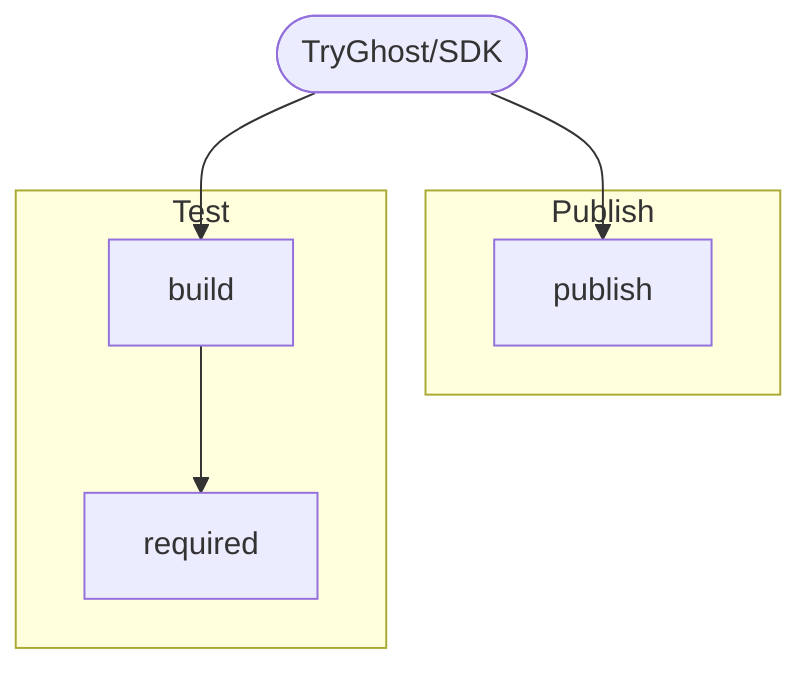

# Repository Architecture Analysis: TryGhost/SDK

## Metadata
- **SHA**: `8d3c1c470472f1a64b694725d511a9a219fe758c`
- **Primary Ecosystem**: JavaScript/TypeScript

## Quality Metrics
- **ast_engine**: tree-sitter
- **avg_cognitive_complexity**: 2.21
- **avg_cyclomatic_complexity**: 2.79
- **component_count**: 16
- **dead_code_count**: 0
- **dead_code_symbols**: 0 entry(ies)
- **duplication_pct**: 89.62
- **file_complexities**: 25 entry(ies)
- **files_analyzed**: 220
- **fitness_passed**: False
- **fitness_violation_count**: 3
- **framework**: React (Vite)
- **import_edges**: 100 entry(ies)
- **loc**: 25480
- **max_cognitive_complexity**: 56
- **max_cyclomatic_complexity**: 55
- **sloc**: 19900
- **test_file_count**: 152

# Architecture: TryGhost/SDK

## Context
- **Repository**: `TryGhost/SDK`
- **SHA**: `8d3c1c470472f1a64b694725d511a9a219fe758c`
- **Ecosystem**: JavaScript/TypeScript
- **Framework**: React (Vite)

## Building Block View

```mermaid
graph TD;
    n_03602c6f_e01b_471b_9fb0_7b6ff7e2d10e["03602c6f-e01b-471b-9fb0-7b6ff7e2d10e : MODULE"]
    _tryghost_admin_api["@tryghost/admin-api : MODULE"]
    _tryghost_color_utils["@tryghost/color-utils : MODULE"]
    _tryghost_config_url_helpers["@tryghost/config-url-helpers : MODULE"]
    _tryghost_content_api["@tryghost/content-api : MODULE"]
    _tryghost_custom_fonts["@tryghost/custom-fonts : MODULE"]
    _tryghost_helpers["@tryghost/helpers : MODULE"]
    _tryghost_helpers_gatsby["@tryghost/helpers-gatsby : MODULE"]
    _tryghost_html_to_plaintext["@tryghost/html-to-plaintext : MODULE"]
    _tryghost_referrer_parser["@tryghost/referrer-parser : MODULE"]
    _tryghost_release_utils["@tryghost/release-utils : MODULE"]
    _tryghost_schema_org["@tryghost/schema-org : MODULE"]
    _tryghost_social_urls["@tryghost/social-urls : MODULE"]
    _tryghost_string["@tryghost/string : MODULE"]
    _tryghost_timezone_data["@tryghost/timezone-data : MODULE"]
    _tryghost_url_utils["@tryghost/url-utils : MODULE"]
    repo_root(["TryGhost/SDK"])
    repo_root --> _tryghost_admin_api
    repo_root --> _tryghost_color_utils
    repo_root --> _tryghost_config_url_helpers
    repo_root --> _tryghost_content_api
    repo_root --> _tryghost_custom_fonts
    repo_root --> _tryghost_helpers
    repo_root --> _tryghost_helpers_gatsby
    repo_root --> _tryghost_html_to_plaintext
    repo_root --> _tryghost_referrer_parser
    repo_root --> _tryghost_release_utils
    repo_root --> _tryghost_schema_org
    repo_root --> _tryghost_social_urls
    repo_root --> _tryghost_string
    repo_root --> _tryghost_timezone_data
    repo_root --> _tryghost_url_utils
    repo_root --> n_03602c6f_e01b_471b_9fb0_7b6ff7e2d10e
```

## Component Details
- **03602c6f-e01b-471b-9fb0-7b6ff7e2d10e** (`package.json`): MODULE
- **@tryghost/admin-api** (`packages/admin-api/package.json`): MODULE
- **@tryghost/color-utils** (`packages/color-utils/package.json`): MODULE
- **@tryghost/config-url-helpers** (`packages/config-url-helpers/package.json`): MODULE
- **@tryghost/content-api** (`packages/content-api/package.json`): MODULE
- **@tryghost/custom-fonts** (`packages/custom-fonts/package.json`): MODULE
- **@tryghost/helpers** (`packages/helpers/package.json`): MODULE
- **@tryghost/helpers-gatsby** (`packages/helpers-gatsby/package.json`): MODULE
- **@tryghost/html-to-plaintext** (`packages/html-to-plaintext/package.json`): MODULE
- **@tryghost/referrer-parser** (`packages/referrer-parser/package.json`): MODULE
- **@tryghost/release-utils** (`packages/release-utils/package.json`): MODULE
- **@tryghost/schema-org** (`packages/schema-org/package.json`): MODULE
- **@tryghost/social-urls** (`packages/social-urls/package.json`): MODULE
- **@tryghost/string** (`packages/string/package.json`): MODULE
- **@tryghost/timezone-data** (`packages/timezone-data/package.json`): MODULE
- **@tryghost/url-utils** (`packages/url-utils/package.json`): MODULE

## 6-Dimension Repository Scorecard

- **Overall Grade**: `C` (71.70/100)
- **Technical Debt Score**: 28.30
- **Estimated Remediation Effort**: 34.50h

| Dimension | Grade | Score | Weight | Details |
| :--- | :---: | :---: | :---: | :--- |
| Code Quality | `F` | 50.00 | 0.20 | avg_cc=2.79, max_cc=55, duplication=89.62%, dead_code=0 |
| Dependency Health | `B` | 85.00 | 0.15 | dependencies=160, outdated=0, vulnerable=0, has_lockfile=False |
| Maintainability | `F` | 52.00 | 0.15 | avg_cognitive=2.21, max_cognitive=56, fitness_violations=3, oversized_files=1 |
| Pipeline Health | `C` | 71.00 | 0.15 | workflows=2, operational_antipatterns=4, parallel_branches=False |
| Security | `A` | 100.00 | 0.20 | vulnerabilities=0, secrets=0, pipeline_security_findings=0 |
| Test Coverage | `C` | 70.00 | 0.15 | coverage=unavailable, ci_test_job=True, test_files_detected=True |

## Architecture Fitness & Workspace Boundaries

- **[MEDIUM] `ATRUSS-ARCH-005` (COMPLEXITY_THRESHOLD)**: Repository duplication_pct (89.62) exceeds policy threshold (15.0).
- **[MEDIUM] `ATRUSS-ARCH-005` (COMPLEXITY_THRESHOLD)**: Repository max_cognitive_complexity (56.0) exceeds policy threshold (25.0).
- **[MEDIUM] `ATRUSS-ARCH-005` (COMPLEXITY_THRESHOLD)**: Repository max_cyclomatic_complexity (55.0) exceeds policy threshold (20.0).

### Workspace Packages
- **@tryghost/admin-api** (`packages/admin-api`, react_ts_js, pnpm)
- **@tryghost/color-utils** (`packages/color-utils`, react_ts_js, pnpm)
- **@tryghost/config-url-helpers** (`packages/config-url-helpers`, react_ts_js, pnpm)
- **@tryghost/content-api** (`packages/content-api`, react_ts_js, pnpm)
- **@tryghost/custom-fonts** (`packages/custom-fonts`, react_ts_js, pnpm)
- **@tryghost/helpers** (`packages/helpers`, react_ts_js, pnpm)
- **@tryghost/helpers-gatsby** (`packages/helpers-gatsby`, react_ts_js, pnpm) -> internal deps: `@tryghost/helpers`
- **@tryghost/html-to-plaintext** (`packages/html-to-plaintext`, react_ts_js, pnpm)
- **@tryghost/referrer-parser** (`packages/referrer-parser`, react_ts_js, pnpm)
- **@tryghost/release-utils** (`packages/release-utils`, react_ts_js, pnpm)
- **@tryghost/schema-org** (`packages/schema-org`, react_ts_js, pnpm)
- **@tryghost/social-urls** (`packages/social-urls`, react_ts_js, pnpm)
- **@tryghost/string** (`packages/string`, react_ts_js, pnpm)
- **@tryghost/timezone-data** (`packages/timezone-data`, react_ts_js, pnpm)
- **@tryghost/url-utils** (`packages/url-utils`, react_ts_js, pnpm) -> internal deps: `@tryghost/config-url-helpers`

## Supply Chain Dependencies, Vulnerabilities & Secrets

- **Dependencies Parsed**: 160 | **Vulnerabilities**: 0 | **Secrets**: 0

### Inventory Sample
- `@babel/cli` `7.29.7` (npm, `packages/helpers-gatsby/package.json`)
- `@babel/core` `7.29.13` (npm, `packages/content-api/package.json`)
- `@babel/core` `7.29.13` (npm, `packages/helpers-gatsby/package.json`)
- `@babel/core` `7.29.13` (npm, `packages/helpers/package.json`)
- `@babel/polyfill` `7.12.1` (npm, `packages/content-api/package.json`)
- `@babel/polyfill` `7.12.1` (npm, `packages/helpers/package.json`)
- `@babel/preset-env` `7.29.7` (npm, `packages/content-api/package.json`)
- `@babel/preset-env` `7.29.7` (npm, `packages/helpers-gatsby/package.json`)
- `@babel/preset-react` `7.29.7` (npm, `packages/helpers-gatsby/package.json`)
- `@eslint/compat` `2.1.1` (npm, `package.json`)
- `@eslint/eslintrc` `3.3.7` (npm, `package.json`)
- `@eslint/js` `9.39.5` (npm, `package.json`)
- `@gatsbyjs/reach-router` `2.0.1` (npm, `packages/helpers-gatsby/package.json`)
- `@nx/js` `24.0.6` (npm, `package.json`)
- `@rollup/plugin-babel` `7.1.0` (npm, `packages/content-api/package.json`)
- `@rollup/plugin-babel` `7.1.0` (npm, `packages/helpers/package.json`)
- `@rollup/plugin-json` `6.1.0` (npm, `packages/content-api/package.json`)
- `@rollup/plugin-node-resolve` `16.0.3` (npm, `packages/color-utils/package.json`)
- `@rollup/plugin-node-resolve` `16.0.3` (npm, `packages/content-api/package.json`)
- `@rollup/plugin-node-resolve` `16.0.3` (npm, `packages/helpers/package.json`)
- `@rollup/plugin-node-resolve` `16.0.3` (npm, `packages/timezone-data/package.json`)
- `@rollup/plugin-terser` `1.0.2` (npm, `packages/color-utils/package.json`)
- `@rollup/plugin-terser` `1.0.2` (npm, `packages/content-api/package.json`)
- `@rollup/plugin-terser` `1.0.2` (npm, `packages/helpers/package.json`)
- `@rollup/plugin-terser` `1.0.2` (npm, `packages/timezone-data/package.json`)
- `@rollup/plugin-typescript` `12.3.1` (npm, `packages/color-utils/package.json`)
- `@rollup/plugin-typescript` `12.3.1` (npm, `packages/timezone-data/package.json`)
- `@tryghost/config-url-helpers` `1.0.32` (npm, `packages/url-utils/package.json`)
- `@tryghost/errors` `3.4.7` (npm, `packages/release-utils/package.json`)
- `@tryghost/helpers` `1.1.111` (npm, `packages/helpers-gatsby/package.json`)
- ... (+130 more dependencies)

## CI/CD Pipeline Topology

