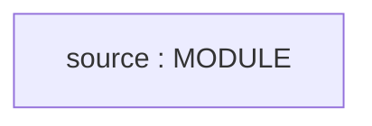
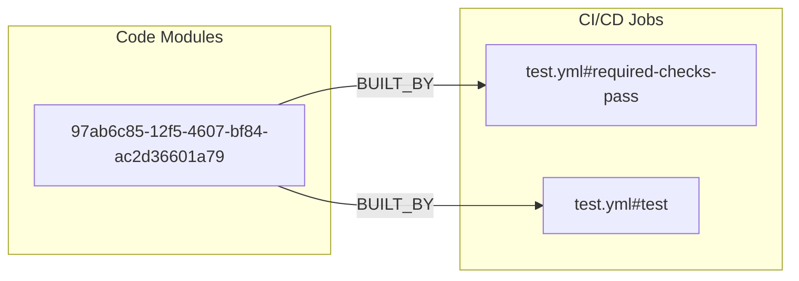
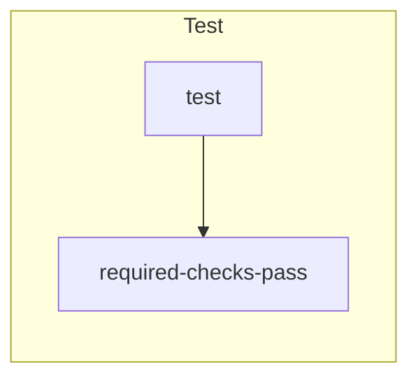

# Repository Architecture Analysis: TryGhost/Source

## Metadata
- **SHA**: `09c51973edca1a5c4dc26356acf2fd810fdd10ce`
- **Primary Ecosystem**: JavaScript/TypeScript

## Quality Metrics
- **ast_engine**: tree-sitter
- **avg_cognitive_complexity**: 16.35
- **avg_cyclomatic_complexity**: 8.9
- **component_count**: 1
- **dead_code_count**: 3
- **dead_code_symbols**: 3 entry(ies)
- **duplication_pct**: 81.33
- **file_complexities**: 10 entry(ies)
- **files_analyzed**: 10
- **fitness_passed**: False
- **fitness_violation_count**: 3
- **framework**: Unknown
- **import_edges**: 100 entry(ies)
- **loc**: 586
- **max_cognitive_complexity**: 1001
- **max_cyclomatic_complexity**: 607
- **sloc**: 457

# Architecture: TryGhost/Source

## Context
- **Repository**: `TryGhost/Source`
- **SHA**: `09c51973edca1a5c4dc26356acf2fd810fdd10ce`
- **Ecosystem**: JavaScript/TypeScript
- **Framework**: Unknown

## Building Block View

## Component Details
- **source** (`package.json`): MODULE

## 6-Dimension Repository Scorecard

- **Overall Grade**: `D` (66.23/100)
- **Technical Debt Score**: 33.77
- **Estimated Remediation Effort**: 30.96h

| Dimension | Grade | Score | Weight | Details |
| :--- | :---: | :---: | :---: | :--- |
| Code Quality | `F` | 20.40 | 0.20 | avg_cc=8.90, max_cc=607, duplication=81.33%, dead_code=3 |
| Dependency Health | `B` | 85.00 | 0.15 | dependencies=16, outdated=0, vulnerable=0, has_lockfile=False |
| Maintainability | `F` | 32.00 | 0.15 | avg_cognitive=16.35, max_cognitive=1001, fitness_violations=3, oversized_files=0 |
| Pipeline Health | `A` | 94.00 | 0.15 | workflows=1, operational_antipatterns=2, parallel_branches=False |
| Security | `A` | 100.00 | 0.20 | vulnerabilities=0, secrets=0, pipeline_security_findings=0 |
| Test Coverage | `C` | 70.00 | 0.15 | coverage=unavailable, ci_test_job=True, test_files_detected=False |

## Architecture Fitness & Workspace Boundaries

- **[MEDIUM] `ATRUSS-ARCH-005` (COMPLEXITY_THRESHOLD)**: Repository duplication_pct (81.33) exceeds policy threshold (15.0).
- **[MEDIUM] `ATRUSS-ARCH-005` (COMPLEXITY_THRESHOLD)**: Repository max_cognitive_complexity (1001.0) exceeds policy threshold (25.0).
- **[MEDIUM] `ATRUSS-ARCH-005` (COMPLEXITY_THRESHOLD)**: Repository max_cyclomatic_complexity (607.0) exceeds policy threshold (20.0).

## Supply Chain Dependencies, Vulnerabilities & Secrets

- **Dependencies Parsed**: 16 | **Vulnerabilities**: 0 | **Secrets**: 0

### Inventory Sample
- `@tryghost/release-utils` `0.9.4` (npm, `package.json`)
- `@tryghost/theme-translations` `0.0.22` (npm, `package.json`)
- `autoprefixer` `10.6.2` (npm, `package.json`)
- `beeper` `2.1.0` (npm, `package.json`)
- `cssnano` `9.9.0` (npm, `package.json`)
- `gscan` `6.7.0` (npm, `package.json`)
- `gulp` `5.0.1` (npm, `package.json`)
- `gulp-concat` `2.6.1` (npm, `package.json`)
- `gulp-livereload` `4.0.2` (npm, `package.json`)
- `gulp-postcss` `10.0.0` (npm, `package.json`)
- `gulp-uglify` `3.0.2` (npm, `package.json`)
- `gulp-zip` `6.1.0` (npm, `package.json`)
- `inquirer` `14.3.0` (npm, `package.json`)
- `postcss` `8.5.32` (npm, `package.json`)
- `postcss-easy-import` `4.0.0` (npm, `package.json`)
- `pump` `3.0.4` (npm, `package.json`)

## Section 7: Code-to-Cloud Deployment Traceability

- `97ab6c85-12f5-4607-bf84-ac2d36601a79` (code_module) --[BUILT_BY]--> `test.yml#required-checks-pass` (ci_job)
- `97ab6c85-12f5-4607-bf84-ac2d36601a79` (code_module) --[BUILT_BY]--> `test.yml#test` (ci_job)

## CI/CD Pipeline Topology

