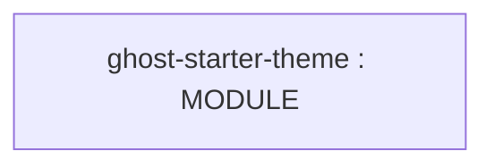
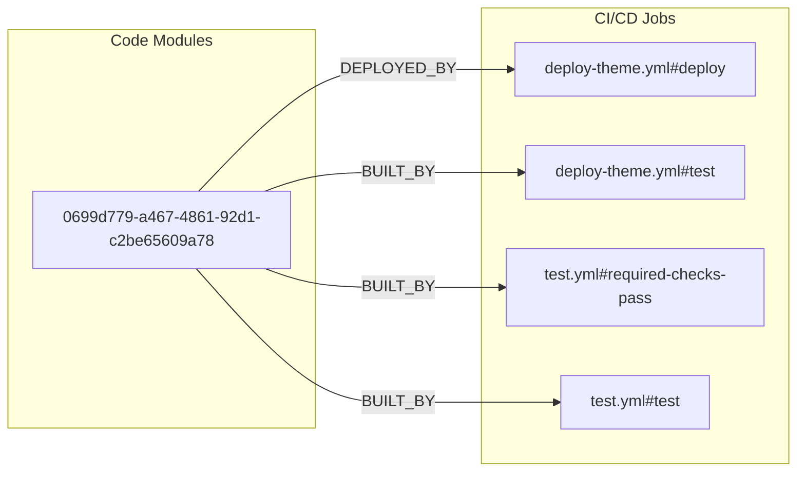
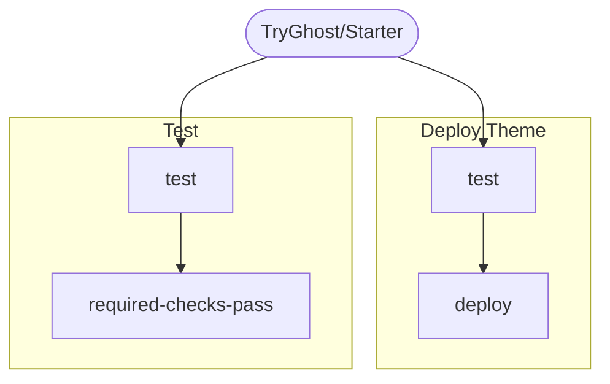

# Repository Architecture Analysis: TryGhost/Starter

## Metadata
- **SHA**: `ee2e9b8c7d4745809f973dbb87df644604111ab1`
- **Primary Ecosystem**: JavaScript/TypeScript

## Quality Metrics
- **ast_engine**: tree-sitter
- **avg_cognitive_complexity**: 4.33
- **avg_cyclomatic_complexity**: 3.71
- **component_count**: 1
- **dead_code_count**: 0
- **dead_code_symbols**: 0 entry(ies)
- **duplication_pct**: 38.68
- **file_complexities**: 5 entry(ies)
- **files_analyzed**: 5
- **fitness_passed**: False
- **fitness_violation_count**: 1
- **framework**: Unknown
- **import_edges**: 13 entry(ies)
- **loc**: 144
- **max_cognitive_complexity**: 17
- **max_cyclomatic_complexity**: 8
- **sloc**: 100

# Architecture: TryGhost/Starter

## Context
- **Repository**: `TryGhost/Starter`
- **SHA**: `ee2e9b8c7d4745809f973dbb87df644604111ab1`
- **Ecosystem**: JavaScript/TypeScript
- **Framework**: Unknown

## Building Block View

## Component Details
- **ghost-starter-theme** (`package.json`): MODULE

## 6-Dimension Repository Scorecard

- **Overall Grade**: `B` (84.08/100)
- **Technical Debt Score**: 15.92
- **Estimated Remediation Effort**: 16.22h

| Dimension | Grade | Score | Weight | Details |
| :--- | :---: | :---: | :---: | :--- |
| Code Quality | `C` | 72.16 | 0.20 | avg_cc=3.71, max_cc=8, duplication=38.68%, dead_code=0 |
| Dependency Health | `B` | 85.00 | 0.15 | dependencies=14, outdated=0, vulnerable=0, has_lockfile=False |
| Maintainability | `A` | 94.00 | 0.15 | avg_cognitive=4.33, max_cognitive=17, fitness_violations=1, oversized_files=0 |
| Pipeline Health | `B` | 82.00 | 0.15 | workflows=2, operational_antipatterns=5, parallel_branches=False |
| Security | `A` | 100.00 | 0.20 | vulnerabilities=0, secrets=0, pipeline_security_findings=0 |
| Test Coverage | `C` | 70.00 | 0.15 | coverage=unavailable, ci_test_job=True, test_files_detected=False |

## Architecture Fitness & Workspace Boundaries

- **[MEDIUM] `ATRUSS-ARCH-005` (COMPLEXITY_THRESHOLD)**: Repository duplication_pct (38.68) exceeds policy threshold (15.0).

## Supply Chain Dependencies, Vulnerabilities & Secrets

- **Dependencies Parsed**: 14 | **Vulnerabilities**: 0 | **Secrets**: 0

### Inventory Sample
- `@babel/core` `8.1.2` (npm, `package.json`)
- `@babel/preset-env` `8.0.7` (npm, `package.json`)
- `@rollup/plugin-babel` `7.1.0` (npm, `package.json`)
- `@rollup/plugin-commonjs` `29.0.3` (npm, `package.json`)
- `@rollup/plugin-node-resolve` `16.0.3` (npm, `package.json`)
- `@rollup/plugin-terser` `1.0.2` (npm, `package.json`)
- `bestzip` `4.0.3` (npm, `package.json`)
- `gscan` `6.7.0` (npm, `package.json`)
- `postcss` `8.5.32` (npm, `package.json`)
- `postcss-import` `17.0.1` (npm, `package.json`)
- `postcss-preset-env` `11.6.2` (npm, `package.json`)
- `rollup` `4.68.2` (npm, `package.json`)
- `rollup-plugin-livereload` `2.0.5` (npm, `package.json`)
- `rollup-plugin-postcss` `4.0.2` (npm, `package.json`)

## Section 7: Code-to-Cloud Deployment Traceability

- `0699d779-a467-4861-92d1-c2be65609a78` (code_module) --[BUILT_BY]--> `deploy-theme.yml#test` (ci_job)
- `0699d779-a467-4861-92d1-c2be65609a78` (code_module) --[BUILT_BY]--> `test.yml#required-checks-pass` (ci_job)
- `0699d779-a467-4861-92d1-c2be65609a78` (code_module) --[BUILT_BY]--> `test.yml#test` (ci_job)
- `0699d779-a467-4861-92d1-c2be65609a78` (code_module) --[DEPLOYED_BY]--> `deploy-theme.yml#deploy` (ci_job)

## CI/CD Pipeline Topology

