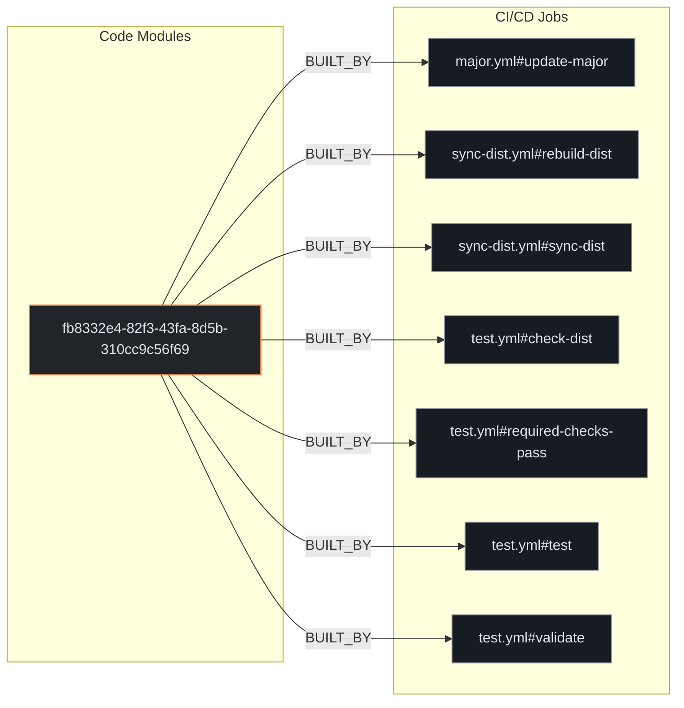
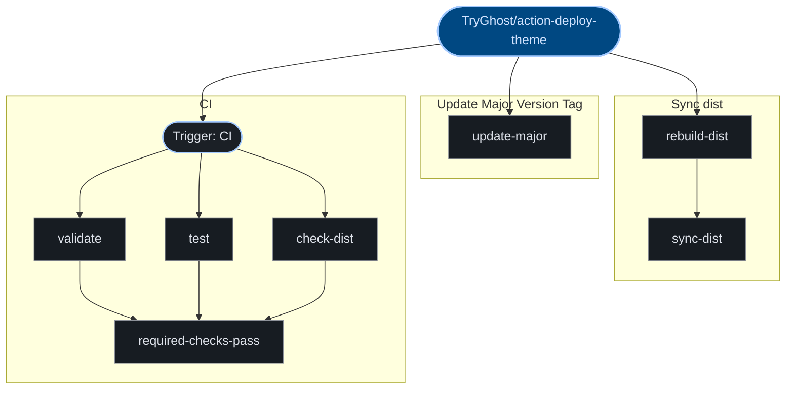

# Repository Architecture Analysis: TryGhost/action-deploy-theme

## Metadata
- **SHA**: `89f9b471c2f4fd894363a9af01d9f92a84ca79c0`
- **Primary Ecosystem**: JavaScript/TypeScript

## Quality Metrics
- **ast_engine**: tree-sitter
- **avg_cognitive_complexity**: 3.14
- **avg_cyclomatic_complexity**: 4.29
- **component_count**: 1
- **dead_code_count**: 0
- **dead_code_symbols**: 0 entry(ies)
- **duplication_pct**: 77.67
- **file_complexities**: 8 entry(ies)
- **files_analyzed**: 8
- **fitness_passed**: False
- **fitness_violation_count**: 1
- **framework**: TypeScript
- **import_edges**: 40 entry(ies)
- **loc**: 937
- **max_cognitive_complexity**: 17
- **max_cyclomatic_complexity**: 12
- **sloc**: 795
- **test_file_count**: 4

# Architecture: TryGhost/action-deploy-theme

## Context
- **Repository**: `TryGhost/action-deploy-theme`
- **SHA**: `89f9b471c2f4fd894363a9af01d9f92a84ca79c0`
- **Ecosystem**: JavaScript/TypeScript
- **Framework**: TypeScript

## Building Block View

## Component Details
- **action-deploy-theme** (`package.json`): MODULE

## 6-Dimension Repository Scorecard

- **Overall Grade**: `B` (86.32/100)
- **Technical Debt Score**: 13.68
- **Estimated Remediation Effort**: 20.95h

| Dimension | Grade | Score | Weight | Details |
| :--- | :---: | :---: | :---: | :--- |
| Code Quality | `D` | 69.84 | 0.20 | avg_cc=4.29, max_cc=12, duplication=77.67%, dead_code=0 |
| Dependency Health | `B` | 85.00 | 0.15 | dependencies=13, outdated=0, vulnerable=0, has_lockfile=False |
| Maintainability | `A` | 94.00 | 0.15 | avg_cognitive=3.14, max_cognitive=17, fitness_violations=1, oversized_files=0 |
| Pipeline Health | `A` | 100.00 | 0.15 | workflows=3, operational_antipatterns=1, parallel_branches=True |
| Security | `A` | 100.00 | 0.20 | vulnerabilities=0, secrets=0, pipeline_security_findings=0 |
| Test Coverage | `C` | 70.00 | 0.15 | coverage=unavailable, ci_test_job=True, test_files_detected=True |

## Architecture Fitness & Workspace Boundaries

- **[MEDIUM] `ATRUSS-ARCH-005` (COMPLEXITY_THRESHOLD)**: Repository duplication_pct (77.67) exceeds policy threshold (15.0).

## Supply Chain Dependencies, Vulnerabilities & Secrets

- **Dependencies Parsed**: 13 | **Vulnerabilities**: 0 | **Secrets**: 0

### Inventory Sample
- `@actions/core` `3.0.1` (npm, `package.json`)
- `@actions/exec` `3.0.0` (npm, `package.json`)
- `@tryghost/admin-api` `1.14.14` (npm, `package.json`)
- `@tryghost/pro-ship` `2.0.1` (npm, `package.json`)
- `@types/node` `26.6.6` (npm, `package.json`)
- `@types/slug` `5.0.9` (npm, `package.json`)
- `@vercel/ncc` `0.45.0` (npm, `package.json`)
- `@vitest/coverage-v8` `5.1.0` (npm, `package.json`)
- `oxfmt` `0.78.0` (npm, `package.json`)
- `oxlint` `1.93.0` (npm, `package.json`)
- `slug` `12.0.1` (npm, `package.json`)
- `typescript` `7.0.2` (npm, `package.json`)
- `vitest` `5.1.0` (npm, `package.json`)

## Section 7: Code-to-Cloud Deployment Traceability

- `fb8332e4-82f3-43fa-8d5b-310cc9c56f69` (code_module) --[BUILT_BY]--> `major.yml#update-major` (ci_job)
- `fb8332e4-82f3-43fa-8d5b-310cc9c56f69` (code_module) --[BUILT_BY]--> `sync-dist.yml#rebuild-dist` (ci_job)
- `fb8332e4-82f3-43fa-8d5b-310cc9c56f69` (code_module) --[BUILT_BY]--> `sync-dist.yml#sync-dist` (ci_job)
- `fb8332e4-82f3-43fa-8d5b-310cc9c56f69` (code_module) --[BUILT_BY]--> `test.yml#check-dist` (ci_job)
- `fb8332e4-82f3-43fa-8d5b-310cc9c56f69` (code_module) --[BUILT_BY]--> `test.yml#required-checks-pass` (ci_job)
- `fb8332e4-82f3-43fa-8d5b-310cc9c56f69` (code_module) --[BUILT_BY]--> `test.yml#test` (ci_job)
- `fb8332e4-82f3-43fa-8d5b-310cc9c56f69` (code_module) --[BUILT_BY]--> `test.yml#validate` (ci_job)

## CI/CD Pipeline Topology

