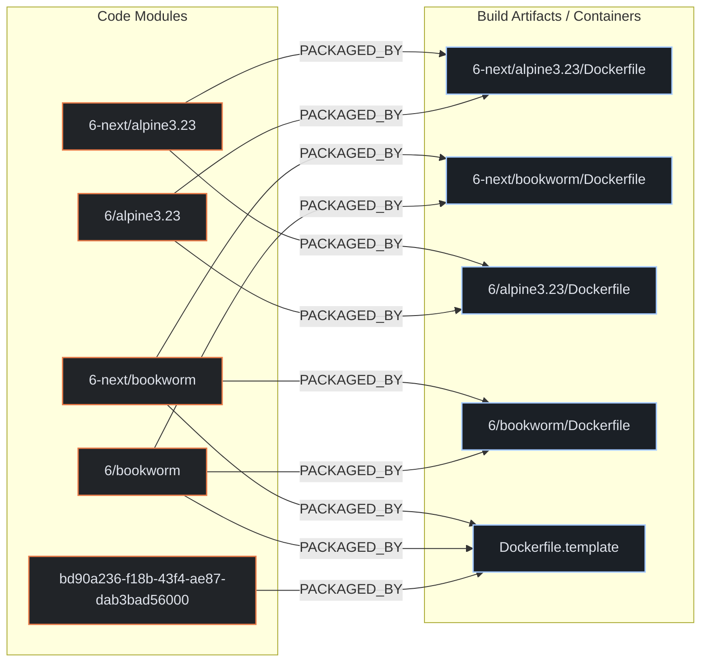
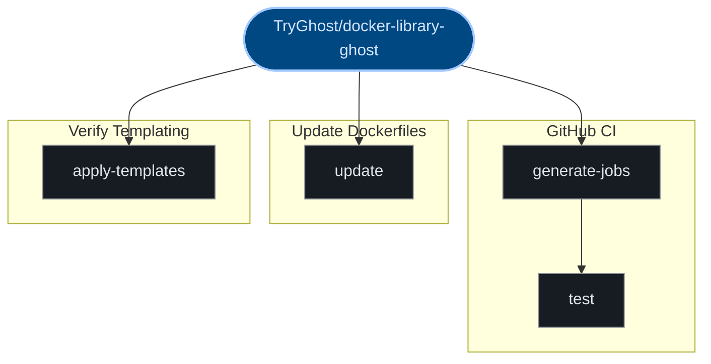

# Repository Architecture Analysis: TryGhost/docker-library-ghost

## Metadata
- **SHA**: `a235302a801ceac861ca6944ebce03995f27d0dd`
- **Primary Ecosystem**: Container / Helm / IaC

## Quality Metrics
- **ast_engine**: fallback
- **avg_cognitive_complexity**: 0.0
- **avg_cyclomatic_complexity**: 0.0
- **component_count**: 4
- **dead_code_count**: 0
- **dead_code_symbols**: 0 entry(ies)
- **duplication_pct**: 0.0
- **file_complexities**: 0 entry(ies)
- **files_analyzed**: 4
- **fitness_passed**: True
- **fitness_violation_count**: 0
- **framework**: Container
- **import_edges**: 0 entry(ies)
- **loc**: 391
- **max_cognitive_complexity**: 0
- **max_cyclomatic_complexity**: 0
- **sloc**: 313

# Architecture: TryGhost/docker-library-ghost

## Context
- **Repository**: `TryGhost/docker-library-ghost`
- **SHA**: `a235302a801ceac861ca6944ebce03995f27d0dd`
- **Ecosystem**: Container / Helm / IaC
- **Framework**: Container

## Building Block View

## Component Details
- **action** (`.github/actions/bashbrew/action.yml`): module
- **ci** (`.github/workflows/ci.yml`): module
- **update** (`.github/workflows/update.yml`): module
- **verify-templating** (`.github/workflows/verify-templating.yml`): module

## 6-Dimension Repository Scorecard

- **Overall Grade**: `A` (92.20/100)
- **Technical Debt Score**: 7.80
- **Estimated Remediation Effort**: 3.95h

| Dimension | Grade | Score | Weight | Details |
| :--- | :---: | :---: | :---: | :--- |
| Code Quality | `A` | 100.00 | 0.20 | avg_cc=0.00, max_cc=0, duplication=0.00%, dead_code=0 |
| Dependency Health | `A` | 90.00 | 0.15 | dependencies=0 (no manifests parsed) |
| Maintainability | `A` | 100.00 | 0.15 | avg_cognitive=0.00, max_cognitive=0, fitness_violations=0, oversized_files=0 |
| Pipeline Health | `B` | 88.00 | 0.15 | workflows=3, operational_antipatterns=4, parallel_branches=False |
| Security | `A` | 100.00 | 0.20 | vulnerabilities=0, secrets=0, pipeline_security_findings=0 |
| Test Coverage | `C` | 70.00 | 0.15 | coverage=unavailable, ci_test_job=True, test_files_detected=False |

## Section 7: Code-to-Cloud Deployment Traceability

- `6-next/alpine3.23` (code_module) --[PACKAGED_BY]--> `6-next/alpine3.23/Dockerfile` (container)
- `6-next/alpine3.23` (code_module) --[PACKAGED_BY]--> `6/alpine3.23/Dockerfile` (container)
- `6-next/bookworm` (code_module) --[PACKAGED_BY]--> `6-next/bookworm/Dockerfile` (container)
- `6-next/bookworm` (code_module) --[PACKAGED_BY]--> `6/bookworm/Dockerfile` (container)
- `6-next/bookworm` (code_module) --[PACKAGED_BY]--> `Dockerfile.template` (container)
- `6/alpine3.23` (code_module) --[PACKAGED_BY]--> `6-next/alpine3.23/Dockerfile` (container)
- `6/alpine3.23` (code_module) --[PACKAGED_BY]--> `6/alpine3.23/Dockerfile` (container)
- `6/bookworm` (code_module) --[PACKAGED_BY]--> `6-next/bookworm/Dockerfile` (container)
- `6/bookworm` (code_module) --[PACKAGED_BY]--> `6/bookworm/Dockerfile` (container)
- `6/bookworm` (code_module) --[PACKAGED_BY]--> `Dockerfile.template` (container)
- `bd90a236-f18b-43f4-ae87-dab3bad56000` (code_module) --[PACKAGED_BY]--> `Dockerfile.template` (container)

## CI/CD Pipeline Topology

