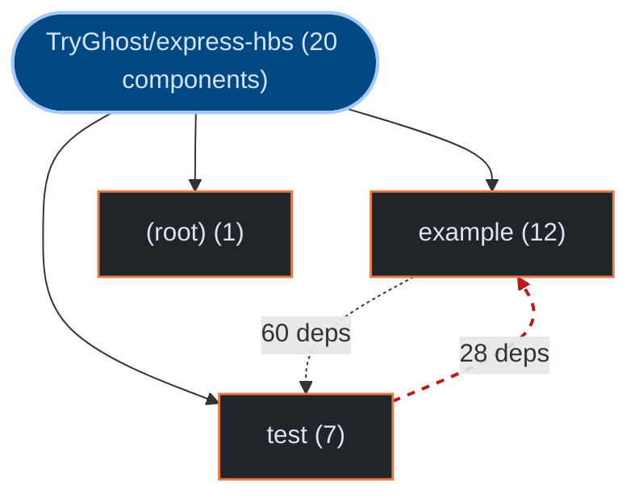
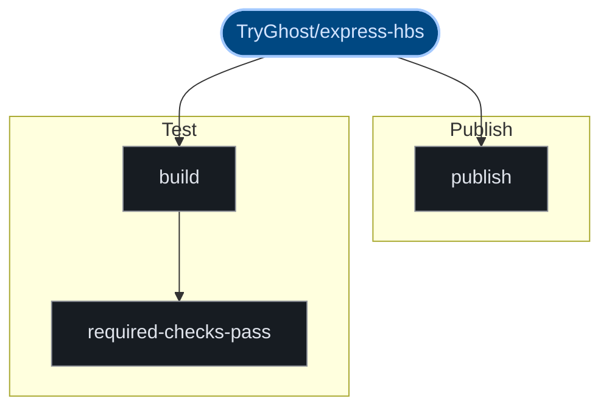

# Repository Architecture Analysis: TryGhost/express-hbs

## Metadata
- **SHA**: `50e1e7018dda89a35874bc598dd6a1358882fa61`
- **Primary Ecosystem**: JavaScript/TypeScript

## Quality Metrics
- **ast_engine**: tree-sitter
- **avg_cognitive_complexity**: 2.24
- **avg_cyclomatic_complexity**: 2.2
- **component_count**: 20
- **dead_code_count**: 0
- **dead_code_symbols**: 0 entry(ies)
- **duplication_pct**: 74.21
- **file_complexities**: 24 entry(ies)
- **files_analyzed**: 24
- **fitness_passed**: False
- **fitness_violation_count**: 52
- **framework**: Express / Node API
- **import_edges**: 100 entry(ies)
- **loc**: 3217
- **max_cognitive_complexity**: 29
- **max_cyclomatic_complexity**: 10
- **sloc**: 2481
- **test_file_count**: 95

# Architecture: TryGhost/express-hbs

## Context
- **Repository**: `TryGhost/express-hbs`
- **SHA**: `50e1e7018dda89a35874bc598dd6a1358882fa61`
- **Ecosystem**: JavaScript/TypeScript
- **Framework**: Express / Node API

## Building Block View

## Component Details
- **express-hbs** (`package.json`): MODULE
- **GET_root** (`example/app-layoutsDir.js`): API_ROUTE (deps: GET_collide, GET_error, GET_fail, GET_fruits, GET_fruits_:name, GET_replace, GET_test1, GET_test2, GET_veggies, GET_veggies_:name)
- **GET_fruits** (`example/app-layoutsDir.js`): API_ROUTE (deps: GET_collide, GET_error, GET_fail, GET_fruits_:name, GET_replace, GET_root, GET_test1, GET_test2, GET_veggies, GET_veggies_:name)
- **GET_fruits_:name** (`example/app-layoutsDir.js`): API_ROUTE (deps: GET_collide, GET_error, GET_fail, GET_fruits, GET_replace, GET_root, GET_test1, GET_test2, GET_veggies, GET_veggies_:name)
- **GET_veggies** (`example/app-layoutsDir.js`): API_ROUTE (deps: GET_collide, GET_error, GET_fail, GET_fruits, GET_fruits_:name, GET_replace, GET_root, GET_test1, GET_test2, GET_veggies_:name)
- **GET_veggies_explicit-dir** (`example/app-layoutsDir.js`): API_ROUTE (deps: GET_collide, GET_error, GET_fail, GET_fruits, GET_fruits_:name, GET_replace, GET_root, GET_test1, GET_test2, GET_veggies, GET_veggies_:name)
- **GET_veggies_:name** (`example/app-layoutsDir.js`): API_ROUTE (deps: GET_collide, GET_error, GET_fail, GET_fruits, GET_fruits_:name, GET_replace, GET_root, GET_test1, GET_test2, GET_veggies)
- **GET_root** (`example/app.js`): API_ROUTE (deps: GET_collide, GET_error, GET_fail, GET_fruits, GET_fruits_:name, GET_test1, GET_test2, GET_veggies, GET_veggies_:name, GET_veggies_explicit-dir)
- **GET_replace** (`example/app.js`): API_ROUTE (deps: GET_collide, GET_error, GET_fail, GET_fruits, GET_fruits_:name, GET_root, GET_test1, GET_test2, GET_veggies, GET_veggies_:name, GET_veggies_explicit-dir)
- **GET_fruits** (`example/app.js`): API_ROUTE (deps: GET_collide, GET_error, GET_fail, GET_fruits_:name, GET_root, GET_test1, GET_test2, GET_veggies, GET_veggies_:name, GET_veggies_explicit-dir)
- **GET_fruits_:name** (`example/app.js`): API_ROUTE (deps: GET_collide, GET_error, GET_fail, GET_fruits, GET_root, GET_test1, GET_test2, GET_veggies, GET_veggies_:name, GET_veggies_explicit-dir)
- **GET_veggies** (`example/app.js`): API_ROUTE (deps: GET_collide, GET_error, GET_fail, GET_fruits, GET_fruits_:name, GET_root, GET_test1, GET_test2, GET_veggies_:name, GET_veggies_explicit-dir)
- **GET_veggies_:name** (`example/app.js`): API_ROUTE (deps: GET_collide, GET_error, GET_fail, GET_fruits, GET_fruits_:name, GET_root, GET_test1, GET_test2, GET_veggies, GET_veggies_explicit-dir)
- **GET_test1** (`test/multiple.js`): API_ROUTE (deps: GET_fail, GET_fruits, GET_fruits_:name, GET_replace, GET_root, GET_veggies, GET_veggies_:name, GET_veggies_explicit-dir)
- **GET_test2** (`test/multiple.js`): API_ROUTE (deps: GET_fail, GET_fruits, GET_fruits_:name, GET_replace, GET_root, GET_veggies, GET_veggies_:name, GET_veggies_explicit-dir)
- **GET_collide** (`test/multiple.js`): API_ROUTE (deps: GET_fail, GET_fruits, GET_fruits_:name, GET_replace, GET_root, GET_veggies, GET_veggies_:name, GET_veggies_explicit-dir)
- **GET_error** (`test/multiple.js`): API_ROUTE (deps: GET_fail, GET_fruits, GET_fruits_:name, GET_replace, GET_root, GET_veggies, GET_veggies_:name, GET_veggies_explicit-dir)
- **GET_root** (`test/apps/async/index.js`): API_ROUTE
- **GET_fail** (`test/apps/async/index.js`): API_ROUTE
- **GET_root** (`test/apps/i18n/index.js`): API_ROUTE

## 6-Dimension Repository Scorecard

- **Overall Grade**: `D` (68.90/100)
- **Technical Debt Score**: 31.10
- **Estimated Remediation Effort**: 155.62h

| Dimension | Grade | Score | Weight | Details |
| :--- | :---: | :---: | :---: | :--- |
| Code Quality | `C` | 75.00 | 0.20 | avg_cc=2.20, max_cc=10, duplication=74.21%, dead_code=0 |
| Dependency Health | `B` | 85.00 | 0.15 | dependencies=16, outdated=0, vulnerable=0, has_lockfile=False |
| Maintainability | `F` | 0.00 | 0.15 | avg_cognitive=2.24, max_cognitive=29, fitness_violations=52, oversized_files=1 |
| Pipeline Health | `C` | 71.00 | 0.15 | workflows=2, operational_antipatterns=3, parallel_branches=False |
| Security | `A` | 100.00 | 0.20 | vulnerabilities=0, secrets=0, pipeline_security_findings=0 |
| Test Coverage | `C` | 70.00 | 0.15 | coverage=unavailable, ci_test_job=True, test_files_detected=True |

## Architecture Fitness & Workspace Boundaries

- **[HIGH] `ATRUSS-ARCH-004` (CIRCULAR_DEPENDENCY)**: Circular dependency detected between architectural components. (GET_collide -> GET_fruits -> GET_collide)
- **[HIGH] `ATRUSS-ARCH-004` (CIRCULAR_DEPENDENCY)**: Circular dependency detected between architectural components. (GET_collide -> GET_fruits -> GET_error -> GET_fruits_:name -> GET_collide)
- **[HIGH] `ATRUSS-ARCH-004` (CIRCULAR_DEPENDENCY)**: Circular dependency detected between architectural components. (GET_collide -> GET_fruits -> GET_error -> GET_fruits_:name -> GET_replace -> GET_collide)
- **[HIGH] `ATRUSS-ARCH-004` (CIRCULAR_DEPENDENCY)**: Circular dependency detected between architectural components. (GET_collide -> GET_fruits -> GET_error -> GET_fruits_:name -> GET_replace -> GET_root -> GET_collide)
- **[HIGH] `ATRUSS-ARCH-004` (CIRCULAR_DEPENDENCY)**: Circular dependency detected between architectural components. (GET_collide -> GET_fruits -> GET_error -> GET_fruits_:name -> GET_replace -> GET_root -> GET_test1 -> GET_veggies -> GET_collide)
- **[HIGH] `ATRUSS-ARCH-004` (CIRCULAR_DEPENDENCY)**: Circular dependency detected between architectural components. (GET_collide -> GET_fruits -> GET_error -> GET_fruits_:name -> GET_replace -> GET_root -> GET_test1 -> GET_veggies -> GET_test2 -> GET_veggies_:name -> GET_collide)
- **[HIGH] `ATRUSS-ARCH-004` (CIRCULAR_DEPENDENCY)**: Circular dependency detected between architectural components. (GET_collide -> GET_fruits -> GET_error -> GET_fruits_:name -> GET_replace -> GET_root -> GET_test1 -> GET_veggies -> GET_test2 -> GET_veggies_:name -> GET_veggies_explicit-dir -> GET_collide)
- **[HIGH] `ATRUSS-ARCH-004` (CIRCULAR_DEPENDENCY)**: Circular dependency detected between architectural components. (GET_collide -> GET_fruits -> GET_error -> GET_fruits_:name -> GET_replace -> GET_root -> GET_test1 -> GET_veggies -> GET_test2 -> GET_veggies_explicit-dir -> GET_collide)
- **[HIGH] `ATRUSS-ARCH-004` (CIRCULAR_DEPENDENCY)**: Circular dependency detected between architectural components. (GET_collide -> GET_fruits -> GET_error -> GET_fruits_:name -> GET_replace -> GET_root -> GET_test1 -> GET_veggies -> GET_test2 -> GET_veggies_explicit-dir -> GET_veggies_:name -> GET_collide)
- **[HIGH] `ATRUSS-ARCH-004` (CIRCULAR_DEPENDENCY)**: Circular dependency detected between architectural components. (GET_collide -> GET_fruits -> GET_error -> GET_fruits_:name -> GET_replace -> GET_root -> GET_test1 -> GET_veggies -> GET_veggies_:name -> GET_collide)
- **[HIGH] `ATRUSS-ARCH-004` (CIRCULAR_DEPENDENCY)**: Circular dependency detected between architectural components. (GET_collide -> GET_fruits -> GET_error -> GET_fruits_:name -> GET_replace -> GET_root -> GET_test1 -> GET_veggies -> GET_veggies_:name -> GET_test2 -> GET_veggies_explicit-dir -> GET_collide)
- **[HIGH] `ATRUSS-ARCH-004` (CIRCULAR_DEPENDENCY)**: Circular dependency detected between architectural components. (GET_collide -> GET_fruits -> GET_error -> GET_fruits_:name -> GET_replace -> GET_root -> GET_test1 -> GET_veggies -> GET_veggies_:name -> GET_veggies_explicit-dir -> GET_collide)
- **[HIGH] `ATRUSS-ARCH-004` (CIRCULAR_DEPENDENCY)**: Circular dependency detected between architectural components. (GET_collide -> GET_fruits -> GET_error -> GET_fruits_:name -> GET_replace -> GET_root -> GET_test1 -> GET_veggies -> GET_veggies_explicit-dir -> GET_collide)
- **[HIGH] `ATRUSS-ARCH-004` (CIRCULAR_DEPENDENCY)**: Circular dependency detected between architectural components. (GET_collide -> GET_fruits -> GET_error -> GET_fruits_:name -> GET_replace -> GET_root -> GET_test1 -> GET_veggies -> GET_veggies_explicit-dir -> GET_test2 -> GET_veggies_:name -> GET_collide)
- **[HIGH] `ATRUSS-ARCH-004` (CIRCULAR_DEPENDENCY)**: Circular dependency detected between architectural components. (GET_collide -> GET_fruits -> GET_error -> GET_fruits_:name -> GET_replace -> GET_root -> GET_test1 -> GET_veggies -> GET_veggies_explicit-dir -> GET_veggies_:name -> GET_collide)
- **[HIGH] `ATRUSS-ARCH-004` (CIRCULAR_DEPENDENCY)**: Circular dependency detected between architectural components. (GET_collide -> GET_fruits -> GET_error -> GET_fruits_:name -> GET_replace -> GET_root -> GET_test1 -> GET_veggies_:name -> GET_collide)
- **[HIGH] `ATRUSS-ARCH-004` (CIRCULAR_DEPENDENCY)**: Circular dependency detected between architectural components. (GET_collide -> GET_fruits -> GET_error -> GET_fruits_:name -> GET_replace -> GET_root -> GET_test1 -> GET_veggies_:name -> GET_test2 -> GET_veggies -> GET_collide)
- **[HIGH] `ATRUSS-ARCH-004` (CIRCULAR_DEPENDENCY)**: Circular dependency detected between architectural components. (GET_collide -> GET_fruits -> GET_error -> GET_fruits_:name -> GET_replace -> GET_root -> GET_test1 -> GET_veggies_:name -> GET_test2 -> GET_veggies -> GET_veggies_explicit-dir -> GET_collide)
- **[HIGH] `ATRUSS-ARCH-004` (CIRCULAR_DEPENDENCY)**: Circular dependency detected between architectural components. (GET_collide -> GET_fruits -> GET_error -> GET_fruits_:name -> GET_replace -> GET_root -> GET_test1 -> GET_veggies_:name -> GET_test2 -> GET_veggies_explicit-dir -> GET_collide)
- **[HIGH] `ATRUSS-ARCH-004` (CIRCULAR_DEPENDENCY)**: Circular dependency detected between architectural components. (GET_collide -> GET_fruits -> GET_error -> GET_fruits_:name -> GET_replace -> GET_root -> GET_test1 -> GET_veggies_:name -> GET_test2 -> GET_veggies_explicit-dir -> GET_veggies -> GET_collide)
- **[HIGH] `ATRUSS-ARCH-004` (CIRCULAR_DEPENDENCY)**: Circular dependency detected between architectural components. (GET_collide -> GET_fruits -> GET_error -> GET_fruits_:name -> GET_replace -> GET_root -> GET_test1 -> GET_veggies_:name -> GET_veggies -> GET_collide)
- **[HIGH] `ATRUSS-ARCH-004` (CIRCULAR_DEPENDENCY)**: Circular dependency detected between architectural components. (GET_collide -> GET_fruits -> GET_error -> GET_fruits_:name -> GET_replace -> GET_root -> GET_test1 -> GET_veggies_:name -> GET_veggies -> GET_test2 -> GET_veggies_explicit-dir -> GET_collide)
- **[HIGH] `ATRUSS-ARCH-004` (CIRCULAR_DEPENDENCY)**: Circular dependency detected between architectural components. (GET_collide -> GET_fruits -> GET_error -> GET_fruits_:name -> GET_replace -> GET_root -> GET_test1 -> GET_veggies_:name -> GET_veggies -> GET_veggies_explicit-dir -> GET_collide)
- **[HIGH] `ATRUSS-ARCH-004` (CIRCULAR_DEPENDENCY)**: Circular dependency detected between architectural components. (GET_collide -> GET_fruits -> GET_error -> GET_fruits_:name -> GET_replace -> GET_root -> GET_test1 -> GET_veggies_:name -> GET_veggies_explicit-dir -> GET_collide)
- **[HIGH] `ATRUSS-ARCH-004` (CIRCULAR_DEPENDENCY)**: Circular dependency detected between architectural components. (GET_collide -> GET_fruits -> GET_error -> GET_fruits_:name -> GET_replace -> GET_root -> GET_test1 -> GET_veggies_:name -> GET_veggies_explicit-dir -> GET_test2 -> GET_veggies -> GET_collide)
- **[HIGH] `ATRUSS-ARCH-004` (CIRCULAR_DEPENDENCY)**: Circular dependency detected between architectural components. (GET_collide -> GET_fruits -> GET_error -> GET_fruits_:name -> GET_replace -> GET_root -> GET_test1 -> GET_veggies_:name -> GET_veggies_explicit-dir -> GET_veggies -> GET_collide)
- **[HIGH] `ATRUSS-ARCH-004` (CIRCULAR_DEPENDENCY)**: Circular dependency detected between architectural components. (GET_collide -> GET_fruits -> GET_error -> GET_fruits_:name -> GET_replace -> GET_root -> GET_test1 -> GET_veggies_explicit-dir -> GET_collide)
- **[HIGH] `ATRUSS-ARCH-004` (CIRCULAR_DEPENDENCY)**: Circular dependency detected between architectural components. (GET_collide -> GET_fruits -> GET_error -> GET_fruits_:name -> GET_replace -> GET_root -> GET_test1 -> GET_veggies_explicit-dir -> GET_test2 -> GET_veggies -> GET_collide)
- **[HIGH] `ATRUSS-ARCH-004` (CIRCULAR_DEPENDENCY)**: Circular dependency detected between architectural components. (GET_collide -> GET_fruits -> GET_error -> GET_fruits_:name -> GET_replace -> GET_root -> GET_test1 -> GET_veggies_explicit-dir -> GET_test2 -> GET_veggies -> GET_veggies_:name -> GET_collide)
- **[HIGH] `ATRUSS-ARCH-004` (CIRCULAR_DEPENDENCY)**: Circular dependency detected between architectural components. (GET_collide -> GET_fruits -> GET_error -> GET_fruits_:name -> GET_replace -> GET_root -> GET_test1 -> GET_veggies_explicit-dir -> GET_test2 -> GET_veggies_:name -> GET_collide)
- **[HIGH] `ATRUSS-ARCH-004` (CIRCULAR_DEPENDENCY)**: Circular dependency detected between architectural components. (GET_collide -> GET_fruits -> GET_error -> GET_fruits_:name -> GET_replace -> GET_root -> GET_test1 -> GET_veggies_explicit-dir -> GET_test2 -> GET_veggies_:name -> GET_veggies -> GET_collide)
- **[HIGH] `ATRUSS-ARCH-004` (CIRCULAR_DEPENDENCY)**: Circular dependency detected between architectural components. (GET_collide -> GET_fruits -> GET_error -> GET_fruits_:name -> GET_replace -> GET_root -> GET_test1 -> GET_veggies_explicit-dir -> GET_veggies -> GET_collide)
- **[HIGH] `ATRUSS-ARCH-004` (CIRCULAR_DEPENDENCY)**: Circular dependency detected between architectural components. (GET_collide -> GET_fruits -> GET_error -> GET_fruits_:name -> GET_replace -> GET_root -> GET_test1 -> GET_veggies_explicit-dir -> GET_veggies -> GET_test2 -> GET_veggies_:name -> GET_collide)
- **[HIGH] `ATRUSS-ARCH-004` (CIRCULAR_DEPENDENCY)**: Circular dependency detected between architectural components. (GET_collide -> GET_fruits -> GET_error -> GET_fruits_:name -> GET_replace -> GET_root -> GET_test1 -> GET_veggies_explicit-dir -> GET_veggies -> GET_veggies_:name -> GET_collide)
- **[HIGH] `ATRUSS-ARCH-004` (CIRCULAR_DEPENDENCY)**: Circular dependency detected between architectural components. (GET_collide -> GET_fruits -> GET_error -> GET_fruits_:name -> GET_replace -> GET_root -> GET_test1 -> GET_veggies_explicit-dir -> GET_veggies_:name -> GET_collide)
- **[HIGH] `ATRUSS-ARCH-004` (CIRCULAR_DEPENDENCY)**: Circular dependency detected between architectural components. (GET_collide -> GET_fruits -> GET_error -> GET_fruits_:name -> GET_replace -> GET_root -> GET_test1 -> GET_veggies_explicit-dir -> GET_veggies_:name -> GET_test2 -> GET_veggies -> GET_collide)
- **[HIGH] `ATRUSS-ARCH-004` (CIRCULAR_DEPENDENCY)**: Circular dependency detected between architectural components. (GET_collide -> GET_fruits -> GET_error -> GET_fruits_:name -> GET_replace -> GET_root -> GET_test1 -> GET_veggies_explicit-dir -> GET_veggies_:name -> GET_veggies -> GET_collide)
- **[HIGH] `ATRUSS-ARCH-004` (CIRCULAR_DEPENDENCY)**: Circular dependency detected between architectural components. (GET_collide -> GET_fruits -> GET_error -> GET_fruits_:name -> GET_replace -> GET_root -> GET_test2 -> GET_veggies -> GET_collide)
- **[HIGH] `ATRUSS-ARCH-004` (CIRCULAR_DEPENDENCY)**: Circular dependency detected between architectural components. (GET_collide -> GET_fruits -> GET_error -> GET_fruits_:name -> GET_replace -> GET_root -> GET_test2 -> GET_veggies -> GET_test1 -> GET_veggies_:name -> GET_collide)
- **[HIGH] `ATRUSS-ARCH-004` (CIRCULAR_DEPENDENCY)**: Circular dependency detected between architectural components. (GET_collide -> GET_fruits -> GET_error -> GET_fruits_:name -> GET_replace -> GET_root -> GET_test2 -> GET_veggies -> GET_test1 -> GET_veggies_:name -> GET_veggies_explicit-dir -> GET_collide)
- ... (+12 more fitness violations)

## Supply Chain Dependencies, Vulnerabilities & Secrets

- **Dependencies Parsed**: 16 | **Vulnerabilities**: 0 | **Secrets**: 0

### Inventory Sample
- `@tryghost/pro-ship` `2.0.4` (npm, `package.json`)
- `@types/express` `5.0.6` (npm, `package.json`)
- `@types/node` `26.6.6` (npm, `package.json`)
- `cookie-parser` `1.4.7` (npm, `package.json`)
- `express` `5.3.0` (npm, `package.json`)
- `handlebars` `4.7.10` (npm, `package.json`)
- `i18n` `0.15.4` (npm, `package.json`)
- `lodash` `4.18.1` (npm, `package.json`)
- `mocha` `12.0.3` (npm, `package.json`)
- `nyc` `18.0.0` (npm, `package.json`)
- `oxfmt` `0.76.0` (npm, `package.json`)
- `oxlint` `1.91.0` (npm, `package.json`)
- `readdirp` `3.6.0` (npm, `package.json`)
- `rewire` `9.0.1` (npm, `package.json`)
- `supertest` `7.3.2` (npm, `package.json`)
- `typescript` `7.0.2` (npm, `package.json`)

## CI/CD Pipeline Topology

