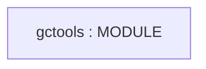
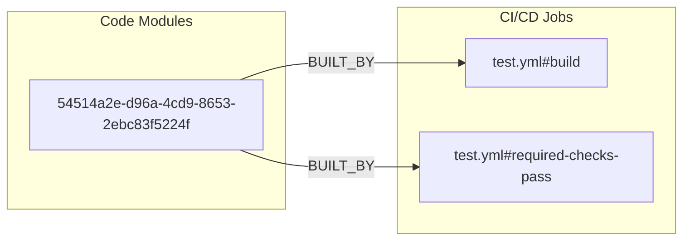
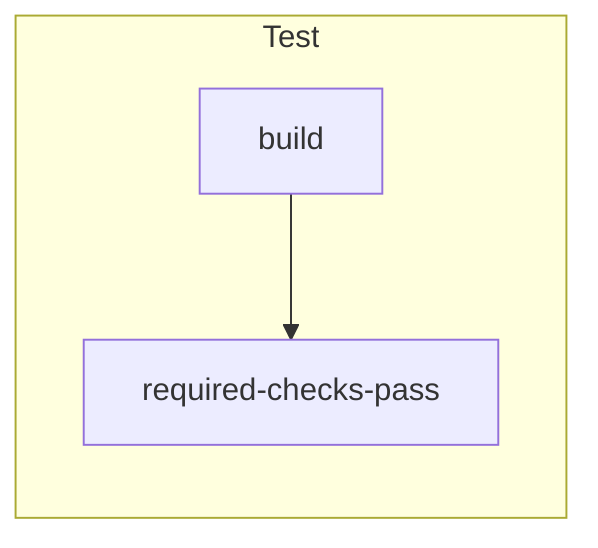

# Repository Architecture Analysis: TryGhost/gctools

## Metadata
- **SHA**: `2984cbbe57b929002c8d9e526395ebf5c9477501`
- **Primary Ecosystem**: JavaScript/TypeScript

## Quality Metrics
- **ast_engine**: tree-sitter
- **avg_cognitive_complexity**: 5.21
- **avg_cyclomatic_complexity**: 3.95
- **component_count**: 1
- **dead_code_count**: 0
- **dead_code_symbols**: 0 entry(ies)
- **duplication_pct**: 89.43
- **file_complexities**: 25 entry(ies)
- **files_analyzed**: 194
- **fitness_passed**: False
- **fitness_violation_count**: 3
- **framework**: Unknown
- **import_edges**: 100 entry(ies)
- **loc**: 29475
- **max_cognitive_complexity**: 242
- **max_cyclomatic_complexity**: 87
- **sloc**: 24618
- **test_file_count**: 41

# Architecture: TryGhost/gctools

## Context
- **Repository**: `TryGhost/gctools`
- **SHA**: `2984cbbe57b929002c8d9e526395ebf5c9477501`
- **Ecosystem**: JavaScript/TypeScript
- **Framework**: Unknown

## Building Block View

## Component Details
- **gctools** (`package.json`): MODULE

## 6-Dimension Repository Scorecard

- **Overall Grade**: `C` (74.30/100)
- **Technical Debt Score**: 25.70
- **Estimated Remediation Effort**: 31.31h

| Dimension | Grade | Score | Weight | Details |
| :--- | :---: | :---: | :---: | :--- |
| Code Quality | `F` | 46.20 | 0.20 | avg_cc=3.95, max_cc=87, duplication=89.43%, dead_code=0 |
| Dependency Health | `B` | 85.00 | 0.15 | dependencies=29, outdated=0, vulnerable=0, has_lockfile=False |
| Maintainability | `F` | 51.37 | 0.15 | avg_cognitive=5.21, max_cognitive=242, fitness_violations=3, oversized_files=1 |
| Pipeline Health | `A` | 94.00 | 0.15 | workflows=1, operational_antipatterns=2, parallel_branches=False |
| Security | `A` | 100.00 | 0.20 | vulnerabilities=0, secrets=0, pipeline_security_findings=0 |
| Test Coverage | `C` | 70.00 | 0.15 | coverage=unavailable, ci_test_job=True, test_files_detected=True |

## Architecture Fitness & Workspace Boundaries

- **[MEDIUM] `ATRUSS-ARCH-005` (COMPLEXITY_THRESHOLD)**: Repository duplication_pct (89.43) exceeds policy threshold (15.0).
- **[MEDIUM] `ATRUSS-ARCH-005` (COMPLEXITY_THRESHOLD)**: Repository max_cognitive_complexity (242.0) exceeds policy threshold (25.0).
- **[MEDIUM] `ATRUSS-ARCH-005` (COMPLEXITY_THRESHOLD)**: Repository max_cyclomatic_complexity (87.0) exceeds policy threshold (20.0).

## Supply Chain Dependencies, Vulnerabilities & Secrets

- **Dependencies Parsed**: 29 | **Vulnerabilities**: 0 | **Secrets**: 0

### Inventory Sample
- `@inquirer/confirm` `6.4.0` (npm, `package.json`)
- `@tryghost/admin-api` `1.14.16` (npm, `package.json`)
- `@tryghost/errors` `3.4.8` (npm, `package.json`)
- `@tryghost/listr-smart-renderer` `0.16.0-0` (npm, `package.json`)
- `@tryghost/mg-assetscraper-db` `0.14.0-0` (npm, `package.json`)
- `@tryghost/mg-fs-utils` `0.27.0-0` (npm, `package.json`)
- `@tryghost/mg-ghost-authors` `0.11.0-0` (npm, `package.json`)
- `@tryghost/pretty-cli` `3.4.4` (npm, `package.json`)
- `@tryghost/string` `0.3.10` (npm, `package.json`)
- `@tryghost/zip` `4.0.3` (npm, `package.json`)
- `axios` `1.21.1` (npm, `package.json`)
- `bluebird` `3.7.2` (npm, `package.json`)
- `chalk` `6.0.1` (npm, `package.json`)
- `cli-progress` `3.12.0` (npm, `package.json`)
- `file-type` `22.3.0` (npm, `package.json`)
- `fs-extra` `11.4.1` (npm, `package.json`)
- `glob` `14.0.5` (npm, `package.json`)
- `heic-convert` `2.1.0` (npm, `package.json`)
- `inquirer` `14.3.0` (npm, `package.json`)
- `inquirer-datepicker-prompt` `0.4.3` (npm, `package.json`)
- `inquirer-search-checkbox` `1.0.0` (npm, `package.json`)
- `jsonwebtoken` `9.0.3` (npm, `package.json`)
- `lodash` `4.18.1` (npm, `package.json`)
- `lorem-ipsum` `3.0.0` (npm, `package.json`)
- `oxfmt` `0.78.0` (npm, `package.json`)
- `oxlint` `1.93.0` (npm, `package.json`)
- `superbytes` `2.1.0` (npm, `package.json`)
- `title-case` `4.3.2` (npm, `package.json`)
- `tty-table` `7.2.1` (npm, `package.json`)

## Section 7: Code-to-Cloud Deployment Traceability

- `54514a2e-d96a-4cd9-8653-2ebc83f5224f` (code_module) --[BUILT_BY]--> `test.yml#build` (ci_job)
- `54514a2e-d96a-4cd9-8653-2ebc83f5224f` (code_module) --[BUILT_BY]--> `test.yml#required-checks-pass` (ci_job)

## CI/CD Pipeline Topology

