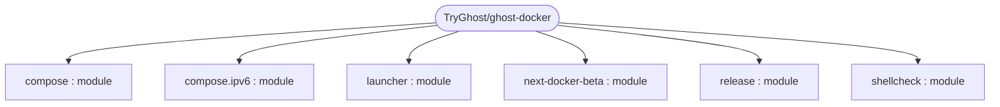
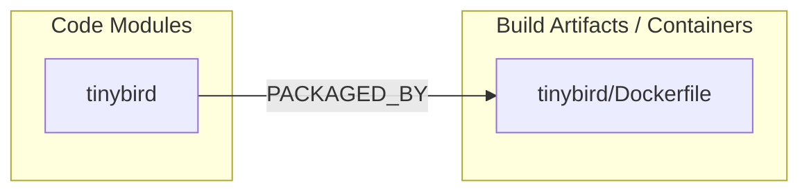
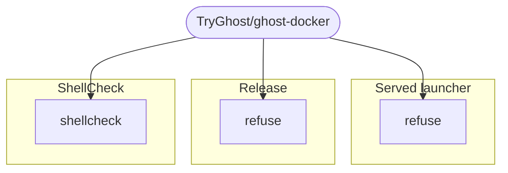

# Repository Architecture Analysis: TryGhost/ghost-docker

## Metadata
- **SHA**: `74e0df94c51ff45b5fcf6194be9ed18d7e147757`
- **Primary Ecosystem**: Container / Helm / IaC

## Quality Metrics
- **ast_engine**: fallback
- **avg_cognitive_complexity**: 0.0
- **avg_cyclomatic_complexity**: 0.0
- **component_count**: 6
- **dead_code_count**: 0
- **dead_code_symbols**: 0 entry(ies)
- **duplication_pct**: 0.0
- **file_complexities**: 0 entry(ies)
- **files_analyzed**: 6
- **fitness_passed**: True
- **fitness_violation_count**: 0
- **framework**: Docker Compose
- **import_edges**: 0 entry(ies)
- **loc**: 397
- **max_cognitive_complexity**: 0
- **max_cyclomatic_complexity**: 0
- **sloc**: 354

# Architecture: TryGhost/ghost-docker

## Context
- **Repository**: `TryGhost/ghost-docker`
- **SHA**: `74e0df94c51ff45b5fcf6194be9ed18d7e147757`
- **Ecosystem**: Container / Helm / IaC
- **Framework**: Docker Compose

## Building Block View

## Component Details
- **compose.ipv6** (`compose.ipv6.yml`): module
- **compose** (`compose.yml`): module
- **next-docker-beta** (`.github/ISSUE_TEMPLATE/next-docker-beta.yml`): module
- **launcher** (`.github/workflows/launcher.yml`): module
- **release** (`.github/workflows/release.yml`): module
- **shellcheck** (`.github/workflows/shellcheck.yml`): module

## 6-Dimension Repository Scorecard

- **Overall Grade**: `B` (89.65/100)
- **Technical Debt Score**: 10.35
- **Estimated Remediation Effort**: 6.09h

| Dimension | Grade | Score | Weight | Details |
| :--- | :---: | :---: | :---: | :--- |
| Code Quality | `A` | 100.00 | 0.20 | avg_cc=0.00, max_cc=0, duplication=0.00%, dead_code=0 |
| Dependency Health | `A` | 90.00 | 0.15 | dependencies=0 (no manifests parsed) |
| Maintainability | `A` | 100.00 | 0.15 | avg_cognitive=0.00, max_cognitive=0, fitness_violations=0, oversized_files=0 |
| Pipeline Health | `C` | 71.00 | 0.15 | workflows=3, operational_antipatterns=4, parallel_branches=False |
| Security | `A` | 100.00 | 0.20 | vulnerabilities=0, secrets=0, pipeline_security_findings=0 |
| Test Coverage | `C` | 70.00 | 0.15 | coverage=unavailable, ci_test_job=True, test_files_detected=False |

## Section 7: Code-to-Cloud Deployment Traceability

- `tinybird` (code_module) --[PACKAGED_BY]--> `tinybird/Dockerfile` (container)

## CI/CD Pipeline Topology

