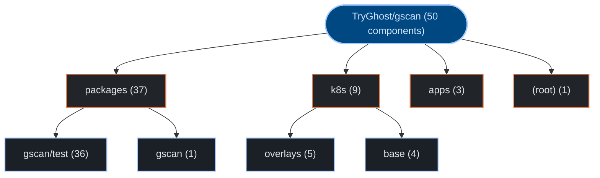
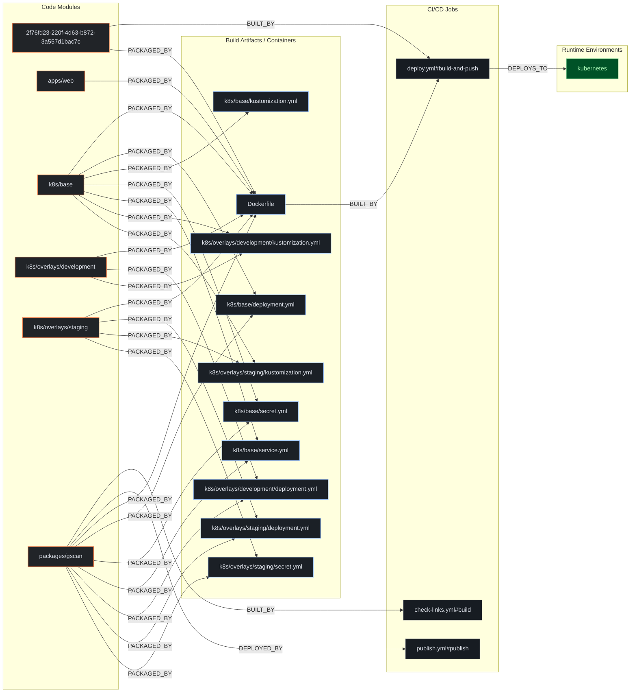
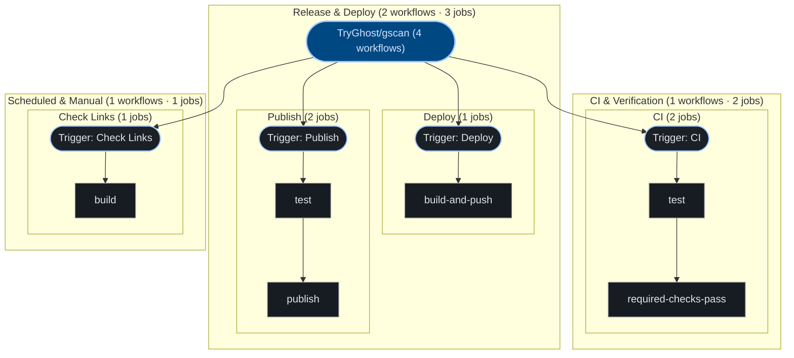

# Repository Architecture Analysis: TryGhost/gscan

## Metadata
- **SHA**: `afc49bb4b35fb9a6ce39d74b593a8f0075a5d478`
- **Primary Ecosystem**: JavaScript/TypeScript

## Quality Metrics
- **ast_engine**: tree-sitter
- **avg_cognitive_complexity**: 3.68
- **avg_cyclomatic_complexity**: 3.52
- **component_count**: 50
- **dead_code_count**: 4
- **dead_code_symbols**: 4 entry(ies)
- **duplication_pct**: 89.51
- **file_complexities**: 25 entry(ies)
- **files_analyzed**: 124
- **fitness_passed**: False
- **fitness_violation_count**: 3
- **framework**: Express / Node API
- **import_edges**: 100 entry(ies)
- **loc**: 19272
- **max_cognitive_complexity**: 36
- **max_cyclomatic_complexity**: 27
- **sloc**: 14910
- **test_file_count**: 647

# Architecture: TryGhost/gscan

## Context
- **Repository**: `TryGhost/gscan`
- **SHA**: `afc49bb4b35fb9a6ce39d74b593a8f0075a5d478`
- **Ecosystem**: JavaScript/TypeScript
- **Framework**: Express / Node API

## Building Block View

## Component Details
- **@tryghost/gscan-web** (`apps/web/package.json`): MODULE
- **gscan-root** (`package.json`): MODULE
- **gscan** (`packages/gscan/package.json`): MODULE
- **my-theme** (`packages/gscan/test/fixtures/themes/010-packagejson/bad-config/package.json`): MODULE
- **my-theme** (`packages/gscan/test/fixtures/themes/010-packagejson/bad-config-2/package.json`): MODULE
- **my-theme** (`packages/gscan/test/fixtures/themes/010-packagejson/deprecated-engines-ghost-api-v01/package.json`): MODULE
- **my-theme** (`packages/gscan/test/fixtures/themes/010-packagejson/deprecated-engines-ghost-api-v2/package.json`): MODULE
- **ATheme_test** (`packages/gscan/test/fixtures/themes/010-packagejson/fields-are-invalid/package.json`): MODULE
- **fields-are-missing** (`packages/gscan/test/fixtures/themes/010-packagejson/fields-are-missing/package.json`): MODULE
- **my-theme** (`packages/gscan/test/fixtures/themes/010-packagejson/fields-are-valid/package.json`): MODULE
- **my-theme** (`packages/gscan/test/fixtures/themes/010-packagejson/fields-are-valid-v3/package.json`): MODULE
- **my-theme** (`packages/gscan/test/fixtures/themes/010-packagejson/ghost-api-use/package.json`): MODULE
- **my-theme** (`packages/gscan/test/fixtures/themes/010-packagejson/invalid-custom-theme/package.json`): MODULE
- **my-theme** (`packages/gscan/test/fixtures/themes/010-packagejson/no-config/package.json`): MODULE
- **my-theme** (`packages/gscan/test/fixtures/themes/010-packagejson/valid-custom-theme/package.json`): MODULE
- **theme** (`packages/gscan/test/fixtures/themes/020-structure/recommendation/package.json`): MODULE
- **valid-card-assets** (`packages/gscan/test/fixtures/themes/050-koenig-css-classes/valid-card-assets/package.json`): MODULE
- **valid-card-assets-exclude** (`packages/gscan/test/fixtures/themes/050-koenig-css-classes/valid-card-assets-exclude/package.json`): MODULE
- **valid-card-assets-exclude-callout** (`packages/gscan/test/fixtures/themes/050-koenig-css-classes/valid-card-assets-exclude-callout/package.json`): MODULE
- **valid-card-assets-include** (`packages/gscan/test/fixtures/themes/050-koenig-css-classes/valid-card-assets-include/package.json`): MODULE
- **my-theme** (`packages/gscan/test/fixtures/themes/080-helper-usage/v4/invalid/package.json`): MODULE
- **my-theme** (`packages/gscan/test/fixtures/themes/080-helper-usage/v4/invalid-folder/package.json`): MODULE
- **my-theme** (`packages/gscan/test/fixtures/themes/080-helper-usage/v4/invalid_all/package.json`): MODULE
- **my-theme** (`packages/gscan/test/fixtures/themes/080-helper-usage/v4/mixed/package.json`): MODULE
- **my-theme** (`packages/gscan/test/fixtures/themes/080-helper-usage/v4/valid/package.json`): MODULE
- **my-theme** (`packages/gscan/test/fixtures/themes/080-helper-usage/v5/invalid-no-empty-translations/package.json`): MODULE
- **my-theme** (`packages/gscan/test/fixtures/themes/080-helper-usage/v5/valid/package.json`): MODULE
- **custom-settings-filter-attribute** (`packages/gscan/test/fixtures/themes/100-custom-template-settings-usage/filter-attribute/package.json`): MODULE
- **custom-settings-filter-attribute-uppercase** (`packages/gscan/test/fixtures/themes/100-custom-template-settings-usage/filter-attribute-uppercase/package.json`): MODULE
- **no-custom-settings** (`packages/gscan/test/fixtures/themes/100-custom-template-settings-usage/no-custom-settings/package.json`): MODULE
- **custom-settings-partial** (`packages/gscan/test/fixtures/themes/100-custom-template-settings-usage/partial/package.json`): MODULE
- **custom-settings-unused** (`packages/gscan/test/fixtures/themes/100-custom-template-settings-usage/unused/package.json`): MODULE
- **custom-settings-valid** (`packages/gscan/test/fixtures/themes/100-custom-template-settings-usage/valid/package.json`): MODULE
- **custom-settings-with-partials** (`packages/gscan/test/fixtures/themes/100-custom-template-settings-usage/with-partials/package.json`): MODULE
- **theme-with-custom-settings** (`packages/gscan/test/fixtures/themes/theme-with-custom-settings/package.json`): MODULE
- **anothertheme** (`packages/gscan/test/fixtures/themes/zip-content/bad-example-folder/package.json`): MODULE
- **ATheme** (`packages/gscan/test/fixtures/themes/zip-content/example/package.json`): MODULE
- **anothertheme** (`packages/gscan/test/fixtures/themes/zip-content/multi-example/theme/theme-name/package.json`): MODULE
- **anothertheme** (`packages/gscan/test/fixtures/themes/zip-content/nested-example/bad-example-folder/package.json`): MODULE
- **GET_root** (`apps/web/index.js`): API_ROUTE
- **POST_root** (`apps/web/index.js`): API_ROUTE
- **deployment** (`k8s/base/deployment.yml`): module
- **kustomization** (`k8s/base/kustomization.yml`): module
- **secret** (`k8s/base/secret.yml`): module
- **service** (`k8s/base/service.yml`): module
- **deployment** (`k8s/overlays/development/deployment.yml`): module
- **kustomization** (`k8s/overlays/development/kustomization.yml`): module
- **deployment** (`k8s/overlays/staging/deployment.yml`): module
- **kustomization** (`k8s/overlays/staging/kustomization.yml`): module
- **secret** (`k8s/overlays/staging/secret.yml`): module

## 6-Dimension Repository Scorecard

- **Overall Grade**: `D` (68.73/100)
- **Technical Debt Score**: 31.27
- **Estimated Remediation Effort**: 37.22h

| Dimension | Grade | Score | Weight | Details |
| :--- | :---: | :---: | :---: | :--- |
| Code Quality | `F` | 46.92 | 0.20 | avg_cc=3.52, max_cc=27, duplication=89.51%, dead_code=4 |
| Dependency Health | `B` | 85.00 | 0.15 | dependencies=29, outdated=0, vulnerable=0, has_lockfile=False |
| Maintainability | `F` | 58.00 | 0.15 | avg_cognitive=3.68, max_cognitive=36, fitness_violations=3, oversized_files=0 |
| Pipeline Health | `C` | 76.00 | 0.15 | workflows=4, operational_antipatterns=7, parallel_branches=False |
| Security | `B` | 80.00 | 0.20 | vulnerabilities=0, secrets=0, pipeline_security_findings=1 |
| Test Coverage | `C` | 70.00 | 0.15 | coverage=unavailable, ci_test_job=True, test_files_detected=True |

## Architecture Fitness & Workspace Boundaries

- **[MEDIUM] `ATRUSS-ARCH-005` (COMPLEXITY_THRESHOLD)**: Repository duplication_pct (89.51) exceeds policy threshold (15.0).
- **[MEDIUM] `ATRUSS-ARCH-005` (COMPLEXITY_THRESHOLD)**: Repository max_cognitive_complexity (36.0) exceeds policy threshold (25.0).
- **[MEDIUM] `ATRUSS-ARCH-005` (COMPLEXITY_THRESHOLD)**: Repository max_cyclomatic_complexity (27.0) exceeds policy threshold (20.0).

### Workspace Packages
- **@tryghost/gscan-web** (`apps/web`, react_ts_js, pnpm) -> internal deps: `gscan`
- **gscan** (`packages/gscan`, react_ts_js, pnpm)

## Supply Chain Dependencies, Vulnerabilities & Secrets

- **Dependencies Parsed**: 29 | **Vulnerabilities**: 0 | **Secrets**: 0

### Inventory Sample
- `@eslint/compat` `2.1.1` (npm, `package.json`)
- `@eslint/eslintrc` `3.3.7` (npm, `package.json`)
- `@eslint/js` `10.0.1` (npm, `package.json`)
- `@sentry/node` `11.12.0` (npm, `apps/web/package.json`)
- `@tryghost/config` `2.3.22` (npm, `apps/web/package.json`)
- `@tryghost/debug` `2.3.19` (npm, `packages/gscan/package.json`)
- `@tryghost/debug` `2.3.22` (npm, `apps/web/package.json`)
- `@tryghost/errors` `3.4.5` (npm, `packages/gscan/package.json`)
- `@tryghost/errors` `3.4.8` (npm, `apps/web/package.json`)
- `@tryghost/logging` `6.0.5` (npm, `apps/web/package.json`)
- `@tryghost/nql` `0.13.4` (npm, `packages/gscan/package.json`)
- `@tryghost/pretty-cli` `3.4.1` (npm, `packages/gscan/package.json`)
- `@tryghost/pro-ship` `2.0.0` (npm, `packages/gscan/package.json`)
- `@tryghost/server` `3.1.24` (npm, `apps/web/package.json`)
- `@tryghost/zip` `4.0.0` (npm, `packages/gscan/package.json`)
- `@vitest/coverage-v8` `5.1.0` (npm, `package.json`)
- `chalk` `6.0.1` (npm, `packages/gscan/package.json`)
- `eslint` `10.14.0` (npm, `package.json`)
- `eslint-plugin-ghost` `4.0.1` (npm, `package.json`)
- `express` `5.3.0` (npm, `apps/web/package.json`)
- `express-handlebars` `9.0.4` (npm, `apps/web/package.json`)
- `gscan` `*` (npm, `apps/web/package.json`)
- `handlebars` `4.7.10` (npm, `packages/gscan/package.json`)
- `lodash` `4.18.1` (npm, `packages/gscan/package.json`)
- `multer` `2.5.0` (npm, `apps/web/package.json`)
- `nodemon` `3.1.14` (npm, `apps/web/package.json`)
- `semver` `7.8.6` (npm, `packages/gscan/package.json`)
- `validator` `13.0.0` (npm, `packages/gscan/package.json`)
- `vitest` `5.1.0` (npm, `package.json`)

## Section 7: Code-to-Cloud Deployment Traceability

- `deploy.yml#build-and-push` (ci_job) --[DEPLOYS_TO]--> `kubernetes` (environment)
- `2f76fd23-220f-4d63-b872-3a557d1bac7c` (code_module) --[BUILT_BY]--> `deploy.yml#build-and-push` (ci_job)
- `2f76fd23-220f-4d63-b872-3a557d1bac7c` (code_module) --[PACKAGED_BY]--> `Dockerfile` (container)
- `apps/web` (code_module) --[PACKAGED_BY]--> `Dockerfile` (container)
- `k8s/base` (code_module) --[PACKAGED_BY]--> `Dockerfile` (container)
- `k8s/base` (code_module) --[PACKAGED_BY]--> `k8s/base/deployment.yml` (iac)
- `k8s/base` (code_module) --[PACKAGED_BY]--> `k8s/base/kustomization.yml` (iac)
- `k8s/base` (code_module) --[PACKAGED_BY]--> `k8s/base/secret.yml` (iac)
- `k8s/base` (code_module) --[PACKAGED_BY]--> `k8s/base/service.yml` (iac)
- `k8s/base` (code_module) --[PACKAGED_BY]--> `k8s/overlays/development/kustomization.yml` (iac)
- `k8s/base` (code_module) --[PACKAGED_BY]--> `k8s/overlays/staging/kustomization.yml` (iac)
- `k8s/overlays/development` (code_module) --[PACKAGED_BY]--> `Dockerfile` (container)
- `k8s/overlays/development` (code_module) --[PACKAGED_BY]--> `k8s/overlays/development/deployment.yml` (iac)
- `k8s/overlays/development` (code_module) --[PACKAGED_BY]--> `k8s/overlays/development/kustomization.yml` (iac)
- `k8s/overlays/staging` (code_module) --[PACKAGED_BY]--> `Dockerfile` (container)
- `k8s/overlays/staging` (code_module) --[PACKAGED_BY]--> `k8s/overlays/staging/deployment.yml` (iac)
- `k8s/overlays/staging` (code_module) --[PACKAGED_BY]--> `k8s/overlays/staging/kustomization.yml` (iac)
- `k8s/overlays/staging` (code_module) --[PACKAGED_BY]--> `k8s/overlays/staging/secret.yml` (iac)
- `packages/gscan` (code_module) --[BUILT_BY]--> `check-links.yml#build` (ci_job)
- `packages/gscan` (code_module) --[DEPLOYED_BY]--> `publish.yml#publish` (ci_job)
- `packages/gscan` (code_module) --[PACKAGED_BY]--> `Dockerfile` (container)
- `packages/gscan` (code_module) --[PACKAGED_BY]--> `k8s/base/deployment.yml` (iac)
- `packages/gscan` (code_module) --[PACKAGED_BY]--> `k8s/base/secret.yml` (iac)
- `packages/gscan` (code_module) --[PACKAGED_BY]--> `k8s/base/service.yml` (iac)
- `packages/gscan` (code_module) --[PACKAGED_BY]--> `k8s/overlays/development/deployment.yml` (iac)
- `packages/gscan` (code_module) --[PACKAGED_BY]--> `k8s/overlays/staging/deployment.yml` (iac)
- `packages/gscan` (code_module) --[PACKAGED_BY]--> `k8s/overlays/staging/secret.yml` (iac)
- `Dockerfile` (container) --[BUILT_BY]--> `deploy.yml#build-and-push` (ci_job)

## CI/CD Pipeline Topology

